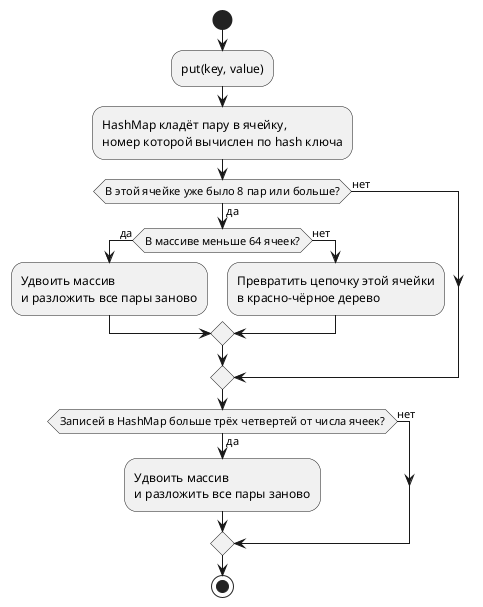

# HashMap: когда массив удваивается и когда появляется дерево

**HashMap** — это коллекция Java, в которой каждое значение ищут по ключу. Вызов `put(ключ, значение)` кладёт в **HashMap** одну **запись**: ключ и значение вместе. В этом документе такая запись называется **парой**.

Пример: `map.put(37, "заказ")` кладёт одну пару. Ключ этой пары — число 37, значение — строка `"заказ"`. Пока в **HashMap** лежит только эта пара, в нём одна запись.

Внутри **HashMap** лежит массив. Каждая ячейка этого массива называется **bucket**. Пару **HashMap** кладёт в одну ячейку. Номер ячейки **HashMap** вычисляет по `hashCode()` ключа.

Иногда разные ключи получают один и тот же номер ячейки. Это называется **collision**. Тогда в одной ячейке лежат несколько пар, одна за другой. Такая последовательность называется **цепочкой**.

Документ отвечает на вопросы по порядку:

1. Сколько ячеек в новом **HashMap**.
2. Когда **HashMap** удваивает массив.
3. Что будет, если в одну ячейку попали 9 ключей, а остальные ячейки пустые.
4. Как пары переезжают в новые ячейки после удвоения.
5. Когда цепочка наконец превращается в красно-чёрное дерево.

## 1. Сколько ячеек в новом HashMap

В новом **HashMap** — **16 ячеек**.

Массив создаётся не в `new HashMap<>()`, а при первом `put()`.

## 2. Когда HashMap удваивает массив

У удвоения два разных повода. Они не зависят друг от друга.

### Повод первый: в HashMap стало слишком много записей

**HashMap** считает, сколько всего записей в нём лежит. Одна запись — это одна пара «ключ и значение», которую положили через `put()`. Если `put()` вызвали 12 раз с разными ключами, в **HashMap** лежит 12 пар.

Граница удвоения — три четверти от числа ячеек массива. Это число называется **load factor**. По умолчанию **load factor** равен 0.75.

Для 16 ячеек граница считается так: 16 × 0.75 = 12. Когда в **HashMap** кладут 13-ю пару, **HashMap** удваивает массив до 32 ячеек.

Неважно, в каких ячейках лежат пары: все в одной ячейке или по одной в разных. Для этого повода **HashMap** смотрит только на общее число записей.

Зачем: когда ячеек мало, а записей много, collision случаются чаще. Больше ячеек — пары лежат свободнее, цепочки короче.

### Повод второй: одна ячейка переполнена

**HashMap** следит, сколько пар лежит в каждой ячейке цепочкой. Граница — 8 пар в одной ячейке.

Когда в ячейку, где уже лежат 8 пар, кладут девятую, **HashMap** хочет превратить цепочку в дерево. Но сначала **HashMap** проверяет, сколько всего ячеек в массиве:

- если ячеек **меньше 64** — дерево не строится, вместо этого **HashMap** удваивает массив;
- если ячеек **64 или больше** — **HashMap** превращает цепочку этой ячейки в дерево.

Зачем сначала удваивать: длинная цепочка в маленьком массиве обычно значит, что массиву просто тесно. Удвоение разгружает все ячейки сразу и обходится дешевле, чем дерево.

## 3. Девять ключей в одной ячейке, остальные пустые

Исходное состояние: **HashMap** из 16 ячеек. В ячейке 5 лежат 8 пар, остальные 15 ячеек пустые.

1. Кладём девятую пару, она тоже попадает в ячейку 5. Теперь в ячейке 5 цепочка из 9 пар.
2. Срабатывает второй повод: в ячейке уже было 8 пар. **HashMap** проверяет массив: 16 ячеек, это меньше 64. Дерево не строится.
3. **HashMap** удваивает массив **один раз**: было 16 ячеек, стало 32. Сразу до 64 массив не растёт.
4. Первый повод здесь ни при чём. В **HashMap** всего 9 пар, а граница для 16 ячеек — 12 пар.

## 4. Как пары переезжают после удвоения

Номер ячейки **HashMap** получает в два шага:

1. Из `hashCode()` ключа вычисляет **hash**.
2. Из hash и числа ячеек `n` вычисляет номер ячейки по формуле `hash & (n - 1)`.

Обе формулы работают с битами, поэтому сначала — как Java хранит число.

### Как Java хранит int

`hashCode()` возвращает `int`. `int` — это 32 бита, каждый бит равен 0 или 1.

Самый левый бит — знак: 0 означает плюс, 1 означает минус. Поэтому `int` бывает от −2 147 483 648 до 2 147 483 647.

Примеры, все 32 бита разбиты на группы по 4:

```text

 37 = 0000 0000 0000 0000 0000 0000 0010 0101
-37 = 1111 1111 1111 1111 1111 1111 1101 1011
```

### Шаг 1. Откуда берётся hash

Каждый класс сам решает, что вернуть из `hashCode()`:

- `Integer` возвращает само число: `Integer.valueOf(37).hashCode()` равен 37.
- `String` считает число по символам строки: `"hello".hashCode()` равен 99 162 322, а `"HashMap".hashCode()` равен −1 932 803 762. Число может быть любым `int`, в том числе отрицательным.

**HashMap** не использует `hashCode()` напрямую. **HashMap** перемешивает его формулой:

```java

hash = h ^ (h >>> 16)      // h — результат hashCode()
```

- `h >>> 16` сдвигает все 32 бита на 16 позиций вправо. Левые 16 бит заполняются нулями, правые 16 бит выпадают.
- `^` (XOR) сравнивает два числа бит за битом: если биты разные, результат 1, если одинаковые — 0.

Зачем это нужно: номер ячейки зависит только от правых битов hash. Перемешивание добавляет в правые биты информацию из левых, чтобы ключи, которые отличаются только левыми битами, не попадали в одну ячейку.

Пример для `"HashMap"`:

```text

h          = 1000 1100 1100 1011 1100 0001 0100 1110   (−1 932 803 762)
h >>> 16   = 0000 0000 0000 0000 1000 1100 1100 1011
h ^ (h>>>16) = 1000 1100 1100 1011 0100 1101 1000 0101   (hash = −1 932 833 403)
```

Левые 16 бит не изменились. Правые 16 бит стали XOR правой и левой половины.

Для небольших чисел `Integer`, меньше 65 536, левые 16 бит — нули. Тогда `h >>> 16` равно 0, а `h ^ 0` равно h. Поэтому у ключа `Integer` 37 hash равен 37.

**HashMap** вычисляет hash один раз при `put()` и хранит его вместе с парой.

### Шаг 2. Формула номера ячейки: hash & (n - 1)

`&` (побитовое И) сравнивает два числа бит за битом: результат 1, только если оба бита равны 1. Во всех остальных случаях — 0.

`n` — число ячеек. При 16 ячейках `n - 1 = 15`:

```text

15 = 0000 0000 0000 0000 0000 0000 0000 1111
```

В числе 15 единицы стоят только в последних 4 битах. Поэтому `hash & 15` обнуляет все биты hash, кроме последних 4. Последние 4 бита — это число от 0 до 15, то есть номер одной из 16 ячеек.

Пример для ключа `Integer` 37 (hash = 37):

```text

hash      = 0000 0000 0000 0000 0000 0000 0010 0101   (37)
n - 1     = 0000 0000 0000 0000 0000 0000 0000 1111   (15)
hash & 15 = 0000 0000 0000 0000 0000 0000 0000 0101   (5)
```

Ключ 37 попадает в ячейку **5**.

### Что происходит с отрицательным hash

Знак хранится в самом левом бите. В маске `n - 1` самый левый бит всегда 0, поэтому `&` всегда обнуляет знак. Номер ячейки поэтому всегда от 0 до `n - 1`, даже если hash отрицательный.

Пример для `"HashMap"` (hash = −1 932 833 403):

```text

hash      = 1000 1100 1100 1011 0100 1101 1000 0101
n - 1     = 0000 0000 0000 0000 0000 0000 0000 1111   (15)
hash & 15 = 0000 0000 0000 0000 0000 0000 0000 0101   (5)
```

Строка `"HashMap"` попадает в ячейку **5**.

### Что HashMap делает при удвоении

1. **HashMap** создаёт новый массив из 32 ячеек.
2. **HashMap** берёт по очереди каждую пару из старого массива.
3. Для каждой пары **HashMap** применяет ту же формулу, но с новым `n`: `hash & 31`. `hashCode()` заново не вызывается, потому что hash уже хранится в паре.
4. **HashMap** кладёт пару в ячейку с полученным номером.

При 32 ячейках маска `n - 1 = 31`:

```text

31 = 0000 0000 0000 0000 0000 0000 0001 1111
```

Маска 15 оставляла последние **4** бита hash. Маска 31 оставляет последние **5** битов. В номер ячейки добавляется один бит — пятый справа, он стоит на месте числа 16.

### Пример: 9 пар из ячейки 5

Показаны последние 8 битов hash, остальные 24 бита у этих чисел — нули.

| Ключ (hash) | Последние 8 бит hash | hash & 15 (последние 4 бита) | hash & 31 (последние 5 бит) |
|---|---|---|---|
| 5 | 0000 0101 | 0101 = 5 | 0 0101 = 5 |
| 21 | 0001 0101 | 0101 = 5 | 1 0101 = 21 |
| 37 | 0010 0101 | 0101 = 5 | 0 0101 = 5 |
| 53 | 0011 0101 | 0101 = 5 | 1 0101 = 21 |
| 69 | 0100 0101 | 0101 = 5 | 0 0101 = 5 |
| 85 | 0101 0101 | 0101 = 5 | 1 0101 = 21 |
| 101 | 0110 0101 | 0101 = 5 | 0 0101 = 5 |
| 117 | 0111 0101 | 0101 = 5 | 1 0101 = 21 |
| 133 | 1000 0101 | 0101 = 5 | 0 0101 = 5 |

Расчёт для двух ключей полностью:

```text

37:  hash = 0010 0101          53:  hash = 0011 0101
     & 31 = 0001 1111               & 31 = 0001 1111
     итог = 0000 0101 = 5           итог = 0001 0101 = 21
```

**До удвоения** у всех 9 ключей последние 4 бита одинаковые — `0101`. Поэтому `hash & 15` у всех равен 5, и все 9 пар лежат в ячейке 5 одной цепочкой.

**После удвоения** решает пятый бит справа:

- у ключей 5, 37, 69, 101, 133 пятый бит равен 0, номер остаётся `0 0101` = **5**;
- у ключей 21, 53, 85, 117 пятый бит равен 1, номер становится `1 0101` = **21**.

**Итог:** вместо одной цепочки из 9 пар стало две цепочки: 5 пар в ячейке 5 и 4 пары в ячейке 21. Дерево **HashMap** строит только при 8 парах в одной ячейке, поэтому дерево не нужно.

### Почему только ячейка 5 или 21

Последние 4 бита у всех пар из ячейки 5 одинаковые — `0101`. После удвоения к ним добавляется только один новый бит, и он бывает либо 0, либо 1:

- `0 0101` = 5 — пара остаётся в той же ячейке;
- `1 0101` = 16 + 5 = 21 — пара переезжает в ячейку «старый номер + 16».

Третьего варианта нет. В коде удвоения Java проверяет именно этот бит выражением `hash & 16`: результат 0 — ячейка остаётся прежней, иначе — номер увеличивается на 16.

## 5. Когда появляется красно-чёрное дерево

Удвоение помогает, только если hash у ключей разный. Если `hashCode()` у всех ключей одинаковый, например класс ключа всегда возвращает 42, то после любого удвоения все пары снова получают одинаковый номер ячейки:

- 42 в битах — `0010 1010`;
- 16 ячеек: `0010 1010 & 0000 1111` = `1010` = 10, ячейка 10;
- 32 ячейки: `0010 1010 & 0001 1111` = `0 1010` = 10, ячейка 10;
- 64 ячейки: `0010 1010 & 0011 1111` = `10 1010` = 42, ячейка 42.

Все пары с hash 42 при любом числе ячеек получают один и тот же номер.

Что происходит с такими ключами:

1. Пары 1–8. **HashMap** кладёт их в одну ячейку цепочкой. Массив — 16 ячеек.
2. Пара 9. В ячейке было 8 пар, массив 16 — меньше 64. **HashMap** удваивает массив до 32. Все 9 пар снова оказываются в одной ячейке.
3. Пара 10. В ячейке было 9 пар, массив 32 — меньше 64. **HashMap** удваивает массив до 64. Все 10 пар снова в одной ячейке.
4. Пара 11. В ячейке было 10 пар, массив 64 — уже не меньше 64. Теперь **HashMap** превращает цепочку этой ячейки в **красно-чёрное дерево**.

Дерево появляется только в этой одной ячейке. В остальных ячейках по-прежнему цепочки.

Зачем дерево: в цепочке **HashMap** ищет ключ перебором, пара за парой. В дереве пары упорядочены, и поиск идёт за O(log n): для 1000 пар это около 10 сравнений вместо 1000.

## 6. Общая схема put()



Что показывает схема:

1. **HashMap** всегда сначала кладёт пару в нужную ячейку.
2. Затем **HashMap** проверяет второй повод — длину цепочки в этой ячейке. Если цепочка длинная, **HashMap** либо удваивает массив (ячеек меньше 64), либо строит дерево (ячеек 64 и больше).
3. В конце **HashMap** проверяет первый повод — общее число записей. Если записей больше трёх четвертей от числа ячеек, **HashMap** удваивает массив.

## Источник

Все числа и правила взяты из исходного кода **HashMap** в OpenJDK: [HashMap.java](https://github.com/openjdk/jdk/blob/master/src/java.base/share/classes/java/util/HashMap.java).

**Цитата — 16 ячеек и граница в три четверти:**
> ```java
> static final int DEFAULT_INITIAL_CAPACITY = 1 << 4; // aka 16
> static final float DEFAULT_LOAD_FACTOR = 0.75f;
> ```
>
> The next size value at which to resize (capacity * load factor).

**Перевод:**
> Начальная ёмкость по умолчанию — 16. Коэффициент загрузки по умолчанию — 0.75.
>
> Следующий размер, при котором массив увеличивается: ёмкость × коэффициент загрузки.

**Цитата — 8 пар и 64 ячейки:**
> ```java
> static final int TREEIFY_THRESHOLD = 8;
> static final int MIN_TREEIFY_CAPACITY = 64;
> ```
>
> The smallest table capacity for which bins may be treeified. (Otherwise the table is resized if too many nodes in a bin.)

**Перевод:**
> Наименьший размер массива, при котором ячейку можно превратить в дерево. Иначе, если в ячейке слишком много узлов, массив увеличивается.

**Цитата — как вычисляется hash и номер ячейки:**
> ```java
> return (key == null) ? 0 : (h = key.hashCode()) ^ (h >>> 16);
> ...
> if ((p = tab[i = (n - 1) & hash]) == null)
> ```

**Перевод:**
> hash равен `hashCode()` ключа, перемешанному со своими старшими 16 разрядами. Номер ячейки равен `(n - 1) & hash`.

**Цитата — пара остаётся на месте или сдвигается на старый размер массива:**
> Initializes or doubles table size. … Otherwise, because we are using power-of-two expansion, the elements from each bin must either stay at same index, or move with a power of two offset in the new table.

**Перевод:**
> Метод создаёт массив или удваивает его. … Поскольку массив растёт степенями двойки, пары из каждой ячейки либо остаются на том же номере, либо сдвигаются на степень двойки в новом массиве.
