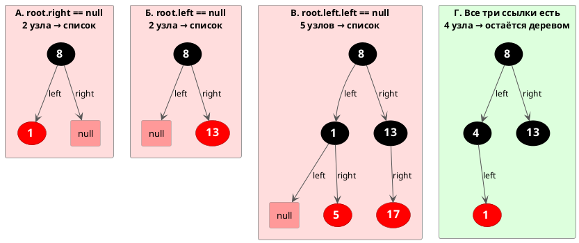
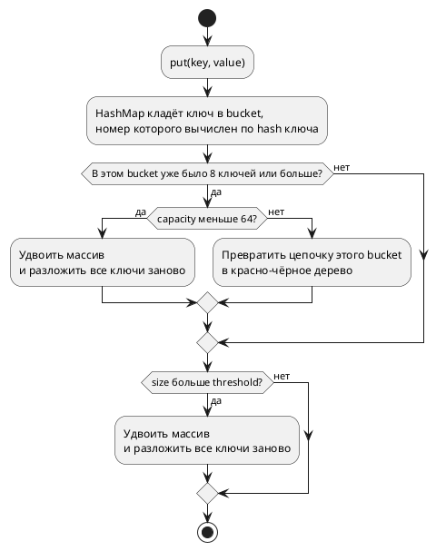

# HashMap: hash, номер bucket, удвоение массива и дерево

**HashMap** хранит ключи и значения. Вызов `put(37, "заказ")` кладёт ключ 37 и значение `"заказ"`. Искать потом будут по ключу: `get(37)` вернёт `"заказ"`.

Внутри **HashMap** лежит массив. Каждая ячейка этого массива называется **bucket**. **HashMap** кладёт ключ в один **bucket**. Номер **bucket** **HashMap** вычисляет по `hashCode()` ключа.

Иногда разные ключи получают один и тот же номер **bucket**. Это называется **collision**. Тогда в одном **bucket** лежат несколько ключей, один за другим. Такая последовательность называется **цепочкой**.

Удвоение не создаёт новый **HashMap**. **HashMap** остаётся тем же объектом. Меняется только внутренний массив **bucket**.

<a id="toc"></a>
## Оглавление

1. [Четыре числа внутри HashMap](#s1)
2. [Повод первый: ключей в HashMap стало слишком много](#s2)
3. [Почему считают ключи, а не занятые bucket](#s3)
4. [Повод второй: один bucket переполнен](#s4)
5. [Как HashMap вычисляет hash ключа](#s5)
   - [Что означает каждый символ формулы](#s5-1)
   - [Как выглядит int в битах](#s5-2)
   - [Что такое h: откуда берётся число](#s5-3)
   - [Шаг 1. Сдвиг h >>> 16](#s5-4)
   - [Шаг 2. Как работает XOR](#s5-5)
   - [Шаг 3. Перемешивание целиком: h ^ (h >>> 16)](#s5-6)
   - [Пример с отрицательным h: ключ "HashMap"](#s5-7)
   - [Зачем перемешивать биты](#s5-8)
6. [Как HashMap выбирает bucket: hash & (n - 1)](#s6)
   - [Как работает &](#s6-1)
   - [Пример: ключ 37](#s6-2)
   - [Отрицательный hash](#s6-3)
7. [Где хранится hash: put(), get(), удвоение](#s7)
8. [Как ключи переезжают после удвоения](#s8)
   - [Пример: hash 18](#s8-1)
   - [Пример: hash 34](#s8-2)
   - [Четыре ключа из одного bucket](#s8-3)
9. [Дерево появляется только в одном bucket](#s9)
10. [Когда дерево снова становится цепочкой](#s10)
    - [Обычный remove(): как HashMap понимает, что дерево деградировало](#s10-1)
    - [Проверка деградации: три ссылки возле корня](#s10-2)
    - [Удвоение массива, в котором уже есть дерево](#s10-3)
    - [Сравнение двух случаев](#s10-4)
11. [Общая схема put()](#s11)
12. [Зачем свой hashCode(), если identity hash code уже распределяется нормально](#s12)
13. [Что будет, если equals() не переопределить](#s13)
14. [Сгенерированный id в hashCode()](#s14)
15. [Источники](#src)

<a id="s1"></a>
## 1. Четыре числа внутри HashMap

Их нельзя смешивать.

- **capacity** — сколько **bucket** в массиве. В новом **HashMap** это 16. Массив создаётся не в `new HashMap<>()`, а при первом `put()`.
- **size** — сколько ключей лежит во всём **HashMap**. Каждый `put()` с новым ключом увеличивает **size** на 1.
- **load factor** — коэффициент 0.75. Это не граница и не «75% занятых ячеек».
- **threshold** — граница удвоения. Её считают так: **capacity** × **load factor**. Для 16 **bucket**: 16 × 0.75 = 12.

В коде после вставки ключа стоит проверка:

```java

if (++size > threshold)
    resize();
```

При **size** = 12 граница ещё не превышена. Когда кладут 13-й ключ, **size** становится 13, условие `13 > 12` выполняется, и **HashMap** удваивает массив: **capacity** становится 32.

Число непустых **bucket** в этой проверке не участвует.

<a id="s2"></a>
## 2. Повод первый: ключей в HashMap стало слишком много

Это проверка `size > threshold`.

0.75 не значит «занято 75% **bucket**». **Bucket** может хранить несколько ключей. Поэтому число ключей и число занятых **bucket** — разные вещи.

Пример. В массиве 16 **bucket**, **threshold** = 12:

```text

bucket 0: 3 ключа
bucket 1: 3 ключа
bucket 2: 3 ключа
bucket 3: 3 ключа
остальные 12 bucket: пустые
```

Ключей всего 12, занято только 4 **bucket** из 16, то есть 25%. Следующий `put()` с новым ключом увеличит **size** до 13 и удвоит массив. Для этой проверки неважно, что 12 **bucket** пустые.

**load factor** 0.75 лучше читать так: «в среднем 0.75 ключа на один **bucket**». Это отношение **size** / **capacity**, а не доля непустых ячеек.

<a id="s3"></a>
## 3. Почему считают ключи, а не занятые bucket

Идея «удваивать, когда ячейки заполнены» понятна: хочется, чтобы цепочки не были длинными и `get()` не перебирал много ключей. Но число занятых **bucket** длину цепочки не показывает.

Сравним два состояния массива из 16 **bucket**:

```text

Вариант А: занято 2 bucket, в каждом 1 ключ. Всего 2 ключа.
Вариант Б: занято 2 bucket, в каждом 6 ключей. Всего 12 ключей.
```

Доля занятых **bucket** одинаковая: 2 из 16. Во втором случае цепочки длиннее, и поиск медленнее. Если смотреть только на занятые ячейки, эти два состояния выглядели бы одинаково.

Ещё следствие: новый ключ в уже занятый **bucket** не увеличивает число занятых ячеек, но удлиняет цепочку. Счётчик занятых **bucket** такое ухудшение не увидел бы. Поэтому первый повод смотрит на **size**.

Эта проверка не обещает короткую цепочку в каждом **bucket**. Она не даёт всему массиву стать слишком плотным. Длинную цепочку в одной ячейке ловит второй повод.

<a id="s4"></a>
## 4. Повод второй: один bucket переполнен

**HashMap** следит, сколько ключей лежит в каждом **bucket** цепочкой.

Когда в **bucket**, где уже лежат 8 ключей, кладут девятый, **HashMap** хочет превратить цепочку в дерево. Но сначала проверяет **capacity**:

- если **capacity** меньше 64 — дерево не строится, вместо этого **HashMap** удваивает массив;
- если **capacity** 64 или больше — **HashMap** превращает цепочку только этого **bucket** в дерево. Остальные **bucket** не трогает.

Пример. 16 **bucket**, в **bucket** 5 лежат 8 ключей, остальные пустые. Девятый ключ тоже попадает в **bucket** 5.

1. Срабатывает второй повод: в этом **bucket** уже было 8 ключей. **capacity** = 16, это меньше 64. Дерево не строится.
2. **HashMap** удваивает массив один раз: 16 → 32. Сразу до 64 массив не растёт.
3. Первый повод здесь ни при чём: ключей всего 9, а **threshold** для 16 **bucket** равен 12.

<a id="s5"></a>
## 5. Как HashMap вычисляет hash ключа

Номер **bucket** **HashMap** получает в два шага:

1. **HashMap** вызывает `hashCode()` ключа и перемешивает биты полученного числа. Результат называется **hash**. Этот раздел про первый шаг.
2. **HashMap** берёт из hash номер **bucket** по формуле `hash & (n - 1)`. Это [раздел 6](#s6).

Формула первого шага из исходного кода **HashMap**:

```java

static final int hash(Object key) {
    int h;
    return (key == null) ? 0 : (h = key.hashCode()) ^ (h >>> 16);
}
```

---

HashMap выбирает корзину **по младшим битам** хеша. 

- Выражение `h ^ (h >>> 16)` подмешивает в них старшие биты — чтобы информация из старшей половины тоже влияла на выбор корзины. 
- Именно такое объяснение дано в комментарии к этому методу в OpenJDK.

В **HashMap** индекс корзины вычисляется как `(n - 1) & hash`, где **n** — степень двойки.

- Поэтому при выборе корзины используются только младшие биты хеша. 
- Если разные хеши отличаются только старшими битами, без дополнительной обработки они попадут в одну корзину.

- Выражение `h ^ (h >>> 16)` сдвигает старшие **16 бит** в младшую половину и смешивает их с исходными младшими через **XOR**. 
- Благодаря этому старшие биты тоже влияют на индекс. 
- **XOR** выбран как дешёвая операция, позволяющая обеим половинам влиять на результат. 
- Это помогает уменьшать коллизии по индексу, но не устраняет их полностью.

---

Ключ `null` всегда получает hash 0. Для остальных ключей ниже разобрана строка `(h = key.hashCode()) ^ (h >>> 16)`: сначала что означает каждый символ, потом как выглядит число в битах, потом каждое действие на одном примере.

<a id="s5-1"></a>
### Что означает каждый символ формулы

- `h` — переменная типа `int`. **HashMap** кладёт в неё число, которое вернул `key.hashCode()`. Например, для ключа `Integer` 131 077 переменная `h` равна 131 077.
- `>>>` — сдвиг вправо. Он двигает биты числа вправо на заданное число позиций.
- `16` — на сколько позиций двигать. Это не второе число для вычисления, а расстояние сдвига. Биты самого числа 16 в вычислении не участвуют.
- `h >>> 16` — новое число: биты `h`, сдвинутые на 16 позиций вправо. Сама переменная `h` не меняется.
- `^` — XOR, побитовое «исключающее ИЛИ». Он сравнивает два числа бит за битом.
- `h ^ (h >>> 16)` — XOR исходного числа `h` и сдвинутого числа. Результат и есть hash.

Порядок вычисления: сначала Java получает `h`, затем считает сдвинутое число `h >>> 16`, затем делает XOR этих двух чисел.

<a id="s5-2"></a>
### Как выглядит int в битах

`int` в Java — это 32 бита, то есть 32 цифры 0 или 1. Для удобства их пишут группами по 4.

Биты нумеруют справа налево, от позиции 0 до позиции 31. Правые 16 бит (позиции 0–15) называют **младшими**, левые 16 бит (позиции 16–31) — **старшими**.

```text

число 37 = 0000 0000 0000 0000  0000 0000 0010 0101
           старшие 16 бит       младшие 16 бит
           (позиции 31–16)      (позиции 15–0)
```

У числа 37 все старшие биты нули. Младшие биты `0010 0101` — это 37 в двоичной записи: 32 + 4 + 1.

Самый левый бит (позиция 31) — знаковый. Если он 0, число положительное. Если 1, число отрицательное:

```text

 37 = 0000 0000 0000 0000  0000 0000 0010 0101
-37 = 1111 1111 1111 1111  1111 1111 1101 1011
```

Отрицательные числа Java хранит в дополнительном коде, поэтому слева у −37 стоят единицы.


---

Самый левый бит маски в **HashMap** единицей не бывает. 

Максимальное количество bucket — `2³⁰`, то есть `1 073 741 824`. 

- Это последняя степень двойки, которая ещё помещается в положительный **int**. Следующее удвоение HashMap не делает.

 - Если массив уже такого размера и **resize()** вызывают снова, новый массив не создаётся. 
 - Метод возвращает прежний массив и записывает **threshold** равным **2 147 483 647**, максимальному положительному **int**.
 - Проверка `++size > threshold` после этого не срабатывает: `size` больше этого числа не становится. Новые ключи по-прежнему кладутся в уже существующие `bucket`.

---

<a id="s5-3"></a>
### Что такое h: откуда берётся число

`hashCode()` пишет класс ключа. **HashMap** только вызывает этот метод и кладёт результат в `h`.

- `Integer` возвращает само число: для ключа 131 077 `h` = 131 077.
- `String` считает число по символам строки: для ключа `"HashMap"` `h` = −1 932 803 762.

Дальше все шаги показаны на ключе `Integer` 131 077. В битах этот `h` выглядит так:

```text

h = 131 077 = 0000 0000 0000 0010  0000 0000 0000 0101
              старшие 16 бит       младшие 16 бит
```

Старшие 16 бит: `0000 0000 0000 0010`. Младшие 16 бит: `0000 0000 0000 0101`.

<a id="s5-4"></a>
### Шаг 1. Сдвиг h >>> 16

Сначала сдвиг на одну позицию, на коротком 8-битном числе, чтобы было видно, что делает `>>>`:

```text

было:            1011 0100
сдвиг на 1:      0101 1010
```

Что произошло:

1. Каждый бит переехал на одну позицию вправо.
2. Самый правый бит (`0`) выпал: справа для него места нет.
3. Слева освободилась одна позиция, и `>>>` записал туда `0`.

Сдвиг на 16 позиций — то же самое, только каждый бит переезжает на 16 позиций. В числе 32 бита, 16 — ровно половина. Поэтому старшая половина встаёт точно на место младшей.

Ключ 131 077:

```text

h        = 0000 0000 0000 0010  0000 0000 0000 0101
h >>> 16 = 0000 0000 0000 0000  0000 0000 0000 0010
```

Что произошло:

1. Младшие 16 бит `h` (`0000 0000 0000 0101`) выпали справа.
2. Старшие 16 бит `h` (`0000 0000 0000 0010`) переехали вправо и стали младшими битами нового числа.
3. Слева `>>>` записал 16 нулей.

Новое число `h >>> 16` равно 2. В нём лежит старшая половина `h`, но уже на месте младшей.

Три знака `>>>` означают: слева всегда пишутся нули. Обычный сдвиг `>>` записал бы слева копию знакового бита. Для отрицательного `h` это были бы единицы.

<a id="s5-5"></a>
### Шаг 2. Как работает XOR

XOR (`^`) берёт два числа и сравнивает их биты в одной и той же позиции. Правило для одной пары бит:

```text

0 ^ 0 = 0    биты одинаковые, результат 0
1 ^ 1 = 0    биты одинаковые, результат 0
0 ^ 1 = 1    биты разные, результат 1
1 ^ 0 = 1    биты разные, результат 1
```

Пример на 4 битах:

```text

  1100
^ 1010
  ----
  0110
```

Считаем справа налево, позиция за позицией:

1. Правая позиция: `0 ^ 0 = 0`.
2. Вторая справа: `0 ^ 1 = 1`.
3. Третья справа: `1 ^ 0 = 1`.
4. Левая позиция: `1 ^ 1 = 0`.

Получилось `0110`.

Одно следствие правила понадобится дальше. XOR с нулём не меняет бит: `0 ^ 0 = 0`, `1 ^ 0 = 1`. Бит остаётся таким, каким был.

<a id="s5-6"></a>
### Шаг 3. Перемешивание целиком: h ^ (h >>> 16)

Теперь XOR двух чисел из шага 1: исходного `h` и сдвинутого `h >>> 16`. Ключ 131 077:

```text

h            = 0000 0000 0000 0010  0000 0000 0000 0101
h >>> 16     = 0000 0000 0000 0000  0000 0000 0000 0010
               ----------------------------------------  ^
hash         = 0000 0000 0000 0010  0000 0000 0000 0111
```

Что произошло в левой половине. У `h >>> 16` там одни нули. XOR с нулём не меняет бит. Поэтому левая половина hash такая же, как у `h`: `0000 0000 0000 0010`.

Что произошло в правой половине. Здесь XOR сравнивает младшие биты `h` с бывшими старшими битами `h`, которые сдвиг поставил на это место. Последние 4 бита:

```text

младшие биты h   :  0101
старшие биты h   :  0010
                    ----  ^
результат        :  0111
```

1. Правая позиция: `1 ^ 0 = 1`.
2. Вторая справа: `0 ^ 1 = 1`.
3. Третья справа: `1 ^ 0 = 1`.
4. Левая позиция: `0 ^ 0 = 0`.

Остальные 12 бит правой половины у обоих чисел нули, `0 ^ 0 = 0`.

Итог: hash = `0000 0000 0000 0010 0000 0000 0000 0111` = 131 079.

Это и называют **перемешиванием**. Младшие биты hash теперь зависят и от младшей, и от старшей половины `hashCode()`. До перемешивания последние 4 бита были `0101`, после стали `0111`: на них повлияла старшая половина `0010`.

Если старшая половина `h` — одни нули, перемешивание ничего не меняет. Так происходит с любым `Integer` от 0 до 65 535: `h >>> 16` = 0, а XOR с нулём не меняет биты. Например, hash ключа 37 равен 37.

<a id="s5-7"></a>
### Пример с отрицательным h: ключ "HashMap"

Те же три шага для ключа `String` `"HashMap"`. Здесь `h` отрицательный, его левый бит равен 1.

Исходное число:

```text

h = −1 932 803 762 = 1000 1100 1100 1011  1100 0001 0100 1110
                     старшие 16 бит       младшие 16 бит
```

Шаг 1, сдвиг. Младшие 16 бит выпадают, старшие переезжают вправо, слева 16 нулей:

```text

h >>> 16           = 0000 0000 0000 0000  1000 1100 1100 1011
```

Шаг 2, XOR. Левая половина: XOR с нулями, биты не меняются. Правая половина: младшие биты `h` против старших битов `h`, группа за группой:

```text

младшие биты h   :  1100  0001  0100  1110
старшие биты h   :  1000  1100  1100  1011
                    ----  ----  ----  ----  ^
результат        :  0100  1101  1000  0101
```

Первая группа слева: `1 ^ 1 = 0`, `1 ^ 0 = 1`, `0 ^ 0 = 0`, `0 ^ 0 = 0`, получилось `0100`. Остальные группы считаются так же.

Шаг 3, итог. Левая половина от `h`, правая — результат XOR:

```text

hash = −1 932 833 403 = 1000 1100 1100 1011  0100 1101 1000 0101
```

hash остался отрицательным: знаковый бит в левой половине, а левую половину XOR не трогает. Как из отрицательного hash получается номер **bucket**, разобрано в [разделе 6](#s6-3).

<a id="s5-8"></a>
### Зачем перемешивать биты

Номер **bucket** берётся только из младших битов hash. При 16 **bucket** — из последних 4 бит (см. [раздел 6](#s6)). Если бы **HashMap** брал номер прямо из `hashCode()`, старшие биты на номер не влияли бы.

Пример: ключи `Integer` 65 541 и 131 077. Они отличаются только старшей половиной:

```text

65 541  = 0000 0000 0000 0001  0000 0000 0000 0101
131 077 = 0000 0000 0000 0010  0000 0000 0000 0101
```

Без перемешивания последние 4 бита у обоих `0101`, то есть 5. Оба ключа попали бы в **bucket** 5.

С перемешиванием каждый ключ проходит шаги 1–3:

```text

65 541:   h >>> 16 = 0000 0000 0000 0000  0000 0000 0000 0001
          hash     = 0000 0000 0000 0001  0000 0000 0000 0100   (65 540)

131 077:  h >>> 16 = 0000 0000 0000 0000  0000 0000 0000 0010
          hash     = 0000 0000 0000 0010  0000 0000 0000 0111   (131 079)
```

Последние 4 бита теперь `0100` (4) и `0111` (7). Ключ 65 541 попадает в **bucket** 4, ключ 131 077 — в **bucket** 7. Старшая половина повлияла на номер, и ключи разошлись по разным **bucket**.

<a id="s6"></a>
## 6. Как HashMap выбирает bucket: hash & (n - 1)

Номер **bucket** считается так:

```java

i = (n - 1) & hash;
```

Что означает каждый символ:

- `hash` — число из [раздела 5](#s5).
- `n` — **capacity**, число **bucket** в массиве. Оно всегда степень двойки: 16, 32, 64.
- `n - 1` — **маска**. У степени двойки минус один в битах справа стоят одни единицы, а слева одни нули.
- `&` — побитовое И. Оно сравнивает два числа бит за битом.
- `i` — номер **bucket**.

Как выглядят маски:

```text

n = 16, маска 15 = 0000 0000 0000 0000  0000 0000 0000 1111   (справа 4 единицы)
n = 32, маска 31 = 0000 0000 0000 0000  0000 0000 0001 1111   (справа 5 единиц)
n = 64, маска 63 = 0000 0000 0000 0000  0000 0000 0011 1111   (справа 6 единиц)
```

<a id="s6-1"></a>
### Как работает &

`&` берёт два числа и сравнивает их биты в одной и той же позиции. Правило для одной пары бит:

```text

0 & 0 = 0    хотя бы один бит 0, результат 0
0 & 1 = 0    хотя бы один бит 0, результат 0
1 & 0 = 0    хотя бы один бит 0, результат 0
1 & 1 = 1    оба бита 1, результат 1
```

По сути это умножение бит: 1 × 1 = 1, всё остальное даёт 0.

Что из этого следует для маски:

1. Там, где у маски 1, бит hash остаётся таким, каким был: `0 & 1 = 0`, `1 & 1 = 1`.
2. Там, где у маски 0, результат всегда 0.

Маска 15 имеет единицы только в последних 4 позициях. Поэтому `hash & 15` оставляет у hash последние 4 бита, а все остальные обнуляет. Результат всегда от 0 до 15, то есть номер существующего **bucket**.

<a id="s6-2"></a>
### Пример: ключ 37

Ключ `Integer` 37, hash = 37, **capacity** = 16, маска 15:

```text

hash 37  = 0000 0000 0000 0000  0000 0000 0010 0101
маска 15 = 0000 0000 0000 0000  0000 0000 0000 1111
           ----------------------------------------  &
номер    = 0000 0000 0000 0000  0000 0000 0000 0101   это 5
```

Последние 4 позиции, справа налево:

1. `1 & 1 = 1`.
2. `0 & 1 = 0`.
3. `1 & 1 = 1`.
4. `0 & 1 = 0`.

Получилось `0101`, это 5. Во всех остальных позициях у маски 0, поэтому там результат 0, в том числе там, где у hash стояла единица (`0010` в пятой группе). Ключ 37 попадает в **bucket** 5.

<a id="s6-3"></a>
### Отрицательный hash

У маски `n - 1` знаковый бит (самый левый) всегда 0. По правилу `&` в этой позиции результат тоже 0. Поэтому номер **bucket** не бывает отрицательным, даже если hash отрицательный.

Ключ `"HashMap"`, hash = −1 932 833 403 (из [раздела 5](#s5-7)), **capacity** = 16:

```text

hash     = 1000 1100 1100 1011  0100 1101 1000 0101
маска 15 = 0000 0000 0000 0000  0000 0000 0000 1111
           ----------------------------------------  &
номер    = 0000 0000 0000 0000  0000 0000 0000 0101   это 5
```

Последние 4 бита hash `0101` прошли через единицы маски. Все остальные биты, включая знаковую единицу слева, встретили нули маски и обнулились. Ключ `"HashMap"` попадает в **bucket** 5.

<a id="s7"></a>
## 7. Где хранится hash: put(), get(), удвоение

`put()`. **HashMap** один раз вызывает `hashCode()` ключа, считает hash по формуле из [раздела 5](#s5) и сохраняет его в узле цепочки, в поле `Node.hash`. Рядом в том же узле лежат ключ и значение.

`get(key)`. **HashMap** считает hash для ключа, который передали в `get()`. То есть `hashCode()` аргумента вызывается при каждом `get()`. Затем **HashMap** находит **bucket** через `hash & (n - 1)` и в этом **bucket** сравнивает:

1. сохранённый `Node.hash` с hash аргумента;
2. если числа равны — ключи через `==` или `equals()`.

Удвоение массива. **HashMap** не вызывает `hashCode()` ключей заново. Он берёт сохранённый `Node.hash` и считает новый номер **bucket** с новой маской.

Само число `hashCode()` хранится по-разному, это зависит от класса ключа:

- **identity hash code** из `Object.hashCode()` JVM вычисляет при первом вызове и записывает в заголовок объекта;
- `String` кэширует результат в своём поле `hash`;
- свой `hashCode()` в вашем классе считается заново при каждом вызове, если вы сами не кэшируете результат.

Следствие: изменяемый ключ перестаёт находиться. Код создаёт список и кладёт его в **HashMap**:

```java

List<Integer> key = new ArrayList<>();
key.add(1);
map.put(key, "заказ");
```

`put()` вызывает `key.hashCode()` у списка `[1]` и записывает это число в `Node.hash`. В том же узле лежит сам объект `key`.

Потом код выполняет `key.add(2)`. Список становится `[1, 2]`. Следующий `key.hashCode()` даёт другое число: `hashCode()` списка считается по его элементам.

Код вызывает `map.get(key)`.

1. **HashMap** снова вызывает `key.hashCode()` и получает уже новое число.
2. По новому числу выбирается другой **bucket**. Узел с заказом лежит в старом.
3. `get()` возвращает `null`.

`map.size()` по-прежнему равен 1. `remove()` никто не вызывал, узел из массива не удалён. Найти его через `get(key)` нельзя: в узле записан hash списка `[1]`, а `get()` ищет hash списка `[1, 2]`.

<a id="s8"></a>
## 8. Как ключи переезжают после удвоения

При удвоении hash ключа не меняется. Меняется маска: 15 становится 31. Маска 31 оставляет на один бит больше — последние 5 бит вместо 4.

<a id="s8-1"></a>
### Пример: hash 18

Почему hash 18 при 16 **bucket** попадает в **bucket** 2, а при 32 **bucket** — в **bucket** 18. Hash тот же, меняется маска.

16 **bucket**:

```text

18 = 10010
15 = 01111
     -----
     00010   это 2
```

Последние 4 бита числа 18 — `0010`, это 2. Старшая единица отбрасывается. Поэтому hash 18 не значит «положить в bucket 18».

32 **bucket**:

```text

18 = 10010
31 = 11111
     -----
     10010   это 18
```

Теперь участвуют 5 бит, и номер становится 18.

<a id="s8-2"></a>
### Пример: hash 34

```text

34 = 100010

16 bucket, маска 15 = 001111:
  100010
& 001111
  ------
  000010   это 2

32 bucket, маска 31 = 011111:
  100010
& 011111
  ------
  000010   это 2
```

У hash 34 пятый бит справа равен 0, поэтому после удвоения ключ остаётся в **bucket** 2.

<a id="s8-3"></a>
### Четыре ключа из одного bucket

| Сохранённый hash | 16 bucket: hash & 15 | 32 bucket: hash & 31 |
|---|---|---|
| 2 | 2 | 2 |
| 18 | 2 | 18 |
| 34 | 2 | 2 |
| 50 | 2 | 18 |

До удвоения все четыре ключа лежат в **bucket** 2 одной цепочкой. После удвоения цепочка делится:

```text

До, 16 bucket:
bucket 2 → hash 2 → hash 18 → hash 34 → hash 50

После, 32 bucket:
bucket 2  → hash 2  → hash 34
bucket 18 → hash 18 → hash 50
```

Из **bucket** `i` ключ либо остаётся в `i`, либо переезжает в `i + старое capacity`. Из **bucket** 2 при переходе 16 → 32 это только **bucket** 2 и **bucket** 18. Третьего варианта нет.

Какой из двух вариантов, решает один бит — тот, который маска 31 добавила к маске 15. **HashMap** проверяет его так: `(hash & 16) == 0`. Если 0 — ключ остаётся в `i`. Если не 0 — переезжает в `i + 16`.

Если у ключей одинаковый сохранённый hash, формула при любом **capacity** даёт один номер. Удвоение такие ключи не разделит.

<a id="s9"></a>
## 9. Дерево появляется только в одном bucket

Представим массив:

```text

bucket 0 → один ключ
bucket 1 → цепочка из 3 ключей
bucket 2 → длинная цепочка
bucket 3 → пусто
```

Если сработали условия дерева, меняется только **bucket** 2:

```text

bucket 0 → один ключ              без изменений
bucket 1 → цепочка из 3 ключей    без изменений
bucket 2 → красно-чёрное дерево
bucket 3 → пусто                  без изменений
```

В одном **HashMap** одновременно могут быть пустые **bucket**, **bucket** с цепочкой и **bucket** с деревом.

Пороги:

- **capacity** не меньше 64. Ровно 64 уже достаточно. Если меньше, вместо дерева вызывается удвоение.
- Дерево пробуют построить, когда в цепочку, где уже 8 ключей, кладут девятый. Фраза «на восьмом ключе обязательно появляется дерево» неверна.

Зачем дерево: в цепочке `get()` перебирает ключи один за другим. В дереве поиск идёт за O(log n).

<a id="s10"></a>
## 10. Когда дерево снова становится цепочкой

Обратное превращение называется **untreeify**. Оно тоже касается только этого **bucket**. Соседние **bucket** не перестраиваются.

Есть два разных случая: обычный `remove()` и удвоение массива. Проверяют их по-разному.

<a id="s10-1"></a>
### Обычный remove(): как HashMap понимает, что дерево деградировало

**Деградировало** значит: в дереве осталось так мало ключей, что дерево больше не нужно. Простая цепочка из нескольких ключей ищется так же быстро, а памяти занимает меньше.

При обычном `remove()` **HashMap** не считает, сколько ключей осталось в дереве. Вместо подсчёта **HashMap** смотрит на форму дерева возле корня. Поэтому на вопрос «было 8 ключей в дереве, удалили 2, осталось 6, оно сразу станет цепочкой?» ответ: не обязательно.

<a id="s10-2"></a>
### Проверка деградации: три ссылки возле корня

При удвоении массива **HashMap** считает узлы точно: `lc <= UNTREEIFY_THRESHOLD` (см. [раздел 10.3](#s10-3)). При обычном `remove()` узлы не считаются. Метод `removeTreeNode` смотрит только на три ссылки возле корня дерева.

Условие из `removeTreeNode`:

```java

if (root == null
    || (movable
        && (root.right == null
            || (rl = root.left) == null
            || rl.left == null))) {
    tab[index] = first.untreeify(map);  // too small
    return;
}
```

Дерево считается слишком маленьким, если выполняется хотя бы одно условие:

1. `root.right == null` — у корня нет правого потомка.
2. `root.left == null` — у корня нет левого потомка.
3. `root.left.left == null` — у левого потомка корня нет своего левого потомка.

Это не правило «осталось 6 узлов или меньше». Это **эвристика** — быстрая приблизительная проверка по форме дерева. Отдельного имени у неё в коде нет. Комментарий в OpenJDK называет её просто «the test» и пишет «appears to have too few nodes», то есть «дерево выглядит слишком маленьким».

Как это выглядит на деревьях. Розовые рамки — проверка сработала, и **bucket** становится цепочкой. Зелёная рамка — проверка не сработала, и **bucket** остаётся деревом. Розовый прямоугольник `null` — та ссылка, которую нашла проверка.



Что на схеме:

1. Дерево А. У корня 8 нет правого ребёнка. Проверка `root.right == null` срабатывает сразу. В дереве 2 узла.
2. Дерево Б. У корня 8 нет левого ребёнка. Срабатывает `root.left == null`. В дереве 2 узла.
3. Дерево В. У корня оба ребёнка есть, но у левого ребёнка 1 нет левого ребёнка. Срабатывает `root.left.left == null`. В дереве 5 узлов.
4. Дерево Г. У корня оба ребёнка есть, у левого ребёнка 4 есть левый ребёнок 1. Ни одна ссылка не `null`, проверка не срабатывает. В дереве только 4 узла, но оно остаётся деревом.

Главный вывод из В и Г: дерево из 5 узлов превращается в цепочку, а дерево из 4 узлов остаётся деревом. Решает не число узлов, а форма возле корня.

Зачем смотреть только на три ссылки:

- Точный подсчёт при каждом `remove()` требует обойти всё дерево.
- Проверка трёх ссылок почти ничего не стоит.
- Маленькое дерево не нужно: узел `TreeNode` занимает больше памяти, чем обычный `Node`, а на нескольких ключах цепочка ищется так же быстро.

<a id="s10-3"></a>
### Удвоение массива, в котором уже есть дерево

При удвоении ключи одного старого **bucket** могут разойтись на два (см. [раздел 8](#s8)). Здесь уже есть явное число: если в получившейся части 6 ключей или меньше, эта часть становится цепочкой.

Пример. **capacity** 64, в **bucket** 2 дерево из 10 ключей. После удвоения до 128:

```text

bucket 2  → 5 ключей → цепочка
bucket 66 → 5 ключей → цепочка
```

Номер 66 получается как 2 + 64: старый номер плюс старое **capacity**.

<a id="s10-4"></a>
### Сравнение двух случаев

| Ситуация | Как проверяют | Порог |
|---|---|---|
| Удвоение массива (разделение **bucket**) | Считают точное число узлов | 6 или меньше (`UNTREEIFY_THRESHOLD`) |
| Обычный `remove()` | Смотрят на форму дерева | примерно от 2 до 6 узлов |

<a id="s11"></a>
## 11. Общая схема put()



Что показывает схема:

1. **HashMap** всегда сначала кладёт ключ в нужный **bucket**.
2. Затем проверяет длину цепочки в этом **bucket**. Если цепочка длинная, либо удваивает массив (**capacity** меньше 64), либо строит дерево в этом **bucket**.
3. В конце проверяет `size > threshold`. Если ключей во всём **HashMap** больше границы, удваивает массив. Занятость отдельных **bucket** здесь не смотрит.

<a id="s12"></a>
## 12. Зачем свой hashCode(), если identity hash code уже распределяется нормально

**Identity hash code** — число из `Object.hashCode()`. У двух разных объектов оно разное. Пока `equals()` тоже из `Object` и сравнивает ссылки, эта пара согласована: разные объекты дают и разные числа, и `false` из `equals()`.

Свой `hashCode()` нужен после своего `equals()`. Класс `User` считает `equals()` по email: два объекта с email `"a@b.c"` равны. `hashCode()` класс не переопределил, остаётся **identity hash code**.

```java

User userA = new User("a@b.c");
User userB = new User("a@b.c");
users.add(userA);
```

`userA.equals(userB)` возвращает `true`: email совпал. Код вызывает `users.contains(userB)`.

1. `HashSet` вызывает `userB.hashCode()`. Это **identity hash code** объекта `userB`. У `userA` при `add()` был записан другой **identity hash code**.
2. По числу `userB` выбирается другой **bucket**. Узел с `userA` лежит в старом.
3. `contains()` возвращает `false`, хотя `equals()` говорит, что объекты равны.

Контракт такой: если `equals()` возвращает `true`, `hashCode()` этих объектов обязан быть одинаковым. Здесь договор нарушен. `HashSet` выбирает **bucket** по числу и до `equals()` в чужом **bucket** не доходит.

Поэтому `hashCode()` считают по тем же полям, что и `equals()`. У `userA` и `userB` тогда одно число, один **bucket**, и `contains(userB)` находит `userA`.

<a id="s13"></a>
## 13. Что будет, если equals() не переопределить

`equals()` из `Object` отвечает на один вопрос: это тот же объект в памяти или другой. Сравнение внутри метода — `this == other`. Поля метод не читает.

Класс `User` хранит email и не переопределяет ни `equals()`, ни `hashCode()`. Код создаёт два объекта:

```java

User userA = new User("a@b.c");
User userB = new User("a@b.c");
```

`userA` и `userB` — два разных объекта. Строка email у обоих одна и та же, `"a@b.c"`. Для `equals()` из `Object` это неважно: `userA == userB` даёт `false`.

`HashSet` кладёт объекты через **HashMap**. Поиск идёт в три шага: hash ключа, номер **bucket**, затем `==` или `equals()`.

Код сначала делает `users.add(userA)`. В множестве один объект.

Потом код вызывает `users.contains(userB)`.

1. `HashSet` вызывает `userB.hashCode()`. Метод не переопределён, поэтому число — **identity hash code** объекта `userB`. У `userA` число другое.
2. По этому числу `HashSet` выбирает **bucket**. Объект `userA` лежит в другом **bucket**.
3. В **bucket** объекта `userB` объекта `userA` нет. `contains()` возвращает `false`.

До `equals()` выполнение здесь обычно не доходит: разные hash сразу ведут в разные **bucket**. Если бы hash совпал и оба объекта оказались в одном **bucket**, `HashSet` вызвал бы `userA.equals(userB)`. Метод из `Object` сравнил бы ссылки и тоже вернул бы `false`.

Та же проверка пропускает и второй `add()`. Код вызывает `users.add(userB)`. `HashSet` не находит `userA` и кладёт `userB` рядом. В множестве два объекта с email `"a@b.c"`. Для программы это два пользователя, хотя email один.

Свой `equals()` пишут, когда два объекта с одинаковыми полями должны считаться одним. Тогда `hashCode()` считают по тем же полям: иначе равные объекты попадут в разные **bucket**. Если программе нужен именно конкретный объект в памяти, `equals()` и `hashCode()` оставляют из `Object`.

<a id="s14"></a>
## 14. Сгенерированный id в hashCode()

Слом даёт такая **entity**. Аннотация `@GeneratedValue(strategy = GenerationType.IDENTITY)` говорит базе: id появится только в ответе на `INSERT`. До `flush()` поле id остаётся `null`. `hashCode()` читает это поле и при `null` возвращает 0.

```java

@Entity
public class Book {
    @Id
    @GeneratedValue(strategy = GenerationType.IDENTITY)
    private Long id;

    @Override
    public int hashCode() {
        return id == null ? 0 : id.hashCode();
    }
}
```

Новый `HashSet` имеет 16 **bucket**, номера с 0 по 15. Номер **bucket** — это hash по маске 15.

```java

Book book = new Book();                 // id == null
library.getBooks().add(book);
entityManager.flush();                  // INSERT, база вернула id 15
library.getBooks().contains(book);
```

1. `add(book)` вызывает `book.hashCode()`. id ещё `null`, метод возвращает 0. `0 & 15 = 0`, поэтому `HashSet` кладёт узел в **bucket** 0 и записывает в узел число 0.
2. `flush()` выполняет `INSERT`. База возвращает id 15 и записывает его в тот же объект `book`. Узел остаётся в **bucket** 0: `HashSet` его не перекладывает.
3. `contains(book)` снова вызывает `book.hashCode()`. id уже 15, `Long.hashCode()` для 15 тоже 15. `15 & 15 = 15`. `HashSet` открывает **bucket** 15, узла там нет и возвращает `false`. Узел с этой книгой по-прежнему лежит в **bucket** 0.

Рабочий случай — та же `hashCode()`, другая аннотация. `@GeneratedValue(strategy = GenerationType.SEQUENCE)` берёт id запросом `nextval` до `INSERT`. К моменту `add()` в поле уже стоит 15.

```java

@Entity
public class Book {
    @Id
    @GeneratedValue(strategy = GenerationType.SEQUENCE)
    private Long id;

    @Override
    public int hashCode() {
        return id == null ? 0 : id.hashCode();
    }
}
```

```java

Book book = new Book();
entityManager.persist(book);           // SELECT nextval(...); Hibernate пишет число в book.id
library.getBooks().add(book);
library.getBooks().contains(book);
```

1. `persist(book)` просит у базы следующее значение sequence. База возвращает, например, 15. Hibernate сам записывает 15 в поле id этого объекта. В коде приложения `setId` нет: 15 пришло из `nextval`, не из литерала.
2. `add(book)` вызывает `book.hashCode()`. В поле уже 15, метод возвращает 15. `15 & 15 = 15`, узел сразу кладётся в **bucket** 15.
3. id больше не меняется. `contains(book)` снова получает 15 и открывает **bucket** 15. Узел там, метод возвращает `true`.

Отсюда правило. `hashCode()` по id безопасен, только если id уже стоит в поле в момент `add()` и больше не меняется. При `IDENTITY` объект сначала попадает в **bucket** 0 как hash от `null`, а после `flush()` `contains()` ищет его уже по hash числа 15.

Hibernate показывает тот же слом: `equals()` и `hashCode()` по сгенерированному id, книги добавляют в `Set` до commit, после commit `contains()` не находит те же экземпляры. Для равенства Hibernate советует natural-id, например ISBN. Для id, если на него всё же опираются, советует постоянный `hashCode()`, который не меняется, когда id из `null` становится числом.

**Источник:** https://docs.jboss.org/hibernate/orm/current/userguide/html_single/Hibernate_User_Guide.html#mapping-model-pojo-equalshashcode

**Цитата:**
> The issue here is a conflict between the use of the generated identifier, the contract of `Set`, and the equals/hashCode implementations. `Set` says that the equals/hashCode value for an object should not change while the object is part of the `Set`. But that is exactly what happened here because the equals/hasCode are based on the (generated) id, which was not set until the Jakarta Persistence transaction is committed.
>
> Note that this is just a concern when using generated identifiers. If you are using assigned identifiers this will not be a problem, assuming the identifier value is assigned prior to adding to the `Set`.

**Перевод:**
> Конфликт такой: сгенерированный идентификатор, контракт `Set` и реализация `equals()` / `hashCode()`. `Set` требует, чтобы `equals()` и `hashCode()` не менялись, пока объект лежит в `Set`. Здесь они построены по сгенерированному id, а id появляется только к commit транзакции.
>
> Это касается именно сгенерированных идентификаторов. Если id назначаете сами и делаете это до добавления в `Set`, такой проблемы нет.

<a id="src"></a>
## Источники

Все числа и правила взяты из исходного кода **HashMap** в OpenJDK: [HashMap.java](https://github.com/openjdk/jdk/blob/master/src/java.base/share/classes/java/util/HashMap.java).

**Цитата — capacity, load factor и threshold:**
> ```java
> static final int DEFAULT_INITIAL_CAPACITY = 1 << 4; // aka 16
> static final float DEFAULT_LOAD_FACTOR = 0.75f;
> ```
>
> The next size value at which to resize (capacity * load factor).
>
> ```java
> if (++size > threshold)
>     resize();
> ```

**Перевод:**
> Начальная ёмкость по умолчанию — 16. Коэффициент загрузки по умолчанию — 0.75.
>
> Следующий размер, при котором массив увеличивается: ёмкость × коэффициент загрузки. Если после вставки size стал больше threshold, вызывается resize().

**Цитата — перемешивание hash и номер bucket:**
> ```java
> return (key == null) ? 0 : (h = key.hashCode()) ^ (h >>> 16);
> ...
> if ((p = tab[i = (n - 1) & hash]) == null)
> ```
>
> Computes key.hashCode() and spreads (XORs) higher bits of hash to lower. Because the table uses power-of-two masking, sets of hashes that vary only in bits above the current mask will always collide.

**Перевод:**
> Метод вычисляет `key.hashCode()` и распространяет (через XOR) старшие биты hash на младшие. Массив использует маску степени двойки, поэтому hash, которые отличаются только битами выше текущей маски, всегда попадают в один bucket.

**Цитата — где хранится hash и как get() сравнивает ключи:**
> ```java
> static class Node<K,V> implements Map.Entry<K,V> {
>     final int hash;
>     final K key;
> ...
> (first = tab[(n - 1) & (hash = hash(key))]) != null) {
>     if (first.hash == hash && // always check first node
>         ((k = first.key) == key || (key != null && key.equals(k))))
> ```

**Перевод:**
> Узел `Node` хранит hash, ключ и значение. `get()` считает hash аргумента, находит bucket, сравнивает сохранённый `hash` узла с hash аргумента, а потом ключи через `==` или `equals()`.

**Цитата — дерево и обратное превращение:**
> ```java
> static final int TREEIFY_THRESHOLD = 8;
> static final int UNTREEIFY_THRESHOLD = 6;
> static final int MIN_TREEIFY_CAPACITY = 64;
> ```
>
> The bin count threshold for untreeifying a (split) bin during a resize operation.
>
> If the current tree appears to have too few nodes, the bin is converted back to a plain bin. (The test triggers somewhere between 2 and 6 nodes, depending on tree structure).

**Перевод:**
> Порог превращения цепочки в дерево — 8. Порог обратного превращения при разделении во время resize — 6. Наименьшая ёмкость массива для дерева — 64.
>
> Если текущее дерево выглядит слишком маленьким, bin снова становится обычной цепочкой. Проверка срабатывает где-то между 2 и 6 узлами, в зависимости от структуры дерева.

**Цитата — переезд при удвоении:**
> Initializes or doubles table size. … Otherwise, because we are using power-of-two expansion, the elements from each bin must either stay at same index, or move with a power of two offset in the new table.

**Перевод:**
> Метод создаёт массив или удваивает его. Поскольку массив растёт степенями двойки, элементы каждой ячейки либо остаются на том же номере, либо сдвигаются на степень двойки в новом массиве.
