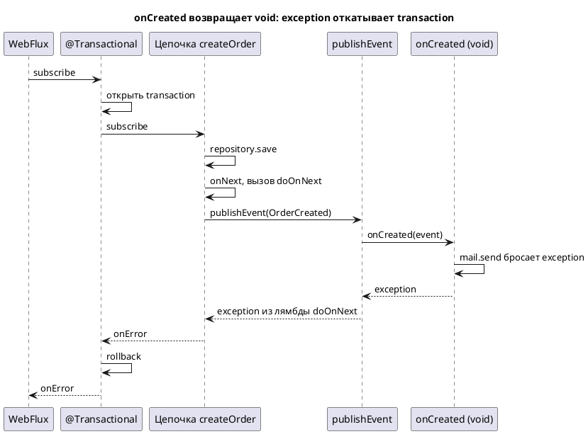
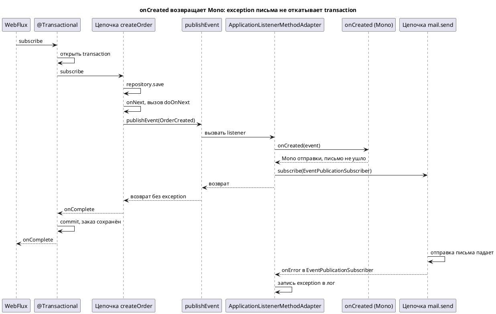

# Observer и Listener: паттерны в Java и Spring

> Отдельное руководство к [project-reactor-interview-guide.md](../project-reactor-interview-guide.md), §2.  
> **Формат:** схема → кто есть кто → как выглядит код → источник → цитата EN/RU.

**Перегенерация PNG:** `python docs/Images-docs/gen_reactor_diagrams.py`.

---

## Оглавление

0. [Коротко: что сказать на собеседовании](#interview-summary)
    - [Пояснение к рисунку: почему на схеме есть `ApplicationEventMulticaster`, а в коде его нет](#figure-explanation)
    - [Кто заполняет реестр listeners и как multicaster находит нужных](#multicaster-registry)
1. [Observer в Java — `Observable` / `Observer`](#1-observer-в-java--observable--observer)
2. [Listener в Spring — `ApplicationListener` / `@EventListener`](#2-слушатель-в-spring--applicationlistener--eventlistener)
    - [Пример: `ApplicationReadyEvent`](#application-ready-event)
    - [Любой объект как event](#event-any-object)
    - [Какой объект лежит в поле publisher](#publisher-field)
    - [Публикация event в WebFlux](#event-webflux)
3. [Паттерн Mediator — что это и при чём тут Spring](#3-паттерн-mediator--что-это-и-при-чём-тут-spring)
4. [Observer, Listener, Mediator — три синонима или три разных паттерна?](#4-observer-listener-mediator--три-синонима-или-три-разных-паттерна)
5. [Observer и Listener — сравнительная таблица](#5-observer-и-listener--сравнительная-таблица)

---

<a id="interview-summary"></a>

## 0. Коротко: что сказать на собеседовании

**Классический Observer (GoF).** 

**Subject** (наблюдаемый объект) хранит список наблюдателей, даёт операции `attach` / `detach` для подписки и отписки и при изменении состояния сам оповещает каждого наблюдателя. 
**Subject** напрямую знает всех своих подписчиков.

**Spring Events.** Между publisher и подписчиками стоит **посредник** — `ApplicationEventMulticaster`:

- Класс, который публикует event, хранит `ApplicationEventPublisher` и вызывает у него `publishEvent`. Этот `ApplicationEventPublisher` один на всё приложение: его получает каждый такой класс. 
  - Интерфейс реализует `ApplicationContext`, поэтому объект в поле — `ApplicationContext`. Класс, который публикует **event**, не знает, какие **listeners** его получат.
- **ApplicationContext** передаёт event в `ApplicationEventMulticaster` (по умолчанию это `SimpleApplicationEventMulticaster`).
- **Multicaster** хранит реестр **listener**'ов, выбирает подходящих по типу **event** и вызывает их.
- **Listener** — это **bean**, реализующий `ApplicationListener`, или метод с аннотацией `@EventListener`.

**Синхронно или асинхронно.**

**По умолчанию — синхронно.** 
- **Listener** выполняется в том же потоке, в котором **publisher** вызвал `publishEvent()`. Для **publisher** это выглядит как обычный вызов метода: управление вернётся к нему `только после того`, как все **listener** закончат работу.

_Пример_: `OrderService.createOrder()` в транзакции сохраняет заказ и публикует `OrderCreatedEvent`, а **listener** на этот **event** отправляет клиенту письмо. 

Что из этого следует:

- **Listener** работает внутри `той же транзакции`, что и **publisher**. Если **listener** тоже пишет в базу (например, сохраняет запись аудита), эта запись сохранится или откатится вместе с заказом. Это полезно, когда данные должны быть согласованы.
   - `Медленный` **listener** задерживает **publisher.** Например, если письмо отправляется 3 секунды, `createOrder()` завершится на 3 секунды позже, и пользователь дольше ждёт ответа.
  
- **exception** в **listener** прерывает **publisher**.
  - **exception** долетает до `createOrder()`, и если его не перехватить, **transaction** откатывается: из-за ошибки при отправке письма не сохранится и сам заказ.

`createOrder()` сохраняет заказ и в этом же вызове вызывает `publishEvent`.

**Listener** по умолчанию выполняется в этом же вызове. Если при отправке письма **listener** бросает **exception**, оно выходит из `publishEvent` в `createOrder()`.

Если `createOrder()` не перехватывает этот **exception** и метод помечен `@Transactional`, Spring откатывает **transaction**: заказ в базе не остаётся.

Это верно, пока **listener** синхронный. Если на нём стоит `@Async`, **exception** в `createOrder()` не приходит, и заказ остаётся сохранённым.

Есть и обратная ситуация: письмо ушло, а заказ не создан. **Listener** отправил письмо до commit, а потом `createOrder()` бросил **exception** или commit упал на ограничении базы. Rollback отменяет запись заказа, но не письмо. Чтобы письмо уходило только после commit, на тот же метод ставят `@TransactionalEventListener` вместо `@EventListener`. Это всё ещё **listener**: на объявлении `@TransactionalEventListener` стоит `@EventListener`, и `EventListenerMethodProcessor` регистрирует метод так же. Меняется момент вызова: не сразу в `publishEvent`, а после commit. Подробно — [Listener и transaction](listener%20in%20imperative%20and%20reactive.md#письмо-ушло-а-заказ-не-создан).

**Источник:** [TransactionalEventListener.java, Spring Framework 6.2.11](https://github.com/spring-projects/spring-framework/blob/v6.2.11/spring-tx/src/main/java/org/springframework/transaction/event/TransactionalEventListener.java) · [EventListenerMethodProcessor.java](https://github.com/spring-projects/spring-framework/blob/v6.2.11/spring-context/src/main/java/org/springframework/context/event/EventListenerMethodProcessor.java)

> **EN:** «An EventListener that is invoked according to a TransactionPhase.» / `@EventListener public @interface TransactionalEventListener` / `AnnotatedElementUtils.findMergedAnnotation(method, EventListener.class)`

> **RU:** «Это `@EventListener`, который вызывается в фазе **transaction**.» / «На типе `@TransactionalEventListener` стоит аннотация `@EventListener`.» / «`EventListenerMethodProcessor` ищет на методе `@EventListener`, в том числе если `@EventListener` стоит на другой аннотации.»

-----

**Асинхронно — через `@Async`.** Если пометить метод listener'а аннотацией `@Async` и включить `@EnableAsync` в конфигурации, Spring выполнит listener в отдельном потоке из пула. `publishEvent()` вернёт управление сразу, не дожидаясь listener'а. Так делают для действий, которые не должны задерживать основную операцию: отправка писем, обновление кэша, запись аудита. 

Чем за это платят:
- **Listener** работает `вне транзакции` **publisher**. Если ему нужна **transaction**, он открывает свою.
- **Publisher** не узнает об ошибке **listener**. **exception** возникает в другом потоке и до `createOrder()` не доходит: заказ сохранится, даже если письмо не ушло. Поэтому ошибку нужно обработать или записать в лог в самом **listener**.

> По умолчанию events Spring синхронные: listener выполняется в потоке publisher и внутри его транзакции. Поэтому медленный listener задерживает publisher, а его исключение может откатить всю операцию. Если listener не должен влиять на основную операцию, я помечаю его `@Async` — он выполняется в отдельном потоке.

**Частые заблуждения.**

**Event** публикует **multicaster**.

  - Нет. **Publisher** — тот, кто вызывает `publishEvent()`, а **multicaster** только рассылает **event** подходящим **listeners**. Неформально его можно назвать шиной **events** Spring (event bus), но официального термина Spring Bus нет: в Spring Framework он называется event multicaster.

**Multicaster** подписывается на **publisher**.

  - Нет. `ApplicationContext` сам вызывает у **multicaster** метод `multicastEvent(...)` и передаёт ему **event**.

**Multicaster** сам собирает реестр **listeners**.

  - Нет. Реестр хранится внутри **multicaster**, но заполняет его `ApplicationContext`: `registerListeners()`, `ApplicationListenerDetector` и `EventListenerMethodProcessor` (подробно — [Кто заполняет реестр listeners](#multicaster-registry)).

**Multicaster** хранит список **publishers** и список типов **events**.

  - Нет. Он хранит только **listeners**. Типа **event** в реестре нет: при `publishEvent(...)` **multicaster** читает тип у объекта **event** и по нему оставляет подходящих **listeners**.

Класс, который публикует **event**, сам реализует `ApplicationEventPublisher`.

  - Нет. Интерфейс реализует `ApplicationContext`. Класс только хранит этот общий `ApplicationEventPublisher` и вызывает у него `publishEvent`. Подробно — [Какой объект лежит в поле publisher](#publisher-field).

**Event** должен наследовать `ApplicationEvent`.

  - Нет, если тип стоит в `publishEvent` или в параметре `@EventListener`. Да, если тип стоит в скобках `ApplicationListener<OrderCreated>`: там нужен наследник `ApplicationEvent`. Подробно — [Любой объект как event](#event-any-object).

В WebFlux **listener** выполняется в другом потоке.

  - Нет. `publishEvent` и в WebFlux вызывает **listeners** в том потоке, который его вызвал. Подробно — [Публикация event в WebFlux](#event-webflux).

`@TransactionalEventListener` — это уже не **listener**.

  - Нет. На объявлении `@TransactionalEventListener` стоит `@EventListener`. `EventListenerMethodProcessor` находит метод через `findMergedAnnotation` и регистрирует его в **multicaster**. Другая аннотация меняет только момент вызова.

**Exception** из `@TransactionalEventListener` с фазой `AFTER_COMMIT` дойдёт до `createOrder()`.

  - Нет. Это тот же **listener**: на аннотации стоит `@EventListener`. Spring вызывает его из `afterCompletion` и пишет его **exception** в лог. Заказ остаётся сохранённым, а `createOrder()` о потерянном письме не узнаёт. Подробно — [Письмо упало после commit](listener%20in%20imperative%20and%20reactive.md#письмо-упало-после-commit).

Достаточно написать класс с `implements ApplicationListener`.

  - Нет. Класс должен быть **bean** в `ApplicationContext` (например, с `@Component`), иначе Spring его не зарегистрирует и **event** до него не дойдёт.

**Какой это паттерн: Observer или Publish-Subscribe?**

Коротко: оба названия верны, но на разных уровнях. **Внутри Spring** механизм устроен как Observer, а **для ваших компонентов** он работает как publish-subscribe. Ниже по шагам.

**Шаг 1. Как устроен классический Observer.**
 - Есть наблюдаемый объект (Subject), например заказ.
 - Заказ сам хранит список наблюдателей.
 - Наблюдателя подписывают на конкретный заказ вызовом `attach()`, отписывают вызовом `detach()`.
 - Когда заказ меняется, он сам обходит свой список и у каждого наблюдателя вызывает `update()`.
 - Итог: заказ знает всех своих наблюдателей, а наблюдатель знает, на какой заказ подписан.

**Шаг 2. Как устроены events Spring.**
Действия те же — хранить список, подписать, разослать, — но выполняет их не ваш сервис:
 - **Список подписчиков** хранит `ApplicationEventMulticaster` внутри `ApplicationContext`. Он один на всё приложение.
 - **Подписывает listeners сам Spring** при создании bean, а отписывает при его уничтожении. Ваш код только объявляет listener через `implements ApplicationListener` или `@EventListener`.
 - **Рассылает тоже multicaster.** Ваш сервис вызывает `publishEvent()`, контекст передаёт event multicaster'у, а тот находит listeners по **типу event** и вызывает их.
 - Итог: сервис-publisher не знает listeners, listeners не знают publisher. Их связывает только тип event.

**Шаг 3. Сравнение.**

| Действие | Классический Observer | Spring Events |
|----------|-----------------------|----------------|
| Кто хранит список подписчиков | Сам наблюдаемый объект | `ApplicationEventMulticaster`, один на контекст |
| Кто подписывает | Код приложения вызывает `attach()` | Spring при создании bean |
| На что подписываются | На конкретный объект | На тип event (`BlockedListEvent`) |
| Кто рассылает | Сам наблюдаемый объект | Multicaster |
| Знают ли publisher и подписчики друг о друге | Да | Нет |

**Шаг 4. Почему Spring называет это Observer.**
Если считать наблюдаемым объектом не ваш сервис, а контекст вместе с multicaster'ом, все роли Observer на месте: есть список, подписка, отписка и рассылка. Listener — это наблюдатель, а его `onApplicationEvent()` — это `update()`. Поэтому документация пишет «essentially the standard Observer design pattern» — «по сути это стандартный Observer».

**Шаг 5. Почему это одновременно Publish-Subscribe.**
Посмотрим на тот же механизм глазами ваших компонентов. Сервис-publisher отдаёт event в общий канал, listeners получают events нужного типа, и друг о друге они ничего не знают. Именно так в книге _Enterprise Integration Patterns_ описан **Publish-Subscribe Channel**.

**Итог: два уровня, два названия.**
 - **Уровень реализации — Observer.** У контекста с multicaster'ом есть список listeners, подписка, отписка и рассылка.
 - **Уровень взаимодействия компонентов — Publish-Subscribe.** Ваш сервис и listeners связаны только типом event и не знают друг о друге.

Поэтому выбирать одно из двух названий не нужно. Путаница возникает, когда Subject'ом считают ваш сервис-publisher: у него действительно нет ни списка подписчиков, ни рассылки, и кажется, что Observer здесь нет. Но Subject в Spring — это контекст вместе с multicaster'ом (шаг 4).

> Технически Spring подписывает listeners двумя компонентами: класс с `implements ApplicationListener` регистрирует `ApplicationListenerDetector`, а метод с `@EventListener` — `EventListenerMethodProcessor`.

_Mediator_ («Посредник») — паттерн, при котором объекты взаимодействуют не напрямую, а через отдельный объект, управляющий их взаимодействием.

**Почему Multicater не является классическим паттерном Mediator:** 
 - **Mediator по GoF** — это посредник, который содержит логику взаимодействия участников: 
   - он решает, кто и как должен отреагировать на действие другого участника. 
 - **Multicaster** такой логики не содержит: он ничего не решает, а **доставляет** event всем listeners подходящего типа. 

 - Сходство только в том, что в обоих случаях участники общаются ч**ерез промежуточный объект** и не ссылаются друг на друга. 
 - Поэтому **multicaster** — канал доставки, а не координатор (подробно — §3).

---

Вы говорите, что мультикастер «не содержит логики маршрутизации». Это **не совсем так**: он выбирает listeners по типу event (`supportsEventType`), то есть простая фильтрация по подписке у него есть. 
 - Нет другого: логики, которая координирует участников между собой, а это **и отличает** _Mediator_. 
 - Так и стоит сказать на собеседовании.

**Итог для собеседования.** 
 - Можно сказать так: «Внутри мультикастер устроен как **Observer** (список listeners, рассылка), но по архитектуре Spring Events — это Publish-Subscribe: publisher и **Listeners** развязаны через канал-мультикастер, а настоящий Subject с состоянием здесь **не нужен**».

---

«При старте контекст регистрирует всех listeners в мультикастере. Когда publisher вызывает `publishEvent`, контекст передаёт event мультикастеру. Мультикастер по типу event выбирает подписанных listeners из своего реестра и вызывает каждого».

Одно уточнение: 
 - по умолчанию listeners вызываются синхронно, в том же потоке, что и publisher. Асинхронность включается отдельно, например через `@Async` или через `TaskExecutor` в мультикастере.

---

**Ответ одной фразой:**

> «Внутри events Spring устроены как Observer: `ApplicationEventMulticaster` хранит listeners и рассылает им events. Для моих компонентов это publish-subscribe: publisher и listeners не знают друг о друге и связаны только типом event. Это не Mediator: multicaster ничего не координирует, а только доставляет events.»

Источники и цитаты: Spring и EIP — §4, GoF Mediator — §3.

---


**Как читать рисунок:** 
  - слева — **классический Observer** (Subject **сам хранит** список наблюдателей и **сам вызывает** `update()`). 
  - Справа — **events Spring** (publisher публикует event в контекст, а `ApplicationEventMulticaster` — центральный посредник — находит нужные listener'ы по типу event и вызывает их).

**ApplicationEventMulticaster** имеет методы регистрации и удаления listeners.

> **Уточнение:** Spring в официальной документации называет `ApplicationListener` реализацией «standard Observer design pattern».
> 
> Это верно **концептуально** (push-уведомление, ослабленная связанность). 
>  - Точнее, **структурно** это вариант Observer — **Publish–Subscribe** (публикация–подписка) с каналом events посередине: 
>   - publisher (Publisher) не знает listeners (**Listeners**) и не вызывает их напрямую — за это отвечает `ApplicationEventMulticaster`, который играет роль **канала events** (event channel, event bus). Паттерном Mediator он **не** является, хотя внешне на него частично похож. Подробно — в §3 и §4.


<a id="figure-explanation"></a>

# Пояснение к рисунку: почему на схеме есть `ApplicationEventMulticaster`, а в коде его нет

## В чём возникает путаница

На рисунке справа показана цепочка `Publisher → ApplicationEventMulticaster → Listener`, а в примере кода разработчик видит только `ApplicationEvent`, `ApplicationEventPublisher`, `ApplicationListener` и `@EventListener`. 
 - Из-за этого может возникнуть ощущение, что схема и код противоречат друг другу.

На самом деле противоречия нет: 
 - код показывает **публичный API Spring**, 
 - а рисунок показывает **внутреннюю архитектурную цепочку доставки events**.

---

## Что пишет разработчик в коде

В обычном Spring-коде разработчик работает только со следующими сущностями:

- `ApplicationEvent` — объект events.
- `ApplicationEventPublisher` — API для публикации event.
- `ApplicationListener<E>` или `@EventListener` — обработчик events.

Именно поэтому в минимальном примере нет явного `ApplicationEventMulticaster`: его обычно **не создают и не вызывают вручную**.

---

### Минимальный пример (доменный event — из документации Spring)

**1. Event:**

```java
/**
 * Доменный event: адрес добавлен в чёрный список.
 * <p>Расширяет {@link ApplicationEvent}: Spring автоматически
 * передаст объект всем listener'ам, подписанным на этот тип.</p>
 */
public class BlockedListEvent extends ApplicationEvent {

    private final String address;

    /**
     * @param source  объект, опубликовавший event (обычно {@code this})
     * @param address e-mail адрес, попавший в чёрный список
     */
    public BlockedListEvent(Object source, String address) {
        super(source);
        this.address = address;
    }

    /** @return заблокированный адрес */
    public String getAddress() { return address; }
}
```

**2. Публикация** (сервис реализует `ApplicationEventPublisherAware`):

```java
/**
 * Сервис рассылки.
 * <p>Реализует {@link ApplicationEventPublisherAware}, чтобы Spring
 * автоматически внедрил {@link ApplicationEventPublisher} — через него
 * сервис публикует events, <em>не зная</em>, кто на них подписан.</p>
 */
@Service
public class EmailService implements ApplicationEventPublisherAware {

    /** Внедряется Spring'ом автоматически через setApplicationEventPublisher. */
    private ApplicationEventPublisher publisher;

    @Override
    public void setApplicationEventPublisher(ApplicationEventPublisher publisher) {
        this.publisher = publisher;
    }

    /**
     * Добавляет адрес в чёрный список и публикует event.
     * <p>Publisher не вызывает listener'ы напрямую —
     * он лишь «бросает» event в контекст.</p>
     *
     * @param address адрес для блокировки
     */
    public void blockAddress(String address) {
        publisher.publishEvent(new BlockedListEvent(this, address));
    }
}
```

**3. Listener** — стиль `ApplicationListener`:

```java
/**
 * Listener, отправляющий уведомление при блокировке адреса.
 * <p>Реализует {@link ApplicationListener}: Spring найдёт этот bean
 * в контексте и вызовет {@code onApplicationEvent} при каждой
 * публикации {@link BlockedListEvent}.</p>
 */
@Component
public class BlockedListNotifier implements ApplicationListener<BlockedListEvent> {

    /**
     * Вызывается Spring'ом (через {@code ApplicationEventMulticaster}),
     * <em>не</em> вызывается publisher напрямую.
     *
     * @param event опубликованный event
     */
    @Override
    public void onApplicationEvent(BlockedListEvent event) {
        System.out.println("Заблокирован адрес: " + event.getAddress());
    }
}
```

**4. Тот же listener** — стиль `@EventListener` (рекомендуемый):

```java
/**
 * Listener в аннотационном стиле.
 * <p>{@link EventListener} заменяет реализацию интерфейса —
 * Spring сам определяет тип events по параметру метода.</p>
 */
@Component
public class BlockedListNotifier {

    /**
     * Вызывается контекстом при публикации {@link BlockedListEvent}.
     *
     * @param event опубликованный event
     */
    @EventListener
    public void onBlocked(BlockedListEvent event) {
        System.out.println("Заблокирован адрес: " + event.getAddress());
    }
}
```
---
.... для метода с `@EventListener` Spring создаёт отдельный объект-adapter, который реализует `ApplicationListener` и передаёт event в ваш метод.

... Каждый такой метод становится отдельным ApplicationListener.

**Ловушка, о которой стоит знать.** Bean с `@EventListener` **нельзя** делать **lazy**, иначе его метод **не будет зарегистрирован** как `listener`.

---

## Что происходит внутри Spring

Когда код вызывает:

```java
publisher.publishEvent(new BlockedListEvent(this, address));
```

- это не означает, что `EmailService` сам ищет нужные **listener**'ы и вызывает их. 
  - На практике **вызов** уходит внутрь `ApplicationContext`, а дальше **event** передаётся компоненту `ApplicationEventMulticaster`, который уже находит подходящие **listener**'ы и вызывает их.

```java
/**
* Сервис рассылки.
* <p>Реализует {@link ApplicationEventPublisherAware}, чтобы Spring
* автоматически внедрил {@link ApplicationEventPublisher} — через него
* сервис публикует events, <em>не зная</em>, кто на них подписан.</p>
  */
  @Service
  public class EmailService implements ApplicationEventPublisherAware {

  /** Внедряется Spring'ом автоматически через setApplicationEventPublisher. */
  private ApplicationEventPublisher publisher;

  @Override
  public void setApplicationEventPublisher(ApplicationEventPublisher publisher) {
  this.publisher = publisher;
  }

  /**
    * Добавляет адрес в чёрный список и публикует event.
    * <p>Publisher не вызывает listener'ы напрямую —
    * он лишь «бросает» event в контекст.</p>
    *
    * @param address адрес для блокировки
      */
      public void blockAddress(String address) {
      publisher.publishEvent(new BlockedListEvent(this, address));
      }
  }
```

То есть фактическая цепочка такая:

```text
EmailService
  → ApplicationEventPublisher.publishEvent(...)
    → ApplicationContext
      → ApplicationEventMulticaster
        → ApplicationListener / @EventListener
```

- Именно эту внутреннюю цепочку рисунок и показывает.

<a id="multicaster-registry"></a>

### Кто заполняет реестр listeners и как multicaster находит нужных

**Коротко.**

- **Реестр listeners.** Он хранится внутри `ApplicationEventMulticaster`. Заполняет его не сам multicaster, а `ApplicationContext` и его помощники: `registerListeners()`, `ApplicationListenerDetector`, `EventListenerMethodProcessor`.
- **Реестра publishers нет.** `ApplicationContext` не ведёт список тех, кто вызывает `publishEvent(...)`. Вызвать этот метод может любой код, которому внедрили `ApplicationEventPublisher`.
- **Списка типов events нет.** Multicaster не хранит каталог типов events. Тип он читает из объекта event в момент `publishEvent(...)`, затем перебирает реестр listeners и оставляет тех, чей параметр принимает этот тип.

Каталога типов нет, и сравнение типов при этом есть: тип не ищут в заранее составленном списке. Его берут у конкретного объекта event, который только что опубликовали.

**Шаг 1. Создание пустого канала.** В методе `AbstractApplicationContext.refresh()` контекст вызывает `initApplicationEventMulticaster()`. Если в контексте есть bean с именем `applicationEventMulticaster`, контекст берёт его, иначе создаёт `SimpleApplicationEventMulticaster`. На этом шаге реестр listeners пустой.

**Шаг 2. Регистрация bean-listeners по имени.** Сразу после этого контекст вызывает `registerListeners()`:
- передаёт в multicaster listeners, которых добавили вручную через `addApplicationListener(...)` до запуска контекста, методом `multicaster.addApplicationListener(listener)`;
- ищет имена всех bean, которые реализуют `ApplicationListener`, и передаёт каждое имя методом `multicaster.addApplicationListenerBean(beanName)`. Передаются **имена bean**, а не объекты: сами bean на этом шаге ещё не созданы;
- рассылает «ранние» events (early events), опубликованные до появления multicaster'а.

**Шаг 3. Регистрация готовых объектов listeners.** Когда контейнер создаёт bean, который реализует `ApplicationListener`, `ApplicationListenerDetector` (это `BeanPostProcessor`) добавляет готовый объект в multicaster через `addApplicationListener(...)`.

**Шаг 4. Регистрация методов с `@EventListener`.** `registerListeners()` такие методы **не** регистрирует. Это делает `EventListenerMethodProcessor` в методе `afterSingletonsInstantiated()`, то есть после создания всех singleton-bean. Для каждого метода с `@EventListener` он создаёт объект-адаптер `ApplicationListenerMethodAdapter` и добавляет его в multicaster через `context.addApplicationListener(...)`.

**Что хранит multicaster после старта.** Две коллекции: `Set<ApplicationListener<?>>` с объектами-listeners и `Set<String>` с именами bean-listeners. Плюс кэш `Map<ListenerCacheKey, CachedListenerRetriever>`, который заполняется позже, при публикации (шаг 6).

**Чего multicaster не хранит:**
- **Реестра publishers.** Публиковать event может любой код, у которого есть `ApplicationEventPublisher`; заранее его никто не регистрирует.
- **Списка типов events.** Тип multicaster читает из объекта event только в момент вызова `publishEvent(...)`. Заранее составленного списка типов у него нет.

**Шаг 5. Публикация.** Publisher вызывает `publishEvent(event)`. Если `event` не наследует `ApplicationEvent` (например, это обычный объект `OrderCreated`), контекст оборачивает его в `PayloadApplicationEvent<OrderCreated>`. Затем контекст определяет тип event (`ResolvableType`) и вызывает `multicaster.multicastEvent(event, eventType)`.

**Шаг 6. Подбор listeners по типу event.** Внутри `multicastEvent(...)` multicaster вызывает `getApplicationListeners(event, eventType)`:
- строит ключ кэша `ListenerCacheKey` из двух частей: тип event и класс источника этого event (`event.getSource().getClass()`);
- если по этому ключу в кэше уже есть готовый список listeners, сразу берёт его;
- если нет — перебирает весь реестр и для каждого listener вызывает `supportsEvent(...)`. Для обычного `ApplicationListener<OrderCreatedEvent>` тип event берётся из generic-параметра через `GenericApplicationListenerAdapter`; для метода с `@EventListener` — из параметра метода через `ApplicationListenerMethodAdapter`;
- сортирует подходящих listeners по `@Order` и кладёт список в кэш.

**Шаг 7. Вызов.** Multicaster по очереди вызывает `onApplicationEvent(event)` у каждого listener из списка: по умолчанию в потоке publisher, а если multicaster'у задан `TaskExecutor` — в потоках этого executor'а.

Когда в реестр добавляют или из него удаляют listener (`addApplicationListener`, `removeApplicationListener`), multicaster очищает кэш, и при следующей публикации список подбирается заново.

**Схема:**

```text
AbstractApplicationContext.refresh()
  ├── initApplicationEventMulticaster()   создать пустой SimpleApplicationEventMulticaster
  ├── registerListeners()                 добавить имена bean с implements ApplicationListener
  ├── finishBeanFactoryInitialization()   создать singleton-bean:
  │     ├── ApplicationListenerDetector   добавить готовые объекты listeners
  │     └── EventListenerMethodProcessor  добавить адаптеры для методов с @EventListener
  └── ...

publishEvent(new OrderCreated(42))
  → PayloadApplicationEvent<OrderCreated>
  → multicaster.multicastEvent(event, eventType)
  → getApplicationListeners: ключ (тип event, класс источника) → кэш или перебор реестра + supportsEvent
  → onApplicationEvent(...) у каждого подходящего listener
```

**Источник:** [Spring Framework, исходный код — `AbstractApplicationContext.registerListeners()`](https://github.com/spring-projects/spring-framework/blob/main/spring-context/src/main/java/org/springframework/context/support/AbstractApplicationContext.java)

> **EN:** «Add beans that implement ApplicationListener as listeners. Doesn't affect other listeners, which can be added without being beans.» / «Do not initialize FactoryBeans here: We need to leave all regular beans uninitialized to let post-processors apply to them!»

> **RU:** «Добавляет bean, реализующие ApplicationListener, как listeners. Не затрагивает других listeners, которые можно добавить, не делая их bean.» / «Не инициализировать здесь FactoryBean: все обычные bean нужно оставить неинициализированными, чтобы к ним применились post-processor'ы!»

**Источник:** [Spring Framework, исходный код — `AbstractApplicationEventMulticaster`](https://github.com/spring-projects/spring-framework/blob/main/spring-context/src/main/java/org/springframework/context/event/AbstractApplicationEventMulticaster.java)

> **EN:** «Return a Collection of ApplicationListeners matching the given event type. Non-matching listeners get excluded early.» / «Cache key for ListenerRetrievers, based on event type and source type.»

> **RU:** «Возвращает коллекцию ApplicationListener, подходящих под данный тип event. Неподходящие listeners отсеиваются заранее.» / «Ключ кэша для ListenerRetriever, основанный на типе event и типе источника.»

**Источник:** [Javadoc — `EventListenerMethodProcessor`](https://docs.spring.io/spring-framework/docs/current/javadoc-api/org/springframework/context/event/EventListenerMethodProcessor.html)

> **EN:** «Registers EventListener methods as individual ApplicationListener instances.»

> **RU:** «Регистрирует методы с EventListener как отдельные экземпляры ApplicationListener.»

> **На собеседовании:** «Реестр listeners лежит внутри multicaster, а заполняет его `ApplicationContext`. Реестра publishers нет, и каталога типов events тоже нет. При `publishEvent(...)` multicaster читает тип у объекта event, перебирает listeners, проверяет `supportsEvent` и кэширует результат по ключу „тип event + класс источника“.»

---

## Почему `ApplicationEventMulticaster` есть на схеме

Он нужен на рисунке не потому, что разработчик обязан его писать в коде, а потому что без него трудно объяснить, 
 - **почему Spring Events структурно — это Observer в варианте Publish–Subscribe (с каналом events посередине), а не классический GoF Observer**.

В GoF Observer:

- Subject **сам хранит** список наблюдателей.
- Subject **сам вызывает** `update()` у каждого Observer.

В Spring Events:

- publisher **не хранит** список listener'ов;
- publisher **не вызывает** listener'ы напрямую;
- эту работу делает `ApplicationEventMulticaster` как центральный посредник — канал events (event bus), а не Mediator в смысле GoF.

Именно поэтому на рисунке его показывать правильно.

---

## На что опираться при чтении примера

Нужно опираться сразу на **два уровня понимания**:

### 1. Уровень прикладного кода

Если задача — писать Spring-приложение, достаточно помнить следующее:

- event создаётся как `ApplicationEvent` или обычный объект;
- event публикуется через `ApplicationEventPublisher`;
- обработка делается через `ApplicationListener` или `@EventListener`.

На этом уровне `ApplicationEventMulticaster` можно вообще не трогать.

### 2. Уровень архитектуры

Если задача — **понять паттерн**, тогда важно знать внутреннюю роль `ApplicationEventMulticaster`:

- он выступает **каналом events** (посредником-доставщиком) между _publisher_ и _listener'ами_;
- он решает, какие **listener'ы** подходят _по типу_ **events**;
- он делает реальную dispatch-**рассылку** внутри Spring.

---

## Как связать код и рисунок одной фразой

Самая удобная формулировка такая:

> В примере кода показан **внешний API**, с которым работает разработчик, а на рисунке показан **внутренний механизм доставки events** внутри Spring.

Или ещё короче:

> `publishEvent()` — это то, что пишет разработчик; `ApplicationEventMulticaster` — это то, через что Spring реально доставляет event listener'ам.

---

## Практический вывод

- Если документ ориентирован на **объяснение паттернов**, `ApplicationEventMulticaster` на схеме нужен. 
- Если документ ориентирован только на **прикладное использование API**, его можно было бы не рисовать.

Для текущего документа логичнее оставить `ApplicationEventMulticaster` на рисунке, но рядом с примером кода добавить короткое пояснение в отдельной теме:

> `ApplicationEventMulticaster` не участвует в пользовательском коде напрямую, но участвует во внутренней доставке events внутри `ApplicationContext`.

Так схема и код перестают конфликтовать: 
  - один показывает **что пишет разработчик**, другой — **как это реально работает внутри Spring**.

---

## 1. Observer в Java — `Observable` / `Observer`

### Как выглядит паттерн

| Роль в GoF | В JDK (до reactive) | Что происходит |
|------------|---------------------|----------------|
| **Subject** (наблюдаемый) | `java.util.Observable` | Хранит **набор** `Observer`. При изменении состояния вызывает `setChanged()` → `notifyObservers()`. |
| **Observer** (наблюдатель) | `java.util.Observer` | Реализует `update(Observable o, Object arg)` — его вызывают **все** подписанные наблюдатели. |
| **Подписка** | `observable.addObserver(observer)` | Subject **знает** каждого Observer в своём списке. |
| **Уведомление** | `notifyObservers(arg)` | Subject **сам обходит** список и вызывает `update()` у каждого. |

**Цепочка в одну строку:** изменили данные в Subject → `notifyObservers()` → `update()` у каждого Observer.

* GoF — это «Gang of Four», четыре автора книги “Design Patterns: Elements of Reusable Object-Oriented Software” (Gamma, Helm, Johnson, Vlissides), где формализованы классические паттерны проектирования, включая Observer

### пример

```java
import java.util.ArrayList;
import java.util.List;

/**
 * ROLE: Observer
 *
 * <p>Общий контракт для всех наблюдателей.</p>
 * <p>Любой Observer обязан реализовать метод {@link #update(String)},
 * чтобы Subject мог уведомить его об изменении состояния.</p>
 */
interface OrderObserver {

    /**
     * Вызывается Subject'ом при изменении статуса заказа.
     *
     * @param newStatus новое состояние Subject'а
     */
    void update(String newStatus);
}

/**
 * ROLE: Subject
 *
 * <p>Наблюдаемый объект из GoF Observer.</p>
 * <p><b>Главный признак Subject:</b> он сам хранит список Observer'ов
 * и сам вызывает их метод {@code update()}.</p>
 */
class OrderStatus {

    /**
     * 1. Subject ХРАНИТ список подписчиков.
     * <p>Это ключевая часть GoF Observer:
     * список наблюдателей находится внутри Subject.</p>
     */
    private final List<OrderObserver> observers = new ArrayList<>();

    /**
     * Текущее состояние Subject'а.
     */
    private String status;

    /**
     * 2. Подписка Observer на Subject.
     *
     * @param observer наблюдатель, которого нужно добавить
     */
    public void addObserver(OrderObserver observer) {
        observers.add(observer);
    }

    /**
     * 3. Отписка Observer от Subject.
     *
     * @param observer наблюдатель, которого нужно удалить
     */
    public void removeObserver(OrderObserver observer) {
        observers.remove(observer);
    }

    /**
     * 4. Изменение состояния Subject'а.
     * <p>Как только состояние изменилось, Subject сам запускает
     * механизм уведомления всех подписчиков.</p>
     *
     * @param newStatus новый статус заказа
     */
    public void setStatus(String newStatus) {
        this.status = newStatus;
        notifyObservers();
    }

    /**
     * 5. Subject САМ обходит список Observer'ов
     * и САМ вызывает {@code update()} у каждого.
     *
     * <p>Именно это и есть суть GoF Observer.</p>
     * <p>Здесь нет Spring, нет EventBus, нет Mediator,
     * нет скрытой логики в родительском классе.</p>
     */
    private void notifyObservers() {
        for (OrderObserver observer : observers) {
            observer.update(status);
        }
    }
}

/**
 * ROLE: ConcreteObserver
 *
 * <p>Конкретная реализация Observer.</p>
 * <p>Получает уведомление от Subject'а и выполняет свою реакцию.</p>
 */
class OrderLogger implements OrderObserver {

    /**
     * Реакция на изменение состояния Subject'а.
     *
     * @param newStatus новый статус заказа
     */
    @Override
    public void update(String newStatus) {
        System.out.println("OrderLogger: статус заказа = " + newStatus);
    }
}

/**
 * ROLE: ConcreteObserver
 *
 * <p>Ещё один конкретный Observer.</p>
 * <p>Показывает, что у одного Subject может быть несколько подписчиков.</p>
 */
class OrderNotifier implements OrderObserver {

    /**
     * Реакция на изменение статуса.
     *
     * @param newStatus новый статус заказа
     */
    @Override
    public void update(String newStatus) {
        System.out.println("OrderNotifier: отправляем уведомление о статусе " + newStatus);
    }
}

/**
 * ROLE: Client
 *
 * <p>Клиентский код собирает паттерн:</p>
 * <ol>
 *   <li>создаёт Subject;</li>
 *   <li>создаёт ConcreteObserver'ов;</li>
 *   <li>подписывает Observer'ов на Subject;</li>
 *   <li>меняет состояние Subject'а.</li>
 * </ol>
 */
public class OrderObserverDemo {

    public static void main(String[] args) {

        // Шаг 1. Создаём Subject
        OrderStatus subject = new OrderStatus();

        // Шаг 2. Создаём ConcreteObserver'ов
        OrderObserver logger = new OrderLogger();
        OrderObserver notifier = new OrderNotifier();

        // Шаг 3. Подписываем Observer'ов на Subject
        subject.addObserver(logger);
        subject.addObserver(notifier);

        // Шаг 4. Меняем состояние Subject'а
        // Subject сам вызовет update() у каждого подписчика
        subject.setStatus("PAID");
        subject.setStatus("SHIPPED");

        // Шаг 5. Можно отписать одного Observer'а
        subject.removeObserver(logger);

        // Теперь уведомление получит только оставшийся Observer
        subject.setStatus("DELIVERED");
    }
}
```

> `Observable` / `Observer` помечены **`@Deprecated` с Java 9** — для нового кода JDK их не рекомендует, но они остаются **каноническим примером** паттерна в Java API.

### Когда встречается сегодня

- Учебные и legacy-коды на `Observable` / `Observer`.
- **Reactor / Reactive Streams** — та же **push-идея** («источник уведомляет подписчика»), но через `Publisher` / `Subscriber` и с backpressure. Подробно это разобрано в [project-reactor-interview-guide.md](../project-reactor-interview-guide.md).

**Источник:** [Oracle — `Observable` (Java SE 8)](https://docs.oracle.com/javase/8/docs/api/java/util/Observable.html) · [`Observer`](https://docs.oracle.com/javase/8/docs/api/java/util/Observer.html)

> **EN:** «This class represents an observable object … It can have one or more observers. An observer may be any object that implements interface Observer. After an observable instance changes, an application calling the Observable's notifyObservers method causes all of its observers to be notified of the change by a call to their update method.»

> **RU:** «Этот класс представляет наблюдаемый объект … У него может быть один или несколько observers. Observer — любой объект, реализующий интерфейс Observer. После изменения observable вызов notifyObservers приводит к тому, что все observers получают update.»

---

<a id="pattern-listener"></a>

<a id="2-слушатель-в-spring--applicationlistener--eventlistener"></a>

## 2. Listener в Spring — `ApplicationListener` / `@EventListener`

### Как выглядит паттерн в Spring

Здесь **не** `addObserver()` на вашем объекте. Модель такая:

| Роль | Класс / API в Spring | Что происходит |
|------|----------------------|----------------|
| **Event** | `ApplicationEvent` (или любой объект, с 4.2) | Объект-сообщение: «произошло X». |
| **Publisher** | `ApplicationEventPublisher` | Вызывает `publishEvent(event)` — **не** знает список listener'ов и **не** вызывает их напрямую. |
| **Listener** | `ApplicationListener<E>` или метод с `@EventListener` | Bean в контексте; Spring **регистрирует** его и **вызывает** при совпадении типа event. |
| **Раздача** | `ApplicationEventMulticaster` (внутри контекста) | **Канал events** (event bus): хранит listener'ы, находит подходящие по типу event и вызывает их (по умолчанию это `SimpleApplicationEventMulticaster`, вызов **синхронный**, в потоке publisher). |

**Цепочка в одну строку:** `publishEvent(event)` → `ApplicationEventMulticaster` → `onApplicationEvent(event)` / метод с `@EventListener`.

### Минимальный пример (доменный event — из документации Spring)

**1. Event:**

```java
/**
 * Доменный event: адрес добавлен в чёрный список.
 * <p>Расширяет {@link ApplicationEvent}: Spring автоматически
 * передаст объект всем listener'ам, подписанным на этот тип.</p>
 */
public class BlockedListEvent extends ApplicationEvent {

    private final String address;

    /**
     * @param source  объект, опубликовавший event (обычно {@code this})
     * @param address e-mail адрес, попавший в чёрный список
     */
    public BlockedListEvent(Object source, String address) {
        super(source);
        this.address = address;
    }

    /** @return заблокированный адрес */
    public String getAddress() { return address; }
}
```

**2. Публикация** (сервис реализует `ApplicationEventPublisherAware`):

```java
/**
 * Сервис рассылки.
 * <p>Реализует {@link ApplicationEventPublisherAware}, чтобы Spring
 * автоматически внедрил {@link ApplicationEventPublisher} — через него
 * сервис публикует events, <em>не зная</em>, кто на них подписан.</p>
 */
@Service
public class EmailService implements ApplicationEventPublisherAware {

    /** Внедряется Spring'ом автоматически через setApplicationEventPublisher. */
    private ApplicationEventPublisher publisher;

    @Override
    public void setApplicationEventPublisher(ApplicationEventPublisher publisher) {
        this.publisher = publisher;
    }

    /**
     * Добавляет адрес в чёрный список и публикует event.
     * <p>Publisher не вызывает listener'ы напрямую —
     * он лишь «бросает» event в контекст.</p>
     *
     * @param address адрес для блокировки
     */
    public void blockAddress(String address) {
        publisher.publishEvent(new BlockedListEvent(this, address));
    }
}
```

**3. Listener** — стиль `ApplicationListener`:

```java
/**
 * Listener, отправляющий уведомление при блокировке адреса.
 * <p>Реализует {@link ApplicationListener}: Spring найдёт этот bean
 * в контексте и вызовет {@code onApplicationEvent} при каждой
 * публикации {@link BlockedListEvent}.</p>
 */
@Component
public class BlockedListNotifier implements ApplicationListener<BlockedListEvent> {

    /**
     * Вызывается Spring'ом (через {@code ApplicationEventMulticaster}),
     * <em>не</em> вызывается publisher напрямую.
     *
     * @param event опубликованный event
     */
    @Override
    public void onApplicationEvent(BlockedListEvent event) {
        System.out.println("Заблокирован адрес: " + event.getAddress());
    }
}
```

**4. Тот же listener** — стиль `@EventListener` (рекомендуемый):

```java
/**
 * Listener в аннотационном стиле.
 * <p>{@link EventListener} заменяет реализацию интерфейса —
 * Spring сам определяет тип events по параметру метода.</p>
 */
@Component
public class BlockedListNotifier {

    /**
     * Вызывается контекстом при публикации {@link BlockedListEvent}.
     *
     * @param event опубликованный event
     */
    @EventListener
    public void onBlocked(BlockedListEvent event) {
        System.out.println("Заблокирован адрес: " + event.getAddress());
    }
}
```

> `ApplicationListener` **extends** `java.util.EventListener` — это **Java-интерфейс-маркер** для callback-модели (Swing, servlet events и т.д.). Spring строит на нём свой механизм events `ApplicationContext`.

**Источник:** [Spring Framework — Application Events](https://docs.spring.io/spring-framework/reference/core/beans/context-introduction.html#context-functionality-events) · [Javadoc — `ApplicationListener`](https://docs.spring.io/spring-framework/docs/current/javadoc-api/org/springframework/context/ApplicationListener.html)

> **EN (Reference):** «Event handling in the ApplicationContext is provided through the ApplicationEvent class and the ApplicationListener interface. If a bean that implements the ApplicationListener interface is deployed into the context, every time an ApplicationEvent gets published to the ApplicationContext, that bean is notified. Essentially, this is the standard Observer design pattern.»

> **EN (Javadoc):** «Interface to be implemented by application event listeners. Based on the standard EventListener interface for the Observer design pattern.»

> **RU:** «Обработка events в ApplicationContext идёт через ApplicationEvent и ApplicationListener. Если bean с ApplicationListener развёрнут в ApplicationContext, при каждой публикации ApplicationEvent он получает уведомление. По сути, это стандартный паттерн Observer.» / «Интерфейс listener events приложения. Основан на стандартном EventListener — интерфейсе для паттерна Observer.»

<a id="event-any-object"></a>

### Любой объект как event

Класс `OrderCreated` может не наследовать `ApplicationEvent`. Это решает не аннотация на классе, а строка, в которую вы подставляете `OrderCreated`.

В вызове `publishEvent(new OrderCreated("A-1"))` и в параметре `onCreated(OrderCreated event)` наследовать `ApplicationEvent` не нужно. С Spring 4.2 такой вызов доходит до метода с `@EventListener`.

В объявлении `implements ApplicationListener<OrderCreated>` наследовать нужно. Компилятор принимает в этих угловых скобках только наследника `ApplicationEvent`. Обычный `OrderCreated` туда не встаёт, и класс **listener** не компилируется.

Без `@EventListener` и без `ApplicationListener` вызов `publishEvent` некому доставить. Класс **event** сам по себе подписчика не создаёт.

Класс `OrderCreated` без `ApplicationEvent`.

```java

public class OrderCreated {

    private final String id;

    public OrderCreated(String id) {
        this.id = id;
    }

    public String getId() {
        return id;
    }
}

```

Этот **listener** не компилируется: `OrderCreated` стоит в угловых скобках `ApplicationListener`.

```java

public class OrderCreatedListener implements ApplicationListener<OrderCreated> {

    @Override
    public void onApplicationEvent(OrderCreated event) {
    }
}

```

Этот **listener** компилируется: `OrderCreated` стоит в параметре метода `onCreated`.

```java

@Component
public class OrderCreatedListener {

    @EventListener
    public void onCreated(OrderCreated event) {
        System.out.println(event.getId());
    }
}

```

Как `publishEvent(new OrderCreated("A-1"))` доходит до `onCreated`.

1. **Publisher** вызывает `publisher.publishEvent(new OrderCreated("A-1"))`.
2. `ApplicationContext` кладёт этот объект в `PayloadApplicationEvent<OrderCreated>`.
3. У метода `onCreated` записан тип `OrderCreated`. Multicaster сравнивает его с типом внутри обёртки и вызывает метод. В параметр приходит `OrderCreated`, не обёртка.

Чтобы принять тот же объект через интерфейс, в скобках пишут обёртку: `ApplicationListener<PayloadApplicationEvent<OrderCreated>>`. С Spring 5.3 то же делает `ApplicationListener.forPayload`.

**Источник:** [Spring Framework — Application Events](https://docs.spring.io/spring-framework/reference/core/beans/context-introduction.html#context-functionality-events) · [Javadoc — `ApplicationListener`](https://docs.spring.io/spring-framework/docs/current/javadoc-api/org/springframework/context/ApplicationListener.html)

> **EN:** «As of Spring 4.2, the event infrastructure … offers … the ability to publish any arbitrary event (that is, an object that does not necessarily extend from ApplicationEvent). When such an object is published, we wrap it in an event for you.»

> **EN (Javadoc):** «E - the specific ApplicationEvent subclass to listen to.»

> **RU:** «С Spring 4.2 можно публиковать любой объект, который не обязательно наследует `ApplicationEvent`. Когда такой объект публикуют, Spring оборачивает его в event.» / «E — конкретный подкласс `ApplicationEvent`, который listener принимает.»

<a id="publisher-field"></a>

### Какой объект лежит в поле publisher

`ApplicationEventPublisher` — один общий объект. `ApplicationContext` подставляет его в каждый класс, который публикует events. Класс `ApplicationContext` реализует интерфейс `ApplicationEventPublisher`, поэтому этот объект — сам `ApplicationContext`.

Класс, который публикует event, например `EmailService`, хранит `ApplicationEventPublisher` в поле. Публикация — это вызов `publishEvent` на этом поле. `EmailService` интерфейс `ApplicationEventPublisher` не реализует.

Когда `ApplicationContext` создаёт bean `EmailService`, он вызывает `setApplicationEventPublisher` и передаёт туда себя. То же самое он передаёт в `OrderService` и в любой другой такой класс: во всех полях один объект.

<a id="event-webflux"></a>

### Публикация event в WebFlux

Сначала два свойства Reactor, без них дальше непонятно.

`Mono` ничего не делает, пока на нём не вызвали `subscribe`. Тот, кто вызвал `subscribe`, становится **subscriber** этой цепочки.

Сигналы `onNext`, `onComplete`, `onError` идут только по той цепочке, на которой вызвали `subscribe`, и приходят только её **subscriber**. В другую цепочку сигнал сам не переходит.

```java

@Transactional
public Mono<Void> createOrder(Order order) {
    return repository.save(order)
        .doOnNext(saved -> publisher.publishEvent(new OrderCreated(saved.getId())));
}

```

Что делает `@Transactional` с этой цепочкой.

1. Контроллер возвращает `Mono` метода `createOrder`. WebFlux вызывает на нём `subscribe`.
2. `@Transactional` перед этим открывает **transaction** и встаёт **subscriber** цепочки `createOrder`.
3. Цепочка прислала `onComplete` — Spring делает commit.
4. Цепочка прислала `onError` — Spring делает rollback.

Ход цепочки `createOrder`.

1. `repository.save` пишет заказ в базу внутри **transaction**. Commit ещё не было.
2. `repository.save` присылает `onNext` с сохранённым заказом.
3. На этом `onNext` выполняется `doOnNext`, и внутри него вызывается `publishEvent`.
4. Что будет дальше, зависит от того, что возвращает метод **listener**.

**Listener** возвращает `void`.

```java

@EventListener
public void onCreated(OrderCreated event) {
    mail.send(event.getId());
}

```



Что происходит на диаграмме.

1. `publishEvent` вызывает `onCreated` обычным вызовом метода и ждёт возврата.
2. `mail.send` бросает **exception**. Оно выходит из `onCreated`, из `publishEvent` и из лямбды внутри `doOnNext`.
3. Reactor ловит **exception**, брошенное внутри `doOnNext`, и превращает его в сигнал `onError` цепочки `createOrder`.
4. `onError` доходит до `@Transactional`. Spring делает rollback. Заказа в базе нет.

Это **exception** можно поймать в цепочке `createOrder`, например оператором `onErrorResume` после `doOnNext`. Если `onErrorResume` вернёт обычное значение, цепочка закончится `onComplete`, и Spring сделает commit.

**Listener** возвращает `Mono<Void>`.

```java

@EventListener
public Mono<Void> onCreated(OrderCreated event) {
    return mail.send(event.getId());
}

```



Что происходит на диаграмме.

1. `publishEvent` вызывает `onCreated`. `mail.send` письмо не отправляет, а возвращает новый `Mono` отправки. На нём ещё никто не вызвал `subscribe`, поэтому письмо пока не ушло.
2. `ApplicationListenerMethodAdapter` получает этот `Mono` и сам вызывает на нём `subscribe`. **Subscriber** цепочки письма — объект адаптера `EventPublicationSubscriber`, а не цепочка `createOrder`.
3. `onCreated` вернулся без **exception**, поэтому `publishEvent` тоже возвращается нормально. Лямбда в `doOnNext` закончилась без ошибки.
4. Цепочка `createOrder` присылает `onComplete`. Spring делает commit. Заказ в базе.
5. Письмо отправляется уже после этого. Если отправка падает, цепочка письма присылает `onError`. Этот `onError` получает только **subscriber** цепочки письма — `EventPublicationSubscriber`.
6. `EventPublicationSubscriber.onError` пишет **exception** в лог: `Unexpected error occurred in asynchronous listener`. В `doOnNext` и в `createOrder` этот сигнал не попадает: цепочку письма никто не соединил с цепочкой `createOrder`.

Если письмо должно откатывать заказ, его вызывают в самой цепочке `createOrder`, например `.flatMap(saved -> mail.send(saved.getId()))`, а не через **event**. Тогда `onError` письма идёт по цепочке `createOrder`.

В обоих случаях письмо уходит до commit. Если после этого **transaction** откатится, письмо о несуществующем заказе уже у клиента. Чтобы письмо уходило после commit, на тот же метод ставят `@TransactionalEventListener`. Это тот же **listener**: на аннотации стоит `@EventListener`. `TransactionalEventPublisher` только кладёт `TransactionContext` в **event**, чтобы этот **listener** дождался фазы реактивной **transaction**. Подробно — [Listener и transaction, реактивный стек](listener%20in%20imperative%20and%20reactive.md#контекст-передаётся-через-source).

**Источник:** [TransactionalOperatorImpl](https://github.com/spring-projects/spring-framework/blob/v6.2.11/spring-tx/src/main/java/org/springframework/transaction/reactive/TransactionalOperatorImpl.java) · [ApplicationListenerMethodAdapter](https://github.com/spring-projects/spring-framework/blob/v6.2.11/spring-context/src/main/java/org/springframework/context/event/ApplicationListenerMethodAdapter.java)

> **EN:** `Flux.usingWhen(..., this.transactionManager::commit, this::rollbackOnException, this.transactionManager::rollback)` / `adapter.toPublisher(result).subscribe(new EventPublicationSubscriber())` / `logger.error("Unexpected error occurred in asynchronous listener", t)`

> **RU:** «Реактивная **transaction** фиксируется, когда завершается `Mono` метода `createOrder`. Если `onCreated` вернул `Mono` метода `mail.send`, адаптер только подписывается на него. Ошибку этой подписки адаптер пишет в лог.»

---

<a id="application-ready-event"></a>

### Пример: `ApplicationReadyEvent`

Типичный **Spring Boot** listener — реакция на **жизненный цикл** приложения (не Reactor).


Что на рисунке происходит по порядку.

1. `SpringApplication.run()` поднимает `ApplicationContext` и создаёт beans.
2. Затем выполняются `ApplicationRunner` и `CommandLineRunner`.
3. Когда они закончили, Spring Boot публикует `ApplicationReadyEvent`. Это сигнал, что приложение уже может принимать запросы. Поэтому такой **listener** ставят на прогрев кэша или регистрацию в service discovery, а не на создание заказа.
4. `ApplicationContext` передаёт этот **event** в `ApplicationEventMulticaster`.
5. Multicaster находит метод с `@EventListener` на `ApplicationReadyEvent` и вызывает `onAppReady`. Этот метод вызывает multicaster, не код сервиса.

```java
/**
 * Listener жизненного цикла: выполняет действия после полного старта приложения.
 * <p>Spring Boot публикует {@link ApplicationReadyEvent} последним при запуске —
 * после того, как все {@code ApplicationRunner} и {@code CommandLineRunner}
 * уже отработали. Использовать для прогрева кешей, регистрации в service
 * discovery и т.п.</p>
 */
@Component
@Slf4j
public class AppStartupListener {

    /**
     * Вызывается контекстом, когда приложение готово обслуживать запросы.
     *
     * @param event event готовности приложения; содержит ссылку
     *              на {@link org.springframework.boot.SpringApplication}
     */
    @EventListener(ApplicationReadyEvent.class)
    public void onAppReady(ApplicationReadyEvent event) {
        log.info("Приложение готово обслуживать запросы");
    }
}
```

**Источник:** [Spring Boot — Application events](https://docs.spring.io/spring-boot/reference/features/spring-application.html#features.spring-application.application-events-and-listeners) · [Javadoc — `ApplicationReadyEvent`](https://docs.spring.io/spring-boot/api/java/org/springframework/boot/context/event/ApplicationReadyEvent.html)

> **EN:** «An ApplicationReadyEvent is sent after any application and command-line runners have been called.» / «Event published as late as conceivably possible to indicate that the application is ready to service requests.»

> **RU:** «ApplicationReadyEvent отправляется после выполнения всех ApplicationRunner и CommandLineRunner.» / «Event публикуется максимально поздно при старте — приложение готово обслуживать запросы.»

---

<a id="pattern-mediator"></a>

## 3. Паттерн Mediator — что это и при чём тут Spring

Mediator по GoF — объект, который хранит сценарий: он решает, кто на чьё действие как отвечает.

`ApplicationEventMulticaster` сценария не хранит. Он держит реестр **listeners** и вызывает тех, чей тип совпал с типом **event**. **Publisher** только публикует, **listener** только получает. Multicaster не решает, что им делать дальше.

Поэтому `ApplicationEventMulticaster` — канал **events**, не Mediator.

**Источник:** Gamma, Helm, Johnson, Vlissides — *Design Patterns*, Addison-Wesley, 1994, глава Mediator, раздел Intent.

> **EN:** «Define an object that encapsulates how a set of objects interact. Mediator promotes loose coupling by keeping objects from referring to each other explicitly, and it lets you vary their interaction independently.»

> **RU:** «Определите объект, который инкапсулирует то, как взаимодействует набор объектов. Mediator ослабляет связанность, избавляя объекты от необходимости явно ссылаться друг на друга, и позволяет независимо изменять их взаимодействие.»

---

## 4. Observer, Listener, Mediator — три синонима или три разных паттерна?

### Как связаны термины

На практике эти три термина часто используют как взаимозаменяемые, хотя между ними есть структурные отличия. Разобраться помогает цитата из [Refactoring.Guru — Observer](https://refactoring.guru/design-patterns/observer):

> **EN:** «Observer — Also known as: **Event-Subscriber, Listener**.»

> **RU:** «Observer — также известен как: **Event-Subscriber, Listener**.»

Это значит: Refactoring.Guru считает все три названия **синонимами одного паттерна**. Spring придерживается той же позиции, называя `ApplicationListener` реализацией Observer.

### Почему же мы говорим «в Spring это Listener, а не Observer»?

Потому что **идея** и **структура** — разные вещи:

| Критерий | GoF Observer | Spring Events (Listener) |
|----------|-------------|--------------------------|
| **Идея** | Push-уведомление при изменении состояния | Push-уведомление при наступлении events |
| **Кто хранит список получателей** | Сам Subject | `ApplicationEventMulticaster` (посредник) |
| **Знает ли publisher получателей** | **Да** — Subject хранит `List<Observer>` | **Нет** — publisher знает только `ApplicationEventPublisher` |
| **Посредник** | Отсутствует | `ApplicationEventMulticaster` — канал events (event bus) модели Publish–Subscribe, **не** Mediator |
| **Триггер** | Изменение **состояния** объекта | Любой **факт** (event) |

**Итог:** Spring называет свою систему Observer по **концепции** (push + слабая связанность). Структурно же это **Observer в варианте Publish–Subscribe**: между publisher и listener'ами стоит канал events — `ApplicationEventMulticaster`. Слово «listener» пришло из интерфейса-маркера `java.util.EventListener`, который расширяет `ApplicationListener`; именно поэтому в разговорной практике Spring-код с `@EventListener` принято называть listener'ом. Паттерна Mediator здесь **нет** — см. §3.

[blog.beezwax.net](https://blog.beezwax.net/did-you-hear-something-observer-pattern-vs-event-listeners/) формулирует практическое разграничение:

> **EN:** «Observers are registered to the subjects they are observing, and **a subject knows all the observers it notifies**. Listeners, on the other hand, are listening for events on a global Events instance … **Any objects that are triggering events will broadcast their events without knowing who they are broadcasting to.**»

> **RU:** «Наблюдатели регистрируются у конкретного Subject, и **Subject знает всех своих Observer'ов**. Listener'ы же слушают events через глобальный экземпляр Events … **Любой объект, публикующий event, не знает, кто его слушает.**»

### Классический GoF Observer — кто что делает

- **Subject** (наблюдаемый объект) хранит список наблюдателей и предоставляет операции `attach()` / `detach()` (подписка / отписка).
- При изменении состояния Subject вызывает `notify()`, который **сам обходит** список и у каждого наблюдателя вызывает `Observer.update()`.
- Посредника нет: Subject напрямую (через абстрактный интерфейс `Observer`) знает каждого подписчика.

> **Путаница в названиях JDK:** в `java.util` роль **Subject** играет класс **`Observable`** (наблюдаемый: `addObserver()` / `deleteObserver()` / `notifyObservers()`), а наблюдатели реализуют интерфейс **`Observer`** с методом `update()`. То есть `Observable` — это **наблюдаемый**, а не наблюдатель. Оба типа помечены `@Deprecated` с Java 9 (см. §1).

### Spring Events — три роли

| Роль | Тип в Spring | Что делает |
|------|--------------|------------|
| **Publisher** | `ApplicationEventPublisher` (обычно это сам `ApplicationContext`) | Вызывает `publishEvent()`; **не знает** подписчиков |
| **Канал events** | `ApplicationEventMulticaster` (по умолчанию `SimpleApplicationEventMulticaster`) | **Хранит** listener'ы, **подбирает** их по типу event и **вызывает** |
| **Подписчики** | `ApplicationListener<E>` / методы с `@EventListener` | Получают event; publisher не знают |

**Источник:** [Javadoc — `ApplicationEventPublisher`](https://docs.spring.io/spring-framework/docs/current/javadoc-api/org/springframework/context/ApplicationEventPublisher.html) · [Javadoc — `ApplicationEventMulticaster`](https://docs.spring.io/spring-framework/docs/current/javadoc-api/org/springframework/context/event/ApplicationEventMulticaster.html) · [Spring Framework — Standard and Custom Events](https://docs.spring.io/spring-framework/reference/core/beans/context-introduction.html#context-functionality-events)

> **EN (`ApplicationEventPublisher`):** «Interface that encapsulates event publication functionality. Serves as a super-interface for ApplicationContext.» / «Such an event publication step is effectively a hand-off to the multicaster and does not imply synchronous/asynchronous execution or even immediate execution at all.»

> **EN (`ApplicationEventMulticaster`):** «Interface to be implemented by objects that can manage a number of ApplicationListener objects and publish events to them. An ApplicationEventPublisher, typically a Spring ApplicationContext, can use an ApplicationEventMulticaster as a delegate for actually publishing events.»

> **EN (Reference):** «Finally, as with classic ApplicationListener implementations, the actual multicasting happens via a context-wide ApplicationEventMulticaster at runtime. By default, this is a SimpleApplicationEventMulticaster with synchronous event publication in the caller thread.»

> **RU:** «Интерфейс, инкапсулирующий функциональность публикации events. Служит суперинтерфейсом для ApplicationContext.» / «Такая публикация — по сути передача events multicaster'у; она не означает ни синхронного, ни асинхронного, ни даже немедленного выполнения.» / «Интерфейс для объектов, которые управляют набором объектов ApplicationListener и публикуют им events. ApplicationEventPublisher — обычно Spring ApplicationContext — может использовать ApplicationEventMulticaster как делегата для фактической публикации events.» / «Как и для классических реализаций ApplicationListener, фактическая рассылка во время выполнения идёт через общий для контекста ApplicationEventMulticaster. По умолчанию это SimpleApplicationEventMulticaster с синхронной публикацией в потоке вызывающего кода.»

### Правильное название — Publish–Subscribe

Модель, в которой publisher не знает подписчиков, а между ними стоит канал, называется **Publish–Subscribe** (публикация–подписка). В книге *Enterprise Integration Patterns* (Gregor Hohpe, Bobby Woolf, 2003) она описана как паттерн **Publish-Subscribe Channel** (канал публикации–подписки).

**Источник:** [Enterprise Integration Patterns — Publish-Subscribe Channel](https://www.enterpriseintegrationpatterns.com/patterns/messaging/PublishSubscribeChannel.html)

> **EN:** «Send the event on a Publish-Subscribe Channel, which delivers a copy of a particular event to each receiver.»

> **RU:** «Отправьте event в Publish-Subscribe Channel, который доставляет копию этого event каждому получателю.»

Внутри одного процесса (одного `ApplicationContext`) роль такого канала играет `ApplicationEventMulticaster`. Поэтому его можно назвать **шиной events** (event bus), а всю систему — неформально «Spring event bus». Это **неофициальное** название: типа с именем `EventBus` в Spring Framework нет (не путать, например, с классом `EventBus` из Guava).

Отличие от EIP: там канал — это инфраструктура обмена сообщениями между приложениями (брокер, топик), а в Spring это обычный объект в памяти, который по умолчанию вызывает listener'ы синхронно в потоке publisher.

### Почему Spring сам называет это Observer

**Источник:** [Spring Framework — Standard and Custom Events](https://docs.spring.io/spring-framework/reference/core/beans/context-introduction.html#context-functionality-events)

> **EN:** «Essentially, this is the standard Observer design pattern.»

> **RU:** «По сути, это стандартный паттерн проектирования Observer.»

Это **упрощение**, а не ошибка. Publish–Subscribe — вариант Observer, в котором между Subject и наблюдателями появляется посредник-канал: идея та же (push-уведомление подписчиков), меняется лишь то, **кто хранит список и рассылает уведомления**. GoF и сами приводят Publish-Subscribe среди альтернативных названий Observer (раздел Also Known As). Поэтому оба утверждения верны каждое на своём уровне: «это Observer» — по идее, «это Publish–Subscribe с каналом events» — по структуре.

### Формулировка для собеседования

> Spring Events — это Observer в варианте Publish–Subscribe: publisher (`ApplicationEventPublisher`) не знает подписчиков, а `ApplicationEventMulticaster` работает как канал events (event bus) и доставляет их listener-ам по типу event.

---

<a id="observer-listener-diff"></a>

## 5. Observer и Listener — сравнительная таблица

| | **Observer (GoF / JDK)** | **Listener (Spring Events)** |
|---|---|---|
| **API** | `Observable` + `Observer` | `ApplicationEvent` + `ApplicationListener` / `@EventListener` |
| **Кто хранит подписчиков** | **Сам Subject** (`addObserver`) | **Контекст** (`ApplicationEventMulticaster`) |
| **Как уведомляют** | Subject вызывает `notifyObservers()` → `update()` напрямую | Publisher вызывает `publishEvent()` → **канал events** (`ApplicationEventMulticaster`) вызывает listener'ы |
| **Связь publisher ↔ получатель** | Subject **знает** и **хранит** список Observer'ов | Publisher **не знает** listener'ов — только публикует event |
| **Триггер** | Изменение **состояния** объекта (`setChanged`) | Факт **events** (`BlockedListEvent`, `ApplicationReadyEvent`, …) |
| **Посредник / паттерн** | Отсутствует — классический GoF Observer | `ApplicationEventMulticaster` — канал events (event bus); паттерн Publish–Subscribe, **не** Mediator |
| **Отписка в runtime** | `removeObserver()` | Возможна, если listener добавлен в контекст вручную через `addApplicationListener()`: тогда его удаляют через `removeApplicationListener()` (с Spring 6.0). Listeners, которых Spring зарегистрировал сам, из кода приложения обычно не отписывают |
| **Типичный кейс** | Модель MVC, push-потоки данных, legacy | Доменные и lifecycle-events в Spring-приложении |

### Практическое правило

- **Observer (GoF)** — «мой объект **сам ведёт** список и **сам зовёт** `update()` у каждого наблюдателя».
- **Listener (Spring)** — «я **публикую event** в контекст, канал events (`ApplicationEventMulticaster`) **сам найдёт** bean'ы и **вызовет** обработчик».

---

## Источники (сводка)

| Тема | Документ |
|------|----------|
| Observer в JDK | [Observable](https://docs.oracle.com/javase/8/docs/api/java/util/Observable.html), [Observer](https://docs.oracle.com/javase/8/docs/api/java/util/Observer.html) |
| GoF Observer / Mediator / синонимы | [Refactoring.Guru — Observer](https://refactoring.guru/design-patterns/observer) |
| Observer vs Listener (практика) | [blog.beezwax.net — Did You Hear Something?](https://blog.beezwax.net/did-you-hear-something-observer-pattern-vs-event-listeners/) |
| Spring Events | [Application Events (Reference)](https://docs.spring.io/spring-framework/reference/core/beans/context-introduction.html#context-functionality-events) |
| ApplicationListener | [Javadoc](https://docs.spring.io/spring-framework/docs/current/javadoc-api/org/springframework/context/ApplicationListener.html) |
| ApplicationEventPublisher / ApplicationEventMulticaster | [Javadoc — Publisher](https://docs.spring.io/spring-framework/docs/current/javadoc-api/org/springframework/context/ApplicationEventPublisher.html), [Javadoc — Multicaster](https://docs.spring.io/spring-framework/docs/current/javadoc-api/org/springframework/context/event/ApplicationEventMulticaster.html) |
| Реестр listeners и подбор по типу event | [AbstractApplicationContext (исходный код)](https://github.com/spring-projects/spring-framework/blob/main/spring-context/src/main/java/org/springframework/context/support/AbstractApplicationContext.java), [AbstractApplicationEventMulticaster (исходный код)](https://github.com/spring-projects/spring-framework/blob/main/spring-context/src/main/java/org/springframework/context/event/AbstractApplicationEventMulticaster.java), [Javadoc — EventListenerMethodProcessor](https://docs.spring.io/spring-framework/docs/current/javadoc-api/org/springframework/context/event/EventListenerMethodProcessor.html) |
| Publish-Subscribe Channel | [Enterprise Integration Patterns](https://www.enterpriseintegrationpatterns.com/patterns/messaging/PublishSubscribeChannel.html) (Hohpe, Woolf) |
| GoF Mediator (Intent) | Gamma, Helm, Johnson, Vlissides — *Design Patterns: Elements of Reusable Object-Oriented Software*, Addison-Wesley, 1994 |
| ApplicationReadyEvent | [Spring Boot](https://docs.spring.io/spring-boot/reference/features/spring-application.html#features.spring-application.application-events-and-listeners), [Javadoc](https://docs.spring.io/spring-boot/api/java/org/springframework/boot/context/event/ApplicationReadyEvent.html) |
| `@TransactionalEventListener` остаётся `@EventListener` | [TransactionalEventListener.java](https://github.com/spring-projects/spring-framework/blob/v6.2.11/spring-tx/src/main/java/org/springframework/transaction/event/TransactionalEventListener.java), [EventListenerMethodProcessor.java](https://github.com/spring-projects/spring-framework/blob/v6.2.11/spring-context/src/main/java/org/springframework/context/event/EventListenerMethodProcessor.java) |
| Listener и transaction, фазы `@TransactionalEventListener` | [Listener и transaction](listener%20in%20imperative%20and%20reactive.md), [Transaction-bound Events (Reference)](https://docs.spring.io/spring-framework/reference/data-access/transaction/event.html) |
| Любой объект как event, поле publisher, WebFlux | [Application Events (Reference)](https://docs.spring.io/spring-framework/reference/core/beans/context-introduction.html#context-functionality-events), [ApplicationListenerMethodAdapter](https://github.com/spring-projects/spring-framework/blob/v6.2.11/spring-context/src/main/java/org/springframework/context/event/ApplicationListenerMethodAdapter.java) |
