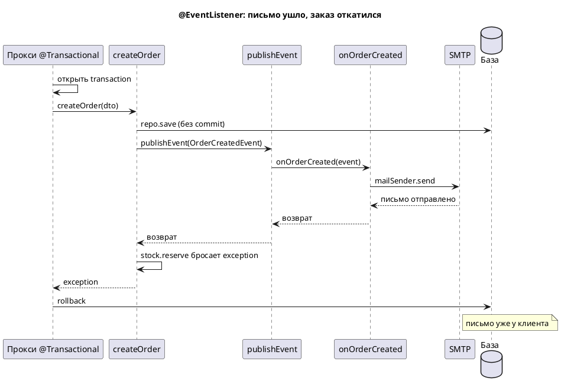

# Listener и transaction: императивный и реактивный стек

> Продолжение [Observer и Listener — паттерны в Java и Spring](Observer%20и%20Listener%20-%20паттерны%20в%20Java%20и%20Spring.md).

Метод `createOrder` открывает **transaction**, сохраняет заказ и публикует `OrderCreatedEvent`.

Метод **listener** получает этот **event** и отправляет клиенту письмо.

Документ отвечает на два вопроса:

1. Работает ли метод **listener** внутри **transaction** метода `createOrder`.
2. Что происходит с заказом и письмом, если где-то возникла ошибка.

Сначала описано, как это устроено. Пример с заказом и ошибками идёт в разделе 3.

## Коротко

### Императивный стек

Метод с обычным `@EventListener` Spring вызывает сразу, внутри `publishEvent`.

Вызов идёт в том же потоке, в котором работает `createOrder`. Commit заказа к этому моменту ещё не выполнен.

Spring хранит **transaction** метода `createOrder` в `ThreadLocal` этого потока. `ThreadLocal` — хранилище, из которого код получает значение, привязанное к текущему потоку.

Поэтому метод **listener** работает в **transaction** метода `createOrder`. Его запись в базу попадёт в тот же commit, что и заказ.

Передавать объект **transaction** в `publishEvent` или полем в `OrderCreatedEvent` не нужно. В `OrderCreatedEvent` передают только данные для письма, например id заказа и адрес.

### `@TransactionalEventListener`

`@TransactionalEventListener` — это тот же **listener**, а не замена ему.

На объявлении аннотации `@TransactionalEventListener` стоит `@EventListener`. Поэтому `EventListenerMethodProcessor` находит такой метод и регистрирует его в **multicaster** так же, как метод с `@EventListener`.

Отличается только момент вызова.

Когда `createOrder` вызывает `publishEvent`, Spring не вызывает метод **listener**.

Вместо этого Spring прикрепляет к **transaction** метода `createOrder` объект, который вызовет метод **listener** позже. Как устроен этот объект — в разделе [Как Spring откладывает вызов метода listener](#как-spring-откладывает-вызов-метода-listener).

Момент вызова задаёт атрибут `phase` аннотации `@TransactionalEventListener`. По умолчанию это `AFTER_COMMIT`: метод **listener** вызывается после успешного commit заказа.

Если в момент `publishEvent` **transaction** нет, метод **listener** не вызывается. Это поведение меняет атрибут `fallbackExecution = true`.

### Реактивный стек

В WebFlux **transaction** хранится не в `ThreadLocal`, а в Reactor Context цепочки `Mono`.

`publishEvent` — обычный метод. Он возвращает `void` и Reactor Context не читает.

Поэтому метод **listener** сам не получает **transaction** метода `createOrder`. Дальше возможны два варианта.

**Вариант 1.** Обычный **event**.

Метод **listener** не получает **transaction** метода `createOrder`. Данные для письма передают полями `OrderCreated`: id заказа и адрес.

**Вариант 2.** Транзакционный **event**, с Spring 6.1.

`TransactionalEventPublisher` достаёт `TransactionContext` из Reactor Context и передаёт его в **event** как source. `TransactionContext` — объект, который описывает текущую реактивную **transaction**.

По этому source метод с `@TransactionalEventListener` привязывается к **transaction** метода `createOrder` и вызывается после её commit.

### Что будет с заказом при ошибке письма

Ответ зависит от того, когда Spring вызывает метод **listener**.

С обычным `@EventListener` **exception** письма доходит до `createOrder`, и **transaction** метода `createOrder` откатывается. Заказа в базе нет.

С `@TransactionalEventListener` в фазе `AFTER_COMMIT` метод **listener** вызывается после commit. Заказ уже в базе, а **exception** письма Spring только пишет в лог.

## Оглавление

1. [Императивный стек](#1-императивный-стек)
    - [Как Spring откладывает вызов метода listener](#как-spring-откладывает-вызов-метода-listener)
    - [Exception из @EventListener](#exception-из-eventlistener)
2. [Реактивный стек: два варианта](#2-реактивный-стек-два-варианта)
    - [Контекст не передаётся](#контекст-не-передаётся)
    - [Контекст передаётся через source](#контекст-передаётся-через-source)
3. [Заказ и письмо](#3-заказ-и-письмо)
    - [Письмо упало: заказ откатился](#письмо-упало-заказ-откатился)
    - [Письмо ушло, а заказ не создан](#письмо-ушло-а-заказ-не-создан)
    - [Письмо после commit](#письмо-после-commit)
    - [Письмо упало после commit](#письмо-упало-после-commit)
    - [Тот же заказ в WebFlux](#тот-же-заказ-в-webflux)
4. [Другие фазы](#4-другие-фазы)
    - [BEFORE_COMMIT](#before_commit)
    - [Чем AFTER_COMMIT отличается от BEFORE_COMMIT](#чем-after_commit-отличается-от-before_commit)
    - [AFTER_ROLLBACK](#after_rollback)
    - [AFTER_COMPLETION](#after_completion)
5. [Сводка](#5-сводка)
6. [Источники](#6-источники)

---

## 1. Императивный стек

**transaction** Spring привязана к потоку.

Метод с `@EventListener` выполняется в потоке **publisher**. Поэтому он работает внутри **transaction** метода `createOrder`.

К моменту вызова метода **listener** `repo.save` уже добавил заказ в **transaction**, а commit ещё не выполнен. Запись метода **listener** в базу попадёт в этот же commit.

Метод с `@TransactionalEventListener` тоже работает с **transaction** метода `createOrder`. Но Spring вызывает его не сразу, а в фазе из атрибута `phase`.

Фазы: `BEFORE_COMMIT`, `AFTER_COMMIT` (по умолчанию), `AFTER_ROLLBACK`, `AFTER_COMPLETION`. Они разобраны в разделах 3 и 4.

**Источник:** [TransactionalEventListener.java, Spring Framework 6.2.11](https://github.com/spring-projects/spring-framework/blob/v6.2.11/spring-tx/src/main/java/org/springframework/transaction/event/TransactionalEventListener.java) · [EventListenerMethodProcessor.java](https://github.com/spring-projects/spring-framework/blob/v6.2.11/spring-context/src/main/java/org/springframework/context/event/EventListenerMethodProcessor.java)

> **EN:** «An EventListener that is invoked according to a TransactionPhase.» / `@EventListener public @interface TransactionalEventListener` / `AnnotatedElementUtils.findMergedAnnotation(method, EventListener.class)`

> **RU:** «Это `@EventListener`, который вызывается в фазе **transaction**.» / «На объявлении `@TransactionalEventListener` стоит аннотация `@EventListener`.» / «`EventListenerMethodProcessor` ищет на методе `@EventListener`, в том числе если `@EventListener` стоит на другой аннотации. Поэтому метод с `@TransactionalEventListener` он тоже находит.»

**Источник:** [Spring Framework Reference — Transaction-bound Events](https://docs.spring.io/spring-framework/reference/data-access/transaction/event.html)

> **EN:** «For the former, listeners are guaranteed to see the current thread-bound transaction.» / «If no transaction is running, the listener is not invoked at all … You can, however, override that behavior by setting the `fallbackExecution` attribute of the annotation to `true`.»

> **RU:** «Для **transaction**, привязанной к потоку, **listener** гарантированно видит текущую **transaction**.» / «Если **transaction** нет, **listener** не вызывается вообще … Это поведение меняет атрибут `fallbackExecution = true`.»

**Источник:** [Spring Framework Reference — Application Events](https://docs.spring.io/spring-framework/reference/core/beans/context-introduction.html#context-functionality-events)

> **EN:** «By default, this is a SimpleApplicationEventMulticaster with synchronous event publication in the caller thread.»

> **RU:** «По умолчанию это `SimpleApplicationEventMulticaster` с синхронной публикацией **event** в потоке вызывающего кода.»

### Как Spring откладывает вызов метода listener

Сначала два понятия.

`TransactionSynchronization` — интерфейс Spring с методами, которые Spring вызывает при завершении **transaction**. Метод `beforeCommit` вызывается перед commit. Метод `afterCompletion` вызывается после commit или после rollback.

`PlatformSynchronization` — класс Spring, который реализует `TransactionSynchronization`. Он вложен в класс `TransactionalApplicationListenerSynchronization`. Его объект хранит опубликованный **event** и ссылку на метод **listener**.

Теперь по шагам, на примере метода `onOrderCreated` с `@TransactionalEventListener`.

1. `createOrder` вызывает `publishEvent(new OrderCreatedEvent(...))`.
2. Spring видит на методе `onOrderCreated` аннотацию `@TransactionalEventListener` и не вызывает этот метод.
3. Spring создаёт объект `PlatformSynchronization`. В него Spring кладёт опубликованный `OrderCreatedEvent` и ссылку на метод `onOrderCreated`.
4. Spring регистрирует объект `PlatformSynchronization` в **transaction** метода `createOrder`. Регистрация значит: когда эта **transaction** будет завершаться, Spring вызовет у объекта `beforeCommit` и `afterCompletion`.
5. `createOrder` завершает работу. Прокси `@Transactional` начинает завершать **transaction** метода `createOrder`.
6. Прокси вызывает у объекта `PlatformSynchronization` метод `beforeCommit`, затем выполняет commit или rollback, затем вызывает метод `afterCompletion`.
7. Внутри `beforeCommit` и `afterCompletion` объект `PlatformSynchronization` сравнивает текущий момент с атрибутом `phase` метода `onOrderCreated`. Если момент совпал, объект вызывает `onOrderCreated` и передаёт ему сохранённый `OrderCreatedEvent`.

**Источник:** [Spring Framework, исходный код — `TransactionalApplicationListenerSynchronization` (v6.2.11)](https://github.com/spring-projects/spring-framework/blob/v6.2.11/spring-tx/src/main/java/org/springframework/transaction/event/TransactionalApplicationListenerSynchronization.java)

> **EN:** `TransactionSynchronizationManager.registerSynchronization(new PlatformSynchronization<>(event, listener, callbacks));` / `public void afterCompletion(int status) { … if (phase == TransactionPhase.AFTER_COMMIT && status == STATUS_COMMITTED) { processEventWithCallbacks(); }`

> **RU:** «Spring регистрирует в текущей **transaction** объект `PlatformSynchronization`, в котором хранятся **event** и **listener**.» / «В методе `afterCompletion`: если у метода **listener** фаза `AFTER_COMMIT` и **transaction** зафиксирована, объект вызывает метод **listener**.»

### Exception из @EventListener

`RuntimeException` из метода с обычным `@EventListener` выходит в `createOrder` без изменений.

Проверяемое **exception** Spring оборачивает в `UndeclaredThrowableException`. Это тоже `RuntimeException`, поэтому прокси `@Transactional` делает rollback и в этом случае.

**Источник:** [Spring Framework, исходный код — `ApplicationListenerMethodAdapter.doInvoke`](https://github.com/spring-projects/spring-framework/blob/v6.2.11/spring-context/src/main/java/org/springframework/context/event/ApplicationListenerMethodAdapter.java)

> **EN:** `if (targetException instanceof RuntimeException runtimeException) { throw runtimeException; } else { throw new UndeclaredThrowableException(targetException, msg); }`

> **RU:** «Если метод **listener** бросил `RuntimeException`, Spring пробрасывает его дальше. Любое другое **exception** Spring оборачивает в `UndeclaredThrowableException`.»

---

## 2. Реактивный стек: два варианта

`publishEvent` — обычный вызов метода. Он не читает Reactor Context и не возвращает `Mono`.

Поэтому реактивная **transaction** метода `createOrder` до метода **listener** сама не доходит.

С версии 6.1 метод с `@TransactionalEventListener` работает и с реактивной **transaction**. Условие одно: `TransactionContext` должен быть передан в **event** как source.

**Источник:** [Spring Framework Reference — Transaction-bound Events](https://docs.spring.io/spring-framework/reference/data-access/transaction/event.html)

> **EN:** «As of 6.1, `@TransactionalEventListener` can work with thread-bound transactions managed by `PlatformTransactionManager` as well as reactive transactions managed by `ReactiveTransactionManager`. … Since the latter uses the Reactor context instead of thread-local variables, the transaction context needs to be included in the published event instance as the event source.»

> **RU:** «С версии 6.1 `@TransactionalEventListener` работает и с **transaction**, привязанными к потоку (`PlatformTransactionManager`), и с реактивными **transaction** (`ReactiveTransactionManager`). … Реактивные **transaction** хранятся в Reactor Context, а не в thread-local, поэтому контекст **transaction** нужно передать в публикуемый **event** как его source.»

### Контекст не передаётся

**publisher** вызывает `publisher.publishEvent(new OrderCreated(id, email))` внутри `Mono`, например из `doOnNext` или из `Mono.fromRunnable`.

Spring сразу вызывает метод с `@EventListener`, обычным вызовом метода.

Reactor Context цепочки `createOrder` в этот вызов не передаётся. Метод **listener** не получает ни **transaction**, ни данные security.

Id заказа и адрес почты передают полями `OrderCreated`.

### Контекст передаётся через source

`TransactionalEventPublisher` — класс Spring из пакета `org.springframework.transaction.reactive`, появился в Spring 6.1.

`TransactionalEventPublisher` читает `TransactionContext` из Reactor Context и публикует **event**, у которого source — этот `TransactionContext`.

- Метод `publishEvent(Object payload)` возвращает `Mono<Void>`, поэтому его ставят в цепочку через `flatMap`.
- Пока на этот `Mono<Void>` никто не подписался, **event** не публикуется.

Метод с `@TransactionalEventListener` и здесь тот же **listener**: на аннотации стоит `@EventListener`, и метод регистрирует `EventListenerMethodProcessor`.

Source нужен, чтобы Spring нашёл реактивную **transaction** метода `createOrder` и вызвал метод **listener** после её commit, а не в момент `publishEvent`.

**Источник:** [Javadoc — `TransactionalEventPublisher`](https://docs.spring.io/spring-framework/docs/current/javadoc-api/org/springframework/transaction/reactive/TransactionalEventPublisher.html)

> **EN:** «A delegate for publishing transactional events in a reactive setup. Includes the current Reactor-managed `TransactionContext` as a source object for every `ApplicationEvent` to be published.»

> **RU:** «Делегат для публикации транзакционных **events** в реактивном приложении. Передаёт текущий `TransactionContext` как source в каждый публикуемый `ApplicationEvent`.»

---

## 3. Заказ и письмо

Ниже заказ в императивном стеке.

- `createOrder` открывает **transaction**, сохраняет заказ, публикует **event** и после этого резервирует товар.
- Метод **listener** `onOrderCreated` отправляет письмо.

```java

@Service
public class OrderService {

    private final OrderRepository repo;
    private final StockService stock;
    private final ApplicationEventPublisher publisher;

    @Transactional
    public void createOrder(OrderDto dto) {
        Order order = repo.save(new Order(dto));
        publisher.publishEvent(new OrderCreatedEvent(order.getId(), dto.email()));
        stock.reserve(dto.items());
    }
}

@Component
public class OrderMailListener {

    @EventListener
    public void onOrderCreated(OrderCreatedEvent event) {
        mailSender.send(event.email(), "Заказ создан");
    }
}

```

Шаги одного успешного вызова.

1. Прокси `@Transactional` открывает **transaction** и вызывает `createOrder`.
2. `repo.save` добавляет заказ в **transaction**. Commit ещё не выполнен.
3. `publishEvent` сразу вызывает `onOrderCreated` в этом же потоке. Письмо уходит, пока заказ не зафиксирован.
4. `createOrder` продолжает работу и вызывает `stock.reserve`.
5. `createOrder` завершается, прокси выполняет commit.

### Письмо упало: заказ откатился

`mailSender.send` бросает **exception**.

**exception** выходит из `onOrderCreated`, затем из `publishEvent`, затем из `createOrder`.

Прокси `@Transactional` получает `RuntimeException` и делает rollback. Заказа в базе нет, хотя ошибка была только в почте.

Если `onOrderCreated` сам ловит **exception** через `try/catch`, прокси выполняет commit. Заказ сохранён, письмо потеряно.

### Письмо ушло, а заказ не создан

Письмо уже отправлено на шаге 3. После этого **transaction** метода `createOrder` откатывается.

Причины, например:

- `stock.reserve` бросил **exception**;
- commit упал на ограничении базы.

Rollback отменяет только записи в базе. SMTP-сервер в **transaction** не участвует, и отправленное письмо вернуть нельзя.

Клиент получил письмо о заказе, которого нет.



Что происходит на диаграмме.

1. `repo.save` добавляет заказ в **transaction**. Commit ещё не выполнен.
2. `publishEvent` сразу вызывает `onOrderCreated`, и письмо уходит на SMTP-сервер.
3. После возврата из `publishEvent` метод `stock.reserve` бросает **exception**.
4. Прокси `@Transactional` делает rollback. Заказа в базе нет.
5. Rollback письмо не затрагивает.

Чтобы письмо уходило только после commit, на метод `onOrderCreated` ставят `@TransactionalEventListener` вместо `@EventListener`.

Метод `onOrderCreated` остаётся **listener**: на `@TransactionalEventListener` стоит `@EventListener`.

### Письмо после commit

`OrderService` не меняется. Меняется только аннотация на методе `onOrderCreated`.

```java

@Component
public class OrderMailListener {

    @TransactionalEventListener
    public void onOrderCreated(OrderCreatedEvent event) {
        mailSender.send(event.email(), "Заказ создан");
    }
}

```

Класс `OrderMailListener` по-прежнему **listener**. `EventListenerMethodProcessor` регистрирует тот же метод `onOrderCreated`.

Отличие одно. Во время `publishEvent` Spring не вызывает `onOrderCreated`, а вызывает его после commit.

1. `publishEvent` не вызывает `onOrderCreated`.
2. Spring регистрирует в **transaction** метода `createOrder` объект `PlatformSynchronization` с `OrderCreatedEvent` и ссылкой на `onOrderCreated`. Как это устроено — в разделе [Как Spring откладывает вызов метода listener](#как-spring-откладывает-вызов-метода-listener).
3. `createOrder` завершает работу. Прокси выполняет commit.
4. После commit прокси вызывает у объекта `PlatformSynchronization` метод `afterCompletion(STATUS_COMMITTED)`. Этот метод вызывает `onOrderCreated`.
5. Если вместо commit был rollback, `onOrderCreated` не вызывается. Письмо о несуществующем заказе не уходит.

**Ответ клиенту и @Async.**

Это про время ответа, не про базу.

`onOrderCreated` выполняется в том же потоке, до возврата из прокси `@Transactional` метода `createOrder`.

Пока `mailSender.send` не закончится, прокси не вернёт управление вызывающему коду. Клиент ждёт не только commit заказа, но и ответ SMTP-сервера.

Чтобы отправка письма не задерживала ответ, на метод `onOrderCreated` дополнительно ставят `@Async`. Тогда Spring вызовет `onOrderCreated` в другом потоке, и прокси вернёт ответ, не дожидаясь SMTP.

`@Async` не открывает **transaction** и не сохраняет данные в базу.

**Если вместо письма метод пишет в базу.**

Код выше вызывает `mailSender.send`. Это действие вне базы.

Если вместо письма `onOrderCreated` вызывает, например, `auditRepository.save(...)`, запись идёт не в новую **transaction**.

Spring вызывает `onOrderCreated` из `afterCompletion`. К этому моменту **transaction** метода `createOrder` уже зафиксирована.

Соединение с базой у этой **transaction** ещё может быть открыто. Поэтому `auditRepository.save(...)` присоединяется к ней, как к текущей.

Commit этой **transaction** уже выполнен. Второго commit у неё не будет. Запись аудита останется только в памяти сессии и в базу не попадёт.

Чтобы такая запись сохранилась, метод `onOrderCreated` помечают `@Transactional(propagation = Propagation.REQUIRES_NEW)`. Тогда у `onOrderCreated` своя **transaction** и свой commit, независимый от **transaction** метода `createOrder`.

**Источник:** [Javadoc — `TransactionSynchronization.afterCompletion`](https://docs.spring.io/spring-framework/docs/current/javadoc-api/org/springframework/transaction/support/TransactionSynchronization.html#afterCompletion(int))

> **EN:** «The transaction will have been committed or rolled back already, but the transactional resources might still be active and accessible. … Hence: Use `PROPAGATION_REQUIRES_NEW` for any transactional operation that is called from here.»

> **RU:** «**transaction** уже зафиксирована или откачена, но её ресурсы ещё могут быть открыты. … Поэтому любую транзакционную операцию, которую вызывают отсюда, помечают `PROPAGATION_REQUIRES_NEW`.»

### Письмо упало после commit

`mailSender.send` бросает **exception** внутри `afterCompletion`.

Spring пишет это **exception** в лог и в `createOrder` не передаёт.

Заказ в базе остаётся. Вызывающий код о потерянном письме не узнаёт.

Поэтому **exception** письма ловят в самом методе `onOrderCreated`: пишут в лог и планируют повторную отправку.

Для гарантированной доставки используют таблицу Outbox. В той же **transaction**, что и заказ, в неё записывают поручение отправить письмо. Письмо отправляет отдельный процесс. Подробно — [Фазы и Outbox](фазы%20TransactionalEventListener%20и%20Outbox.md#4-outbox).

**Источник:** [Javadoc — `TransactionSynchronization.afterCompletion`](https://docs.spring.io/spring-framework/docs/current/javadoc-api/org/springframework/transaction/support/TransactionSynchronization.html#afterCompletion(int))

> **EN:** «Throws: RuntimeException - in case of errors; will be logged but not propagated»

> **RU:** «`RuntimeException` из `afterCompletion` записывается в лог и дальше не передаётся.»

### Тот же заказ в WebFlux

**Вариант 1.** Контекст не передаётся.

Метод с `@EventListener` вызывается до commit, как в императивном коде выше.

- Если метод **listener** возвращает `void` и бросает **exception**, заказ откатывается.
- Если метод **listener** возвращает `Mono<Void>`, **exception** письма в цепочку `createOrder` не попадает.

Разбор этих двух случаев — в [Публикация event в WebFlux](Observer%20и%20Listener%20-%20паттерны%20в%20Java%20и%20Spring.md#публикация-event-в-webflux).

```java

@Transactional
public Mono<Void> createOrder(OrderDto dto) {
    return repo.save(new Order(dto))
        .doOnNext(order -> publisher.publishEvent(
            new OrderCreated(order.getId(), dto.email())))
        .flatMap(order -> stock.reserve(dto.items()));
}

```

Письмо здесь тоже может уйти раньше, чем упадёт `stock.reserve`. Rollback заказа письмо не отменит.

**Вариант 2.** Контекст передаётся.

`TransactionalEventPublisher` передаёт `TransactionContext` в **event** как source. Письмо уходит только после commit.

```java

@Transactional
public Mono<Void> createOrder(OrderDto dto) {
    return repo.save(new Order(dto))
        .flatMap(order -> transactionalPublisher.publishEvent(
            new OrderCreated(order.getId(), dto.email())))
        .then(stock.reserve(dto.items()));
}

```

`OrderCreated` здесь — обычный объект, не наследник `ApplicationEvent`.

`publishEvent(Object)` сам оборачивает `OrderCreated` в `PayloadApplicationEvent` и передаёт `TransactionContext` как source.

Если **event** уже наследует `ApplicationEvent`, используют второй метод: `publishEvent(ctx -> new OrderCreatedEvent(ctx, id))`.

Метод **listener** — тот же метод с `@TransactionalEventListener`, как в императивном примере с `AFTER_COMMIT`.

- Если `stock.reserve` завершится `onError`, Spring сделает rollback, и письмо не отправится.
- Если письмо упало после commit, **exception** пишется в лог и в цепочку `createOrder` не попадает.

**Источник:** [Spring Framework, исходный код — реактивный `TransactionSynchronizationUtils`](https://github.com/spring-projects/spring-framework/blob/v6.2.11/spring-tx/src/main/java/org/springframework/transaction/reactive/TransactionSynchronizationUtils.java)

> **EN:** `.onErrorContinue((t, o) -> logger.error("TransactionSynchronization.afterCompletion threw exception", t))`

> **RU:** «Ошибку `afterCompletion` Spring пишет в лог и продолжает работу.»

---

## 4. Другие фазы

В разделе 3 письмо уходит после commit. Причина: на методе `onOrderCreated` стоит `@TransactionalEventListener` без атрибута `phase`, а по умолчанию фаза — `AFTER_COMMIT`.

Фаза — момент, когда Spring вызывает метод **listener** относительно **transaction** метода `createOrder`.

Фазу задают атрибутом `phase` на той же аннотации:

```java

@TransactionalEventListener(phase = TransactionPhase.BEFORE_COMMIT)

```

Класс `OrderMailListener` и метод `onOrderCreated` остаются **listener**. Меняется только момент вызова.

Всего четыре фазы: `BEFORE_COMMIT`, `AFTER_COMMIT`, `AFTER_ROLLBACK` и `AFTER_COMPLETION`. `AFTER_COMMIT` разобрана в разделе 3, ниже — остальные три.

**Источник:** [Spring Framework Reference — Transaction-bound Events](https://docs.spring.io/spring-framework/reference/data-access/transaction/event.html)

> **EN:** «The valid phases are `BEFORE_COMMIT`, `AFTER_COMMIT` (default), `AFTER_ROLLBACK`, as well as `AFTER_COMPLETION` which aggregates the transaction completion (be it a commit or a rollback).»

> **RU:** «Допустимые фазы: `BEFORE_COMMIT`, `AFTER_COMMIT` (по умолчанию), `AFTER_ROLLBACK` и `AFTER_COMPLETION`. Последняя срабатывает при любом завершении **transaction**: и при commit, и при rollback.»

### BEFORE_COMMIT

Spring вызывает метод **listener** из `beforeCommit`.

К этому моменту `createOrder` уже завершился без **exception**, а commit в базе ещё не выполнен.

Название `BEFORE_COMMIT` значит «до commit **transaction** метода `createOrder`». Оно не значит, что метод **listener** делает свой commit раньше заказа.

**Если метод listener бросает exception.**

**exception** доходит до прокси `@Transactional` метода `createOrder`.

Прокси вместо commit делает rollback. Заказа в базе нет.

**Если метод listener пишет в базу**, например сохраняет строку Outbox.

Метод **listener** выполняется в том же потоке, пока **transaction** метода `createOrder` ещё открыта.

`outboxRepository.save(...)` по умолчанию работает с `Propagation.REQUIRED`. Если **transaction** уже открыта, вызов присоединяется к ней, а не открывает новую.

То, что метод **listener** объявлен в другом классе, отдельной **transaction** не создаёт.

Поэтому своего commit у метода **listener** нет. Заказ и строка Outbox фиксируются одним commit. Если этот commit упал, rollback отменяет обе записи.

**Если на методе listener стоит `@Transactional(propagation = Propagation.REQUIRES_NEW)`.**

У метода **listener** появляется своя **transaction** и свой commit.

Этот commit выполняется раньше commit заказа. Rollback заказа его уже не отменяет.

Разбор обоих случаев с диаграммами — [Фазы и Outbox](фазы%20TransactionalEventListener%20и%20Outbox.md#3-спор-про-before_commit).

**Почему письмо в этой фазе не отправляют.**

Метод **listener** отправит письмо до commit заказа.

Если commit потом не состоится, rollback отменит заказ, но не письмо. Клиент получит письмо о заказе, которого нет.

**Источник:** [Javadoc — `TransactionSynchronization.beforeCommit`](https://docs.spring.io/spring-framework/docs/current/javadoc-api/org/springframework/transaction/support/TransactionSynchronization.html#beforeCommit(boolean))

> **EN:** «This callback does not mean that the transaction will actually be committed. A rollback decision can still occur after this method has been called.» / «Note that exceptions will get propagated to the commit caller and cause a rollback of the transaction.»

> **RU:** «Этот вызов не означает, что **transaction** действительно будет зафиксирована. Решение о rollback ещё может быть принято после возврата из метода.» / «**exception** передаётся коду, который начал commit, и вызывает rollback **transaction**.»

**Источник:** [Spring Framework Reference — Transaction Propagation](https://docs.spring.io/spring-framework/reference/data-access/transaction/declarative/tx-propagation.html)

> **EN:** «`PROPAGATION_REQUIRED` enforces a physical transaction, either locally for the current scope if no transaction exists yet or participating in an existing 'outer' transaction defined for a larger scope.»

> **RU:** «`PROPAGATION_REQUIRED` обеспечивает физическую **transaction**: создаёт её, если **transaction** ещё нет, или участвует в уже открытой внешней **transaction**.»

### Чем AFTER_COMMIT отличается от BEFORE_COMMIT

Эти фазы не конкурируют. Они нужны для разных задач.

**AFTER_COMMIT — для действий вне базы.**

Примеры: письмо, HTTP-запрос, сообщение в брокер, сброс кэша.

Rollback базы такое действие не отменит. Поэтому выполнять его можно только тогда, когда заказ точно сохранён.

`AFTER_COMMIT` это гарантирует: Spring вызывает метод **listener** только после успешного commit заказа.

**BEFORE_COMMIT — для записи в ту же базу.**

Примеры: строка Outbox, запись аудита.

Такая запись должна сохраниться одним commit вместе с заказом или отмениться вместе с ним.

`BEFORE_COMMIT` это даёт: запись метода **listener** входит в **transaction** метода `createOrder`.

**Почему запись в базу из AFTER_COMMIT не подходит.**

Когда Spring вызывает метод **listener** в фазе `AFTER_COMMIT`, commit заказа уже выполнен. Запись метода **listener** в этот commit не входит.

Без `REQUIRES_NEW` запись не сохранится: у неё нет своего commit.

С `REQUIRES_NEW` запись сохранится вторым, отдельным commit. Если процесс упадёт между commit заказа и вторым commit, заказ в базе будет, а строки Outbox — нет.

**Как фазы сочетают.**

Строку Outbox пишут в фазе `BEFORE_COMMIT`. Письмо отправляет worker после commit, по строкам Outbox.

### AFTER_ROLLBACK

Spring вызывает метод **listener** из `afterCompletion`, и только если вместо commit был rollback.

Если заказ сохранился, метод **listener** не вызывается.

Фаза нужна для действия, которое имеет смысл только при неудаче. Например, записать в лог, что заказ не создан, или уведомить поддержку.

**exception** метода **listener** Spring пишет в лог и в `createOrder` не передаёт.

### AFTER_COMPLETION

Spring вызывает метод **listener** из `afterCompletion` в обоих случаях: и после commit, и после rollback.

Фаза нужна для действия, которое должно произойти при любом завершении **transaction**. Например, снять временную блокировку, которая держалась на время **transaction**.

**exception** метода **listener** Spring пишет в лог и в `createOrder` не передаёт.

---

## 5. Сводка

| **listener** | **transaction** метода `createOrder` | Когда вызывается | Письмо упало | Письмо ушло, заказ откатился |
| :-- | :-- | :-- | :-- | :-- |
| `@EventListener`, императивный | Видит сам: она в потоке | Сразу, до commit | Rollback заказа | Возможно |
| `@TransactionalEventListener`, `AFTER_COMMIT` | Видит и ждёт фазу | После commit | Заказ сохранён, **exception** в логе | Невозможно |
| `@TransactionalEventListener`, `BEFORE_COMMIT` | Видит и ждёт фазу | Перед commit | Rollback заказа | Возможно |
| WebFlux, обычный `publishEvent` | Не видит: Reactor Context не передан | Сразу, до commit | Зависит от `void` или `Mono` | Возможно |
| WebFlux, `TransactionalEventPublisher` | Видит: `TransactionContext` в source **event** | После commit | Заказ сохранён, **exception** в логе | Невозможно |

Строки с `@TransactionalEventListener` описывают тот же **listener**, что и строка с `@EventListener`. Отличается только момент вызова.

Ошибка отправки письма не должна откатывать заказ. Поэтому для письма выбирают `AFTER_COMMIT`.

Чтобы письмо не потерялось, используют повторную отправку или таблицу Outbox.

---

## 6. Источники

- [Spring Framework Reference — Transaction-bound Events](https://docs.spring.io/spring-framework/reference/data-access/transaction/event.html)
- [Spring Framework Reference — Transaction Propagation](https://docs.spring.io/spring-framework/reference/data-access/transaction/declarative/tx-propagation.html)
- [Spring Framework Reference — Application Events](https://docs.spring.io/spring-framework/reference/core/beans/context-introduction.html#context-functionality-events)
- [Javadoc — `TransactionSynchronization`](https://docs.spring.io/spring-framework/docs/current/javadoc-api/org/springframework/transaction/support/TransactionSynchronization.html)
- [Javadoc — `TransactionalEventPublisher`](https://docs.spring.io/spring-framework/docs/current/javadoc-api/org/springframework/transaction/reactive/TransactionalEventPublisher.html)
- [Исходный код — `TransactionalEventListener` (v6.2.11)](https://github.com/spring-projects/spring-framework/blob/v6.2.11/spring-tx/src/main/java/org/springframework/transaction/event/TransactionalEventListener.java)
- [Исходный код — `EventListenerMethodProcessor` (v6.2.11)](https://github.com/spring-projects/spring-framework/blob/v6.2.11/spring-context/src/main/java/org/springframework/context/event/EventListenerMethodProcessor.java)
- [Исходный код — `ApplicationListenerMethodAdapter` (v6.2.11)](https://github.com/spring-projects/spring-framework/blob/v6.2.11/spring-context/src/main/java/org/springframework/context/event/ApplicationListenerMethodAdapter.java)
- [Исходный код — `TransactionalApplicationListenerSynchronization` (v6.2.11)](https://github.com/spring-projects/spring-framework/blob/v6.2.11/spring-tx/src/main/java/org/springframework/transaction/event/TransactionalApplicationListenerSynchronization.java)
- [Исходный код — реактивный `TransactionSynchronizationUtils` (v6.2.11)](https://github.com/spring-projects/spring-framework/blob/v6.2.11/spring-tx/src/main/java/org/springframework/transaction/reactive/TransactionSynchronizationUtils.java)
