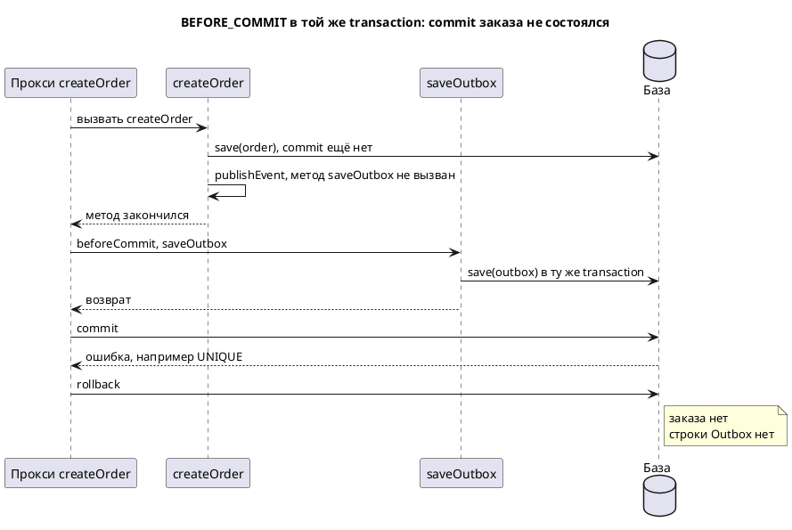
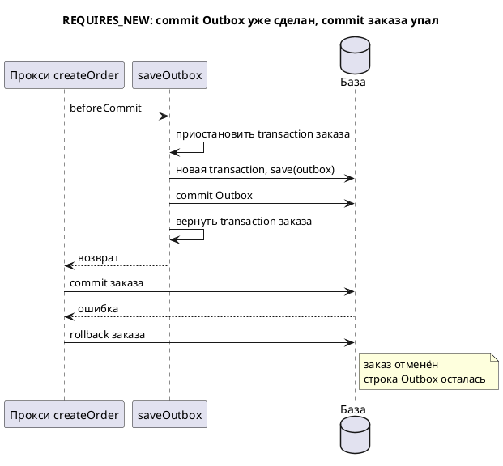
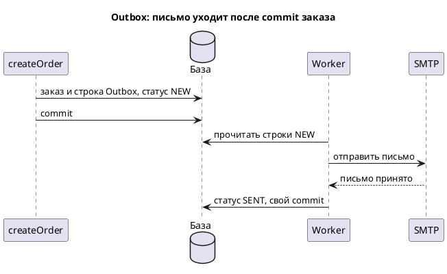

# Фазы `@TransactionalEventListener` и Outbox

> Продолжение [Listener и transaction](listener%20in%20imperative%20and%20reactive.md).  
> Разбор дискуссии из [diskusss.md](diskusss.md): фазы **listener**, `fallbackExecution` и таблица Outbox.

Документ разбирает три темы:

1. Четыре фазы `@TransactionalEventListener`: когда Spring вызывает метод **listener** и для чего нужна каждая фаза.
2. Спор из дискуссии: откатывается ли запись метода **listener** в фазе `BEFORE_COMMIT`, если commit заказа упал.
3. Таблица Outbox: как не потерять письмо, если отправка упала после commit заказа.

Сквозной пример.

Метод `createOrder` с `@Transactional` сохраняет заказ и вызывает `publishEvent(new OrderCreatedEvent(...))`.

На `OrderCreatedEvent` реагирует метод **listener**. В одних примерах это `saveOutbox`, который записывает строку Outbox. В других — метод, который отправляет письмо.

## Коротко

### Что такое @TransactionalEventListener

`@TransactionalEventListener` — это тот же **listener**.

На объявлении аннотации `@TransactionalEventListener` стоит `@EventListener`. Поэтому `EventListenerMethodProcessor` регистрирует такой метод так же, как метод с `@EventListener`.

Отличается только момент вызова.

### Как Spring откладывает вызов

Когда `createOrder` вызывает `publishEvent`, Spring не вызывает метод **listener**.

Вместо этого Spring создаёт объект `PlatformSynchronization` и регистрирует его в **transaction** метода `createOrder`.

`PlatformSynchronization` — класс Spring, который реализует интерфейс `TransactionSynchronization`. Интерфейс `TransactionSynchronization` содержит методы, которые Spring вызывает при завершении **transaction**: `beforeCommit` перед commit и `afterCompletion` после commit или rollback.

В объекте `PlatformSynchronization` хранятся опубликованный `OrderCreatedEvent` и ссылка на метод **listener**.

Когда **transaction** метода `createOrder` завершается, Spring вызывает у объекта `PlatformSynchronization` методы `beforeCommit` и `afterCompletion`.

Объект `PlatformSynchronization` сравнивает текущий момент с атрибутом `phase` метода **listener**. Если момент совпал, объект вызывает метод **listener** и передаёт ему `OrderCreatedEvent`.

Подробно, по шагам — [Как Spring откладывает вызов метода listener](listener%20in%20imperative%20and%20reactive.md#как-spring-откладывает-вызов-метода-listener).

### Четыре фазы

| Фаза | Когда Spring вызывает метод **listener** | Для чего |
| :-- | :-- | :-- |
| `BEFORE_COMMIT` | Из `beforeCommit`, до commit заказа | Запись в базу в **transaction** метода `createOrder`. Например, строка Outbox |
| `AFTER_COMMIT` | Из `afterCompletion`, после успешного commit. Фаза по умолчанию | Действие вне базы, которое нужно, только если заказ сохранён: письмо, обновление кэша |
| `AFTER_ROLLBACK` | Из `afterCompletion`, после rollback | Запись о неудаче: лог, уведомление поддержки |
| `AFTER_COMPLETION` | Из `afterCompletion`, после commit и после rollback | Действие при любом завершении **transaction** |

### Почему письмо не отправляют в BEFORE_COMMIT

Метод **listener** в фазе `BEFORE_COMMIT` отправит письмо до commit заказа.

Commit заказа после этого ещё может не состояться. Rollback отменит заказ, но не отправленное письмо.

### Что такое Outbox

Outbox — таблица в той же базе, что и заказ.

В **transaction** метода `createOrder` вместе с заказом в таблицу Outbox записывается строка с поручением отправить письмо.

Отдельный worker после commit читает строки со статусом `NEW` и отправляет письма.

Если commit заказа не состоялся, строки Outbox тоже нет, и письмо никто не отправит.

### Ответ на спор из дискуссии

Если метод **listener** в фазе `BEFORE_COMMIT` пишет в базу без `REQUIRES_NEW`, своего commit у него нет. Запись входит в **transaction** метода `createOrder`.

Rollback заказа отменяет и эту запись.

Если метод **listener** помечен `@Transactional(propagation = Propagation.REQUIRES_NEW)`, у него своя **transaction** и свой commit.

Этот commit выполняется раньше commit заказа. Ошибка commit заказа его уже не отменяет.

## Оглавление

1. [Когда заканчивается transaction](#1-когда-заканчивается-transaction)
2. [Четыре фазы](#2-четыре-фазы)
    - [BEFORE_COMMIT](#before_commit)
    - [AFTER_COMMIT](#after_commit)
    - [Чем AFTER_COMMIT отличается от BEFORE_COMMIT](#чем-after_commit-отличается-от-before_commit)
    - [AFTER_ROLLBACK](#after_rollback)
    - [AFTER_COMPLETION](#after_completion)
    - [Нет transaction: fallbackExecution](#нет-transaction-fallbackexecution)
3. [Спор про BEFORE_COMMIT](#3-спор-про-before_commit)
    - [Одна transaction](#одна-transaction-отдельного-commit-у-listener-нет)
    - [REQUIRES_NEW](#requires_new-commit-listener-не-откатится)
4. [Outbox](#4-outbox)
    - [Запись вместе с заказом](#запись-вместе-с-заказом)
    - [Почему не AFTER_COMMIT](#почему-не-after_commit)
    - [Worker](#worker)
    - [Повторная отправка](#повторная-отправка)
5. [Сводка](#5-сводка)
6. [Источники](#6-источники)

---

## 1. Когда заканчивается transaction

Прокси `@Transactional` открывает **transaction** при входе в `createOrder`.

Прокси завершает эту **transaction** после выхода из `createOrder`.

`orderRepository.save(order)` не выполняет commit. Вызов только добавляет заказ в **transaction** метода `createOrder`.

JPA может отправить SQL `INSERT` в базу позже, при flush перед commit.

`publisher.publishEvent(...)` тоже не выполняет commit.

По шагам:

1. Прокси открывает **transaction** и вызывает `createOrder`.
2. `orderRepository.save(order)` добавляет заказ в **transaction** метода `createOrder`.
3. `publishEvent` регистрирует в **transaction** метода `createOrder` объект `PlatformSynchronization`. Метод **listener** в этот момент не выполняется.
4. `createOrder` завершается без **exception**.
5. Прокси начинает commit. Сначала Spring вызывает методы **listener** с фазой `BEFORE_COMMIT`. Затем выполняет flush и commit в базе.
6. Если `createOrder` бросает **exception**, прокси делает rollback. Фаза `BEFORE_COMMIT` не наступает, и метод **listener** не вызывается.

---

## 2. Четыре фазы

**Источник:** [Spring Framework Reference — Transaction-bound Events](https://docs.spring.io/spring-framework/reference/data-access/transaction/event.html)

> **EN:** «The valid phases are `BEFORE_COMMIT`, `AFTER_COMMIT` (default), `AFTER_ROLLBACK`, as well as `AFTER_COMPLETION` which aggregates the transaction completion (be it a commit or a rollback).»

> **RU:** «Допустимые фазы: `BEFORE_COMMIT`, `AFTER_COMMIT` (по умолчанию), `AFTER_ROLLBACK` и `AFTER_COMPLETION`. Последняя срабатывает при любом завершении **transaction**: и при commit, и при rollback.»

### BEFORE_COMMIT

```java

@TransactionalEventListener(phase = TransactionPhase.BEFORE_COMMIT)
public void saveOutbox(OrderCreatedEvent event) {
    outboxRepository.save(new OutboxMessage(event.orderId(), event.email(), "NEW"));
}

```

Spring вызывает `saveOutbox` из `beforeCommit`.

К этому моменту `createOrder` уже завершился без **exception**, а commit в базе ещё не выполнен.

Название `BEFORE_COMMIT` значит «до commit **transaction** метода `createOrder`». Оно не значит, что метод `saveOutbox` делает свой commit раньше заказа.

**Если saveOutbox бросает exception.**

**exception** доходит до прокси `createOrder`.

Прокси вместо commit делает rollback. Заказа в базе нет.

**Если saveOutbox пишет в базу.**

Spring вызывает `saveOutbox` в том же потоке, пока **transaction** метода `createOrder` ещё открыта.

`outboxRepository.save(...)` по умолчанию работает с `Propagation.REQUIRED`. Если **transaction** уже открыта, вызов присоединяется к ней, а не открывает новую.

То, что `saveOutbox` объявлен в другом классе, отдельной **transaction** не создаёт.

Поэтому заказ и строка Outbox фиксируются одним commit или вместе отменяются одним rollback.

**Источник:** [Spring Framework Reference — Transaction Propagation](https://docs.spring.io/spring-framework/reference/data-access/transaction/declarative/tx-propagation.html)

> **EN:** «`PROPAGATION_REQUIRED` enforces a physical transaction, either locally for the current scope if no transaction exists yet or participating in an existing 'outer' transaction defined for a larger scope.»

> **RU:** «`PROPAGATION_REQUIRED` обеспечивает физическую **transaction**: создаёт её, если **transaction** ещё нет, или участвует в уже открытой внешней **transaction**.»

**Для чего фаза.**

Для записи в базу, которая должна попасть в **transaction** метода `createOrder`. Пример — строка Outbox без `REQUIRES_NEW`.

Метод в этой фазе вызывается один раз, после того как `createOrder` завершил работу. Поэтому он видит итоговое состояние заказа.

**Для чего фаза не подходит.**

Для письма и HTTP-запроса.

Если commit заказа потом не состоится, rollback не отменит уже отправленное письмо и уже выполненный HTTP-запрос.

**Источник:** [Javadoc — `TransactionSynchronization.beforeCommit`](https://docs.spring.io/spring-framework/docs/current/javadoc-api/org/springframework/transaction/support/TransactionSynchronization.html#beforeCommit(boolean))

> **EN:** «This callback does not mean that the transaction will actually be committed. A rollback decision can still occur after this method has been called. This callback is rather meant to perform work that's only relevant if a commit still has a chance to happen, such as flushing SQL statements to the database.» / «Note that exceptions will get propagated to the commit caller and cause a rollback of the transaction.»

> **RU:** «Этот вызов не означает, что **transaction** действительно будет зафиксирована. Решение о rollback ещё может быть принято после возврата из метода. Вызов предназначен для работы, которая имеет смысл, только пока у commit есть шанс состояться, например для отправки SQL-запросов в базу.» / «**exception** передаётся коду, который начал commit, и вызывает rollback **transaction**.»

### AFTER_COMMIT

Это фаза по умолчанию.

Во время `publishEvent` Spring метод **listener** не вызывает.

Spring вызывает метод **listener** из `afterCompletion(STATUS_COMMITTED)`. К этому моменту commit выполнен, и заказ сохранён в базе.

Если вместо commit был rollback, метод **listener** не вызывается.

**Для чего фаза.**

Для действия вне базы, которое имеет смысл, только если заказ сохранён: отправить письмо, обновить кэш.

**Что с exception.**

**exception** метода **listener** до `createOrder` не доходит. Spring пишет его в лог.

Заказ остаётся в базе.

**Если вместо письма метод пишет в базу.**

Фаза `AFTER_COMMIT` рассчитана на действие вне базы, например на `mailSender.send`.

Если вместо письма метод **listener** вызывает, например, `auditRepository.save(...)`, запись идёт не в новую **transaction**.

Spring вызывает метод **listener** из `afterCompletion`. К этому моменту **transaction** метода `createOrder` уже зафиксирована.

Соединение с базой у этой **transaction** ещё может быть открыто. Поэтому `auditRepository.save(...)` присоединяется к ней, как к текущей.

Commit этой **transaction** уже выполнен. Второго commit у неё не будет. Запись аудита останется только в памяти сессии и в базу не попадёт.

Чтобы такая запись сохранилась, метод **listener** помечают `@Transactional(propagation = Propagation.REQUIRES_NEW)`. Тогда у метода **listener** своя **transaction** и свой commit, независимый от **transaction** метода `createOrder`.

**Где фаза не спасает.**

Если процесс падает после commit заказа, но до вызова метода **listener**, письмо теряется.

Для письма, которое нельзя потерять, одной фазы `AFTER_COMMIT` недостаточно. Используют Outbox.

**Источник:** [Javadoc — `TransactionSynchronization.afterCompletion`](https://docs.spring.io/spring-framework/docs/current/javadoc-api/org/springframework/transaction/support/TransactionSynchronization.html#afterCompletion(int))

> **EN:** «Throws: RuntimeException - in case of errors; will be logged but not propagated» / «any data access code triggered at this point will still "participate" in the original transaction … Use `PROPAGATION_REQUIRES_NEW` for any transactional operation that is called from here.»

> **RU:** «`RuntimeException` записывается в лог и дальше не передаётся.» / «Код доступа к данным в этот момент всё ещё участвует в исходной **transaction**. Для отдельной транзакционной операции здесь используют `PROPAGATION_REQUIRES_NEW`.»

### Чем AFTER_COMMIT отличается от BEFORE_COMMIT

Эти фазы не конкурируют. Они нужны для разных задач.

**AFTER_COMMIT — для действий вне базы.**

Примеры: письмо, HTTP-запрос, сообщение в брокер, сброс кэша.

Rollback базы такое действие не отменит. Поэтому выполнять его можно только тогда, когда заказ точно сохранён.

`AFTER_COMMIT` это гарантирует: Spring вызывает метод **listener** только после успешного commit заказа.

**BEFORE_COMMIT — для записи в ту же базу.**

Примеры: строка Outbox, запись аудита.

Такая запись должна сохраниться одним commit вместе с заказом или отмениться вместе с ним.

`BEFORE_COMMIT` это даёт: запись метода **listener** входит в **transaction** метода `createOrder`.

**Почему запись в базу из AFTER_COMMIT не подходит.**

Когда Spring вызывает метод **listener** в фазе `AFTER_COMMIT`, commit заказа уже выполнен. Запись метода **listener** в этот commit не входит.

Без `REQUIRES_NEW` запись не сохранится: у неё нет своего commit.

С `REQUIRES_NEW` запись сохранится вторым, отдельным commit. Если процесс упадёт между commit заказа и вторым commit, заказ в базе будет, а строки Outbox — нет.

**Как фазы сочетают.**

Строку Outbox пишут в фазе `BEFORE_COMMIT`. Письмо отправляет worker после commit, по строкам Outbox.

### AFTER_ROLLBACK

Spring вызывает метод **listener** только после rollback.

Фаза нужна, чтобы записать факт неудачи или уведомить поддержку.

Rollback уже отменил запись заказа. Удалять заказ из метода **listener** не нужно.

**exception** метода **listener** Spring только пишет в лог.

### AFTER_COMPLETION

Spring вызывает метод **listener** и после commit, и после rollback.

Фаза нужна для действия, которому важен сам факт завершения **transaction**, а не её исход.

**exception** метода **listener** Spring только пишет в лог.

### Нет transaction: fallbackExecution

Метод с `@TransactionalEventListener` регистрируется в **multicaster** при старте приложения, как любой **listener**.

Если в момент вызова `publishEvent` активной **transaction** нет, Spring не вызывает этот метод для опубликованного **event**.

Так бывает, когда метод `createOrder` не помечен `@Transactional`.

Commit не будет, поэтому фаза `AFTER_COMMIT` не наступит. Письмо не уходит, и **exception** при этом нет.

Атрибут `@TransactionalEventListener(fallbackExecution = true)` меняет поведение только в этом случае:

- если **transaction** нет, Spring вызывает метод **listener** сразу, как обычный `@EventListener`;
- если **transaction** есть, метод **listener** по-прежнему ждёт своей фазы.

**Источник:** [Spring Framework Reference — Transaction-bound Events](https://docs.spring.io/spring-framework/reference/data-access/transaction/event.html)

> **EN:** «If no transaction is running, the listener is not invoked at all, since we cannot honor the required semantics. You can, however, override that behavior by setting the `fallbackExecution` attribute of the annotation to `true`.»

> **RU:** «Если **transaction** нет, **listener** не вызывается: требуемую семантику соблюсти нельзя. Атрибут `fallbackExecution = true` это поведение меняет.»

---

## 3. Спор про BEFORE_COMMIT

В дискуссии столкнулись две формулировки.

**Первая.** `saveOutbox` в фазе `BEFORE_COMMIT` уже записал строку Outbox в базу. Значит, это отдельный commit, и ошибка commit заказа его не отменит.

**Вторая**, из конца дискуссии. Ошибка commit заказа откатывает и заказ, и строку Outbox.

Формулировки описывают разные настройки метода `saveOutbox`.

- Вторая верна, когда у `saveOutbox` нет своей **transaction**.
- Первая верна, только когда `saveOutbox` помечен `@Transactional(propagation = Propagation.REQUIRES_NEW)`.

### Одна transaction: отдельного commit у listener нет

У `saveOutbox` нет `@Transactional(REQUIRES_NEW)`.

`outboxRepository.save(...)` присоединяется к **transaction** метода `createOrder`. Это одна физическая **transaction** и одно соединение с базой.

`save` не фиксирует строку Outbox. Commit один, и его выполняет прокси `createOrder` после возврата из `saveOutbox`.



Что происходит на диаграмме.

1. `createOrder` сохраняет заказ и публикует `OrderCreatedEvent`. `saveOutbox` в этот момент не выполняется.
2. `createOrder` завершается без **exception**. Прокси вызывает `saveOutbox` из `beforeCommit`.
3. `outboxRepository.save(...)` добавляет строку Outbox в **transaction** метода `createOrder`. Своего commit у `saveOutbox` нет.
4. Прокси отправляет commit в базу. База отклоняет commit, например из-за ограничения `UNIQUE`.
5. Прокси делает rollback **transaction** метода `createOrder`. В базе нет ни заказа, ни строки Outbox.

Так же заканчивается случай, когда **exception** бросает сам `saveOutbox`. Commit в базе не выполняется, и rollback отменяет и заказ, и строку Outbox.

Если **exception** возникает внутри `createOrder`, `saveOutbox` не вызывается вообще.

Это не противоречит правилу «выполненный commit отменить нельзя». Своего commit у `saveOutbox` здесь не было.

### REQUIRES_NEW: commit listener не откатится

```java

@TransactionalEventListener(phase = TransactionPhase.BEFORE_COMMIT)
@Transactional(propagation = Propagation.REQUIRES_NEW)
public void saveOutbox(OrderCreatedEvent event) {
    outboxRepository.save(new OutboxMessage(event.orderId(), event.email(), "NEW"));
}

```

`Propagation.REQUIRES_NEW` открывает для `saveOutbox` свою физическую **transaction**. Она не входит в **transaction** метода `createOrder`.

Прокси метода `saveOutbox` выполняет commit своей **transaction** при возврате из `saveOutbox`, ещё внутри `beforeCommit`.

Только после этого прокси `createOrder` пытается выполнить commit заказа.



Что происходит на диаграмме.

1. `saveOutbox` приостанавливает **transaction** метода `createOrder` и открывает свою.
2. Строка Outbox сохраняется commit **transaction** метода `saveOutbox`, раньше commit заказа.
3. Ошибка commit заказа откатывает только **transaction** метода `createOrder`.
4. Строка Outbox остаётся. Worker может отправить письмо о заказе, которого в базе нет.

**Источник:** [Spring Framework Reference — Transaction Propagation](https://docs.spring.io/spring-framework/reference/data-access/transaction/declarative/tx-propagation.html)

> **EN:** «`PROPAGATION_REQUIRES_NEW` … always uses an independent physical transaction for each affected transaction scope, never participating in an existing transaction for an outer scope. … the underlying resource transactions are different and, hence, can commit or roll back independently.»

> **RU:** «`PROPAGATION_REQUIRES_NEW` всегда использует независимую физическую **transaction** и не присоединяется к внешней. Ресурсные **transaction** разные, поэтому фиксируются и откатываются независимо.»

Для строки Outbox `REQUIRES_NEW` не используют. Строка Outbox должна исчезнуть вместе с заказом.

---

## 4. Outbox

Письмо не входит в **transaction** базы.

Метод **listener** в фазе `AFTER_COMMIT` отправляет письмо после commit заказа. Если процесс падает между commit и отправкой, письмо теряется.

Ошибка SMTP не отменяет заказ. Вызывающий код о ней не узнаёт: **exception** из `afterCompletion` только пишется в лог.

Outbox решает обе проблемы.

- Поручение отправить письмо записывается в **transaction** метода `createOrder`, вместе с заказом.
- Письмо отправляет другой процесс, и при ошибке он повторяет отправку.

### Запись вместе с заказом

Строку Outbox записывают одним из двух способов. В обоих случаях строка и заказ попадают в **transaction** метода `createOrder`.

**Способ 1.** Прямо в `createOrder`.

```java

@Transactional
public void createOrder(CreateOrderRequest request) {
    Order order = orderRepository.save(new Order(request.email()));
    outboxRepository.save(new OutboxMessage(order.getId(), request.email(), "NEW"));
}

```

**Способ 2.** Из метода **listener** в фазе `BEFORE_COMMIT`, без `REQUIRES_NEW`.

```java

@TransactionalEventListener(phase = TransactionPhase.BEFORE_COMMIT)
public void saveOutbox(OrderCreatedEvent event) {
    outboxRepository.save(new OutboxMessage(event.orderId(), event.email(), "NEW"));
}

```

Способ 1 нагляднее: весь сценарий виден в одном методе.

Способ 2 выбирают, когда `createOrder` не должен знать про Outbox. Тогда `createOrder` только публикует **event**, а строку Outbox записывает `saveOutbox`.

Поля строки Outbox:

- тип, например `ORDER_CREATED`;
- id заказа и адрес;
- статус `NEW`;
- счётчик попыток;
- идентификатор сообщения, например `messageId`. Он нужен получателю, чтобы не выполнить одну и ту же отправку дважды.

### Почему не AFTER_COMMIT

Для `outboxRepository.save(...)` фаза `AFTER_COMMIT` не подходит.

Когда Spring вызывает метод **listener** в фазе `AFTER_COMMIT`, commit заказа уже выполнен. Запись строки Outbox в этот commit не входит.

Без `REQUIRES_NEW` строка Outbox не сохранится: своего commit у записи нет.

С `REQUIRES_NEW` строка Outbox сохранится вторым, отдельным commit. Если процесс упадёт между commit заказа и вторым commit, заказ в базе будет, а строки Outbox — нет. Письмо никто не отправит.

### Worker

Worker — отдельный процесс или метод с `@Scheduled`.

Worker читает строки Outbox со статусом `NEW`, когда **transaction** метода `createOrder` уже завершена.



Что происходит на диаграмме.

1. `createOrder` в одной **transaction** записывает заказ и строку Outbox со статусом `NEW`. Затем прокси выполняет commit.
2. Worker читает строки Outbox со статусом `NEW`.
3. Worker отправляет письмо.
4. После ответа SMTP-сервера worker ставит строке статус `SENT` и фиксирует это своей **transaction**.

Если SMTP-сервер вернул ошибку, статус остаётся `NEW`. При следующем запуске worker повторяет отправку.

Заказ при этом уже сохранён.

### Повторная отправка

Outbox гарантирует доставку «хотя бы один раз», но не «ровно один раз».

Письмо может уйти, а процесс — упасть до смены статуса на `SENT`. При следующем запуске worker снова увидит `NEW` и отправит письмо второй раз.

Поэтому в сообщение добавляют `messageId`. Повтор с тем же `messageId` получатель не обрабатывает заново.

Для почты полностью исключить дубль не всегда можно: SMTP-сервер не обязан запоминать `messageId`.

---

## 5. Сводка

| Что произошло | Заказ | Строка Outbox в **transaction** `createOrder` | Строка Outbox с `REQUIRES_NEW` | Письмо из `BEFORE_COMMIT` | Письмо из `AFTER_COMMIT` |
| :-- | :-- | :-- | :-- | :-- | :-- |
| **exception** в `createOrder` | Нет | Метод не вызывался, строки нет | Метод не вызывался, строки нет | Не отправлялось | Не отправлялось |
| `saveOutbox` бросил **exception** | Нет | Нет, rollback одной **transaction** | Нет: **exception** откатывает и **transaction** метода `saveOutbox` | Могло уйти | Не отправлялось |
| Ошибка commit заказа после успешного `BEFORE_COMMIT` | Нет | Нет | Остаётся | Уже ушло, вернуть нельзя | Не отправлялось |
| Commit заказа прошёл, отправка письма упала | Есть | Есть, статус `NEW`, worker повторит | Есть | Ушло до commit | Потеряно, **exception** в логе |

---

## 6. Источники

- [Spring Framework Reference — Transaction-bound Events](https://docs.spring.io/spring-framework/reference/data-access/transaction/event.html)
- [Spring Framework Reference — Transaction Propagation](https://docs.spring.io/spring-framework/reference/data-access/transaction/declarative/tx-propagation.html)
- [Javadoc — `TransactionSynchronization`](https://docs.spring.io/spring-framework/docs/current/javadoc-api/org/springframework/transaction/support/TransactionSynchronization.html)
- [Исходный код — `TransactionalEventListener` (v6.2.11)](https://github.com/spring-projects/spring-framework/blob/v6.2.11/spring-tx/src/main/java/org/springframework/transaction/event/TransactionalEventListener.java)
- [Исходный код — `TransactionalApplicationListenerSynchronization` (v6.2.11)](https://github.com/spring-projects/spring-framework/blob/v6.2.11/spring-tx/src/main/java/org/springframework/transaction/event/TransactionalApplicationListenerSynchronization.java)
- [Исходный код — `EventListenerMethodProcessor` (v6.2.11)](https://github.com/spring-projects/spring-framework/blob/v6.2.11/spring-context/src/main/java/org/springframework/context/event/EventListenerMethodProcessor.java)
