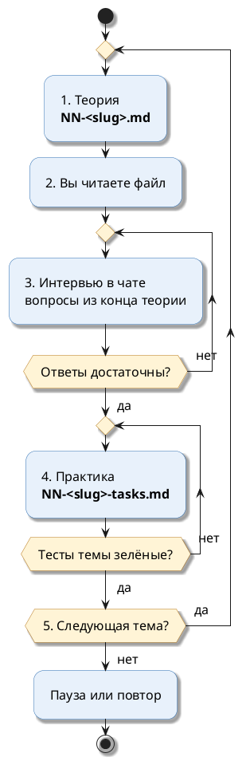

# План курса: профилирование Java-сервиса

Документ — **единая точка отсчёта**. На него можно ссылаться в чате: *«работаем по плану профилирования»*, *«где мы в плане?»*, *«следующая тема по плану»*.

Одна тема за раз: сначала теория, потом интервью, потом практика.

---

## Оглавление

- [Граница курса](#граница-курса)
- [Цель](#цель)
- [Среда](#среда)
- [Лаборатория](#лаборатория)
- [Структура папки](#структура-папки)
- [Как подаётся теория](#как-подаётся-теория)
- [Цитаты из официальных источников](#цитаты-из-официальных-источников)
- [Цикл одной темы](#цикл-одной-темы)
- [Как формулируются задания](#как-формулируются-задания)
- [Как устроена практика в коде](#как-устроена-практика-в-коде)
- [Проверка ответов](#проверка-ответов)
- [Программа тем](#программа-тем)
    - [Тема 01. Сначала не профайлер](#тема-01-сначала-не-профайлер)
    - [Тема 02. Консольные утилиты JDK](#тема-02-консольные-утилиты-jdk)
    - [Тема 03. Память: утечка или мало кучи](#тема-03-память-утечка-или-мало-кучи)
    - [Тема 04. Потоки: дамп, очереди, взаимная блокировка](#тема-04-потоки-дамп-очереди-взаимная-блокировка)
    - [Тема 05. JFR и JMC](#тема-05-jfr-и-jmc)
    - [Тема 06. CPU-профиль](#тема-06-cpu-профиль)
    - [Тема 07. Аллокации и давление на GC](#тема-07-аллокации-и-давление-на-gc)
- [Текущий прогресс](#текущий-прогресс)
- [Как напоминать в чате](#как-напоминать-в-чате)

---

## Граница курса

Семь тем: как искать причину замедления Java-сервиса и какими средствами JDK это делать.

Главная мысль курса: **профайлер — не первый шаг**. Сначала формулируют проблему и смотрят метрики, потом дешёвые снимки JVM, и только потом профиль.

Каждая тема держится на реальном случае из бизнеса:

| Тема | Случай |
|---|---|
| 01 | после релиза оформление заказа отвечает 3 с вместо 300 мс |
| 02 | сервис сессий «тормозит» к вечеру, перезапуск помогает на день |
| 03 | реестр сессий съедает кучу и падает с `OutOfMemoryError` |
| 04 | заказы висят: соединения с БД держит медленный платёжный шлюз; встречные переводы зависли навсегда |
| 05 | задержка растёт на 10 минут днём, к приходу инженера всё нормально |
| 06 | выгрузка для бухгалтерии и ночная сверка с банком съедают CPU |
| 07 | каталог: молодая сборка 5 раз в секунду из-за «защитной копии» прайса |

Курс описывает **JDK 27** и инструменты, которые входят в JDK: `jcmd`, `jstat`, `jfr`, JFR API. Внешние инструменты — VisualVM, JMC, async-profiler — только как способ посмотреть те же данные.

**Не входит:**

- настройка сборщиков мусора и выбор GC дальше «пауза или пропускная способность»;
- JMH и микробенчмарки — только мысль, что изменение надо измерить;
- профилирование нативной памяти дальше `VM.native_memory`;
- APM-системы, Prometheus, Grafana — метрики берутся как данность;
- Spring Boot Actuator и настройки фреймворков.

---

## Цель

После курса уметь:

- описать проблему производительности числами и выбрать, куда смотреть, до запуска профайлера;
- назвать антиметоды: «фонарь», случайные изменения, «все зелёные — значит, всё хорошо»;
- снять с работающей JVM версию, флаги, кучу, гистограмму, дамп потоков — и знать, какие команды останавливают приложение;
- отличить утечку памяти от маленькой кучи по GC-логу и двум гистограммам;
- прочитать дамп потоков: найти очередь к пулу, медленную зависимость и взаимную блокировку;
- держать в продакшене постоянную запись JFR и выгрузить её после инцидента;
- прочитать CPU-профиль и flame graph: собственное время, общее время, «горячий» метод;
- найти место, которое больше всех выделяет память, и доказать исправление замером.

---

## Среда

| Параметр | Значение |
|---|---|
| Проект | `profiling-study` — отдельный Gradle-проект, ни от чего не зависит |
| Язык и JDK | Java 27 через Gradle toolchain. Если JDK 27 на машине нет, Gradle скачает его сам |
| Сборка | Gradle 9.8.2 (wrapper в проекте) |
| Тесты | JUnit 6, AssertJ. База данных и Docker не нужны |
| Где писать | заготовки в `src/main/java/com/example/profcourse/tNN/` |
| Как проверять | готовые тесты в `src/test/java/com/example/profcourse/tNN/` |
| Утилиты | `jcmd`, `jstat`, `jfr` из того же JDK 27, на котором запущена лаборатория |

Gradle запускается на любом JDK 17+. Проверка в WSL:

```bash

java -version
```

Если Java в WSL нет, поставить пакет дистрибутива. Он нужен только для запуска Gradle: код соберётся на JDK 27, который Gradle скачает сам:

```bash

sudo apt update && sudo apt install -y openjdk-25-jdk-headless
```

Тесты одной темы (номер темы — в имени пакета):

```bash

cd /mnt/d/Project_infra/greeting-service-infra/profiling-study
./gradlew test --tests "com.example.profcourse.t01.*"
```

Все тесты курса:

```bash

cd /mnt/d/Project_infra/greeting-service-infra/profiling-study
./gradlew test
```

Из IntelliJ IDEA: открыть папку `profiling-study` как проект Gradle, правой кнопкой по тестовому классу → *Run*. Отчёт — `build/reports/tests/test/index.html`.

---

## Лаборатория

Лаборатория — учебный сервис `LabApp`: каждый сценарий воспроизводит одну проблему из программы. К нему подключаются утилиты JDK, VisualVM и JMC.

**Подготовка — один раз в каждом новом терминале:**

```bash

cd /mnt/d/Project_infra/greeting-service-infra/profiling-study
./gradlew -q classes
export JAVA_HOME="$(./gradlew -q javaHome)"
export PATH="$JAVA_HOME/bin:$PATH"
java -version
```

**Запуск сценария** — в первом терминале:

```bash

java -cp build/classes/java/main com.example.profcourse.lab.LabApp leak
```

Утилиты — во втором терминале, после той же подготовки. Остановить лабораторию — `Ctrl+C`.

| Сценарий | Что воспроизводит | Тема |
|---|---|---|
| `leak` | реестр сессий держит просроченные сессии, куча растёт до `OutOfMemoryError` | 02, 03 |
| `churn` | много короткоживущих объектов, утечки нет — контрольный «здоровый» случай | 02, 03 |
| `pool` | 20 обработчиков, 4 соединения с БД, внутри транзакции — платёжный шлюз на 2 с | 04 |
| `deadlock` | встречные переводы между двумя счетами зависли | 04 |
| `audit` | 8 обработчиков пишут в один журнал под монитором | 04, 05 |
| `report` | выгрузка 8 000 заказов для бухгалтерии | 05, 06 |
| `reconcile` | сверка 30 000 платежей с выпиской банка | 06 |
| `catalog` | цена со скидкой: на каждый запрос копия прайса из 50 000 позиций | 07 |

**Внимание:**

Числа в теории получены запуском на OpenJDK 27 (build 27+35) под Windows с русской локалью: дробная часть там через запятую. В WSL будет точка, время и PID — свои, порядок величин — тот же.

**Документация по инструментам** лежит в репозитории локально, на русском:

| Инструмент | Где |
|---|---|
| JFR, руководство | [`docs/profiler/Java Flight Recorder (JFR)/jfr-runtime-guide-local`](../../../docs/profiler/Java%20Flight%20Recorder%20(JFR)/jfr-runtime-guide-local/README.md) |
| JFR, статья Axiom JDK | [`docs/profiler/Java Flight Recorder (JFR)/axiom-jdk-jfr-local`](../../../docs/profiler/Java%20Flight%20Recorder%20(JFR)/axiom-jdk-jfr-local/README.md) |
| JMC 9, руководство | [`docs/profiler/Java Mission Control/jmc9-user-guide-local`](../../../docs/profiler/Java%20Mission%20Control/jmc9-user-guide-local/README.md) |
| VisualVM | [`docs/profiler/VisualVM/visualvm-docs-local-Ru`](../../../docs/profiler/VisualVM/visualvm-docs-local-Ru/README.md) |

---

## Структура папки

```text
profiling-study/
├── build.gradle, settings.gradle, gradlew
├── docs/profiling-course/
│   ├── 00-plan.md                    ← этот документ
│   ├── 01-before-profiler.md         ← теория + вопросы интервью
│   ├── 01-before-profiler-tasks.md   ← практика: условия задач
│   ├── 02-jdk-tools.md
│   ├── 02-jdk-tools-tasks.md
│   ├── 03-memory.md
│   ├── 03-memory-tasks.md
│   ├── 04-threads.md
│   ├── 04-threads-tasks.md
│   ├── 05-jfr-jmc.md
│   ├── 05-jfr-jmc-tasks.md
│   ├── 06-cpu.md
│   ├── 06-cpu-tasks.md
│   ├── 07-allocations.md
│   └── 07-allocations-tasks.md
├── src/main/java/com/example/profcourse/
│   ├── common/        ← Todo, пауза
│   ├── lab/           ← лаборатория LabApp
│   └── t01/ … t07/    ← заготовки задач и готовые «старые» реализации
└── src/test/
    ├── java/com/example/profcourse/
    │   ├── common/    ← гистограмма кучи, замер времени и аллокаций, часы
    │   └── t01/ … t07/
    └── resources/fixtures/   ← реальные выводы jstat, jcmd, GC-лога с лаборатории
```

| Файл | Содержание |
|---|---|
| `NN-<slug>.md` | Теория. В конце — вопросы, по которым идёт интервью в чате |
| `NN-<slug>-tasks.md` | Практика: задачи с тестами и лабораторная работа с утилитами |

Учебной базы данных нет: внешние системы изображают готовые классы с паузами. Выводы утилит для задач сняты с лаборатории и лежат в `src/test/resources/fixtures/`.

---

## Как подаётся теория

Порядок объяснения один: житейская картинка, потом команда или код, потом что говорит документация.

| Шаг в файле | Что в нём | Объём |
|---|---|---|
| 1. Аналогия | ситуация из жизни без терминов | 2–4 предложения |
| 2. Как это устроено в коде | части аналогии → команды и события JVM, списком | 3–6 пунктов |
| 3. Пример | команда с реальным выводом или минимальный код | до 20 строк |
| 4. Разбор | только неочевидное | списком |
| 5. Цитата | официальный источник и перевод | 1–2 цитаты |
| 6. Правило | вывод одной строкой | 1 строка |

Шаги «Почему не иначе», «Внимание», «Ловушка» — только там, где без них легко ошибиться.

**Ограничения по объёму:**

- курс компактный: суть и то, что спросят, без побочных тем;
- абзац — не больше двух предложений;
- один пример — одна мысль;
- файл темы читается за один раз.

**Схемы:** только PlantUML с `skinparam defaultFontSize 16`, одна мысль на схему.

---

## Цитаты из официальных источников

Каждое утверждение о поведении JDK опирается на официальный источник.

| Источник | Что из него берём |
|---|---|
| Java SE 27 Troubleshooting Guide на docs.oracle.com | утилиты, утечки памяти, JFR для поиска узких мест |
| Java SE 27 Tool Specifications: `jcmd`, `jfr` | команды, параметры, влияние на приложение |
| Javadoc Java SE 27 | `Thread.State`, `jdk.jfr.Recording` |
| JEP 520 на openjdk.org | замер времени методов в JFR |
| Брендан Грегг, brendangregg.com | методики USE, «описание проблемы», антиметоды |
| async-profiler на GitHub | что такое flame graph и safepoint bias |

| Правило | Как делать |
|---|---|
| Цитата по делу | ровно тот фрагмент, на котором держится соседнее утверждение |
| Контекст | перед цитатой сказано, к чему она относится |
| Дословно | английский текст без изменений, сокращения — через `…` |
| Перевод | сразу после цитаты, полный, без своих добавлений |
| Нет цитаты | факт подтверждён запуском, и так и написано: «запуск на JDK 27» |

**Шаблон блока:**

```markdown
- Источник: https://docs.oracle.com/en/java/javase/27/troubleshoot/diagnostic-tools.html

> …дословный фрагмент…

RU:

> …полный перевод…
```

---

## Цикл одной темы

Пять шагов. Следующий — только после зачёта предыдущего.



| Шаг | Что происходит |
|---|---|
| 1. Теория | файл `NN-<slug>.md` уже лежит в папке. Ассистент даёт короткое резюме и путь |
| 2. Чтение | когда готовы: *«Изучил тему N, дай интервью»* |
| 3. Интервью | 4–6 вопросов в чате по одному, на понимание. Основа — «Вопросы для интервью» в конце теории, формулировки меняются. Пробел называется прямо |
| 4. Практика | заполнить заготовки темы и запустить тесты. Лабораторную пройти в терминале и прислать ответы в чат. *«Проверь задание N.M»* — ассистент читает код, запускает тесты и разбирает падения |
| 5. Переход | ассистент отмечает прогресс и предлагает тему N+1 |

---

## Как формулируются задания

Задание самодостаточно: рабочая ситуация и измеримый итог, без названия нужного класса или метода.

| Правило | Как делать |
|---|---|
| Ситуация из работы | выгрузка, сверка, реестр сессий, каталог, переводы |
| Итог измерим | значения, порядок, время «было/стало», байт на вызов, число живых объектов |
| Без имени средства | не писать, чем исправлять: ни `StringBuilder`, ни `HashMap`, ни «упорядочьте блокировки» |
| Только пройденное | решение возможно средствами текущей и прошлых тем |
| Сначала найти | в задачах «сделать быстрее» место проблемы не названо: его находят профилем лаборатории |

**Неправильно:** «Замените `+=` на `StringBuilder`».

**Правильно:** «Выгрузка 8 000 заказов должна идти минимум в 5 раз быстрее старой, текст — символ в символ тот же».

---

## Как устроена практика в коде

- Тело каждого метода-задачи — `throw Todo.task("NN.M");`. Пока задача не решена, тест падает с сообщением `Задача NN.M не решена` и путём к условию.
- Решение пишется вместо этой строки. Сигнатуру метода не менять: по ней работает тест.
- Поля, приватные методы и импорты в класс-задачу добавлять можно.
- Классы с пометкой «Готовый класс, менять не нужно» — данные, внешние системы и «старые» реализации `Legacy…`. Старая реализация — эталон поведения и точка отсчёта для замера.
- Тест проверяет поведение, а не текст решения:
  - результат и порядок;
  - время «было/стало» на одной машине;
  - байты, выделенные потоком;
  - живые объекты в куче после полной сборки;
  - отсутствие взаимной блокировки.
- Задачи на разбор выводов утилит читают реальные файлы из `src/test/resources/fixtures/`.

**Лабораторная работа** в конце файла практики тестов не имеет. Её проходят в терминале, ответы на вопросы присылают в чат.

---

## Проверка ответов

**Интервью** — зачёт, если смысл верен и нет ошибки, которая в работе ведёт к ложному виновнику, остановке продакшена диагностикой или исправлению без замера.

**Практика** — зачёт, если все тесты темы зелёные и лабораторная пройдена: ответы совпадают с тем, что показывают утилиты.

---

## Программа тем

### Тема 01. Сначала не профайлер

Что спрашивают: с чего начать, когда «всё тормозит»; что изменилось и с какого момента; latency, перцентили, базовая линия; метод USE; антиметоды; разложить время запроса по шагам; когда профайлер действительно нужен.

- Источник: https://www.brendangregg.com/usemethod.html

> For every resource, check utilization, saturation, and errors.

RU:

> Для каждого ресурса проверьте загрузку, насыщение и ошибки.

Практика: куда смотреть по снимку метрик; из чего складывается оформление заказа.

### Тема 02. Консольные утилиты JDK

Что спрашивают: `jps`, `jcmd`, `jstat`, `jinfo`, `jmap`, `jstack` — что из этого устарело; какие команды `jcmd` дешёвые, а какие останавливают приложение; как читать `jstat -gcutil`; гистограмма кучи; `VM.native_memory`.

- Источник: https://docs.oracle.com/en/java/javase/27/troubleshoot/diagnostic-tools.html

> It is suggested to use the latest diagnostic utility, `jcmd` instead of the earlier `jstack`, `jinfo,` and `jmap` utilities.

RU:

> Рекомендуется использовать новую диагностическую утилиту `jcmd` вместо прежних `jstack`, `jinfo` и `jmap`.

Практика: сводка по `jstat`; что выросло между двумя гистограммами; лабораторная на сценарии `leak`.

### Тема 03. Память: утечка или мало кучи

Что спрашивают: куча, живые объекты (live set), молодое и старое поколение; виды `OutOfMemoryError`; как отличить утечку от маленькой кучи; GC-лог; дамп кучи, когда и чем снимать; что открыть в VisualVM.

- Источник: https://docs.oracle.com/en/java/javase/27/troubleshoot/troubleshooting-memory-leaks.html

> If the live set increases over time after the application has reached a stable state and is under a stable load, that could be a strong indication of a memory leak.

RU:

> Если живой набор растёт со временем, после того как приложение вышло на стабильный режим и работает под стабильной нагрузкой, это может быть сильным признаком утечки памяти.

Практика: реестр сессий без утечки; утечка или нет по GC-логу.

### Тема 04. Потоки: дамп, очереди, взаимная блокировка

Что спрашивают: состояния потока в дампе; почему дампов нужно несколько; как по дампу найти очередь к пулу и медленную зависимость; взаимная блокировка и как JVM её показывает; конкуренция за монитор.

- Источник: https://docs.oracle.com/en/java/javase/27/docs/api/java.base/java/lang/Thread.State.html

> `BLOCKED` A thread that is blocked waiting for a monitor lock is in this state.

RU:

> `BLOCKED` — в этом состоянии находится поток, заблокированный в ожидании захвата монитора.

Практика: встречные переводы без зависания; где стоят обработчики по дампу.

### Тема 05. JFR и JMC

Что спрашивают: что такое JFR и сколько он стоит; запись при старте и через `jcmd`; шаблоны `default` и `profile`; постоянная запись и выгрузка после инцидента; `jfr summary`, `jfr view`; JMC и автоматический анализ; замер времени метода без правки кода.

- Источник: https://docs.oracle.com/en/java/javase/27/troubleshoot/troubleshoot-performance-issues-using-jfr.html

> The overhead for recording a standard time fixed recording (profiling recording) using the default settings is less than two percent for most applications. Running with a standard continuous recording generally has no measurable performance effect.

RU:

> Накладные расходы стандартной записи фиксированной длительности (профилирующей записи) с настройками по умолчанию — меньше двух процентов для большинства приложений. Стандартная постоянная запись обычно не даёт измеримого влияния на производительность.

Практика: горячие методы по записи; запись после медленного запроса.

### Тема 06. CPU-профиль

Что спрашивают: сэмплирование и инструментирование; собственное и общее время метода; как читать flame graph; safepoint bias; JFR, VisualVM, async-profiler; почему интуиция о «горячем месте» обманывает; как доказать, что стало быстрее.

- Источник: https://github.com/async-profiler/async-profiler/blob/master/docs/FlamegraphInterpretation.md

> Flame graph does not preserve information on _when_ a particular stack trace was taken, it only indicates _how often_ a stack trace was observed during profiling.

RU:

> Flame graph не хранит информацию о том, _когда_ был снят конкретный стек, он показывает только, _как часто_ этот стек встречался во время профилирования.

Практика: выгрузка для бухгалтерии; ночная сверка с банком.

### Тема 07. Аллокации и давление на GC

Что спрашивают: скорость выделения памяти и частота сборок; TLAB; сэмплы аллокаций в JFR; первое место из кода приложения; временные объекты, копии и упаковка; как измерить байты на вызов.

- Источник: https://docs.oracle.com/en/java/javase/27/troubleshoot/troubleshoot-performance-issues-using-jfr.html

> To reduce the need of GCs, decrease the allocation rate.

RU:

> Чтобы реже требовались сборки мусора, снижайте скорость выделения памяти.

Практика: цена со скидкой без лишних объектов; кто выделяет больше всех.

---

## Текущий прогресс

| № | Тема | Теория | Интервью | Практика | Статус |
|---|---|---|---|---|---|
| 01 | Сначала не профайлер | ✅ | ⬜ | ⬜ | **теория → интервью** |
| 02 | Консольные утилиты JDK | ✅ | ⬜ | ⬜ | не начата |
| 03 | Память: утечка или мало кучи | ✅ | ⬜ | ⬜ | не начата |
| 04 | Потоки: дамп, очереди, взаимная блокировка | ✅ | ⬜ | ⬜ | не начата |
| 05 | JFR и JMC | ✅ | ⬜ | ⬜ | не начата |
| 06 | CPU-профиль | ✅ | ⬜ | ⬜ | не начата |
| 07 | Аллокации и давление на GC | ✅ | ⬜ | ⬜ | не начата |

**Легенда:** ⬜ — не пройдено · ✅ — готово или пройдено. В столбце «Теория» ✅ значит, что файл теории написан.

---

## Как напоминать в чате

| Фраза | Что делает ассистент |
|---|---|
| *«Работаем по плану профилирования»* | Открывает этот файл и продолжает текущий шаг |
| *«Где мы в плане?»* | Называет тему и шаг: теория, интервью или практика |
| *«Изучил тему N, дай интервью»* | Шаг 3: вопросы по одному |
| *«Проверь задание N.M»* | Читает решение, запускает тесты темы, разбирает падения |
| *«Проверь лабораторную N»* | Сверяет ответы с тем, что показывают утилиты |
| *«Подсказка к N.M»* | Наводящий вопрос без названия класса или метода |
| *«Следующая тема»* | Отмечает прогресс и предлагает тему N+1 |

---

*Создано: 2026-10-20 для JDK 27. Обновляется по мере прохождения.*
