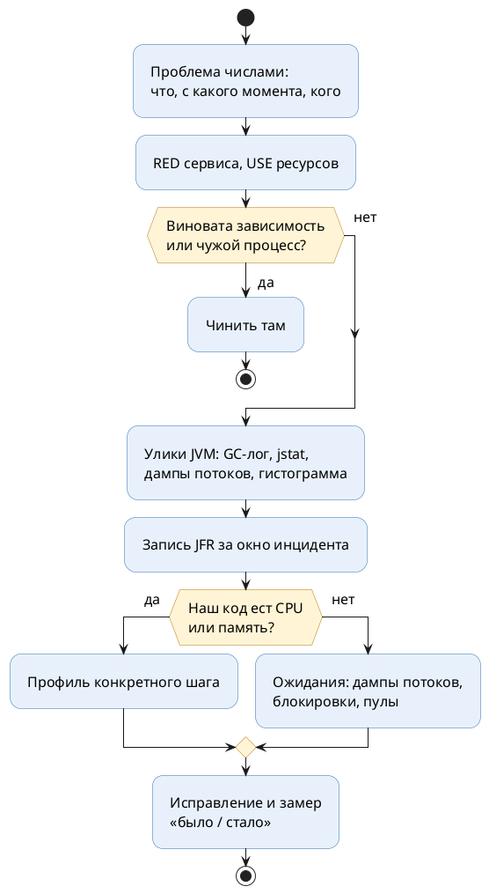

# Тема 01. Сначала не профайлер

> **Статус:** теория · **Дальше:** интервью в чате, затем [практика](01-before-profiler-tasks.md)

---

## Оглавление

- [1. Опишите проблему числами](#1-опишите-проблему-числами)
- [2. Среднее врёт: перцентили и базовая линия](#2-среднее-врёт-перцентили-и-базовая-линия)
- [3. Антиметоды](#3-антиметоды)
- [4. Куда смотреть: RED для сервиса, USE для ресурсов](#4-куда-смотреть-red-для-сервиса-use-для-ресурсов)
- [5. Разложите время запроса](#5-разложите-время-запроса)
- [6. Подготовьте JVM заранее, соберите улики до перезапуска](#6-подготовьте-jvm-заранее-соберите-улики-до-перезапуска)
- [7. Алгоритм целиком: где в нём профайлер](#7-алгоритм-целиком-где-в-нём-профайлер)
- [Вопросы для интервью](#вопросы-для-интервью)

---

## 1. Опишите проблему числами

**Аналогия:**

Пациент говорит врачу: «Мне плохо». Врач не отправляет его сразу на МРТ, а спрашивает: где болит, с какого дня, что изменилось, было ли так раньше.

Половина диагнозов ставится на этом разговоре, без аппаратуры.

**Как это устроено в коде:**

- **«Мне плохо»** — жалоба «сервис тормозит». С ней работать нельзя.
- **«Где болит»** — какая операция: оформление заказа, поиск, выгрузка.
- **«С какого дня»** — с какого момента: релиз, изменение нагрузки, переезд базы.
- **«Было ли так раньше»** — есть ли базовая линия: сколько операция занимала в обычный день.
- **МРТ** — профайлер. Дорогой и точный, но отвечает на вопрос, который уже задан.

**Пример: карточка инцидента до любых инструментов**

```text
Что:        POST /checkout — оформление заказа
Симптом:    p99 3 100 мс, обычно 300 мс; ошибок нет
С какого:   2026-10-20 10:40, через 10 минут после релиза 4.12
Кого:       все клиенты, все 6 подов одинаково
Что ещё:    поиск и каталог — в норме
Изменения:  релиз 4.12: новый шаг «проверка лимита у антифрода»
```

**Разбор:**

- «Все поды одинаково» — проблема не в одной машине, а в коде или зависимости.
- «Поиск в норме» — CPU и GC общие для всех операций; раз остальное быстрое, они вряд ли виноваты.
- «Через 10 минут после релиза» и новый шаг — первая гипотеза уже есть, и она проверяется откатом или замером шага, а не профилем.

- Источник: https://www.brendangregg.com/methodology.html

> ### Problem Statement Method
>
> 1. What makes you think there is a performance problem?
> 2. Has this system ever performed well?
> 3. What has changed recently? (Software? Hardware? Load?)
> 4. Can the performance degradation be expressed in terms of latency or run time?
> 5. Does the problem affect other people or applications (or is it just you)?
> 6. What is the environment? What software and hardware is used? Versions? Configuration?

RU:

> ### Метод описания проблемы
>
> 1. Почему вы думаете, что есть проблема производительности?
> 2. Работала ли эта система когда-нибудь хорошо?
> 3. Что недавно изменилось? (Программы? Оборудование? Нагрузка?)
> 4. Можно ли выразить ухудшение через задержку или время выполнения?
> 5. Затрагивает ли проблема других людей или приложения (или только вас)?
> 6. Какое окружение? Какие программы и оборудование? Версии? Конфигурация?

**Правило:** пока проблема не записана числами и временем начала, инструменты не запускают.

---

## 2. Среднее врёт: перцентили и базовая линия

**Аналогия:**

Средняя температура по больнице — 36,6. При этом у одного пациента 40, а один уже остывает.

**Как это устроено в коде:**

- **Средняя температура** — среднее время ответа. Сотня быстрых запросов прячет десяток очень медленных.
- **Температура конкретного пациента** — перцентиль: p99 = 3 с значит, что 1 % запросов дольше 3 с.
- **Карта пациента** — базовая линия: p99 этой же операции в обычный день, в тот же час.
- **Пятиминутное окно** — график усредняет пики. Секундная перегрузка CPU на нём выглядит как 80 %.

**Разбор:**

- Сравнивать надо с базовой линией той же операции, а не с «кажется, раньше было быстрее».
- Порог «есть ли деградация» задают заранее. В задачах курса: p99 выше нормы больше чем в полтора раза.

- Источник: https://www.brendangregg.com/usemethod.html

> A burst of high utilization can cause saturation and performance issues, even though utilization is low when averaged over a long interval. …
>
> I had an example where a customer had problems with CPU saturation (latency) even though their monitoring tools showed CPU utilization was never higher than 80%. The monitoring tool was reporting five minute averages, during which CPU utilization hit 100% for seconds at a time.

RU:

> Всплеск высокой загрузки может вызвать насыщение и проблемы с производительностью, даже если загрузка, усреднённая по длинному интервалу, низкая. …
>
> У меня был случай, когда у клиента были проблемы с насыщением CPU (задержкой), хотя его инструменты мониторинга показывали, что загрузка CPU никогда не превышала 80 %. Инструмент мониторинга показывал средние за пять минут, а внутри них загрузка CPU по нескольку секунд держалась на 100 %.

**Правило:** смотрят перцентили против базовой линии, а не среднее против ощущений.

---

## 3. Антиметоды

**Аналогия:**

Человек потерял ключи в тёмном дворе, а ищет под фонарём: там светлее.

**Как это устроено в коде:**

- **Под фонарём** — запустить знакомый инструмент, потому что он знакомый, и искать в его выводе «что-нибудь странное».
- **Наугад** — менять настройки (`-Xmx`, размер пула, GC) по одной и смотреть, полегчало ли.
- **Светофор** — на дашборде всё зелёное, значит, проблемы нет; что-то красное — значит, это причина.
- **Чужая зона** — «это база тормозит», без единого замера.

- Источник: https://www.brendangregg.com/methodology.html

> ### Streetlight Anti-Method
>
> Pick observability tools that are:
>
> - familiar
> - found on the Internet
> - found at random
>
> Run tools
>
> Look for obvious issues
>
> …
>
> ### Traffic Light Anti-Method
>
> 1. Open dashboard
> 2. All green? Assume everything is good.
> 3. Something red? Assume that's a problem.

RU:

> ### Антиметод «фонарь»
>
> Выберите инструменты наблюдения, которые:
>
> - знакомы;
> - найдены в интернете;
> - попались случайно.
>
> Запустите инструменты.
>
> Ищите очевидные проблемы.
>
> …
>
> ### Антиметод «светофор»
>
> 1. Откройте дашборд.
> 2. Всё зелёное? Считайте, что всё хорошо.
> 3. Что-то красное? Считайте, что это и есть проблема.

**Правило:** инструмент выбирают под гипотезу, а не гипотезу под знакомый инструмент.

---

## 4. Куда смотреть: RED для сервиса, USE для ресурсов

**Аналогия:**

У кассы магазина три вопроса: сколько покупателей пришло, сколько ушло ни с чем, сколько ждали. У каждого кассира свои три: сколько он занят, какая к нему очередь, сколько ошибок в чеках.

**Как это устроено в коде:**

- **Магазин целиком** — сервис. Метод RED: запросы в секунду (Rate), ошибки (Errors), время ответа (Duration).
- **Кассир** — ресурс: CPU, память, пул соединений, пул потоков, внешний сервис. Метод USE:
  - загрузка (Utilization) — сколько времени ресурс занят;
  - насыщение (Saturation) — очередь к ресурсу;
  - ошибки (Errors).
- **Очередь важнее загрузки** — пул занят на 100 % и очереди нет: это норма. Есть очередь — это и есть задержка.

**Решающая таблица:** проверки идут сверху вниз, первая сработавшая — ответ. Порядок важен: следствия проверяются после причин.

| № | Признак | Куда дальше | Почему здесь |
|---|---|---|---|
| 1 | p99 не выше нормы больше чем в 1,5 раза | расследовать нечего | нет деградации |
| 2 | CPU машины ≥ 90 %, а CPU JVM < 50 % | процессы ОС: `top`, диспетчер задач | процессор отнял кто-то другой |
| 3 | паузы GC ≥ 10 % времени | память: тема 03 | паузы тормозят всё, в том числе пул |
| 4 | внешняя система отвечает в 2+ раза дольше обычного | эта зависимость | пул занят из-за неё — это следствие |
| 5 | пул занят полностью и есть очередь | кто держит соединения: тема 04 | зависимость быстрая, а соединений не хватает |
| 6 | CPU JVM ≥ 80 % | CPU-профиль: тема 06 | наш код сам ест процессор |
| 7 | ничего из этого | дампы потоков: тема 04 | процессор свободен, значит, потоки чего-то ждут |

**Разбор:**

- Строка 4 выше строки 5: медленный банк исчерпывает пул, но чинить надо банк или таймаут, а не размер пула.
- Строка 7 — частый случай «CPU 10 %, а всё стоит». Профиль CPU тут бесполезен: ждущий поток процессор не тратит.

- Источник: https://www.brendangregg.com/usemethod.html

> - utilization: the average time that the resource was busy servicing work
> - saturation: the degree to which the resource has extra work which it can't service, often queued
> - errors: the count of error events

RU:

> - загрузка: среднее время, когда ресурс был занят обслуживанием работы;
> - насыщение: степень, в которой у ресурса есть дополнительная работа, которую он не может обслужить, часто стоящая в очереди;
> - ошибки: число событий-ошибок.

- Источник: https://www.brendangregg.com/methodology.html

> ### RED Method
>
> For every service or microservice, check:
>
> 1. Request rate
> 2. Errors
> 3. Duration

RU:

> ### Метод RED
>
> Для каждого сервиса или микросервиса проверьте:
>
> 1. Частоту запросов
> 2. Ошибки
> 3. Длительность

**Правило:** RED показывает, что сервису плохо; USE по каждому ресурсу показывает, где.

---

## 5. Разложите время запроса

**Аналогия:**

Посылка шла неделю вместо двух дней. Смотрят трекинг: сутки на складе, сутки в пути, пять дней на таможне.

Вопрос «почему долго» превращается в вопрос «почему таможня».

**Как это устроено в коде:**

- **Трекинг** — время каждого шага запроса: проверка, склад, БД, платёжный шлюз.
- **Источник замеров** — трассировка (span'ы), логи с длительностью, метрики клиента к каждой зависимости.
- **Доля шага** — время шага / время запроса. Шаг на 3 % не стоит оптимизировать, даже если он «некрасивый».

Запуск на JDK 27: оформление заказа из четырёх шагов, каждый обёрнут в замер.

```java
long start = System.nanoTime();
pipeline.chargeCard(orderId);
long chargeNanos = System.nanoTime() - start;
// chargeCard     121 мс  75 %
// reserveStock    21 мс  13 %
// saveOrder       16 мс  10 %
// validate         5 мс   3 %
```

**Разбор:**

- Три четверти времени — платёжный шлюз. Это чужая система: профиль нашего кода её не ускорит.
- Если бы 75 % занимал шаг из нашего кода без ожиданий, следующим шагом был бы CPU-профиль этого шага.

- Источник: https://www.brendangregg.com/methodology.html

> ### Time Division Method
>
> 1. Measure operation time (or latency)
> 2. Divide time into logical synchronous components
> 3. Continue division until latency origin is identified
> 4. Quantify: estimate speedup if problem fixed

RU:

> ### Метод деления времени
>
> 1. Измерьте время операции (или задержку).
> 2. Разделите время на логические последовательные части.
> 3. Продолжайте деление, пока не найдёте источник задержки.
> 4. Оцените количественно: какое ускорение даст исправление.

**Правило:** сначала найти шаг, где теряется время; профилировать — только его и только если он наш.

---

## 6. Подготовьте JVM заранее, соберите улики до перезапуска

**Аналогия:**

Видеорегистратор в машине включают до аварии. После аварии машину не отгоняют, пока не сфотографировали место.

**Как это устроено в коде:**

- **Регистратор** — флаги, которые стоят в продакшене постоянно:
  - `-Xlog:gc*:file=…` — GC-лог в отдельный файл;
  - `-XX:+HeapDumpOnOutOfMemoryError` — дамп кучи при падении по памяти;
  - `-XX:StartFlightRecording` — постоянная запись JFR (тема 05).
- **Фото места аварии** — до перезапуска снять несколько дампов потоков и выгрузить запись JFR.
- **Отогнать машину** — перезапуск. Он лечит симптом и стирает улики: куча, потоки, временные файлы — всё пропадает.

```bash

java -Xlog:gc*:file=/var/log/app/gc.log:time,uptime:filecount=5,filesize=20m \
     -XX:+HeapDumpOnOutOfMemoryError -XX:HeapDumpPath=/var/dumps \
     -XX:StartFlightRecording:maxage=1h,maxsize=500m,dumponexit=true,filename=/var/dumps/ \
     -jar app.jar
```

- Источник: https://docs.oracle.com/en/java/javase/27/troubleshoot/prepare-java-troubleshooting.html

> If your application runs into a problem and you want to start the debugging process, collecting data about the issue is the first step. This is especially true as restarting an application or system will move or delete files.
>
> …
>
> - If the application stopped responding, then gather these files:
>   - Stack traces: Take several stack traces using `jcmd Thread.print` before restarting the system
>   - Dump flight recordings

RU:

> Если приложение столкнулось с проблемой и вы хотите начать отладку, первый шаг — собрать данные о проблеме. Особенно это важно потому, что перезапуск приложения или системы переместит или удалит файлы.
>
> …
>
> - Если приложение перестало отвечать, соберите:
>   - стеки: снимите несколько стеков через `jcmd Thread.print` до перезапуска системы;
>   - выгрузку записей JFR.

**Правило:** GC-лог, дамп кучи при OOM и постоянный JFR включают до инцидента; во время инцидента сначала снимают улики, потом перезапускают.

---

## 7. Алгоритм целиком: где в нём профайлер

**Аналогия:**

Сначала опрос пациента, потом градусник и анализ крови, потом рентген. МРТ — когда понятно, какой орган смотреть.

**Как это устроено в коде:**

- **Опрос** — описание проблемы числами, разделы 1–2.
- **Градусник** — метрики RED и USE, раздел 4.
- **Анализ крови** — дешёвые снимки JVM: GC-лог, `jstat`, дамп потоков, гистограмма (темы 02–04).
- **Рентген** — запись JFR за окно инцидента (тема 05).
- **МРТ** — CPU- или allocation-профиль конкретного шага (темы 06–07).
- **Контроль** — замер после исправления на тех же данных: стало ли лучше, и насколько.



**Ловушка:**

«CPU 10 %, а всё тормозит» — профиль CPU покажет то немногое, что выполняется, и ничего не скажет об ожидании. Здесь нужны дампы потоков.

**Правило:** профайлер отвечает на вопрос «какой метод в нашем коде»; до этого вопроса надо дойти по алгоритму.

---

## Вопросы для интервью

1. Сервис «тормозит». Какие пять вопросов вы зададите до запуска любого инструмента?
2. Почему среднее время ответа плохо подходит для поиска деградации? Что смотреть вместо него?
3. Что такое метод USE? Чем насыщение отличается от загрузки и почему оно важнее?
4. p99 вырос в 10 раз, CPU 10 %, GC в норме. Куда смотреть и почему не в CPU-профиль?
5. Платёжный шлюз отвечает 3 с, пул соединений исчерпан. Что из этого причина, а что следствие?
6. Назовите два антиметода и чем они опасны.
7. Какие флаги JVM включить в продакшене заранее и что сделать до перезапуска упавшего сервиса?
8. Когда профайлер действительно нужен и что он должен показать?

---

**Практика:** [01-before-profiler-tasks.md](01-before-profiler-tasks.md)
