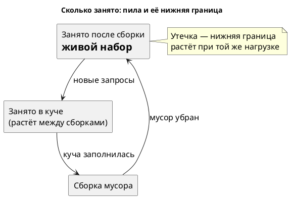

# Тема 03. Память: утечка или мало кучи

> **Статус:** теория · **Дальше:** интервью в чате, затем [практика](03-memory-tasks.md)

---

## Оглавление

- [1. Живой набор: что на самом деле занимает кучу](#1-живой-набор-что-на-самом-деле-занимает-кучу)
- [2. Утечка или мало кучи](#2-утечка-или-мало-кучи)
- [3. Виды OutOfMemoryError](#3-виды-outofmemoryerror)
- [4. GC-лог: включить заранее и прочитать](#4-gc-лог-включить-заранее-и-прочитать)
- [5. Дамп кучи: кто держит объекты](#5-дамп-кучи-кто-держит-объекты)
- [6. Где утечки бывают в бизнес-коде](#6-где-утечки-бывают-в-бизнес-коде)
- [Вопросы для интервью](#вопросы-для-интервью)

---

## 1. Живой набор: что на самом деле занимает кучу

**Аналогия:**

Офисный стол к вечеру завален бумагами. Нужны из них только те, что лежат в папке «в работе», остальное уборщица выбросит ночью.

**Как это устроено в коде:**

- **Стол** — куча, её предел задаёт `-Xmx`.
- **Бумаги за день** — все выделенные объекты. Почти все живут миллисекунды: запрос обработан — объект не нужен.
- **Уборка** — сборка мусора. Молодая сборка чистит свежие объекты, полная — всю кучу.
- **Папка «в работе»** — живой набор (live set): объекты, на которые ещё есть ссылки. Его размер виден после полной сборки.
- **Сколько занято сейчас** — число без смысла: в нём и папка, и неубранный мусор.



- Источник: https://docs.oracle.com/en/java/javase/27/troubleshoot/troubleshooting-memory-leaks.html

> For detecting memory leaks, it is important to monitor the live set of the application that is, the amount of Java heap space or Metaspace being used after a full garbage collection. If the live set increases over time after the application has reached a stable state and is under a stable load, that could be a strong indication of a memory leak.

RU:

> Для поиска утечек памяти важно следить за живым набором приложения, то есть за объёмом Java-кучи или Metaspace, занятым после полной сборки мусора. Если живой набор растёт со временем, после того как приложение вышло на стабильный режим и работает под стабильной нагрузкой, это может быть сильным признаком утечки памяти.

**Правило:** судят по занятому **после** сборки, а не по текущему «used» в графане.

---

## 2. Утечка или мало кучи

**Аналогия:**

Склад переполнен: либо туда завозят и не вывозят — утечка, либо он просто мал для нормального оборота. Во втором случае нужен склад побольше.

**Как это устроено в коде:**

- **Утечка** — живой набор растёт при той же нагрузке. Увеличенная куча только отложит падение.
- **Мало кучи** — живой набор стоит на месте, но близко к пределу. Сборки частые, падение — в пике нагрузки.
- **Всё в порядке** — живой набор стоит и далеко от предела, даже если молодых сборок сотни в секунду.

Запуск на JDK 27, лаборатория `leak` с `-Xmx96m`: занято после каждой полной сборки, МБ.

```text
7, 7, 33, 85, 90, 91, 91, 91, 91, 91, 91, 92, 92, 92, 92, 92, 92, 92, 92, 92, 92, 92, 93
```

Лаборатория `churn` с той же кучей, 33 секунды: 2 180 молодых сборок, ни одной полной; старое поколение — 4–5 %.

**Разбор:**

- `leak`: граница растёт и упирается в 93 из 96 МБ — утечка. Первые три значения — от наших гистограмм в теме 02, остальные — от нехватки памяти.
- `churn`: мусора много, но он не доживает до старого поколения — утечки нет, есть давление на GC (тема 07).
- Одна полная сборка с высоким остатком — ещё не утечка: нужен ряд и стабильная нагрузка.

- Источник: https://docs.oracle.com/en/java/javase/27/troubleshoot/troubleshooting-memory-leaks.html

> This error does not necessarily imply a memory leak. The problem can be as simple as a configuration issue, where the specified heap size (or the default size, if it is not specified) is insufficient for the application.

RU:

> Эта ошибка не обязательно означает утечку памяти. Проблема может быть просто в конфигурации: заданный размер кучи (или размер по умолчанию, если он не задан) недостаточен для приложения.

**Ловушка:**

«Увеличим `-Xmx`, и всё пройдёт» при утечке даёт падение не через час, а через сутки — уже ночью.

**Правило:** ряд «занято после полной сборки» растёт при той же нагрузке — ищут, кто держит объекты; стоит у предела — меняют размер кучи.

---

## 3. Виды OutOfMemoryError

**Аналогия:**

«Закончилось место» — это ещё не диагноз. Важно, где: в комнатах, в кладовке, на парковке.

**Как это устроено в коде:**

Текст после двоеточия в `java.lang.OutOfMemoryError: …` называет, какая память кончилась.

| Сообщение | Что кончилось | Куда смотреть |
|---|---|---|
| `Java heap space` | Java-куча | живой набор, дамп кучи |
| `GC overhead limit exceeded` | время: почти всё уходит на сборки, а памяти почти не освобождается | живой набор у предела |
| `Metaspace` | память под классы | генерация классов, перезагрузка контекстов |
| `Requested array size exceeds VM limit` | массив больше допустимого JVM | код, создающий огромный массив |
| `… Out of swap space?` | память процесса вне кучи | `VM.native_memory`, лимит контейнера |

- Источник: https://docs.oracle.com/en/java/javase/27/troubleshoot/troubleshooting-memory-leaks.html

> The detail message Java heap space indicates that an object could not be allocated in the Java heap.
>
> …
>
> In other cases, and in particular for a long-lived application, the message might indicate that the application is unintentionally holding references to objects, which prevents the objects from being garbage collected. This is the Java language equivalent of a memory leak.

RU:

> Сообщение Java heap space означает, что объект не удалось разместить в Java-куче.
>
> …
>
> В других случаях, особенно для долго работающего приложения, сообщение может означать, что приложение непреднамеренно держит ссылки на объекты и не даёт сборщику их убрать. Это аналог утечки памяти в языке Java.

**Ловушка:**

Стек `OutOfMemoryError` показывает, кому не хватило памяти, а не кто её занял. Чинить место из стека — бесполезно.

**Правило:** сначала читают текст после `OutOfMemoryError:` — он выбирает, какой инструмент брать.

---

## 4. GC-лог: включить заранее и прочитать

**Аналогия:**

Бортовой самописец. Его включают до полёта; после аварии включать поздно.

**Как это устроено в коде:**

- **Включить** — флаг при старте: `-Xlog:gc:file=gc.log` — одна строка на сборку; `-Xlog:gc*` — подробно, по фазам.
- **Ротация** — `-Xlog:gc*:file=gc.log:time,uptime:filecount=5,filesize=20m`: пять файлов по 20 МБ, старые затираются.
- **Цена** — строка на сборку; на работу приложения не влияет заметно.
- **Строка паузы** — номер сборки, вид, причина, «было → стало (ёмкость)», длительность.

Запуск на JDK 27, лаборатория `leak` с `-Xmx96m`, начало и последние секунды:

```text
[0.284s][info][gc] GC(0) Pause Young (Normal) (G1 Evacuation Pause) 5M->1M(10M) 2.149ms
[0.650s][info][gc] GC(1) Pause Young (Normal) (G1 Evacuation Pause) 4M->2M(10M) 1.276ms
…
[231.626s][info][gc] GC(956) Concurrent Mark Cycle 42.839ms
[231.804s][info][gc] GC(957) Pause Young (Normal) (G1 Evacuation Pause) (Evacuation Failure: Allocation) 94M->94M(96M) 0.582ms
[231.861s][info][gc] GC(958) Pause Full (G1 Compaction Pause) 94M->93M(96M) 56.710ms
```

**Разбор:**

- `Pause Young … 5M->1M(10M)` — до сборки 5 МБ, после 1 МБ, куча сейчас 10 МБ. Норма: почти всё — мусор.
- `Pause Full … 94M->93M(96M)` — полная сборка освободила 1 МБ из 94. Приложение стоит 57 мс ради одного мегабайта.
- `Evacuation Failure` — молодой сборке некуда переложить живые объекты: старое поколение забито.
- `Concurrent Mark Cycle` — фоновая работа G1, приложение в это время не стоит. В сумму пауз её не включают.

- Источник: https://docs.oracle.com/en/java/javase/27/troubleshoot/troubleshooting-memory-leaks.html

> The memory usage information can also be extracted from garbage collection logs.

RU:

> Данные об использовании памяти можно также получить из логов сборки мусора.

**Правило:** GC-лог с ротацией включён на каждом сервисе заранее; разбор начинают с ряда `Pause Full` и чисел после `->`.

---

## 5. Дамп кучи: кто держит объекты

**Аналогия:**

Гистограмма говорит: «на складе 40 000 лишних коробок». Дамп — фотография склада с ярлыками: на каждой коробке видно, к какой полке она привязана.

**Как это устроено в коде:**

- **Фотография** — файл `.hprof`: все объекты кучи и ссылки между ними. Весит примерно как занятая куча.
- **Снять на живом** — `jcmd <pid> GC.heap_dump /path/heap.hprof`. Приложение стоит, пока файл пишется.
- **Снять при падении** — `-XX:+HeapDumpOnOutOfMemoryError -XX:HeapDumpPath=/var/dumps`. Флаг ставят заранее.
- **Открыть** — VisualVM: `File > Load…`, сводка **Summary**, класс из гистограммы → список экземпляров → деталь **GC Root**. То есть: кто держит. Пошагово — ниже, «Утечка в VisualVM».
- **Безопасность** — в дампе лежат данные клиентов: номера карт, токены, пароли. Хранят и передают как продакшен-базу.

Запуск на JDK 27, лаборатория `leak` с `-Xmx96m` и `HeapDumpOnOutOfMemoryError`, последние строки через 4 минуты:

```text
входов: 131430, сессий в реестре: 131430, действующих по таймауту: 1800
java.lang.OutOfMemoryError: Java heap space
Dumping heap to build/lab/dumps\java_pid23352.hprof ...
Heap dump file created [118455694 bytes in 0.113 secs]
Exception in thread "main" java.lang.OutOfMemoryError: Java heap space
	at com.example.profcourse.lab.LabApp.requestGarbage(LabApp.java:199)
	at com.example.profcourse.lab.LabApp.leak(LabApp.java:92)
```

**Разбор:**

- Стек ошибки указывает на `requestGarbage` — на того, кому не хватило места, а не на того, кто его занял. Виновник — реестр со 131 430 сессиями при 1 800 действующих.
- Дамп — 118 МБ при куче 96 МБ. Он главный инструмент утечки, но дорогой: пауза и файл размером с кучу. Его снимают после того, как гистограммы подтвердили рост.
- Путь до корня отвечает на вопрос тикета: «`UserSession` держит `ConcurrentHashMap` в поле `sessions` у `LegacySessionRegistry`».

- Источник: https://docs.oracle.com/en/java/javase/27/troubleshoot/troubleshooting-memory-leaks.html

> Heap dumps are the most important data to troubleshoot memory leaks.
>
> …
>
> You can use the `-XX:+HeapDumpOnOutOfMemoryError` Java option to dump the Java heap of a process when it fails with a `java.lang.OutOfMemoryError` error.

RU:

> Дампы кучи — самые важные данные для разбора утечек памяти.
>
> …
>
> Параметр Java `-XX:+HeapDumpOnOutOfMemoryError` позволяет снять дамп Java-кучи процесса, когда он падает с ошибкой `java.lang.OutOfMemoryError`.

Работа с дампом в VisualVM — [локальная документация, «Просмотр Heap Dump»](../../../docs/profiler/VisualVM/visualvm-docs-local-Ru/www/heapdump.html); вкладки процесса — [«Overview»](../../../docs/profiler/VisualVM/visualvm-docs-local-Ru/www/overview_tab.html) и [«Monitor»](../../../docs/profiler/VisualVM/visualvm-docs-local-Ru/www/monitor_tab.html).

### Утечка в VisualVM

Снимки — VisualVM 2.1.10 на Windows, лаборатория `leak` с `-Xmx96m` на JDK 27. Сам VisualVM 2.1.10 запускается на JDK 17, к процессам JDK 27 подключается.

```bash

/mnt/c/visualvm_2110/bin/visualvm.exe --jdkhome 'C:\jdk-17'
```

**Шаг 1. Найти процесс.**


1. Окно **Applications → Local** — двойной щелчок по `com.example.profcourse.lab.LabApp (pid …)`.
2. Откроется вкладка **Overview**; рядом — **Monitor**.
3. В **JVM arguments** — `-Xmx96m`. Выше строка «Heap dump on OOME: disabled»: этот запуск без `HeapDumpOnOutOfMemoryError`, дамп снимаем руками.

**Шаг 2. Увидеть рост.**


1. Вкладка **Monitor**.
2. График **Heap**: синяя «пила» — занятая куча. Нижние точки пилы — то, что пережило сборку; за полторы минуты они поднялись с ~15 до ~55 МБ.
3. Кнопка **Heap Dump** — снять дамп. **Perform GC** рядом запускает сборку: если после неё дно пилы не опустилось, объекты кто-то держит.

**Ловушка:**

Для процессов JDK 27 VisualVM 2.1.10 показывает «Uptime: 0 min 00 sec» и CPU 0 %. Куча и потоки при этом верные; CPU смотрят в JFR.

**Шаг 3. Сводка дампа.**


1. Блок **Heap**: 58 МБ, 666 450 объектов.
2. **Classes by Number of Instances**: `UserSession` — 70 566 экземпляров (10,6 %). Двойной щелчок по строке — список экземпляров.

**Шаг 4. Кто держит.**


1. Выделите любой экземпляр, например `UserSession#4`, и нажмите **GC Root** в строке **Details**.
2. Нижняя панель покажет путь до корня: `val` в `ConcurrentHashMap$Node` ← `table` в `ConcurrentHashMap` (70 566 элементов) ← `sessions` в `LegacySessionRegistry#1 [GC root - Java frame]`.

**Разбор:**

- 70 566 сессий за 2 минуты при 1 800 действующих — реестр не удаляет просроченные. Ответ на тикет — последняя строка пути: поле `sessions` у `LegacySessionRegistry`.
- Самый тяжёлый класс — `byte[]` (76,7 % размера), но по нему виновника не видно. Ищут класс, число экземпляров которого растёт от дампа к дампу, и его путь до корня.

**Правило:** `HeapDumpOnOutOfMemoryError` и каталог для дампов есть в параметрах каждого сервиса; на живом процессе дамп — после гистограмм и по согласованию.

---

## 6. Где утечки бывают в бизнес-коде

**Аналогия:**

Вещи теряются не где попало, а в одних и тех же местах: в карманах, в машине, на работе.

**Как это устроено в коде:**

- **Реестр без истечения** — сессии, корзины, ожидающие ответы: «истёкший» объект недействителен, но из карты не удалён. Лаборатория `leak` — этот случай.
- **Кэш без предела** — `Map` как кэш без размера и времени жизни: растёт с числом уникальных ключей.
- **`ThreadLocal` в пуле потоков** — поток не умирает, значение живёт вечно, если не вызвать `remove()`.
- **Подписчики без отписки** — слушатель регистрируется на каждый запрос и не удаляется.
- **Статическая коллекция «для отладки»** — список «последних запросов» без обрезки.

**Ловушка:**

Код реестра в `leak` работает правильно: просроченная сессия не принимается. Тесты на поведение зелёные, утечку видно только по памяти.

**Правило:** у любой долгоживущей коллекции должен быть ответ на вопрос «кто и когда отсюда удаляет».

---

## Вопросы для интервью

1. Что такое живой набор и почему его смотрят после полной сборки?
2. Как по GC-логу отличить утечку от маленькой кучи?
3. Сервис упал с `OutOfMemoryError: Metaspace`. Поможет ли увеличить `-Xmx`?
4. Что означает строка `Pause Full (G1 Compaction Pause) 94M->93M(96M) 56.710ms`?
5. Какие флаги памяти вы включите на каждом сервисе заранее и почему?
6. Когда снимают дамп кучи, а когда достаточно гистограммы? Чем дамп опасен?
7. Назовите три типичных источника утечек в бизнес-коде.
8. Тесты реестра сессий зелёные. Как утечка в нём попала в продакшен?

---

**Практика:** [03-memory-tasks.md](03-memory-tasks.md)
