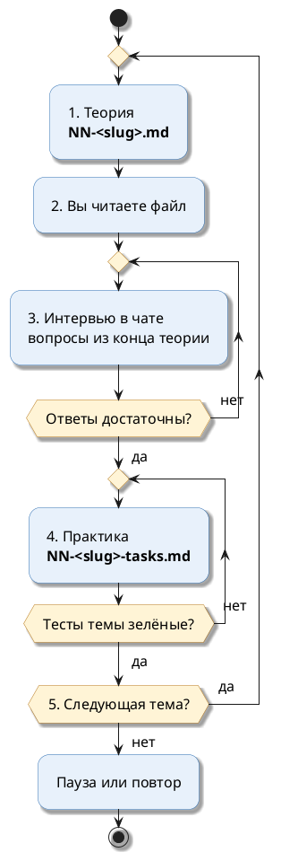

# Памятка агенту: как готовить курс к собеседованию

Документ для агента, которому дали задачу: *«По памятке `reactive-study/docs/COURSE-AUTHORING-GUIDE.md` сделай курс по <тема>»*.

Курс — это набор файлов теории и практики, по которому человек готовится к собеседованию. Сначала он читает теорию, потом проходит интервью в чате, потом решает задачи, а тесты проверяют решения.

---

## Оглавление

- [1. Сначала посмотри образцы](#1-сначала-посмотри-образцы)
- [2. Что получится в итоге](#2-что-получится-в-итоге)
- [3. Порядок работы](#3-порядок-работы)
- [4. Файл плана 00-plan.md](#4-файл-плана-00-planmd)
- [5. Файл теории NN-slug.md](#5-файл-теории-nn-slugmd)
- [6. Файл практики NN-slug-tasks.md](#6-файл-практики-nn-slug-tasksmd)
- [7. Код практики и тесты](#7-код-практики-и-тесты)
- [8. Схемы](#8-схемы)
- [9. Цитаты из официальных источников](#9-цитаты-из-официальных-источников)
- [10. Оформление markdown](#10-оформление-markdown)
- [11. Проверка перед сдачей](#11-проверка-перед-сдачей)
- [12. Частые ошибки](#12-частые-ошибки)
- [13. Как работать с человеком по курсу](#13-как-работать-с-человеком-по-курсу)

---

## 1. Сначала посмотри образцы

**Главный образец — курс Project Reactor.** Он сделан полностью по этой памятке: теория, практика, код, тесты на Postgres в Testcontainers.

Прежде чем писать свой курс, открой и прочитай файлы из таблицы. Оформляй так же.

| Что посмотреть | Путь | Зачем |
|---|---|---|
| План курса | [`reactor-course/00-plan.md`](reactor-course/00-plan.md) | структура плана, правила, программа тем, прогресс |
| Теория, простая тема | [`reactor-course/01-publisher-subscriber.md`](reactor-course/01-publisher-subscriber.md) | аналогия → «Как это устроено в коде» → код → разбор → цитата → правило |
| Теория со схемами и таблицами | [`reactor-course/04-flatmap.md`](reactor-course/04-flatmap.md), [`reactor-course/07-schedulers.md`](reactor-course/07-schedulers.md) | PlantUML, сравнение вариантов таблицей |
| Практика | [`reactor-course/04-flatmap-tasks.md`](reactor-course/04-flatmap-tasks.md), [`reactor-course/12-lifecycle-debug-tasks.md`](reactor-course/12-lifecycle-debug-tasks.md) | «Ситуация» → «Что сделать» → «Ожидаемый результат» |
| Заготовка задачи | `reactive-study/src/main/java/com/example/reactivestudy/reactorcourse/t04/T04OrderTasks.java` | метод с `throw Todo.task("04.N")` |
| Готовая «внешняя система» | `reactive-study/src/main/java/com/example/reactivestudy/reactorcourse/t04/DeliveryEstimateService.java` | класс, который считает вызовы для теста |
| Тест задачи | `reactive-study/src/test/java/com/example/reactivestudy/reactorcourse/t04/T04OrderTasksTest.java` | что и как проверяет тест |
| Общая база для тестов | `reactive-study/src/test/java/com/example/reactivestudy/reactorcourse/CoursePostgresTest.java` | Postgres в Testcontainers, сброс таблиц |
| Заглушка «задача не решена» | `reactive-study/src/main/java/com/example/reactivestudy/reactorcourse/common/Todo.java` | сообщение с номером задачи и путём к условию |
| Учебные данные | `reactive-study/src/main/resources/db/migration/V17__reactor_course.sql` | таблицы с префиксом курса, все строки заданы явно |

**Другие курсы в том же стиле** (практика в них без кода и тестов):

| Курс | План |
|---|---|
| SQL | [`sql-course/00-plan.md`](sql-course/00-plan.md) |
| Java Concurrency | [`java-concurrency-course/00-plan.md`](java-concurrency-course/00-plan.md) |

**Исходные материалы по темам собеседований** — `docs/interview/` в корне репозитория. Они показывают, **что спрашивают**, но источником технических правил не считаются (см. [раздел 9](#9-цитаты-из-официальных-источников)).

---

## 2. Что получится в итоге

```text
reactive-study/docs/<slug>-course/
├── 00-plan.md                  ← план: правила, программа тем, прогресс
├── 01-<slug>.md                ← теория темы 01 + вопросы интервью
├── 01-<slug>-tasks.md          ← практика темы 01
├── 02-<slug>.md
├── 02-<slug>-tasks.md
└── …

reactive-study/src/main/java/com/example/reactivestudy/<course>/
├── common/                     ← сущности, репозитории, исключения, Todo
└── t01/ … tNN/                 ← заготовки задач и готовые вспомогательные классы

reactive-study/src/test/java/com/example/reactivestudy/<course>/
├── <Course>PostgresTest.java   ← базовый класс с Testcontainers
└── t01/ … tNN/                 ← проверочные тесты

reactive-study/src/main/resources/db/migration/
└── V<N>__<course>.sql          ← учебные таблицы с префиксом курса
```

Если по теме курса нет кода (например, только SQL), часть с `src/` не нужна: задачи и проверка — в файлах практики, как в `sql-course`.

---

## 3. Порядок работы

1. **Прочитать образцы** из [раздела 1](#1-сначала-посмотри-образцы).
2. **Собрать материал:** что спрашивают — из `docs/interview/<тема>`; правила — из официальной документации, цитаты сохранить дословно.
3. **Написать `00-plan.md`:** граница курса, цель, среда, программа тем, таблица прогресса.
4. **Подготовить инфраструктуру:** миграция с учебными данными, базовый тестовый класс, `Todo`. Прогнать один пустой тест — база поднимается.
5. **По каждой теме:**
   1. Написать теорию `NN-<slug>.md`.
   2. Проверить каждое утверждение о поведении запуском кода или цитатой.
   3. Написать практику `NN-<slug>-tasks.md`, заготовки и тесты.
   4. Написать эталонное решение каждой задачи и прогнать тесты — все зелёные.
   5. Заменить решения заготовками `throw Todo.task("NN.M")`. Убедиться, что код компилируется, а тесты падают с сообщением «Задача NN.M не решена».
6. **Эталоны** сохранить **вне репозитория** — в своём agent store. В репозиторий решения не попадают.
7. **Связать с репозиторием:** строка в таблице «Курсы» в [`reactive-study/README.md`](../README.md); описание таблиц в `src/main/resources/db/BUSINESS-CASE.md`.
8. **Выполнить проверки** из [раздела 11](#11-проверка-перед-сдачей).
9. **Коротко отчитаться:** что сделано, где лежит, что проверено.

**Внимание:**

Не выдумывать поведение библиотеки. Если не уверен — запусти пример или найди цитату. Наблюдение из запуска так и подписывается: «запуск на <библиотека> <версия>».

---

## 4. Файл плана 00-plan.md

Образец: [`reactor-course/00-plan.md`](reactor-course/00-plan.md). Разделы в таком порядке:

| Раздел | Что в нём |
|---|---|
| Вступление | «Документ — единая точка отсчёта», одна тема за раз |
| Оглавление | ссылки на все разделы и темы |
| Граница курса | сколько тем, по каким материалам, **что не входит** |
| Цель | список «после курса уметь…» |
| Среда | таблица: модуль, JDK, библиотеки, база, где писать, как проверять; команды запуска тестов |
| Структура папки | дерево файлов и таблица «файл → содержание» |
| Учебные данные | таблицы, число строк, сами данные, если по ним считаются ожидаемые результаты |
| Как подаётся теория | шаги блока теории, правила схем, оформление, ограничения объёма |
| Цитаты | правила цитирования и шаблон блока |
| Цикл одной темы | PlantUML activity (шаблон — в [разделе 8](#8-схемы)) и таблица шагов |
| Как формулируются задания | правила и пример «неправильно / правильно» |
| Как устроена практика в коде | `Todo`, сигнатуры, готовые классы |
| Проверка ответов | когда интервью и практика засчитаны |
| Программа тем | по каждой теме: «Что спрашивают», ключевая цитата, «Практика» одной строкой |
| Текущий прогресс | таблица тем с ⬜ / ✅ |
| Как напоминать в чате | фразы и что делает ассистент |

---

## 5. Файл теории NN-slug.md

Образец: [`reactor-course/01-publisher-subscriber.md`](reactor-course/01-publisher-subscriber.md).

**Шапка файла:**

```markdown
# Тема 04. flatMap, concatMap, flatMapSequential

> **Статус:** теория · **Дальше:** интервью в чате, затем [практика](04-flatmap-tasks.md)

---

## Оглавление
…
```

**Каждый раздел строится по шагам:**

| Шаг | Метка в файле | Что в нём |
|---|---|---|
| 1 | `**Аналогия:**` | ситуация из жизни без терминов: склад, касса, конвейер. Короткие абзацы |
| 2 | `**Как это устроено в коде:**` | список «часть аналогии → элемент кода», по одному факту на пункт |
| 3 | — | минимальный пример кода с выводом в комментарии |
| 4 | `**Разбор:**` | что происходит в неочевидных строках — списком |
| 5 | `**Как работает:**` | что гарантирует спецификация или документация (по необходимости) |
| 6 | `**Почему не иначе:**` | наивный вариант и как он ломается — списком |
| 7 | — | цитата из официального источника и перевод |
| 8 | `**Правило:**` | вывод одной строкой |

**Дополнительные метки** — если нужны: `**Внимание:**`, `**Ловушка:**`, `**Для сравнения:**`, `**Когда нужен:**`.

**Образец шага 1 и 2:**

```markdown
**Аналогия:**

Склад отгружает товар магазину. Магазин заключает со складом договор и по нему звонит: «пришлите ещё три коробки».

Склад шлёт не больше, чем просили.

**Как это устроено в коде:**

- **Склад** — `Publisher`: источник элементов.
- **Магазин** — `Subscriber`: получатель элементов.
- **Договор** — `Subscription`: связь одного подписчика с одним издателем. Через неё подписчик:
  - просит элементы — `request(n)`;
  - отказывается от них — `cancel()`.
```

**В конце файла:**

- раздел `## Вопросы для интервью` — 6–8 вопросов на понимание, нумерованным списком;
- строка `**Практика:** [NN-<slug>-tasks.md](NN-<slug>-tasks.md)`.

**Упражнений в файле теории нет.** Только объяснение и вопросы.

---

## 6. Файл практики NN-slug-tasks.md

Образец: [`reactor-course/04-flatmap-tasks.md`](reactor-course/04-flatmap-tasks.md).

**Шапка:**

```markdown
# Тема 04. Практика: flatMap, concatMap, flatMapSequential

> **Статус:** практика · **Как сдавать:** заполните методы и запустите тесты темы. В чате: *«Проверь задание 04.N»*.
```

**Раздел «Правила»:**

- таблица «задачи → класс решения → тест»;
- готовые классы — списком, у каждого вложенный список того, что он умеет;
- числовые данные готовых классов — таблицей (город → задержка → срок);
- запреты: что не использовать в решении.

**Каждая задача:**

```markdown
## Задача 3. Сроки доставки, не больше двух запросов одновременно

**Ситуация:**

Сервис сроков доставки принадлежит партнёру. По договору к нему можно обращаться не больше чем двумя запросами одновременно.

При этом по очереди — слишком долго.

**Что сделать:**

`deliveryLines(List<String> cities)` — строка `<город>: <дни> дн.` на каждый город.

1. Одновременно к сервису — не больше двух запросов.
2. Все четыре города — меньше чем за 700 мс.
3. Порядок строк не важен.

**Ожидаемый результат:**

- строки `Москва: 1 дн.`, `Казань: 3 дн.` … в любом порядке;
- запросов в работе одновременно — ровно 2;
- вызовов сервиса — 4.
```

**Правила формулировки задач:**

| Правило | Как делать |
|---|---|
| Ситуация из работы | отчёт, касса, склад, платёж — а не «выведите числа» |
| Итог измерим | точные значения, порядок, число вызовов, время, имя потока |
| Без имени средства | не писать, каким оператором или методом решать |
| Без отсылок | не писать «как в задаче 2» |
| Только пройденное | решение возможно средствами текущей и прошлых тем |
| Не повтор теории | данные и ситуация отличаются от примеров теории |
| Несколько сценариев | таблица «вход → результат → что проверяет тест» |
| Пошаговый сценарий | нумерованный список: «1. Пришли 1, 2. 2. Обработчик просит 1…» |

**Неправильно:** «Используйте `concatMap`, чтобы сохранить порядок».

**Правильно:** «Заказы идут блоками по клиентам в порядке номера клиента. Внутри блока — по возрастанию номера заказа».

**В конце файла** — раздел `## Проверка` с командой запуска тестов темы.

---

## 7. Код практики и тесты

**Заготовка:**

- тело метода-задачи — `throw Todo.task("NN.M");`;
- `Todo.task` бросает исключение «Задача NN.M не решена» с путём к условию;
- сигнатуры менять нельзя: по ним работает тест.

**Готовые классы** («Готовый класс, менять не нужно») изображают внешние системы: сервис, шлюз, журнал, хранилище. Они:

- считают вызовы;
- запоминают имена потоков и время вызова;
- считают, сколько вызовов шло одновременно.

Так тест проверяет **поведение**, а не текст решения.

**Тесты:**

- JUnit, база — Postgres в Testcontainers через общий базовый класс;
- перед каждым тестом таблицы, в которые пишут задачи, возвращаются к данным из миграции;
- время в тестах по возможности виртуальное — тест не ждёт реальные секунды;
- тест не подсказывает решение: проверяет результат, порядок, число вызовов, потоки, время.

**Учебные данные:**

- отдельная миграция Flyway, таблицы с префиксом курса (`rc_` у Reactor);
- все строки заданы явно, без `random()`: ожидаемые числа не меняются от запуска к запуску;
- есть «пустой» случай: клиент без заказов, пустая таблица.

**Эталонные решения:**

1. Отметить решение в коде маркерами `// solution NN.M` … `// end solution`.
2. Прогнать все тесты курса — зелёные.
3. Сохранить копию кода с решениями в своём agent store.
4. Скриптом заменить блоки маркеров на `throw Todo.task("NN.M");`.
5. Проверить: компилируется, тесты падают с сообщением о нерешённой задаче.

---

## 8. Схемы

| Правило | Как делать |
|---|---|
| Формат | только блок ` ```plantuml ` с `@startuml` … `@enduml` или рисунок `images/*.png` |
| Запрещено | **mermaid** и схемы текстом (ASCII, стрелки в строке) |
| Размер | `skinparam defaultFontSize 16` |
| Одна схема | одна мысль, не больше 8–10 элементов |
| Типы | sequence — порядок сигналов и вызовов; activity — шаги процесса; rectangle — связи компонентов |
| Activity | **без** `top to bottom direction` — PlantUML выдаёт ошибку |
| Проверка | каждая схема рендерится: `java -jar plantuml.jar -charset UTF-8 -tpng file.puml` |

**Шаблон цикла темы для `00-plan.md`:**



---

## 9. Цитаты из официальных источников

Каждое утверждение о поведении библиотеки опирается на **официальный** источник: Javadoc, Reference Guide, спецификацию, документацию фреймворка или СУБД.

| Правило | Как делать |
|---|---|
| Цитата по делу | ровно тот фрагмент, на котором держится соседнее утверждение |
| Контекст | перед цитатой сказано, к какому классу и методу она относится |
| Дословно | английский фрагмент без изменений, сокращения — через `…` |
| Перевод | сразу после цитаты, полный, **без добавленных фраз** |
| Без цитат по памяти | страница перечитывается (WebFetch) перед публикацией |
| Нет цитаты | факт подтверждается запуском, а в тексте так и написано: «запуск на … показал» |

**Шаблон блока:**

```markdown
Javadoc `Flux.take(long)`:

- Источник: https://projectreactor.io/docs/core/release/api/reactor/core/publisher/Flux.html#take(long)

> Take only the first N values from this Flux, if available. …

RU:

> Берёт только первые N значений из этого `Flux`, если они есть. …
```

**Ловушка:**

Свой вывод нельзя дописывать внутрь перевода цитаты. Он идёт отдельным блоком `**Разбор:**` после цитаты.

---

## 10. Оформление markdown

Текст должен читаться с первого взгляда. Сплошные абзацы — главная претензия к прошлым версиям.

| Правило | Как делать |
|---|---|
| Метка блока | жирная, с двоеточием, **на отдельной строке**; текст — со следующего абзаца |
| Соответствие «аналогия → код» | каждая пара — отдельный пункт: `- **Склад** — `Publisher`: …` |
| Перечисление | два и больше однотипных факта — список, а не предложение через запятую или «;» |
| Шаги по порядку | нумерованный список |
| Сравнение, «вход → результат» | таблица |
| Абзац | не больше двух предложений |
| Блок `bash` | после открывающей строки ` ```bash ` — **пустая строка**, затем команды |
| Пути в командах | WSL: `/mnt/d/Project_infra/greeting-service-infra/...` |
| Язык | текст по-русски, код, команды и идентификаторы — по-английски |

**Неправильно:**

```markdown
**Технический перевод.** `map(f)` синхронно применяет функцию к каждому элементу и отправляет результат вниз. `filter(p)` пропускает элемент, если предикат вернул `true`. Отброшенный элемент downstream не видит, но спрос не теряется.
```

**Правильно:**

```markdown
**Как это устроено в коде:**

- **Маляр** — `map(f)`: синхронно применяет функцию к каждому элементу и отправляет результат вниз.
- **Контролёр** — `filter(p)`: пропускает элемент, если предикат вернул `true`.
- **Замена брака** — спрос не теряется: `filter` сам просит у upstream ещё один элемент.
```

**Запрещённые метки:** `**Технический перевод.**` (непонятно читателю) и любые метки с точкой вместо двоеточия.

---

## 11. Проверка перед сдачей

| Проверка | Как |
|---|---|
| Тесты на эталонах | все зелёные |
| Заготовки | компилируются; тесты падают с «Задача NN.M не решена» |
| Схемы | каждая PlantUML рендерится без ошибок |
| Mermaid | поиск ` ```mermaid ` по папке курса — пусто |
| Метки | поиск `^\*\*[^*]+\.\*\*` (метка с точкой) и `Технический перевод` — пусто |
| Метки в одной строке с текстом | поиск `^\*\*[^*]+:\*\* .+` в файлах практики — пусто |
| Блоки `bash` | после ` ```bash ` везде пустая строка |
| Ссылки | все относительные ссылки ведут на существующие файлы и якоря |
| Цитаты | у каждой внешней ссылки — цитата и перевод |
| README | курс добавлен в таблицу «Курсы» в [`reactive-study/README.md`](../README.md) |

---

## 12. Частые ошибки

- Схема на mermaid или текстом — переделать на PlantUML или PNG.
- Сплошной абзац из 4–5 предложений — разбить на абзацы и списки.
- «**Ситуация:** текст…» в одной строке — метку на отдельную строку.
- «Ожидаемый результат» перечислением через «;» — список или таблица.
- В задаче названо средство решения («используйте `zip`») — заменить требованием к результату.
- Утверждение о поведении без цитаты и без запуска — проверить или убрать.
- В перевод цитаты дописана своя фраза — вынести в «Разбор».
- Эталонное решение осталось в репозитории — вернуть `throw Todo.task(...)`.
- Тест зависит от случайных данных или реального времени — зафиксировать данные, перейти на виртуальное время.

---

## 13. Как работать с человеком по курсу

| Фраза человека | Что делает агент |
|---|---|
| *«Работаем по плану курса <тема>»* | открывает `00-plan.md` курса и продолжает текущий шаг |
| *«Где мы в плане?»* | называет тему и шаг: теория, интервью или практика |
| *«Изучил тему N, дай интервью»* | задаёт 4–6 вопросов по одному, на понимание; пробел называет прямо |
| *«Проверь задание N.M»* | читает решение, запускает тесты темы, разбирает падения |
| *«Подсказка к N.M»* | наводящий вопрос, без названия средства |
| *«Следующая тема»* | отмечает прогресс в `00-plan.md` и предлагает тему N+1 |

**Общие правила общения** — из `.cursor/rules/`: отвечать по-русски, коротко, по одному шагу; команды в терминале выполняет человек (`wsl -d Ubuntu`), если не попросил иначе.

---

*Создано: 2026-10-19 по итогам курса Project Reactor.*
