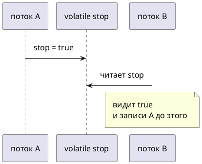

# Тема 03. Видимость и volatile

> **Статус:** теория · **Дальше:** интервью в чате, затем [практика](03-volatile-tasks.md)

---

## Оглавление

- [1. Цикл, который «не видит» остановку](#1-цикл-который-не-видит-остановку)
- [2. Что даёт volatile](#2-что-даёт-volatile)
- [3. volatile не делает ++ атомарным](#3-volatile-не-делает--атомарным)
- [4. long и double](#4-long-и-double)
- [5. happens-before: рабочее правило](#5-happens-before-рабочее-правило)
- [6. Когда volatile, когда замок](#6-когда-volatile-когда-замок)
- [Типичные ошибки](#типичные-ошибки)
- [Вопросы для интервью](#вопросы-для-интервью)

---

## 1. Цикл, который «не видит» остановку

**Аналогия:**

Сторож смотрит на флажок «закрыто» на своём столе и ходит по кругу. Хозяин сменил флажок на двери, но сторож **не подходит к двери** — он смотрит на свою копию.

**Как это устроено в коде:**

- **Флажок на столе** — значение поля, которое поток держит у себя (кэш, регистр).
- **Флажок на двери** — поле в общей памяти.
- Без согласования компилятор и процессор **не обязаны** каждый раз читать поле заново.

JLS 17.3 приводит цикл с `Thread.sleep` и обычным `boolean done`. Компилятор может прочитать поле **один раз** и крутить цикл вечно.

```java
public class StopLoopDemo {
    static boolean stop;

    public static void main(String[] args) throws InterruptedException {
        Thread worker = new Thread(() -> {
            while (!stop) {
            }
            System.out.println("стоп");
        });
        worker.start();
        Thread.sleep(200);
        stop = true;
        worker.join(1000);
        System.out.println(worker.isAlive() ? "всё ещё крутится" : "завершён");
    }
}
```

**Разбор:**

- `main` пишет `stop = true`.
- `worker` крутит `while (!stop)` без паузы.
- На части запусков и JVM цикл **может не увидеть** запись — это не баг вашей логики, а отсутствие happens-before.

- Источник: https://docs.oracle.com/javase/specs/jls/se17/html/jls-17.html

> It is important to note that neither `Thread.sleep` nor `Thread.yield` have any synchronization semantics. … The compiler is free to read the field `this.done` just once, and reuse the cached value in each execution of the loop. This would mean that the loop would never terminate, even if another thread changed the value of `this.done`.

RU:

> Важно, что ни `Thread.sleep`, ни `Thread.yield` не имеют семантики синхронизации. … Компилятор свободен прочитать поле `this.done` один раз и переиспользовать закэшированное значение в каждой итерации. Тогда цикл никогда не завершится, даже если другой поток изменит `this.done`.

**Правило:** обычное поле без замка и без `volatile` **не обязано** быть видно другому потоку.

---

## 2. Что даёт volatile

**Аналогия:**

Флажок теперь на **стеклянной двери**: кто пишет — все видят новую сторону. Но это всё ещё один флажок, а не касса с очередью.

**Как это устроено в коде:**

- **Запись в `volatile`** — последующее чтение **того же** поля в другом потоке увидит эту запись.
- **Взаимного исключения нет:** два потока могут писать одновременно.

Java Tutorial, Atomic Access:

- Источник: https://docs.oracle.com/javase/tutorial/essential/concurrency/atomic.html

> Using `volatile` variables reduces the risk of memory consistency errors, because any write to a `volatile` variable establishes a happens-before relationship with subsequent reads of that same variable. This means that changes to a `volatile` variable are always visible to other threads. What's more, it also means that when a thread reads a `volatile` variable, it sees not just the latest change to the `volatile`, but also the side effects of the code that led up the change.

RU:

> Использование переменных `volatile` снижает риск ошибок согласованности памяти, потому что любая запись в `volatile` устанавливает отношение happens-before с последующими чтениями **той же** переменной. Изменения `volatile` всегда видны другим потокам. Более того, поток, читающий `volatile`, видит не только последнюю запись, но и побочные эффекты кода, который к этой записи привёл.



```java
public class VolatileStopDemo {
    static volatile boolean stop;

    public static void main(String[] args) throws InterruptedException {
        Thread worker = new Thread(() -> {
            while (!stop) {
            }
            System.out.println("стоп");
        });
        worker.start();
        Thread.sleep(50);
        stop = true;
        worker.join();
        System.out.println("готово");
    }
}
```

**Разбор:**

- `volatile` на `stop` связывает запись `main` и чтение в цикле.
- Цикл заканчивается. Замок не нужен: меняется **один флаг**, без `++`.

**Правило:** `volatile` — про **видимость одного поля**, не про очередь потоков.

---

## 3. volatile не делает ++ атомарным

**Аналогия:**

Два кассира смотрят на одну и ту же цифру на табло (оба видят 5), оба пишут 6. Табло честное, но **шаги всё равно трое**.

**Как это устроено в коде:**

`count++` = прочитать, прибавить, записать. `volatile` делает каждое чтение и запись видимыми, но **не склеивает три шага**.

```java
public class VolatileRaceDemo {
    static volatile int count;

    public static void main(String[] args) throws InterruptedException {
        Runnable bump = () -> {
            for (int i = 0; i < 100_000; i++) {
                count++;
            }
        };
        Thread a = new Thread(bump);
        Thread b = new Thread(bump);
        a.start();
        b.start();
        a.join();
        b.join();
        System.out.println(count);
    }
}
```

**Разбор:**

- Итог часто **меньше** 200000 — та же гонка, что в теме 02.
- Лечится замком (тема 02) или атомарным классом (тема 08), не одним `volatile`.

- Источник: https://docs.oracle.com/javase/tutorial/essential/concurrency/atomic.html

> We have already seen that an increment expression, such as `c++`, does not describe an atomic action.

RU:

> Мы уже видели, что выражение инкремента, такое как `c++`, не описывает атомарное действие.

**Правило:** флаг остановки — `volatile`; счётчик `++` — замок или атомик.

---

## 4. long и double

**Аналогия:**

Большое число написано на **двух листочках**. Без правила «писать целиком» читатель может взять левую половину от одной записи и правую от другой.

**Как это устроено в коде:**

JLS 17.7: запись не-`volatile` `long`/`double` **может** считаться двумя 32-битными записями.

- Источник: https://docs.oracle.com/javase/specs/jls/se17/html/jls-17.html#jls-17.7

> For the purposes of the Java programming language memory model, a single write to a non-volatile `long` or `double` value is treated as two separate writes: one to each 32-bit half. … Writes and reads of volatile `long` and `double` values are always atomic.

RU:

> Для модели памяти языка одна запись в не-`volatile` `long` или `double` рассматривается как две отдельные записи: по одной на каждую 32-битную половину. … Чтения и записи `volatile` `long` и `double` всегда атомарны.

**Правило:** общее `long`/`double` между потоками — `volatile` или замок. Это про **цельность записи**, не про `++`.

---

## 5. happens-before: рабочее правило

**Аналогия:**

«Сначала повесили объявление, **потом** открыли дверь». Кто вошёл после открытия, видит объявление. Без этой связи объявление могли не заметить.

**Как это устроено в коде:**

Запись потока A видна чтению потока B, только если есть happens-before от записи к чтению.

Javadoc пакета `java.util.concurrent` (JDK 17):

- Источник: https://docs.oracle.com/en/java/javase/17/docs/api/java.base/java/util/concurrent/package-summary.html

> The results of a write by one thread are guaranteed to be visible to a read by another thread only if the write operation happens-before the read operation. The `synchronized` and `volatile` constructs, as well as the `Thread.start()` and `Thread.join()` methods, can form happens-before relationships. In particular:
>
> - An unlock (`synchronized` block or method exit) of a monitor happens-before every subsequent lock … of that same monitor.
> - A write to a `volatile` field happens-before every subsequent read of that same field. … do not entail mutual exclusion locking.
> - A call to `start` on a thread happens-before any action in the started thread.
> - All actions in a thread happen-before any other thread successfully returns from a `join` on that thread.

RU:

> Результаты записи одного потока гарантированно видны чтению другого только если запись happens-before чтения. Конструкции `synchronized` и `volatile`, а также `Thread.start()` и `Thread.join()`, могут создавать happens-before. В частности:
>
> - Unlock монитора happens-before каждого последующего lock **того же** монитора.
> - Запись в `volatile` happens-before каждого последующего чтения **того же** поля. … взаимного исключения при этом нет.
> - Вызов `start` happens-before действий запущенного потока.
> - Все действия потока happens-before успешного возврата из `join` на этом потоке.


**Правило:** нет happens-before — нет гарантии увидеть чужую запись.

---

## 6. Когда volatile, когда замок

| Нужно | Средство |
|---|---|
| Один флаг «стоп» / «готово» | `volatile` |
| `count++`, баланс, «проверь и спиши» | замок темы 02 |
| Цельная запись `long`/`double` | `volatile` или замок |
| Несколько полей как одно целое | один замок на все поля |

**Почему не иначе:**

- `volatile` на счётчике оставляет гонку.
- Замок на одном флаге работает, но тяжелее, чем нужно.

**Правило:** сначала спросите: это **один флаг** или **чтение-изменение-запись**?

---

## Типичные ошибки

| Ошибка | Что получится |
|---|---|
| Цикл `while (!stop)` без `volatile` и без замка | цикл может не остановиться |
| `volatile int n` и `n++` | итог плавает |
| «`sleep` в цикле сделает поле видимым» | JLS: `sleep` синхронизации не даёт |
| `volatile` на объекте «публикует» все его поля навсегда | видна ссылка; поля объекта — по своим правилам |

---

## Вопросы для интервью

1. Чем гонка (тема 02) отличается от ошибки видимости?
2. Что гарантирует `volatile`, а чего не гарантирует?
3. Почему `volatile int count` и `count++` всё равно ломаются?
4. Зачем `volatile` у `long` и `double`?
5. Назовите четыре рабочих источника happens-before: замок, `volatile`, `start`, `join`.
6. Почему `Thread.sleep` в цикле не заменяет `volatile`?
7. Когда достаточно флага, а когда нужен замок с темы 02?

---

**Практика:** [03-volatile-tasks.md](03-volatile-tasks.md)

*Тема 03 курса [`00-plan.md`](00-plan.md).*
