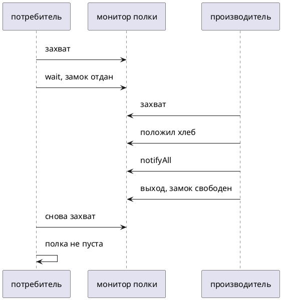

# Тема 04. wait, notify, notifyAll

> **Статус:** теория · **Дальше:** интервью в чате, затем [практика](04-wait-notify-tasks.md)

---

## Оглавление

- [1. Ждать условие, а не крутить цикл](#1-ждать-условие-а-не-крутить-цикл)
- [2. wait отдаёт замок](#2-wait-отдаёт-замок)
- [3. Условие проверяют в while](#3-условие-проверяют-в-while)
- [4. notify и notifyAll](#4-notify-и-notifyall)
- [5. Полка: производитель и потребитель](#5-полка-производитель-и-потребитель)
- [Типичные ошибки](#типичные-ошибки)
- [Вопросы для интервью](#вопросы-для-интервью)

---

## 1. Ждать условие, а не крутить цикл

**Аналогия:**

Покупатель не топчется у пустой полки. Он садится и просит: «позовите, когда положат хлеб». Кладовщик кладёт хлеб и зовёт.

**Как это устроено в коде:**

- **Пустая полка** — общее поле и условие (`empty`).
- **Сесть и ждать** — `Object.wait()`.
- **Позвать** — `notify()` или `notifyAll()`.

Java Tutorial, Guarded Blocks: крутить `while (!joy) {}` — трата процессора. Нужен `wait`.

- Источник: https://docs.oracle.com/javase/tutorial/essential/concurrency/guardmeth.html

> A more efficient guard invokes `Object.wait` to suspend the current thread. … Note: Always invoke `wait` inside a loop that tests for the condition being waited for.

RU:

> Более эффективная защита вызывает `Object.wait`, чтобы приостановить текущий поток. … Всегда вызывайте `wait` внутри цикла, который проверяет условие ожидания.



**Правило:** ждут **условие**, а не «просто паузу». Пауза без отдачи замка — `sleep` (тема 01).

---

## 2. wait отдаёт замок

**Аналогия:**

Кто сел ждать, **отдаёт ключ от комнаты**. Иначе кладовщик не войдёт положить хлеб.

**Как это устроено в коде:**

`wait` вызывают **только** владея монитором этого объекта. Иначе `IllegalMonitorStateException`.

Javadoc `Object.wait` (JDK 17):

- Источник: https://docs.oracle.com/en/java/javase/17/docs/api/java.base/java/lang/Object.html#wait()

> This method should only be called by a thread that is the owner of this object's monitor. … The current thread must own this object's monitor. The thread releases ownership of this monitor and waits until another thread notifies threads waiting on this object's monitor to wake up …

RU:

> Метод должен вызывать только поток — владелец монитора этого объекта. … Поток освобождает владение монитором и ждёт, пока другой поток не известит ожидающих …

**Разбор:**

- `sleep` замок **не** отдаёт (тема 01).
- После `wait` поток снова **захватывает** тот же монитор, прежде чем продолжить.

**Правило:** `wait` / `notify` / `notifyAll` — только внутри `synchronized` **на том же объекте**.

---

## 3. Условие проверяют в while

**Аналогия:**

Позвали всех у полки. Подошёл не тот, или хлеб уже забрали. Нужно снова посмотреть на полку, а не верить крику.

**Как это устроено в коде:**

Поток может проснуться **без** `notify` — spurious wakeup. Javadoc `Object.wait`:

- Источник: https://docs.oracle.com/en/java/javase/17/docs/api/java.base/java/lang/Object.html#wait()

> A thread can wake up without being notified, interrupted, or timing out, a so-called spurious wakeup. … The recommended approach to waiting is to check the condition being awaited in a `while` loop around the call to `wait`.

RU:

> Поток может проснуться без извещения, прерывания и таймаута — ложное пробуждение. … Рекомендуемый способ — проверять условие в цикле `while` вокруг вызова `wait`.

```java
synchronized (shelf) {
    while (shelf.empty) {
        shelf.wait();
    }
    // здесь полка не пуста и замок у нас
}
```

**Почему не иначе:**

- `if` + `wait`: проснулись зря или условие уже ложно — идёте дальше с пустой полкой.

**Правило:** `while (!условие) wait()`, не `if`.

---

## 4. notify и notifyAll

**Аналогия:**

`notify` — ткнуть **одного** спящего наугад. `notifyAll` — разбудить всех, каждый снова смотрит на полку.

Javadoc `Object.notify` (JDK 17):

- Источник: https://docs.oracle.com/en/java/javase/17/docs/api/java.base/java/lang/Object.html#notify()

> Wakes up a single thread that is waiting on this object's monitor. If any threads are waiting on this object, one of them is chosen to be awakened. The choice is arbitrary and occurs at the discretion of the implementation.

RU:

> Будит один поток, ждущий на мониторе этого объекта. Если ждут несколько, выбирается один. Выбор произвольный и на усмотрение реализации.

**Как работает:**

- Разбуженный **не** продолжает сразу: сначала текущий поток должен **отдать замок**.
- При разнородных ждущих (кто ждёт «пусто», кто «полно») `notify` может разбудить **не того**. Тогда сигнал потерян, пока кто-то не позовёт снова.

Tutorial:

> Because `notify` doesn't allow you to specify the thread that is woken up, it is useful only in massively parallel applications … all doing similar chores.

RU:

> `notify` не даёт указать, кого будить, поэтому он полезен только когда много потоков делают одну и ту же работу.

**Правило:** пока не уверены, что все ждут одно и то же — `notifyAll`.

---

## 5. Полка: производитель и потребитель

**Аналогия:**

Одна ячейка. Кладовщик не кладёт вторую буханку, пока первую не забрали. Покупатель не берёт с пустой полки.

**Как это устроено в коде:**

Оба метода на **одном** мониторе. Два условия: «пусто» и «занято». Tutorial — класс `Drop`.

```java
public class Shelf {
    private String loaf;
    private boolean empty = true;

    public synchronized String take() throws InterruptedException {
        while (empty) {
            wait();
        }
        empty = true;
        notifyAll();
        return loaf;
    }

    public synchronized void put(String loaf) throws InterruptedException {
        while (!empty) {
            wait();
        }
        empty = false;
        this.loaf = loaf;
        notifyAll();
    }
}
```

**Разбор:**

- `put` ждёт, пока `empty`.
- `take` ждёт, пока не `empty`.
- После смены флага зовут всех: второй участник проверит своё условие.

**Правило:** одно общее состояние — один монитор, два `while`, сигнал после изменения.

---

## Типичные ошибки

| Ошибка | Что получится |
|---|---|
| `wait` без `synchronized` | `IllegalMonitorStateException` |
| `wait` на `this`, `notify` на другом объекте | никто не проснётся |
| `if` вместо `while` | ложное пробуждение, чужой сигнал |
| `notify` при разных условиях | разбудили не того, зависание |
| `sleep` вместо `wait` внутри замка | второй поток не войдёт |

---

## Вопросы для интервью

1. Чем `wait` отличается от `sleep` по владению замком?
2. Почему `wait` вызывают только внутри `synchronized`?
3. Почему условие проверяют в `while`, а не в `if`?
4. Что такое spurious wakeup?
5. Когда `notify` вместо `notifyAll` теряет пробуждение?
6. Почему разбуженный поток не сразу выполняет код — что он делает с замком?
7. Как выглядят два условия «пусто / полно» на одной полке?

---

**Практика:** [04-wait-notify-tasks.md](04-wait-notify-tasks.md)

*Тема 04 курса [`00-plan.md`](00-plan.md).*
