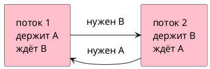
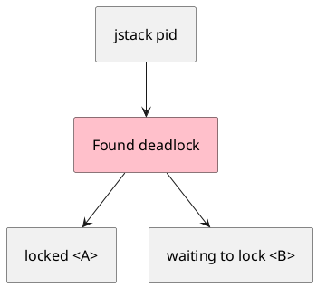

# Тема 05. Deadlock, livelock, starvation

> **Статус:** теория · **Дальше:** интервью в чате, затем [практика](05-deadlock-tasks.md)

---

## Оглавление

- [1. Два ключа навстречу](#1-два-ключа-навстречу)
- [2. Четыре условия](#2-четыре-условия)
- [3. Один порядок захвата](#3-один-порядок-захвата)
- [4. Livelock](#4-livelock)
- [5. Starvation](#5-starvation)
- [6. Как увидеть в дампе](#6-как-увидеть-в-дампе)
- [Типичные ошибки](#типичные-ошибки)
- [Вопросы для интервью](#вопросы-для-интервью)

---

## 1. Два ключа навстречу

**Аналогия:**

Два вежливых знакомых кланяются одновременно и **не разгибаются**, пока другой не ответит. Оба ждут вечно.

Java Tutorial, Deadlock: Альфонс и Гастон.

- Источник: https://docs.oracle.com/javase/tutorial/essential/concurrency/deadlock.html

> Deadlock describes a situation where two or more threads are blocked forever, waiting for each other.

RU:

> Deadlock — ситуация, когда два или больше потоков заблокированы навсегда, ожидая друг друга.

```java
public class BowDemo {
    static class Friend {
        final String name;
        Friend(String name) { this.name = name; }

        synchronized void bow(Friend other) {
            System.out.println(name + " ждёт ответа от " + other.name);
            other.bowBack(this);
        }

        synchronized void bowBack(Friend other) {
            System.out.println(name + " ответил " + other.name);
        }
    }

    public static void main(String[] args) {
        Friend a = new Friend("А");
        Friend b = new Friend("Б");
        new Thread(() -> a.bow(b)).start();
        new Thread(() -> b.bow(a)).start();
    }
}
```

**Разбор:**

- Поток 1 держит монитор `a`, зовёт `b.bowBack` — нужен монитор `b`.
- Поток 2 держит `b`, зовёт `a.bowBack` — нужен `a`.
- Оба в `BLOCKED`. Программа часто **не печатает** «ответил» и не выходит (пока живы не-daemon потоки).



**Правило:** два замка в **разном** порядке у двух потоков — классический deadlock.

---

## 2. Четыре условия

**Как это устроено в коде** (все сразу):

1. **Взаимное исключение** — замок один на объект.
2. **Удержание и ожидание** — поток держит A и ждёт B.
3. **Нет вытеснения** — замок сам не отберут, только владелец отдаст.
4. **Круг ожидания** — 1 ждёт 2, 2 ждёт 1.

Уберите любое — deadlock не сложится. На практике чаще всего ломают пункт 4: **один глобальный порядок** объектов.

**Правило:** ищите цикл «кто кого ждёт».

---

## 3. Один порядок захвата

**Аналогия:**

Оба сначала берут ключ с **меньшим номером**, потом с большим. Встречного круга нет.

```java
void transfer(Object from, Object to) {
    Object first = System.identityHashCode(from) < System.identityHashCode(to) ? from : to;
    Object second = first == from ? to : from;
    synchronized (first) {
        synchronized (second) {
            // перевод
        }
    }
}
```

**Разбор:**

- Оба потока захватывают одну и ту же пару в одном порядке.
- Второй ждёт у **первого** замка, но круга нет.

**Почему не иначе:**

- «Сначала свой счёт, потом чужой» при встречном переводе — снова круг.

**Правило:** для любой пары замков зафиксируйте порядок и не нарушайте его.

---

## 4. Livelock

**Аналогия:**

Двое в коридоре: оба отходят влево, потом оба вправо. Ноги движутся, пройти не могут.

- Источник: https://docs.oracle.com/javase/tutorial/essential/concurrency/starvelive.html

> As with deadlock, livelocked threads are unable to make further progress. However, the threads are not blocked — they are simply too busy responding to each other to resume work.

RU:

> Как и при deadlock, потоки не продвигаются. Но они **не заблокированы** — слишком заняты реакцией друг на друга.

**Правило:** deadlock — стоят в `BLOCKED`/`WAITING`. Livelock — бегают и уступают, прогресса нет.

---

## 5. Starvation

**Аналогия:**

Один кассир не выходит из кабины часами. Остальные почти не получают ключ.

- Источник: https://docs.oracle.com/javase/tutorial/essential/concurrency/starvelive.html

> Starvation describes a situation where a thread is unable to gain regular access to shared resources and is unable to make progress. This happens when shared resources are made unavailable for long periods by "greedy" threads.

RU:

> Starvation — поток не получает регулярный доступ к общим ресурсам и не продвигается. Так бывает, когда «жадные» потоки надолго удерживают ресурс.

**Правило:** долгая работа под замком кормит starvation. Честный замок (тема 06) снижает её, но не отменяет планировщик.

---

## 6. Как увидеть в дампе

**Как это устроено в коде:**

1. Запустите программу с deadlock.
2. Снимите дамп потоков: `jstack <pid>` или Ctrl+Break в консоли JVM на Windows.
3. Ищите `Found one Java-level deadlock` и пары `waiting to lock` / `locked`.

Наблюдение из практики (не формулировка спецификации): в дампе у каждого участника круга видно, какой монитор он держит и какой пытается взять.



**Правило:** сначала воспроизведите зависание, потом читайте круг в дампе, не гадайте.

---

## Типичные ошибки

| Ошибка | Что получится |
|---|---|
| Два `synchronized` в разном порядке | deadlock |
| Долгий I/O внутри замка | starvation остальных |
| «Починил» случайным `sleep` | гонка скрыта, deadlock плавает |
| Путать livelock и deadlock | ищут BLOCKED, а потоки RUNNABLE |

---

## Вопросы для интервью

1. Что такое deadlock своими словами?
2. Почему кланяющиеся друзья из учебника зависают?
3. Назовите четыре условия. Какое проще всего убрать в коде?
4. Чем livelock отличается от deadlock?
5. Что такое starvation?
6. Как по дампу потоков понять, что это deadlock, а не просто долгий `join`?

---

**Практика:** [05-deadlock-tasks.md](05-deadlock-tasks.md)

*Тема 05 курса [`00-plan.md`](00-plan.md).*
