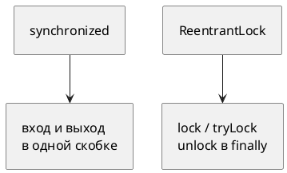
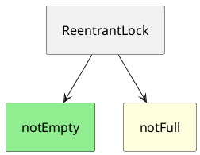

# Тема 06. ReentrantLock и Condition

> **Статус:** теория · **Дальше:** интервью в чате, затем [практика](06-reentrantlock-tasks.md)

---

## Оглавление

- [1. Замок, который можно спросить](#1-замок-который-можно-спросить)
- [2. lock и unlock в finally](#2-lock-и-unlock-в-finally)
- [3. tryLock и таймаут](#3-trylock-и-таймаут)
- [4. Реентерабельность и счётчик](#4-реентерабельность-и-счётчик)
- [5. Честный режим](#5-честный-режим)
- [6. Несколько Condition](#6-несколько-condition)
- [Типичные ошибки](#типичные-ошибки)
- [Вопросы для интервью](#вопросы-для-интервью)

---

## 1. Замок, который можно спросить

**Аналогия:**

У `synchronized` ключ приклеен к двери: вошёл — вышел в той же скобке. `ReentrantLock` — **отдельная связка ключей**: можно попробовать, подождать с часами, отдать в другом методе.

**Как это устроено в коде:**

Javadoc `Lock` (JDK 17):

- Источник: https://docs.oracle.com/en/java/javase/17/docs/api/java.base/java/util/concurrent/locks/Lock.html

> The use of `synchronized` methods or statements … forces all lock acquisition and release to occur in a block-structured way … Implementations of the `Lock` interface enable … a lock to be acquired and released in different scopes … With this increased flexibility comes additional responsibility. The absence of block-structured locking removes the automatic release of locks …

RU:

> `synchronized` заставляет захват и освобождение быть блочными. Реализации `Lock` позволяют захватывать и отпускать в **разных** областях видимости. За гибкость платят ответственностью: автоматического освобождения больше нет.

Javadoc `ReentrantLock`:

- Источник: https://docs.oracle.com/en/java/javase/17/docs/api/java.base/java/util/concurrent/locks/ReentrantLock.html

> A reentrant mutual exclusion `Lock` with the same basic behavior and semantics as the implicit monitor lock accessed using `synchronized` methods and statements, but with extended capabilities.

RU:

> Реентерабельный взаимно исключающий `Lock` с тем же базовым поведением, что у монитора `synchronized`, но с дополнительными возможностями.



**Правило:** тот же взаимный исключающий замок, плюс попытка, таймаут, прерывание, несколько очередей ожидания.

---

## 2. lock и unlock в finally

**Как это устроено в коде:**

Рекомендация из Javadoc `ReentrantLock`:

```java
lock.lock();
try {
    // работа
} finally {
    lock.unlock();
}
```

- Источник: https://docs.oracle.com/en/java/javase/17/docs/api/java.base/java/util/concurrent/locks/ReentrantLock.html

> It is recommended practice to always immediately follow a call to `lock` with a `try` block, most typically in a before/after construction

RU:

> Рекомендуется сразу после `lock` писать блок `try`, обычно в схеме «до / после».

`unlock` не владельцем бросает `IllegalMonitorStateException`.

**Правило:** исключение не должно оставлять замок закрытым — `unlock` только в `finally`.

---

## 3. tryLock и таймаут

**Аналогия:**

Подошли к кабине: занято — **не встаём навечно**, идём к другой или ждём минуту.

Javadoc `tryLock()`:

- Источник: https://docs.oracle.com/en/java/javase/17/docs/api/java.base/java/util/concurrent/locks/ReentrantLock.html#tryLock()

> Acquires the lock only if it is not held by another thread at the time of invocation. … Even when this lock has been set to use a fair ordering policy, a call to `tryLock()` will immediately acquire the lock if it is available, whether or not other threads are currently waiting for the lock.

RU:

> Захватывает замок, только если его **сейчас** не держит другой поток. … Даже на честном замке `tryLock()` без аргументов заберёт свободный замок сразу, **даже если** другие уже ждут.

`tryLock(time, unit)` ждёт ограниченно и **уважает** честность. `lockInterruptibly()` можно прервать во время ожидания замка.

**Почему это чинит встречный захват (тема 05):**

Поток берёт первый замок, второй не дался за 100 мс — **отпускает первый** и пробует снова. Круга «держу и жду вечно» нет.

**Правило:** вечный `lock()` на двух объектах в разном порядке снова даёт deadlock. Спасает возможность **отступить**.

---

## 4. Реентерабельность и счётчик

Тот же поток может захватить замок снова. `getHoldCount()` — сколько раз взяли без пары `unlock`.

- Источник: https://docs.oracle.com/en/java/javase/17/docs/api/java.base/java/util/concurrent/locks/ReentrantLock.html#lock()

> If the current thread already holds the lock then the hold count is incremented by one and the method returns immediately.

RU:

> Если текущий поток уже держит замок, счётчик захватов увеличивается на один, метод сразу возвращается.

**Правило:** каждой паре `lock` — свой `unlock`. Иначе замок останется у потока.

---

## 5. Честный режим

`new ReentrantLock(true)` — при споре предпочтение **дольше ждущему**.

- Источник: https://docs.oracle.com/en/java/javase/17/docs/api/java.base/java/util/concurrent/locks/ReentrantLock.html

> When set `true`, under contention, locks favor granting access to the longest-waiting thread. … Programs using fair locks accessed by many threads may display lower overall throughput (i.e., are slower; often much slower)

RU:

> При `true` в условиях спора замок предпочитает отдать доступ дольше всех ждущему потоку. … Программы с честными замками и многими потоками часто имеют меньшую пропускную способность (медленнее, часто намного).

Честность замка **не** делает честным планировщик ОС.

**Правило:** честный режим — против starvation, ценой скорости.

---

## 6. Несколько Condition

**Аналогия:**

Одна дверь (замок), две очереди: «ждут пустое место» и «ждут товар». Кричат только своей очереди.

Javadoc `Condition`:

- Источник: https://docs.oracle.com/en/java/javase/17/docs/api/java.base/java/util/concurrent/locks/Condition.html

> `Condition` factors out the `Object` monitor methods (`wait`, `notify` and `notifyAll`) into distinct objects to give the effect of having multiple wait-sets per object

RU:

> `Condition` выносит методы монитора `Object` в отдельные объекты: у одного замка несколько множеств ожидания.

Как `wait`: `await` **атомарно** отпускает замок и засыпает. Условие — в `while`. Ложные пробуждения бывают.

Пример из того же Javadoc — `notEmpty` / `notFull`.



**Правило:** один замок, разные условия — разные `Condition`. `signal` будит свою очередь.

---

## Типичные ошибки

| Ошибка | Что получится |
|---|---|
| `unlock` не в `finally` | замок навечно после исключения |
| `tryLock` без проверки `false` | работаете без замка |
| `await` без удержания этого `Lock` | `IllegalMonitorStateException` |
| Смешать `synchronized (lock)` и `lock.lock()` | два разных механизма, друг друга не видят |

---

## Вопросы для интервью

1. Чем `ReentrantLock` отличается от `synchronized` на практике?
2. Почему `unlock` пишут в `finally`?
3. Чем `tryLock()` отличается от `tryLock(time, unit)` на честном замке?
4. Что такое hold count?
5. Что даёт `fair = true` и чем платит?
6. Зачем два `Condition` на одном замке, если есть `notifyAll`?
7. Как `tryLock` с отступлением разрывает deadlock из темы 05?

---

**Практика:** [06-reentrantlock-tasks.md](06-reentrantlock-tasks.md)

*Тема 06 курса [`00-plan.md`](00-plan.md).*
