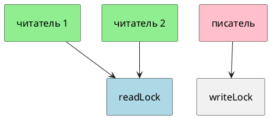

# Тема 07. ReadWriteLock и StampedLock

> **Статус:** теория · **Дальше:** интервью в чате, затем [практика](07-readwritelock-tasks.md)

---

## Оглавление

- [1. Много читателей, один писатель](#1-много-читателей-один-писатель)
- [2. Когда выигрыша нет](#2-когда-выигрыша-нет)
- [3. StampedLock и штамп](#3-stampedlock-и-штамп)
- [4. Оптимистичное чтение](#4-оптимистичное-чтение)
- [5. Не реентерабельный](#5-не-реентерабельный)
- [Типичные ошибки](#типичные-ошибки)
- [Вопросы для интервью](#вопросы-для-интервью)

---

## 1. Много читателей, один писатель

**Аналогия:**

Читальный зал: много людей читают одну книгу-копию правил. Как только библиотекарь **меняет** правила, зал пустеет. Два библиотекаря сразу не правят.

**Как это устроено в коде:**

Javadoc `ReadWriteLock` (JDK 17):

- Источник: https://docs.oracle.com/en/java/javase/17/docs/api/java.base/java/util/concurrent/locks/ReadWriteLock.html

> The read lock may be held simultaneously by multiple reader threads, so long as there are no writers. The write lock is exclusive.

RU:

> Замок чтения могут держать одновременно несколько потоков-читателей, **пока нет писателей**. Замок записи исключающий.

Писатель отпускает запись — читатель видит эти обновления (тот же Javadoc: эффекты `writeLock` видны при захвате `readLock`).



```java
ReadWriteLock rw = new ReentrantReadWriteLock();
rw.readLock().lock();
try { /* чтение */ } finally { rw.readLock().unlock(); }

rw.writeLock().lock();
try { /* запись */ } finally { rw.writeLock().unlock(); }
```

**Правило:** читатели не выстраиваются друг за другом. Читатель и писатель — не одновременно.

---

## 2. Когда выигрыша нет

Тот же Javadoc: выигрыш только если чтений много, записи редкие, чтение не мгновенное. Частые записи — зал всё время закрыт. Короткое чтение — накладные расходы замка больше пользы.

**Правило:** справочник «почти не меняют» — да. Счётчик, который всё время пишут — нет, берите обычный замок.

---

## 3. StampedLock и штамп

**Аналогия:**

Вместо ключа выдают **талон с номером**. Вернули не тот номер — проход не тот.

`StampedLock` — три режима: запись, чтение, оптимистичное чтение. Методы возвращают `long` stamp.

**Правило:** `unlock` тем же штампом, что дали при входе.

---

## 4. Оптимистичное чтение

**Аналогия:**

Взглянули на доску, запомнили цифры. Перед использованием спросили: «пока я смотрел, доску не меняли?» Если меняли — читаем заново уже под обычным чтением.

Javadoc `StampedLock` (JDK 17):

- Источник: https://docs.oracle.com/en/java/javase/17/docs/api/java.base/java/util/concurrent/locks/StampedLock.html

> Method `tryOptimisticRead()` returns a non-zero stamp only if the lock is not currently held in write mode. Method `validate(long)` returns true if the lock has not been acquired in write mode since obtaining a given stamp … Optimistic read sections should only read fields and hold them in local variables for later use after validation. Fields read while in optimistic read mode may be wildly inconsistent

RU:

> `tryOptimisticRead()` возвращает ненулевой штамп, только если замок сейчас не в режиме записи. `validate(long)` возвращает true, если с момента штампа запись не захватывалась. … Оптимистичное чтение должно только читать поля в локальные переменные и проверять их после `validate`. Поля в этом режиме могут быть сильно несогласованы.

```java
long stamp = sl.tryOptimisticRead();
int x = point.x;
int y = point.y;
if (!sl.validate(stamp)) {
    stamp = sl.readLock();
    try {
        x = point.x;
        y = point.y;
    } finally {
        sl.unlockRead(stamp);
    }
}
```

**Правило:** прочитали → `validate` → если ложь, обычное чтение. Без проверки цифры нельзя использовать.

---

## 5. Не реентерабельный

- Источник: https://docs.oracle.com/en/java/javase/17/docs/api/java.base/java/util/concurrent/locks/StampedLock.html

> They are not reentrant, so locked bodies should not call other unknown methods that may try to re-acquire locks

RU:

> Они не реентерабельные, поэтому из секции под замком не вызывайте чужие методы, которые могут снова взять тот же замок.

Повторный захват тем же потоком — зависание на себе.

**Правило:** `ReentrantReadWriteLock` — реентерабельный. `StampedLock` — нет.

---

## Типичные ошибки

| Ошибка | Что получится |
|---|---|
| Писатель и читатель без пары unlock | зал навечно |
| Оптимистичное чтение без `validate` | мусор в координатах |
| Вызов себя же под `StampedLock` | самоблокировка |
| RW-замок на горячей записи | медленнее обычного |

---

## Вопросы для интервью

1. Могут ли два читателя держать `readLock` одновременно? Вместе с писателем?
2. Когда `ReadWriteLock` бесполезен?
3. Что возвращает `tryOptimisticRead` и зачем `validate`?
4. Почему `StampedLock` нельзя считать заменой `synchronized` «везде»?
5. Чем upgrade/downgrade опасны (достаточно: запись исключающая, чтение нет)?

---

**Практика:** [07-readwritelock-tasks.md](07-readwritelock-tasks.md)

*Тема 07 курса [`00-plan.md`](00-plan.md).*
