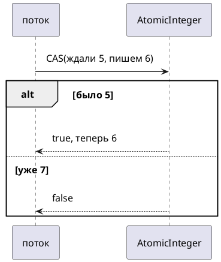

# Тема 08. Атомарные классы и CAS

> **Статус:** теория · **Дальше:** интервью в чате, затем [практика](08-atomic-tasks.md)

---

## Оглавление

- [1. Счётчик без своего замка](#1-счётчик-без-своего-замка)
- [2. compare-and-set](#2-compare-and-set)
- [3. Два атомарных вызова подряд](#3-два-атомарных-вызова-подряд)
- [4. updateAndGet](#4-updateandget)
- [5. LongAdder](#5-longadder)
- [Типичные ошибки](#типичные-ошибки)
- [Вопросы для интервью](#вопросы-для-интервью)

---

## 1. Счётчик без своего замка

**Аналогия:**

Не очередь в кассу, а турникет: «прибавь один» — одна железная операция. Два человека не получают одну и ту же дырку.

**Как это устроено в коде:**

Пакет `java.util.concurrent.atomic` — lock-free обновления **одной** переменной.

- Источник: https://docs.oracle.com/en/java/javase/17/docs/api/java.base/java/util/concurrent/atomic/package-summary.html

> A small toolkit of classes that support lock-free thread-safe programming on single variables.

RU:

> Небольшой набор классов для lock-free потокобезопасного программирования на **одной** переменной.

```java
AtomicInteger n = new AtomicInteger();
n.incrementAndGet(); // атомарный ++
```

`incrementAndGet` — прочитать, прибавить, записать как одно обновление.

**Правило:** один счётчик без составной логики — атомик. Несколько полей как одно целое — замок.

---

## 2. compare-and-set

**Аналогия:**

«Если на ценнике всё ещё 10 — поставь 12. Если уже не 10 — не трогай, посмотри ещё раз».

Javadoc `AtomicInteger.compareAndSet` (JDK 17):

- Источник: https://docs.oracle.com/en/java/javase/17/docs/api/java.base/java/util/concurrent/atomic/AtomicInteger.html#compareAndSet(int,int)

> Atomically sets the value to `newValue` if the current value `== expectedValue`

RU:

> Атомарно ставит значение в `newValue`, если текущее **равно** `expectedValue`.



Цикл CAS: прочитал 5, посчитал 6, `compareAndSet(5, 6)` — если `false`, повторить.

**Правило:** CAS — «смени, только если никто не влез». Это поведение, не ассемблер.

---

## 3. Два атомарных вызова подряд

**Аналогия:**

Два турникета подряд — уже не одна операция. Между ними кто-то пройдёт.

```java
if (stock.get() >= 7) {
    stock.addAndGet(-7); // другой поток уже списал
}
```

**Разбор:**

- Каждый вызов сам по себе атомарный.
- Пара «проверил и списал» — нет.
- Нужен один `updateAndGet` или замок.

**Правило:** атомарность не склеивается через две строки.

---

## 4. updateAndGet

Javadoc: функция применяется, результат пишется через CAS. Функция **без побочных эффектов** — её могут вызвать снова.

- Источник: https://docs.oracle.com/en/java/javase/17/docs/api/java.base/java/util/concurrent/atomic/AtomicInteger.html#updateAndGet(java.util.function.IntUnaryOperator)

> Atomically updates … The function should be side-effect-free, since it may be re-applied when attempted updates fail due to contention among threads.

RU:

> Атомарно обновляет … Функция должна быть без побочных эффектов: при споре потоков её могут вызвать повторно.

```java
stock.updateAndGet(v -> v >= 7 ? v - 7 : v);
```

**Правило:** составное изменение одного значения — одна функция в `updateAndGet` / `accumulateAndGet`.

---

## 5. LongAdder

**Аналогия:**

Вместо одной книги — стопка листочков. Каждый кассир пишет на своём, в конце листки складывают.

Javadoc `LongAdder` (JDK 17):

- Источник: https://docs.oracle.com/en/java/javase/17/docs/api/java.base/java/util/concurrent/atomic/LongAdder.html

> This class is usually preferable to `AtomicLong` when multiple threads update a common sum that is used for purposes such as collecting statistics, not for fine-grained synchronization control. … under high contention, expected throughput of this class is significantly higher

RU:

> Класс обычно предпочтительнее `AtomicLong`, когда много потоков обновляют общую сумму для статистики, а не для тонкой синхронизации. … При сильном споре пропускная способность заметно выше.

`sum()` — **не** атомарный снимок на лету, если в этот момент ещё пишут.

**Правило:** метрики и гистограммы — `LongAdder`. Номер заказа «ровно следующий» — `AtomicLong`.

---

## Типичные ошибки

| Ошибка | Что получится |
|---|---|
| `get` + `set` вместо `incrementAndGet` | гонка |
| Побочный эффект внутри `updateAndGet` | эффект дважды |
| Атомик на одно поле, второе поле рядом обычное | рваный объект |
| Ждать точный `sum()` amid записи | число «почти» |

---

## Вопросы для интервью

1. Что делает `incrementAndGet`?
2. Объясните CAS своими словами.
3. Почему два атомарных вызова подряд не атомарны вместе?
4. Зачем функция в `updateAndGet` без побочных эффектов?
5. Когда `LongAdder` вместо `AtomicLong`?
6. Чем атомик не заменяет замок на двух полях?

---

**Практика:** [08-atomic-tasks.md](08-atomic-tasks.md)

*Тема 08 курса [`00-plan.md`](00-plan.md).*
