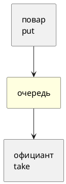

# Тема 10. BlockingQueue: производитель и потребитель

> **Статус:** теория · **Дальше:** интервью в чате, затем [практика](10-blockingqueue-tasks.md)

---

## Оглавление

- [1. Очередь вместо wait/notify](#1-очередь-вместо-waitnotify)
- [2. Четыре формы методов](#2-четыре-формы-методов)
- [3. Ограниченная очередь](#3-ограниченная-очередь)
- [4. Виды очередей](#4-виды-очередей)
- [5. Яд остановки](#5-яд-остановки)
- [Типичные ошибки](#типичные-ошибки)
- [Вопросы для интервью](#вопросы-для-интервью)

---

## 1. Очередь вместо wait/notify

**Аналогия:**

Лоток между кухней и залом. Повар кладёт тарелку и может подождать, если лоток полон. Официант берёт и ждёт, если пусто. Сами «полка пуста/полна» уже внутри лотка.

Javadoc `BlockingQueue` (JDK 17):

- Источник: https://docs.oracle.com/en/java/javase/17/docs/api/java.base/java/util/concurrent/BlockingQueue.html

> A `Queue` that additionally supports operations that wait for the queue to become non-empty when retrieving an element, and wait for space to become available in the queue when storing an element.

RU:

> Очередь, которая умеет ждать, пока появится элемент при взятии, и ждать место при кладке.



**Правило:** тему 04 сами не пишите, если хватает готовой очереди.

---

## 2. Четыре формы методов

Тот же Javadoc:

| | Исключение | Особое значение | Блокирует | С таймаутом |
|---|---|---|---|---|
| Кладка | `add` | `offer` | `put` | `offer(e, time, unit)` |
| Взятие | `remove` | `poll` | `take` | `poll(time, unit)` |

- `put` / `take` — ждут сколько нужно (`InterruptedException`).
- `offer` / `poll` без времени — сразу `false` / `null`.
- `null` класть нельзя: `null` — маркер «poll не удался».

**Правило:** в конвейере обычно `put` и `take`. В «попробовать» — `offer` / `poll`.

---

## 3. Ограниченная очередь

**Аналогия:**

Лоток на три тарелки. Быстрый повар упирается и **ждёт**. Медленный зал не тонет в горе тарелок.

`ArrayBlockingQueue(3)` — вместимость 3. `put` четвёртого ждёт `take`.

**Правило:** bound — тормоз производителя и защита памяти.

---

## 4. Виды очередей

| Класс | Память | Смысл |
|---|---|---|
| `ArrayBlockingQueue` | массив, емкость обязательна | ровный буфер |
| `LinkedBlockingQueue` | узлы; емкость по желанию | без емкости растёт без предела |
| `SynchronousQueue` | **нет** ячейки | кладка ждёт забор, забор ждёт кладку |

Javadoc `SynchronousQueue`:

- Источник: https://docs.oracle.com/en/java/javase/17/docs/api/java.base/java/util/concurrent/SynchronousQueue.html

> A blocking queue in which each insert operation must wait for a corresponding remove operation by another thread, and vice versa. A synchronous queue does not have any internal capacity, not even a capacity of one.

RU:

> Блокирующая очередь, где каждая вставка ждёт соответствующее извлечение другим потоком, и наоборот. Внутренней ёмкости нет, даже на один элемент.

**Правило:** hand-off из рук в руки — `SynchronousQueue`. Буфер — array/linked.

---

## 5. Яд остановки

Javadoc: у очереди нет `close`. Обычный приём — положить **ядовитый** объект. Потребитель увидел яд — вышел. Потока `stop()` нет.

```java
queue.put(job);
// конец:
queue.put(POISON);
```

**Правило:** сколько потребителей — столько ядов (или один яд и дальнейшая рассылка).

---

## Типичные ошибки

| Ошибка | Что получится |
|---|---|
| `poll` вместо `take` в цикле без паузы | кручение CPU, пропуски |
| Неограниченный `LinkedBlockingQueue` | OutOfMemory при быстром поваре |
| Забыть яд | потребитель висит в `take` |
| Класть `null` | `NullPointerException` |

---

## Вопросы для интервью

1. Чем `put`/`take` отличаются от `offer`/`poll`?
2. Зачем ограничивать ёмкость?
3. Чем `SynchronousQueue` отличается от очереди на 1?
4. Как остановить потребителя, не убивая поток?
5. Почему `null` нельзя?
6. Когда linked без ёмкости опасен?

---

**Практика:** [10-blockingqueue-tasks.md](10-blockingqueue-tasks.md)

*Тема 10 курса [`00-plan.md`](00-plan.md).*
