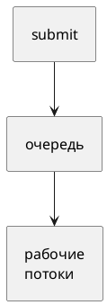

# Тема 11. Пул потоков: ExecutorService, Callable, Future

> **Статус:** теория · **Дальше:** интервью в чате, затем [практика](11-executors-tasks.md)

---

## Оглавление

- [1. Не создавать поток на каждую задачу](#1-не-создавать-поток-на-каждую-задачу)
- [2. Runnable и Callable](#2-runnable-и-callable)
- [3. execute и submit](#3-execute-и-submit)
- [4. Future.get](#4-futureget)
- [5. shutdown и shutdownNow](#5-shutdown-и-shutdownnow)
- [6. Устройство ThreadPoolExecutor](#6-устройство-threadpoolexecutor)
- [7. Размер пула и ThreadLocal](#7-размер-пула-и-threadlocal)
- [Типичные ошибки](#типичные-ошибки)
- [Вопросы для интервью](#вопросы-для-интервью)

---

## 1. Не создавать поток на каждую задачу

**Аналогия:**

Не нанимать нового кассира на каждого покупателя. Есть **смена из N кассиров** и очередь в холле.

**Как это устроено в коде:**

`Executor` — «выполни это». `ExecutorService` — ещё остановка и `Future`.

- Источник: https://docs.oracle.com/en/java/javase/17/docs/api/java.base/java/util/concurrent/ExecutorService.html

> An `Executor` that provides methods to manage termination and methods that can produce a `Future` for tracking progress of one or more asynchronous tasks.

RU:

> `Executor`, у которого есть остановка и методы, дающие `Future` для слежения за асинхронными задачами.

**Правило:** пул ограничивает число потоков. Невыключенный пул держит JVM.

---

## 2. Runnable и Callable

Javadoc `Callable` (JDK 17):

- Источник: https://docs.oracle.com/en/java/javase/17/docs/api/java.base/java/util/concurrent/Callable.html

> A `Runnable`, however, does not return a result and cannot throw a checked exception.

RU:

> У `Runnable` нет результата и нельзя бросить проверяемое исключение.

`Callable.call()` возвращает значение и может бросить `Exception`.

**Правило:** нужен результат или checked — `Callable`. Огонь-и-забудь — `Runnable`.

---

## 3. execute и submit

`execute(Runnable)` — исключения задачи могут уйти в обработчик потока.

`submit` оборачивает в `Future`: исключение **сохраняется** и вылезает из `get` как `ExecutionException`.

Javadoc `ThreadPoolExecutor` (про задачи в `FutureTask`):

- Источник: https://docs.oracle.com/en/java/javase/17/docs/api/java.base/java/util/concurrent/ThreadPoolExecutor.html

> When actions are enclosed in tasks (such as `FutureTask`) either explicitly or via methods such as `submit`, these task objects catch and maintain computational exceptions, and so they do not cause abrupt termination, and the internal exceptions are not passed to this method.

RU:

> Когда действие упаковано в задачу вроде `FutureTask` (в том числе через `submit`), задача ловит и хранит исключения вычисления: поток резко не умирает, внутренние исключения в обработчик не попадают.

**Правило:** после `submit` результат и ошибку забирают через `get`. Иначе ошибка «пропала».

---

## 4. Future.get

- Источник: https://docs.oracle.com/en/java/javase/17/docs/api/java.base/java/util/concurrent/Future.html#get()

> Waits if necessary for the computation to complete, and then retrieves its result.

RU:

> При необходимости ждёт конца вычисления и возвращает результат.

Бросает `ExecutionException` (ошибка задачи), `CancellationException`, `InterruptedException`.

Действия задачи happens-before успешного `get`.

**Правило:** `get` — барьер видимости и место, где ошибка снова становится явной.

---

## 5. shutdown и shutdownNow

Javadoc `ExecutorService`:

- Источник: https://docs.oracle.com/en/java/javase/17/docs/api/java.base/java/util/concurrent/ExecutorService.html#shutdown()

> Initiates an orderly shutdown in which previously submitted tasks are executed, but no new tasks will be accepted. … This method does not wait for previously submitted tasks to complete execution. Use `awaitTermination` to do that.

RU:

> Начинает упорядочную остановку: уже принятые задачи выполняют, новые не берут. … Метод **не ждёт** конца задач. Ждут через `awaitTermination`.

`shutdownNow` — пытается остановить работающие (обычно `interrupt`) и возвращает ещё не начатые.

**Правило:** `shutdown` + `awaitTermination`. Иначе процесс живёт из‑за рабочих потоков пула.

---

## 6. Устройство ThreadPoolExecutor

Порядок в `execute` (Javadoc JDK 17):

- Источник: https://docs.oracle.com/en/java/javase/17/docs/api/java.base/java/util/concurrent/ThreadPoolExecutor.html

> If fewer than corePoolSize threads are running, the Executor always prefers adding a new thread rather than queuing.
> If corePoolSize or more threads are running, the Executor always prefers queuing a request rather than adding a new thread.
> If a request cannot be queued, a new thread is created unless this would exceed maximumPoolSize, in which case, the task will be rejected.

RU:

> Если потоков меньше `corePoolSize` — всегда новый поток, не очередь.
> Если уже `corePoolSize` или больше — сначала в очередь, не новый поток.
> Если в очередь нельзя — новый поток, пока не упрёмся в `maximumPoolSize`; иначе отказ.

Неограниченная очередь:

> Using an unbounded queue … will cause new tasks to wait in the queue when all corePoolSize threads are busy. Thus, no more than corePoolSize threads will ever be created. (And the value of the maximumPoolSize therefore doesn't have any effect.)

RU:

> Неограниченная очередь: новые задачи ждут в очереди, когда все core заняты. Больше `corePoolSize` потоков **не создадут**. `maximumPoolSize` тогда ни на что не влияет.

Отказ по умолчанию — `AbortPolicy` → `RejectedExecutionException`. `CallerRunsPolicy` — задачу выполняет **вызывающий** поток.

Keep-alive: лишние (сверх core) потоки умирают после простоя `keepAliveTime`.

**Правило:** `newFixedThreadPool(n)` — core = max = n, очередь без конца. «Максимум 20» при такой очереди **не сработает**.

---

## 7. Размер пула и ThreadLocal

- CPU-задача — около числа ядер.
- I/O — больше: потоки спят в ожидании сети.

`ThreadLocal` живёт **в рабочем потоке пула**. Поток берут снова — старое значение останется.

Javadoc `ThreadLocal.remove`:

- Источник: https://docs.oracle.com/en/java/javase/17/docs/api/java.base/java/lang/ThreadLocal.html#remove()

> Removes the current thread's value for this thread-local variable.

RU:

> Удаляет значение этой переменной у текущего потока.

**Правило:** в конце задачи в пуле зовите `remove()`, иначе утечёт пользователь прошлого запроса.

---

## Типичные ошибки

| Ошибка | Что получится |
|---|---|
| Забыть `shutdown` | JVM не выходит |
| `submit` и не вызвать `get` | исключение тихо лежит в Future |
| `maximum` при `LinkedBlockingQueue` без ёмкости | потоков не больше core |
| `ThreadLocal` без `remove` | чужой пользователь на том же потоке |

---

## Вопросы для интервью

1. Чем `Callable` отличается от `Runnable`?
2. Куда девается исключение из `submit`? Из `execute`?
3. Что делает `Future.get`?
4. `shutdown` vs `shutdownNow`?
5. Когда создаётся поток сверх core?
6. Почему при безлимитной очереди `max` бесполезен?
7. Зачем чистить `ThreadLocal` в пуле?

---

**Практика:** [11-executors-tasks.md](11-executors-tasks.md)

*Тема 11 курса [`00-plan.md`](00-plan.md).*
