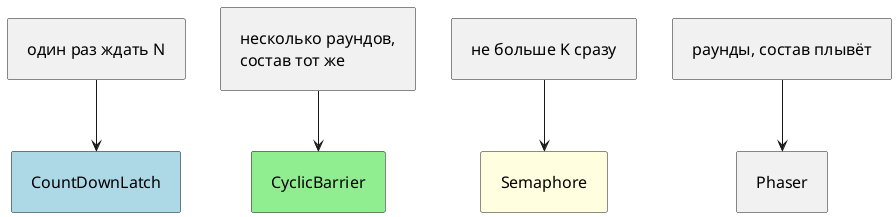

# Тема 12. Синхронизаторы: CountDownLatch, CyclicBarrier, Semaphore, Phaser

> **Статус:** теория · **Дальше:** интервью в чате, затем [практика](12-synchronizers-tasks.md)

---

## Оглавление

- [1. Защёлка один раз](#1-защёлка-один-раз)
- [2. Барьер по кругу](#2-барьер-по-кругу)
- [3. Семафор — набор пропусков](#3-семафор--набор-пропусков)
- [4. Phaser — барьер с переменным составом](#4-phaser--барьер-с-переменным-составом)
- [5. Что выбрать](#5-что-выбрать)
- [Типичные ошибки](#типичные-ошибки)
- [Вопросы для интервью](#вопросы-для-интервью)

---

## 1. Защёлка один раз

**Аналогия:**

Стартовый флаг: трое ещё собираются. Судья считает «3, 2, 1» — каждый `countDown`. На нуле калитка открывается. Потом защёлку **не взводят**.

Javadoc `CountDownLatch` (JDK 17):

- Источник: https://docs.oracle.com/en/java/javase/17/docs/api/java.base/java/util/concurrent/CountDownLatch.html

> A `CountDownLatch` is initialized with a given count. The `await` methods block until the current count reaches zero … This is a one-shot phenomenon -- the count cannot be reset. If you need a version that resets the count, consider using a `CyclicBarrier`.

RU:

> Защёлка с начальным счётом. `await` ждёт нуля. Это одноразово — счёт **нельзя** сбросить. Если нужен сброс — смотрите `CyclicBarrier`.

Кто делает `countDown`, сам ждать нуля не обязан.

**Правило:** «старт всем» или «жди N окончаний» — latch. Второй круг — новый объект или барьер.

---

## 2. Барьер по кругу

**Аналогия:**

Трое дошли до черты, переглянулись, вместе пошли на следующий круг. Черту можно использовать снова.

Javadoc `CyclicBarrier`:

- Источник: https://docs.oracle.com/en/java/javase/17/docs/api/java.base/java/util/concurrent/CyclicBarrier.html

> The barrier is called cyclic because it can be re-used after the waiting threads are released.

RU:

> Барьер циклический: после отпускания потоков его используют снова.

Если один сорвался (interrupt, timeout, ошибка действия барьера) — остальные получают `BrokenBarrierException`. Модель all-or-none.

Необязательный `Runnable` в конструкторе — выполняет **последний** пришедший, до отпускания остальных.

**Правило:** фиксированная партия, несколько раундов — барьер. Слом одного ломает раунд всем.

---

## 3. Семафор — набор пропусков

**Аналогия:**

Три пропуска в зал. Четвёртый ждёт у двери. Вышел — отдал пропуск.

Javadoc `Semaphore`:

- Источник: https://docs.oracle.com/en/java/javase/17/docs/api/java.base/java/util/concurrent/Semaphore.html

> Conceptually, a semaphore maintains a set of permits. Each `acquire()` blocks if necessary until a permit is available, and then takes it. Each `release()` adds a permit … no actual permit objects are used; the `Semaphore` just keeps a count

RU:

> Семафор хранит набор разрешений. `acquire` ждёт и забирает, `release` добавляет. Физических жетонов нет — только счётчик.

`release` может вызвать **другой** поток. Забыли `release` в `finally` — пропуск потерян, зал постепенно пустеет для всех.

Честный семафор снижает starvation.

**Правило:** лимит одновременных обращений — семафор. `release` в `finally`.

---

## 4. Phaser — барьер с переменным составом

Javadoc `Phaser`:

- Источник: https://docs.oracle.com/en/java/javase/17/docs/api/java.base/java/util/concurrent/Phaser.html

> Unlike the case for other barriers, the number of parties registered to synchronize on a phaser may vary over time. Tasks may be registered at any time … and optionally deregistered upon any arrival (using `arriveAndDeregister()`).

RU:

> В отличие от других барьеров, число зарегистрированных сторон может меняться. Регистрация в любой момент, снятие — в том числе `arriveAndDeregister()`.

**Правило:** участник уходит на середине многораундовой работы — `Phaser`, не фиксированный `CyclicBarrier`.

---

## 5. Что выбрать

Самодельный `wait`/`notify` здесь не нужен.

---

## Типичные ошибки

| Ошибка | Что получится |
|---|---|
| Ждать повторного latch | вечный `await` |
| Забыть `countDown` | стартовые потоки висят |
| `acquire` без `release` | лимит схлопывается к нулю |
| Один ушёл с CyclicBarrier | `BrokenBarrierException` всем |

---

## Вопросы для интервью

1. Чем latch отличается от barrier?
2. Что такое `BrokenBarrierException`?
3. Кто имеет право сделать `release` у семафора?
4. Когда Phaser удобнее барьера?
5. Почему эти классы лучше самодельного wait/notify?
6. Как сделать «ворота: все ждут одного сигнала» на latch?

---

**Практика:** [12-synchronizers-tasks.md](12-synchronizers-tasks.md)

*Тема 12 курса [`00-plan.md`](00-plan.md).*
