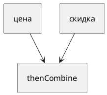

# Тема 13. CompletableFuture

> **Статус:** теория · **Дальше:** интервью в чате, затем [практика](13-completablefuture-tasks.md)

---

## Оглавление

- [1. Future, который умеет цепочку](#1-future-который-умеет-цепочку)
- [2. thenApply и thenCompose](#2-thenapply-и-thencompose)
- [3. thenCombine и allOf](#3-thencombine-и-allof)
- [4. Где выполняется продолжение](#4-где-выполняется-продолжение)
- [5. exceptionally и handle](#5-exceptionally-и-handle)
- [6. commonPool](#6-commonpool)
- [Типичные ошибки](#типичные-ошибки)
- [Вопросы для интервью](#вопросы-для-интервью)

---

## 1. Future, который умеет цепочку

**Аналогия:**

Обычный `Future` — талон «зайдите позже за результатом». `CompletableFuture` — талон плюс **инструкция, что сделать потом**, и можно сказать «готово» снаружи.

`CompletionStage` — стадия: завершилась → запускает зависимые.

```java
CompletableFuture<Integer> f = CompletableFuture.supplyAsync(() -> 2);
System.out.println(f.join()); // 2
```

`join()` как `get`, но непроверяемые исключения.

**Правило:** один этап — `supplyAsync` / `runAsync`. Несколько этапов — методы `then*`, не второй ручной поток.

---

## 2. thenApply и thenCompose

Javadoc `CompletionStage.thenApply` (JDK 17):

- Источник: https://docs.oracle.com/en/java/javase/17/docs/api/java.base/java/util/concurrent/CompletionStage.html#thenApply(java.util.function.Function)

> This method is analogous to `Optional.map` and `Stream.map`.

RU:

> Метод аналогичен `Optional.map` и `Stream.map`.

`thenCompose`:

- Источник: https://docs.oracle.com/en/java/javase/17/docs/api/java.base/java/util/concurrent/CompletionStage.html#thenCompose(java.util.function.Function)

> This method is analogous to `Optional.flatMap` and `Stream.flatMap`.

RU:

> Метод аналогичен `Optional.flatMap` и `Stream.flatMap`.

```java
// map: Integer -> Integer
thenApply(x -> x + 1)

// flatMap: Integer -> CompletionStage<Integer>
thenCompose(x -> loadAsync(x))
```

**Разбор:**

- `thenApply` после асинхронной загрузки даст `CompletableFuture<CompletableFuture<T>>`, если сами вернёте future.
- `thenCompose` склеивает в один слой.

**Правило:** значение — `thenApply`. Новая асинхронная стадия — `thenCompose`.

---

## 3. thenCombine и allOf

`thenCombine` — когда **оба** этапа успешны, функция от двух результатов.

Javadoc `allOf` (JDK 17):

- Источник: https://docs.oracle.com/en/java/javase/17/docs/api/java.base/java/util/concurrent/CompletableFuture.html#allOf(java.util.concurrent.CompletableFuture...)

> Returns a new CompletableFuture that is completed when all of the given CompletableFutures complete. If any of the given CompletableFutures complete exceptionally, then the returned CompletableFuture also does so, with a CompletionException holding this exception as its cause. … the results, if any, of the given CompletableFutures are not reflected in the returned CompletableFuture

RU:

> Новый future завершается, когда завершились все переданные. Если любой завершился исключением — и этот тоже, с `CompletionException`. … Результаты исходных future в возвращённый **не кладутся** — их смотрят по отдельности.



**Правило:** два результата склеить — `thenCombine`. Только дождаться пачки — `allOf`, потом `join` у каждого.

---

## 4. Где выполняется продолжение

Javadoc `CompletableFuture` (JDK 17):

- Источник: https://docs.oracle.com/en/java/javase/17/docs/api/java.base/java/util/concurrent/CompletableFuture.html

> Actions supplied for dependent completions of non-async methods may be performed by the thread that completes the current CompletableFuture, or by any other caller of a completion method.
>
> All async methods without an explicit Executor argument are performed using the `ForkJoinPool.commonPool()` (unless it does not support a parallelism level of at least two, in which case, a new Thread is created to run each task).

RU:

> Действия зависимых стадий **без** `Async` может выполнить поток, который завершил текущий future, или любой вызывающий completion.
>
> Все async-методы без своего `Executor` идут в `ForkJoinPool.commonPool()` (если параллелизм пула меньше двух — новый поток на задачу).

**Правило:** нужен свой пул и предсказуемый поток — `thenApplyAsync(fn, executor)`. Суффикс `Async` без аргумента — commonPool.

---

## 5. exceptionally и handle

Javadoc `CompletionStage`:

> Two method forms (`handle` and `whenComplete`) support unconditional computation whether the triggering stage completed normally or exceptionally. Method `exceptionally` supports computation only when the triggering stage completes exceptionally, computing a replacement result, similarly to the java `catch` keyword.

RU:

> `handle` и `whenComplete` работают и при успехе, и при ошибке. `exceptionally` — только при ошибке, считает замену, как `catch`.

Ошибка в середине цепочки без обработки роняет зависимые с `CompletionException`.

**Правило:** замена значения при сбое — `exceptionally`. Нужны и результат, и ошибка — `handle`.

---

## 6. commonPool

Это единственное место курса про Fork/Join: `commonPool` — общий пул JVM для коротких **вычислений**. Блокирующий I/O там держит потоки всего приложения.

**Почему не иначе:** `supplyAsync(() -> httpCall())` без своего пула конкурирует с чужим кодом на commonPool.

**Правило:** сеть и диск — свой `Executor`. В commonPool — короткая арифметика.

---

## Типичные ошибки

| Ошибка | Что получится |
|---|---|
| `thenApply` вернули future | вложенный future |
| `allOf` и ждут `.get()` у него как список результатов | там `Void` |
| I/O в `supplyAsync` без пула | забитый commonPool |
| Не обработать ошибку | молчание, пока кто-то не сделает `join` |

---

## Вопросы для интервью

1. Чем `CompletableFuture` богаче обычного `Future`?
2. `thenApply` vs `thenCompose`?
3. Когда `thenCombine`, когда `allOf`?
4. Кто выполняет `thenApply` без `Async`?
5. Куда идут `*Async` без `Executor`?
6. Чем `exceptionally` отличается от `handle`?
7. Почему блокирующий вызов в commonPool плох?

---

**Практика:** [13-completablefuture-tasks.md](13-completablefuture-tasks.md)

*Тема 13 курса [`00-plan.md`](00-plan.md).*
