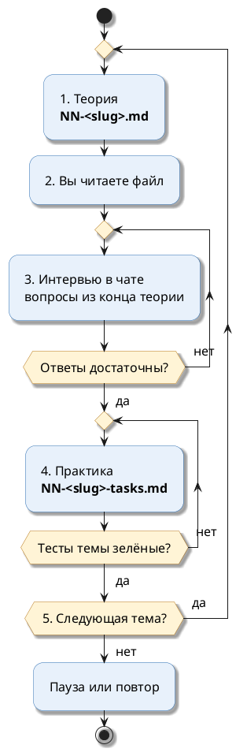

# План курса: Project Reactor

Документ — **единая точка отсчёта**. На него можно ссылаться в чате: *«работаем по плану»*, *«где мы в плане?»*, *«следующая тема по плану»*.

Одна тема за раз: сначала теория, потом интервью, потом практика.

---

## Оглавление

- [Граница курса](#граница-курса)
- [Цель](#цель)
- [Среда](#среда)
- [Структура папки](#структура-папки)
- [Учебные данные: таблицы rc_*](#учебные-данные-таблицы-rc_)
- [Как подаётся теория](#как-подаётся-теория)
    - [Наглядные схемы (PlantUML)](#наглядные-схемы-plantuml)
- [Цитаты из официальных источников](#цитаты-из-официальных-источников)
- [Цикл одной темы](#цикл-одной-темы)
- [Как формулируются задания](#как-формулируются-задания)
- [Как устроена практика в коде](#как-устроена-практика-в-коде)
- [Проверка ответов](#проверка-ответов)
- [Программа тем](#программа-тем)
    - [Тема 01. Publisher, Subscriber, Subscription](#тема-01-publisher-subscriber-subscription)
    - [Тема 02. Источники: Mono и Flux](#тема-02-источники-mono-и-flux)
    - [Тема 03. Преобразование и агрегация](#тема-03-преобразование-и-агрегация)
    - [Тема 04. flatMap, concatMap, flatMapSequential](#тема-04-flatmap-concatmap-flatmapsequential)
    - [Тема 05. Объединение источников](#тема-05-объединение-источников)
    - [Тема 06. Ошибки и повторы](#тема-06-ошибки-и-повторы)
    - [Тема 07. Планировщики: subscribeOn и publishOn](#тема-07-планировщики-subscribeon-и-publishon)
    - [Тема 08. Backpressure](#тема-08-backpressure)
    - [Тема 09. Горячие и холодные источники](#тема-09-горячие-и-холодные-источники)
    - [Тема 10. Context](#тема-10-context)
    - [Тема 11. Время и тестирование](#тема-11-время-и-тестирование)
    - [Тема 12. Жизненный цикл, ресурсы, отладка](#тема-12-жизненный-цикл-ресурсы-отладка)
    - [Тема 13. R2DBC и транзакции](#тема-13-r2dbc-и-транзакции)
- [Текущий прогресс](#текущий-прогресс)
- [Как напоминать в чате](#как-напоминать-в-чате)

---

## Граница курса

Тринадцать тем. В каждой — то, что спрашивают на собеседовании по Project Reactor и что применяют в обычном коде сервиса на WebFlux и R2DBC.

Курс собран по материалам [`docs/interview/reactive`](../../../docs/interview/reactive): upstream и downstream, `flatMap` против `concatMap`, `then`, `zip`, backpressure, `limitRate`, `boundedElastic`, `cache` и горячие источники, `Context`, `retryWhen`, `checkpoint`. Там вопросы разобраны вглубь; здесь — по порядку, от простого к сложному, с практикой на каждую тему.

**Не входит:**

- внутренности Netty, Reactor Netty и HTTP-транспорта WebFlux. Путь HTTP-запроса разобран в `docs/interview/reactive` отдельно;
- `ParallelFlux` (`parallel()` и `runOn()`), `Flux.create` и `Flux.push` с ручным управлением sink;
- reactor-kafka, RSocket, Kotlin-корутины;
- Micrometer, observation, автоматический перенос MDC через `context-propagation`;
- написание собственных операторов и `Processor`.

---

## Цель

После курса уметь:

- объяснить, что происходит при сборке цепочки и при подписке, и почему без подписки ничего не выполняется;
- выбрать между `map`, `flatMap`, `concatMap` и `flatMapSequential` по порядку и параллельности, а не наугад;
- обработать ошибку так, чтобы поток не терялся молча, и повторить вызов только там, где это безопасно;
- вынести блокирующий вызов с потока, который нельзя блокировать;
- ограничить скорость источника и объяснить, что делает каждая стратегия переполнения;
- отличить холодный источник от горячего и не загрузить справочник десять раз;
- передать данные запроса через `Context`, а не через `ThreadLocal`;
- проверить сутки ожидания тестом за миллисекунды;
- закрыть ресурс и откатить транзакцию при ошибке и при отмене.

---

## Среда

| Параметр | Значение |
|---|---|
| Модуль | `reactive-study` |
| Язык и JDK | Java 21 (через Gradle toolchain) |
| Библиотеки | Spring Boot 4, WebFlux, Spring Data R2DBC, Reactor 3.8, reactor-test |
| База для проверки | Postgres 16 в Testcontainers: поднимается сам на время тестов |
| Что нужно на машине | Docker. Отдельная база не нужна |
| Где писать | заготовки классов в `src/main/java/com/example/reactivestudy/reactorcourse/tNN/` |
| Как проверять | готовые тесты в `src/test/java/com/example/reactivestudy/reactorcourse/tNN/` |

Тесты одной темы (номер темы — в имени пакета):

```bash

cd /mnt/d/Project_infra/greeting-service-infra/reactive-study
./gradlew test --tests "com.example.reactivestudy.reactorcourse.t01.*"
```

Один тестовый класс:

```bash

cd /mnt/d/Project_infra/greeting-service-infra/reactive-study
./gradlew test --tests "com.example.reactivestudy.reactorcourse.t03.T03OrderReportsTest"
```

Из IntelliJ IDEA: правой кнопкой по тестовому классу → *Run*. Отчёт Gradle — `build/reports/tests/test/index.html`.

Первый запуск теста с базой скачивает образ `postgres:16.4` и применяет все миграции Flyway: это занимает до минуты. Дальше контейнер один на весь прогон.

---

## Структура папки

```text
reactive-study/docs/reactor-course/
├── 00-plan.md                             ← этот документ
├── 01-publisher-subscriber.md             ← теория + вопросы интервью
├── 01-publisher-subscriber-tasks.md       ← практика: условия задач
├── 02-sources.md
├── 02-sources-tasks.md
└── …
```

| Файл | Содержание |
|---|---|
| `NN-<slug>.md` | Теория. В конце — вопросы, по которым идёт интервью в чате |
| `NN-<slug>-tasks.md` | Практика: ситуация, что сделать, какой класс заполнить, какой тест запустить |

Код практики:

```text
reactive-study/src/main/java/com/example/reactivestudy/reactorcourse/
├── common/        ← готовое: сущности rc_*, репозитории, бизнес-исключения, Todo
├── t01/ … t13/    ← заготовки задач и готовые вспомогательные классы темы
reactive-study/src/test/java/com/example/reactivestudy/reactorcourse/
├── CoursePostgresTest.java   ← общий Postgres в Testcontainers
└── t01/ … t13/               ← проверочные тесты
```

---

## Учебные данные: таблицы rc_*

Миграция `src/main/resources/db/migration/V17__reactor_course.sql`. Все строки заданы явно, без `random()`: ожидаемые числа в задачах не меняются от запуска к запуску.

| Таблица | Что в ней | Строк |
|---|---|---|
| `rc_customers` | клиенты: имя, город, уровень (`gold`, `silver`, `regular`) | 8 |
| `rc_orders` | заказы: клиент, сумма, статус, дата | 20 |
| `rc_bonus_accounts` | бонусный счёт клиента, баланс не меньше 0 (`check`) | 8 |
| `rc_price_ticks` | котировки по четырём артикулам | 10 000 |
| `rc_payments` | оплаты, не больше одной на заказ (`unique`) | 0 |
| `rc_audit_log` | журнал аудита | 0 |

Клиенты:

| id | Имя | Город | Уровень | Бонусы |
|---|---|---|---|---|
| 1 | Анна Смирнова | Москва | gold | 500 |
| 2 | Борис Котов | Казань | regular | 0 |
| 3 | Вера Лаптева | Самара | silver | 120 |
| 4 | Глеб Орлов | Москва | regular | 40 |
| 5 | Дарья Миронова | Казань | gold | 1000 |
| 6 | Егор Соколов | Самара | regular | 0 |
| 7 | Жанна Петрова | Москва | silver | 300 |
| 8 | Зоя Белова | Казань | regular | 50 |

Заказы:

| id | Клиент | Сумма | Статус |
|---|---|---|---|
| 1 | 1 | 1200.00 | delivered |
| 2 | 1 | 350.00 | delivered |
| 3 | 1 | 4800.00 | shipped |
| 4 | 1 | 990.00 | cancelled |
| 5 | 2 | 150.00 | delivered |
| 6 | 2 | 2300.00 | paid |
| 7 | 3 | 780.00 | delivered |
| 8 | 3 | 780.00 | delivered |
| 9 | 3 | 5200.00 | new |
| 10 | 4 | 99.00 | cancelled |
| 11 | 4 | 1450.00 | delivered |
| 12 | 5 | 3100.00 | delivered |
| 13 | 5 | 2750.00 | delivered |
| 14 | 5 | 640.00 | shipped |
| 15 | 5 | 8900.00 | paid |
| 16 | 6 | 420.00 | new |
| 17 | 7 | 1999.00 | delivered |
| 18 | 7 | 250.00 | cancelled |
| 19 | 7 | 3600.00 | shipped |
| 20 | 2 | 560.00 | delivered |

У клиента 8 заказов нет — на нём проверяется «пусто, а не ошибка».

Тесты, которые пишут в базу (темы 08 и 13), перед каждым запуском возвращают `rc_payments`, `rc_audit_log` и балансы к состоянию из миграции.

В локальной базе `reactive_study` (профиль `local`) миграция V17 применится при следующем запуске приложения `reactive-study`. Для тестов курса это не нужно: у них своя база в контейнере.

---

## Как подаётся теория

Файл темы читает человек, который с Reactor знаком мало. Порядок объяснения один: житейская картинка, потом код, потом что на самом деле делает Reactor.

В начале файла — оглавление. Каждый смысловой блок строится по шагам ниже, от простого к сложному. Каждый следующий факт опирается на уже объяснённый; термин не используется раньше определения.

| Шаг в файле | Что в нём | Объём |
|---|---|---|
| 1. Аналогия | ситуация из жизни: склад, касса, конвейер. Без терминов Reactor | 2–4 предложения |
| 2. Как это устроено в коде | что в программе соответствует частям аналогии: издатель, подписчик, оператор, поток. **Списком**, по одному факту на пункт | 3–6 пунктов |
| 3. Тот же смысл кодом | минимальный пример с выводом | до 20 строк |
| 4. Построчный разбор | что происходит при сборке, что — при подписке, какие сигналы идут | только неочевидные строки |
| 5. Как это работает технически | что гарантирует спецификация и что делает оператор | 1–2 абзаца |
| 6. Почему не иначе | наивный вариант и как он ломается | до 10 строк кода и 2 предложения |
| 7. Цитата из официального источника | основание для технического объяснения | цитата и перевод |
| 8. Правило | вывод одной строкой | 1 строка |

### Наглядные схемы (PlantUML)

Где есть **порядок сигналов**, **переход между потоками**, **направление подписки и данных** или **связь подписчиков с источником**, рядом с объяснением ставится компактная схема.

| Правило | Как делать |
|---|---|
| Формат | только блок ` ```plantuml ` с `@startuml` … `@enduml` или готовый рисунок `images/*.png`. **Mermaid и схемы текстом (ASCII, стрелки в строке) запрещены** |
| Размер подписей | `skinparam defaultFontSize 16` в начале диаграммы |
| Компоновка | `skinparam padding 10`; для rectangle — явное направление (`top to bottom direction` / `left to right direction`) |
| Читаемость | стрелки не режут подписи; при риске наложения — разбить на две схемы |
| Одна схема | одна мысль, не больше 8–10 элементов |
| Типы | sequence — порядок сигналов `onSubscribe`, `request`, `onNext`; activity — шаги процесса; rectangle — цепочка операторов, подписчики и источник |

### Оформление текста

Текст должен читаться с первого взгляда, без сплошных абзацев.

| Правило | Как делать |
|---|---|
| Заголовок блока | жирная метка на отдельной строке с двоеточием: `**Аналогия:**`, `**Как это устроено в коде:**`, `**Разбор:**`, `**Почему не иначе:**`, `**Правило:**` |
| Соответствие «аналогия → код» | каждая пара — отдельный пункт: `- **Склад** — `Publisher`: источник элементов.` |
| Перечисление | два и больше однотипных факта — список, а не предложение через запятую |
| Шаги по порядку | нумерованный список `1.` `2.` `3.` |
| Сравнение вариантов | таблица |
| Абзац | не больше двух предложений; дальше — новый абзац или список |

### Ограничения по объёму

- Абзац — не больше двух предложений.
- Один пример — одна мысль.
- Файл темы читается за один раз. Если материал не влезает, тема делится, а не растягивается.

### Требования к примерам

- Примеры используют только Reactor и стандартную библиотеку. Они запускаются в модуле `reactive-study`, где Reactor уже подключён.
- Вывод через `System.out.println`, ожидаемый вывод — в комментарии рядом.
- В примерах, где поток асинхронный, явно показано, как дождаться результата, — иначе `main` завершится раньше.

### Упражнений в файле теории нет

В конце теории — вопросы интервью и ссылка на файл практики `NN-<slug>-tasks.md`.

---

## Цитаты из официальных источников

Каждое техническое утверждение опирается на **официальный** источник: Javadoc Reactor, Reactor Reference Guide, спецификация Reactive Streams, документация Spring Framework. Материалы `docs/interview/reactive` и подборки вопросов показывают, что спрашивают, но источником правил не считаются.

| Правило | Как делать |
|---|---|
| Цитата по делу | ровно тот фрагмент, на котором держится соседнее утверждение |
| Контекст перед цитатой | сказано, к какому классу и методу она относится |
| Разбор после цитаты | факты из цитаты своими словами, по пунктам |
| Нет утверждений без основания | поведение оператора подтверждается цитатой или тестом курса. Наблюдение из теста так и называется |
| Оба языка | английский фрагмент дословно, затем полный перевод |
| Без цитат по памяти | страница перечитывается перед публикацией |

Версии источников: Javadoc reactor-core 3.8.x, Reactor Reference Guide (release), Reactive Streams 1.0.4, Spring Framework 7.

**Шаблон блока:**

```markdown
Подписчик получает элементы только в пределах запрошенного.

- Источник: https://github.com/reactive-streams/reactive-streams-jvm/blob/v1.0.4/README.md

> …дословный фрагмент…

RU:

> …полный перевод фрагмента…

**Правило:** нет запроса — нет элементов.
```

---

## Цикл одной темы

Пять шагов. Следующий — только после зачёта предыдущего.



| Шаг | Что происходит |
|---|---|
| 1. Теория | файл `NN-<slug>.md` уже лежит в папке. Ассистент даёт короткое резюме и путь |
| 2. Чтение | когда готовы: *«Изучил тему N, дай интервью»* |
| 3. Интервью | 4–6 вопросов в чате по одному, на понимание. Основа — раздел «Вопросы для интервью» в конце теории, но формулировки меняются. Пробел называется прямо, вопрос повторяется в другой форме |
| 4. Практика | заполнить заготовки темы, запустить тесты темы. *«Проверь задание N.M»* — ассистент читает код, запускает тесты и разбирает ошибки |
| 5. Переход | ассистент спрашивает про тему N+1 |

---

## Как формулируются задания

Задание самодостаточно: рабочая ситуация и измеримый итог, без названия нужного оператора.

| Правило | Как делать |
|---|---|
| Одна цель | одна ситуация, один ожидаемый результат |
| Итог измерим | точный набор значений, порядок, число вызовов, время, имя потока |
| Без имени средства | не писать, каким оператором решать: ни `flatMap`, ни `zip`, ни `retryWhen`. В требовании — результат: порядок, сколько запросов одновременно, что видит второй подписчик |
| Без отсылок | не писать «как в задании 2» |
| Без конструкций следующих тем | решение возможно средствами пройденного |
| Не повтор теории | ситуация и данные отличаются от примеров теории |
| Эталон до выдачи | к каждой задаче написано своё решение, и тесты прогнаны на нём. Эталон в репозиторий не попадает |

**Неправильно:** «Используйте `concatMap`, чтобы сохранить порядок».

**Правильно:** «Заказы клиентов Казани идут блоками: сначала все заказы клиента 2, потом клиента 5, потом клиента 8. Внутри блока — по возрастанию номера заказа».

---

## Как устроена практика в коде

- Тело каждого метода-задачи — `throw Todo.task("NN.M");`. Пока задача не решена, тест падает с сообщением `Задача NN.M не решена` и путём к условию.
- Решение пишется вместо этой строки. Сигнатуру метода не менять: по ней работает тест.
- Классы с пометкой «Готовый класс, менять не нужно» — внешние системы задачи: сервисы, шлюзы, журналы. Они считают вызовы, запоминают потоки и время, чтобы тест мог проверить поведение.
- Поля и приватные методы в классе-задаче добавлять можно, если в задаче не сказано иного.
- Тест не подсказывает решение: он проверяет результат, порядок, число вызовов, потоки, время.
- Метод, возвращающий `Mono` или `Flux`, сам ничего не делает и не бросает исключений: всё — при подписке. Тесты это проверяют.

---

## Проверка ответов

**Интервью** — зачёт, если смысл верен и нет ошибки, которая в работе даёт потерю данных, зависание, блокировку потока событий или повтор неидемпотентной операции.

**Практика** — зачёт, если все тесты темы зелёные, а решение использует средства текущей и пройденных тем. Блокирующие вызовы `block()`, `Thread.sleep` и собственные потоки в решениях не используются, если задача прямо этого не требует.

---

## Программа тем

### Тема 01. Publisher, Subscriber, Subscription

Что спрашивают: что такое Reactive Streams и четыре интерфейса; порядок сигналов `onSubscribe`, `onNext*`, `onError | onComplete`; что такое demand и зачем `request(n)`; что значит «ничего не происходит до подписки»; чем сборка цепочки отличается от подписки; что такое upstream и downstream.

- Источник: https://github.com/reactive-streams/reactive-streams-jvm/blob/v1.0.4/README.md

> The total number of `onNext`´s signalled by a `Publisher` to a `Subscriber` MUST be less than or equal to the total number of elements requested by that `Subscriber`´s `Subscription` at all times.

RU:

> Общее число сигналов `onNext`, отправленных `Publisher` подписчику `Subscriber`, ДОЛЖНО быть в любой момент меньше или равно общему числу элементов, запрошенных через `Subscription` этого подписчика.

Практика: свой подписчик ведёт журнал сигналов; запросы по одному и отмена; дождаться асинхронного источника с таймаутом; первые запросы к базе через R2DBC-репозиторий.

### Тема 02. Источники: Mono и Flux

Что спрашивают: чем `Mono` отличается от `Flux`; `just` против `fromCallable` и `defer` — когда вычисляется значение; почему `Mono.just(callService())` вызывает сервис сразу; как вернуть ошибку сигналом, а не исключением; `range`, `fromIterable`, `generate`; пустой `Mono` против `Mono` с `null`.

Практика: цена считывается при подписке, а не при сборке; ошибка проверки — сигналом; номера страниц; последовательность с состоянием; ленивый вызов старой системы.

### Тема 03. Преобразование и агрегация

Что спрашивают: `map` и `filter`; `take` и почему он отменяет источник; `reduce` и `collect`; что вернёт `reduce` на пустом потоке с начальным значением и без него; `switchIfEmpty` и `defaultIfEmpty`; `distinct`.

Практика: отчёты по таблице `rc_orders`: фильтр, сумма, группировка по статусу, первые N, ошибка «не найден», город без повторов.

### Тема 04. flatMap, concatMap, flatMapSequential

Что спрашивают: `map` против `flatMap`; почему `flatMap` не сохраняет порядок; что даёт параметр `concurrency`; `concatMap` против `flatMapSequential`; `Mono.flatMap` и `flatMapMany`.

Практика: заказы клиентов города без порядка и с порядком; не больше двух запросов к сервису одновременно; порядок запроса при параллельных вызовах; сводка по клиенту из двух запросов.

### Тема 05. Объединение источников

Что спрашивают: `zip` и что будет, если один источник пустой; `merge` против `concat`; `then`, `thenReturn`, `thenMany`; `Mono.when`; когда `zip`, а когда последовательная цепочка.

Практика: профиль клиента из трёх запросов; приветствие с необязательным промокодом; лента событий двух систем; архив перед новыми событиями; закрытие заказа в два шага; прогрев перед открытием смены.

### Тема 06. Ошибки и повторы

Что спрашивают: почему ошибка — терминальный сигнал; `onErrorReturn`, `onErrorResume`, `onErrorMap`; как пропустить битый элемент и не остановить поток; `retry` против `retryWhen`; `Retry.backoff` и `filter`; почему повторять можно только идемпотентное; `timeout` с запасным источником.

- Источник: https://projectreactor.io/docs/core/release/reference/coreFeatures/error-handling.html

> Before you learn about error-handling operators, you must keep in mind that any error in a reactive sequence is a terminal event. Even if an error-handling operator is used, it does not let the original sequence continue.

RU:

> Прежде чем изучать операторы обработки ошибок, нужно помнить, что любая ошибка в реактивной последовательности — терминальное событие. Даже если используется оператор обработки ошибок, он не позволяет исходной последовательности продолжиться.

Практика: значение по умолчанию для одного типа ошибки; понятная бизнес-ошибка с причиной; пропуск битых номеров; повтор с растущей паузой; ответ из кэша по таймауту; повтор только временных сбоев.

### Тема 07. Планировщики: subscribeOn и publishOn

Что спрашивают: на каком потоке выполняется цепочка без планировщиков; `subscribeOn` против `publishOn`; что будет от двух `subscribeOn`; `parallel` против `boundedElastic`; почему блокирующий вызов нельзя делать на потоке event loop; как обернуть блокирующий клиент.

Практика: блокирующий складской клиент без захвата чужого потока; форматирование на потоках для вычислений; отчёт, где чтение и форматирование на разных пулах; пять запросов одновременно.

### Тема 08. Backpressure

Что спрашивают: что такое backpressure и откуда он в Reactive Streams; `limitRate` против `limitRequest` и `take`; `buffer`; стратегии `onBackpressureBuffer`, `Drop`, `Latest`, `Error`; как R2DBC читает строки по запросу.

Практика: источник получает запросы не больше 500; средняя цена по тысячам котировок из базы; запись журнала пачками по одной; табло последней цены; отбрасывание лишних событий с записью.

### Тема 09. Горячие и холодные источники

Что спрашивают: холодный против горячего; `share`, `publish().autoConnect(n)`, `refCount`; что видит поздний подписчик; `cache` и `cache(ttl)`; `Sinks.many()`: multicast против replay; что будет с сообщением без подписчиков.

Практика: справочник тарифов загружается один раз; справочник с устареванием; одна лента котировок на всех; трансляция с двумя зрителями; шина уведомлений; табло трёх последних цен.

### Тема 10. Context

Что спрашивают: почему `ThreadLocal` не работает в реактивной цепочке; что такое `Context` и почему он неизменяемый; в какую сторону распространяется; почему `contextWrite` пишут внизу цепочки; `deferContextual`; изоляция контекста внутри `flatMap`.

- Источник: https://projectreactor.io/docs/core/release/reference/advancedFeatures/context.html

> Actually, a `Context` is tied to each `Subscriber` in a chain. It uses the `Subscription` propagation mechanism to make itself available to each operator, starting with the final `subscribe` and moving up the chain.

RU:

> На самом деле `Context` привязан к каждому `Subscriber` в цепочке. Он использует механизм распространения `Subscription`, чтобы стать доступным каждому оператору, начиная с финального `subscribe` и двигаясь вверх по цепочке.

Практика: номер трассировки в подписи заказа; передать пользователя цепочке; номер трассировки для заказов из базы; вызов партнёра от его имени, не трогая контекст вызывающего.

### Тема 11. Время и тестирование

Что спрашивают: `delay`, `interval`, `delayElements`; `StepVerifier` и `expectNext`, `verifyComplete`; виртуальное время и `withVirtualTime`; почему источник надо создавать внутри лямбды; `expectNoEvent` и `thenAwait`; `TestPublisher`.

Практика: напоминание через сутки; три сигнала с интервалом; опрос готовности с лимитом попыток; поиск по мере ввода; свой тест ночной выгрузки в виртуальном времени.

### Тема 12. Жизненный цикл, ресурсы, отладка

Что спрашивают: `doOnSubscribe`, `doOnNext`, `doOnError`, `doFinally` и `SignalType`; чем `doFinally` отличается от `doOnComplete`; `Flux.using` и `usingWhen`; почему ресурс закрывают и при отмене; `checkpoint`, `log`, `Hooks.onOperatorDebug`, ReactorDebugAgent.

Практика: метрики потока; файл отчёта закрывается при любом исходе; сессия загрузки подтверждается или откатывается; метка места сборки в ошибке.

### Тема 13. R2DBC и транзакции

Что спрашивают: чем R2DBC отличается от JDBC; `DatabaseClient` и репозитории Spring Data R2DBC; почему транзакция привязана к подписке, а не к потоку; `TransactionalOperator` и `@Transactional` в реактивном коде; что откатывает ошибка внутри цепочки; перевод ошибок базы в `DataAccessException`.

- Источник: https://docs.spring.io/spring-framework/reference/data-access/r2dbc.html

> The `R2dbcTransactionManager` class is a `ReactiveTransactionManager` implementation for a single R2DBC `ConnectionFactory`. It binds an R2DBC `Connection` from the specified `ConnectionFactory` to the subscriber `Context`, potentially allowing for one subscriber `Connection` for each `ConnectionFactory`.

RU:

> Класс `R2dbcTransactionManager` — реализация `ReactiveTransactionManager` для одной R2DBC `ConnectionFactory`. Он привязывает R2DBC `Connection` из указанной `ConnectionFactory` к `Context` подписчика, что позволяет иметь одно соединение подписчика на каждую `ConnectionFactory`.

Практика: перевод бонусов с откатом; оплата заказа ровно один раз; аудит пачками в одной транзакции; всё или ничего.

---

## Текущий прогресс

| № | Тема | Теория | Интервью | Практика | Статус |
|---|---|---|---|---|---|
| 01 | Publisher, Subscriber, Subscription | ✅ | ⬜ | ⬜ | **теория → интервью** |
| 02 | Источники: Mono и Flux | ✅ | ⬜ | ⬜ | не начата |
| 03 | Преобразование и агрегация | ✅ | ⬜ | ⬜ | не начата |
| 04 | flatMap, concatMap, flatMapSequential | ✅ | ⬜ | ⬜ | не начата |
| 05 | Объединение источников | ✅ | ⬜ | ⬜ | не начата |
| 06 | Ошибки и повторы | ✅ | ⬜ | ⬜ | не начата |
| 07 | Планировщики | ✅ | ⬜ | ⬜ | не начата |
| 08 | Backpressure | ✅ | ⬜ | ⬜ | не начата |
| 09 | Горячие и холодные источники | ✅ | ⬜ | ⬜ | не начата |
| 10 | Context | ✅ | ⬜ | ⬜ | не начата |
| 11 | Время и тестирование | ✅ | ⬜ | ⬜ | не начата |
| 12 | Жизненный цикл, ресурсы, отладка | ✅ | ⬜ | ⬜ | не начата |
| 13 | R2DBC и транзакции | ✅ | ⬜ | ⬜ | не начата |

**Легенда:** ⬜ — не пройдено · ✅ — готово или пройдено. В столбце «Теория» ✅ значит, что файл теории написан.

---

## Как напоминать в чате

| Фраза | Что делает ассистент |
|---|---|
| *«Работаем по плану курса Reactor»* | Открывает этот файл и продолжает текущий шаг |
| *«Где мы в плане?»* | Называет тему и шаг: теория, интервью или практика |
| *«Изучил тему N, дай интервью»* | Шаг 3: вопросы по одному |
| *«Проверь задание N.M»* | Читает решение, запускает тесты темы, разбирает падения |
| *«Подсказка к N.M»* | Наводящий вопрос без названия оператора |
| *«Следующая тема»* | Отмечает прогресс и предлагает тему N+1 |

---

*Создано: 2026-10-19. Обновляется по мере прохождения.*
