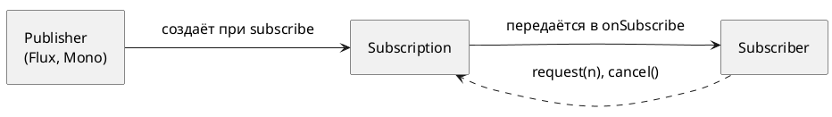
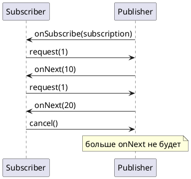
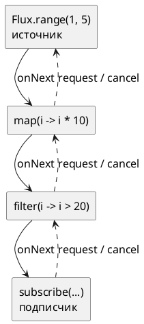

# Тема 01. Publisher, Subscriber, Subscription

> **Статус:** теория · **Дальше:** интервью в чате, затем [практика](01-publisher-subscriber-tasks.md)

---

## Оглавление

- [1. Четыре участника](#1-четыре-участника)
- [2. Порядок сигналов](#2-порядок-сигналов)
- [3. Спрос: request(n)](#3-спрос-requestn)
- [4. Ничего не происходит до подписки](#4-ничего-не-происходит-до-подписки)
- [5. Upstream и downstream](#5-upstream-и-downstream)
- [6. Асинхронный источник и main](#6-асинхронный-источник-и-main)
- [Вопросы для интервью](#вопросы-для-интервью)

---

## 1. Четыре участника

**Аналогия:**

Склад отгружает товар магазину. Магазин заключает со складом договор и по нему звонит: «пришлите ещё три коробки».

Склад шлёт не больше, чем просили. В конце он сообщает: «всё отгружено» или «склад сгорел».

**Как это устроено в коде:**

- **Склад** — `Publisher`: источник элементов.
- **Магазин** — `Subscriber`: получатель элементов.
- **Договор** — `Subscription`: связь одного подписчика с одним издателем. Через неё подписчик:
  - просит элементы — `request(n)`;
  - отказывается от них — `cancel()`.
- **Четвёртый интерфейс** — `Processor`: одновременно подписчик и издатель. В курсе он не нужен.

Откуда эти интерфейсы:

- это спецификация Reactive Streams, пакет `org.reactivestreams`;
- `Flux` и `Mono` в Reactor — реализации `Publisher`;
- `Flux` выдаёт от нуля до N элементов;
- `Mono` — ноль или один.



**Правило:** издатель и подписчик общаются только через сигналы; прямого вызова «дай всё» нет.

---

## 2. Порядок сигналов

**Аналогия:**

Сначала подписывают договор, потом идут поставки, в конце — одно итоговое письмо: «закрыто» или «авария».

После итогового письма поставок не бывает.

**Как это устроено в коде:**

Подписчику приходят сигналы — вызовы его методов — в строгом порядке:

1. `onSubscribe(Subscription)` — ровно один раз.
2. `onNext(T)` — любое число раз, в том числе ни одного.
3. Не больше одного терминального сигнала:
   - `onComplete()` — элементы кончились;
   - `onError(Throwable)` — сбой.

```java
Flux.just("A", "B").subscribe(new BaseSubscriber<String>() {
    @Override
    protected void hookOnSubscribe(Subscription s) {
        System.out.println("onSubscribe");
        request(Long.MAX_VALUE);                   // просим «сколько угодно»
    }
    @Override
    protected void hookOnNext(String value) { System.out.println("onNext " + value); }
    @Override
    protected void hookOnComplete() { System.out.println("onComplete"); }
});
// onSubscribe
// onNext A
// onNext B
// onComplete
```

**Разбор:**

- `BaseSubscriber` — готовая основа подписчика из Reactor: в ней уже есть поле подписки и методы `request`, `cancel`.
- `hookOnSubscribe` — наш код в момент `onSubscribe`. Если не вызвать `request`, ни одного `onNext` не придёт.
- `onComplete` пришёл, потому что у `Flux.just` элементы кончились. У `Flux.error` вместо него был бы `onError`.

**Как работает:**

- порядок задан спецификацией и проверяется TCK — набором тестов на соответствие;
- ошибка не бросается в подписчика исключением — она приходит сигналом `onError`;
- после `onError` сигналов нет.

- Источник: https://github.com/reactive-streams/reactive-streams-jvm/blob/v1.0.4/README.md

> In response to a call to `Publisher.subscribe(Subscriber)` the possible invocation sequences for methods on the `Subscriber` are given by the following protocol:
>
> ```
> onSubscribe onNext* (onError | onComplete)?
> ```
>
> This means that `onSubscribe` is always signalled, followed by a possibly unbounded number of `onNext` signals (as requested by `Subscriber`) followed by an `onError` signal if there is a failure, or an `onComplete` signal when no more elements are available—all as long as the `Subscription` is not cancelled.

RU:

> В ответ на вызов `Publisher.subscribe(Subscriber)` возможные последовательности вызовов методов `Subscriber` задаются следующим протоколом:
>
> ```
> onSubscribe onNext* (onError | onComplete)?
> ```
>
> Это значит, что `onSubscribe` отправляется всегда, за ним — возможно неограниченное число сигналов `onNext` (в пределах запрошенного подписчиком), за ними — сигнал `onError` при сбое или сигнал `onComplete`, когда элементов больше нет, — всё это, пока `Subscription` не отменена.

Что из этого следует:

- `onSubscribe` — первый сигнал всегда, даже у пустого источника;
- терминальный сигнал один или ни одного (бесконечный источник или отмена);
- после `cancel()` подписчик сигналов больше не ждёт.

**Почему не иначе:**

- `try/catch` вокруг `subscribe` ошибку источника не поймает: `subscribe` вернётся нормально, а ошибка придёт в `onError`;
- подписчик без обработчика `onError` ошибку в своём коде не увидит.

- Источник: https://github.com/reactive-streams/reactive-streams-jvm/blob/v1.0.4/README.md, правило 1.9

> `Publisher.subscribe` MUST call `onSubscribe` on the provided `Subscriber` prior to any other signals to that `Subscriber` and MUST return normally, except when the provided `Subscriber` is `null` in which case it MUST throw a `java.lang.NullPointerException` to the caller, for all other situations the only legal way to signal failure (or reject the `Subscriber`) is by calling `onError` (after calling `onSubscribe`).

RU:

> `Publisher.subscribe` ДОЛЖЕН вызвать `onSubscribe` у переданного `Subscriber` раньше любых других сигналов этому `Subscriber` и ДОЛЖЕН завершиться нормально, кроме случая, когда переданный `Subscriber` равен `null`, — тогда он ДОЛЖЕН бросить вызывающему `java.lang.NullPointerException`. Во всех остальных ситуациях единственный законный способ сообщить о сбое (или отклонить `Subscriber`) — вызвать `onError` (после вызова `onSubscribe`).

**Правило:** один `onSubscribe`, сколько угодно `onNext`, один финал.

---

## 3. Спрос: request(n)

**Аналогия:**

Магазин маленький: на полке место под одну коробку. Он звонит «одну», раскладывает её, звонит снова.

Склад не имеет права привезти пять коробок сразу.

**Как это устроено в коде:**

- **Звонок «пришлите n»** — `request(n)`. Число `n` называется спросом (demand).
- **Правило склада** — издатель отправляет `onNext` не больше суммарного спроса.
- **«Везите сколько есть»** — `request(Long.MAX_VALUE)`, спрос без ограничений.
- **«Больше не нужно»** — `cancel()`: издатель прекращает отправку и освобождает ресурсы.



```java
Flux.range(1, 100)
    .doOnRequest(n -> System.out.println("request " + n))
    .subscribe(new BaseSubscriber<Integer>() {
        @Override
        protected void hookOnSubscribe(Subscription s) { request(1); }
        @Override
        protected void hookOnNext(Integer value) {
            System.out.println("onNext " + value);
            if (value == 2) cancel(); else request(1);   // второй элемент — последний
        }
    });
// request 1
// onNext 1
// request 1
// onNext 2
```

**Разбор:**

- `doOnRequest` подглядывает, какой спрос уходит вверх к `Flux.range`;
- источник сгенерировал всего два элемента из ста;
- третий никто не запросил, а потом подписку отменили.

- Источник: https://github.com/reactive-streams/reactive-streams-jvm/blob/v1.0.4/README.md

> The total number of `onNext`´s signalled by a `Publisher` to a `Subscriber` MUST be less than or equal to the total number of elements requested by that `Subscriber`´s `Subscription` at all times.

RU:

> Общее число сигналов `onNext`, отправленных `Publisher` подписчику `Subscriber`, ДОЛЖНО быть в любой момент меньше или равно общему числу элементов, запрошенных через `Subscription` этого подписчика.

- Источник: там же, правило 3.17

> A `Subscription` MUST support an unbounded number of calls to `request` and MUST support a demand up to 2^63-1 (`java.lang.Long.MAX_VALUE`). A demand equal or greater than 2^63-1 (`java.lang.Long.MAX_VALUE`) MAY be considered by the `Publisher` as “effectively unbounded”.

RU:

> `Subscription` ДОЛЖНА поддерживать неограниченное число вызовов `request` и спрос до 2^63-1 (`java.lang.Long.MAX_VALUE`). Спрос, равный или больший 2^63-1 (`java.lang.Long.MAX_VALUE`), `Publisher` МОЖЕТ считать «фактически неограниченным».

Что из этого следует:

- спрос накапливается: `request(2)` и `request(3)` дают 5;
- `subscribe(System.out::println)` в Reactor просит `Long.MAX_VALUE` — это и есть «без ограничений»;
- `request(0)` и отрицательный спрос запрещены, издатель отвечает ошибкой:

> While the `Subscription` is not cancelled, `Subscription.request(long n)` MUST signal `onError` with a `java.lang.IllegalArgumentException` if the argument is <= 0. The cause message SHOULD explain that non-positive request signals are illegal.

RU (правило 3.9):

> Пока `Subscription` не отменена, `Subscription.request(long n)` ДОЛЖЕН отправить `onError` с `java.lang.IllegalArgumentException`, если аргумент <= 0. Сообщение СЛЕДУЕТ сделать таким, чтобы оно объясняло, что неположительный запрос недопустим.

**Почему не иначе:**

- если бы издатель слал сколько хочет, быстрый источник завалил бы медленного подписчика;
- очередь в памяти росла бы, пока не кончится heap;
- спрос — это и есть backpressure, к нему вернёмся в теме 08.

**Правило:** нет запроса — нет элементов.

---

## 4. Ничего не происходит до подписки

**Аналогия:**

Технолог пишет на бумаге маршрут конвейера: «взять, отфильтровать, упаковать». Пока не нажата кнопка «пуск», ни одна деталь не двигается.

Нажать кнопку можно дважды — будет две партии.

**Как это устроено в коде:**

- **Маршрут на бумаге** — сборка (assembly): вызовы `Flux.range(...).map(...).filter(...)`. Каждый оператор создаёт новый объект-описание вокруг предыдущего.
- **Кнопка «пуск»** — `subscribe()`, момент подписки (subscription time). Только теперь начинается работа.
- **Вторая партия** — вторая подписка: цепочка выполняется заново, с самого источника.

```java
Flux<Integer> chain = Flux.range(1, 3)
        .map(i -> {
            System.out.println("map " + i);
            return i * 10;
        });
System.out.println("цепочка собрана");      // map ещё ни разу не вызван
chain.subscribe();                          // map 1, map 2, map 3
chain.subscribe();                          // снова map 1, map 2, map 3
```

**Разбор:**

- первая строка вывода — «цепочка собрана»: лямбда в `map` до подписки не вызывалась;
- вторая подписка прогнала всю цепочку ещё раз — источник `range` выдал элементы заново.

- Источник: https://projectreactor.io/docs/core/release/reference/reactiveProgramming.html

> In Reactor, when you write a `Publisher` chain, data does not start pumping into it by default. Instead, you create an abstract description of your asynchronous process (which can help with reusability and composition).
>
> By the act of subscribing, you tie the `Publisher` to a `Subscriber`, which triggers the flow of data in the whole chain. This is achieved internally by a single `request` signal from the `Subscriber` that is propagated upstream, all the way back to the source `Publisher`.

RU:

> В Reactor, когда вы пишете цепочку `Publisher`, данные по умолчанию в неё не поступают. Вместо этого вы создаёте абстрактное описание асинхронного процесса (что помогает повторному использованию и композиции).
>
> Актом подписки вы связываете `Publisher` с `Subscriber`, и это запускает поток данных во всей цепочке. Внутри это достигается одним сигналом `request` от `Subscriber`, который распространяется вверх по цепочке до самого исходного `Publisher`.

**Почему не иначе:**

- метод сервиса вернул `Flux`, а вызывающий на него не подписался — запрос в базу не ушёл, ошибки нет, данных нет;
- в WebFlux подписывается фреймворк, когда `Flux` возвращён из контроллера;
- цепочку, которую никто не вернул и не подписал, в своём коде легко потерять.

**Правило:** собрать цепочку — значит описать работу; выполнит её только подписка.

---

## 5. Upstream и downstream

**Аналогия:**

Река течёт от истока к устью. Вода — данные — идёт вниз по течению.

Сигнал «хватит воды» передают вверх, к истоку.

**Как это устроено в коде:**

- **Исток** — upstream: всё, что в коде выше оператора, ближе к источнику.
- **Устье** — downstream: всё, что ниже, ближе к `subscribe`.
- **Вода вниз** — данные: `onNext`, `onError`, `onComplete`.
- **Сигналы вверх** — подписка, спрос и отмена: `subscribe`, `request`, `cancel`.



**Разбор:**

- для `map` в этой цепочке upstream — `range`;
- downstream для `map` — `filter` и подписчик;
- каждый оператор — одновременно подписчик своего upstream и издатель для своего downstream.

**Правило:** данные вниз, спрос и отмена вверх.

---

## 6. Асинхронный источник и main

**Аналогия:**

Вы отправили заказ курьером и сразу ушли домой.

Курьер приехал — а принимать некому.

**Как это устроено в коде:**

- **Курьер** — источник, который выдаёт элементы на другом потоке. Например, `Flux.interval` работает на пуле `parallel`.
- **«Сразу ушли»** — `subscribe()` возвращается сразу, не дожидаясь элементов.
- **«Принимать некому»** — поток `main` идёт дальше и может завершить программу раньше первого элемента.
- **Вывод** — в учебном коде и тестах ожидание делают явно.

```java
CountDownLatch done = new CountDownLatch(1);
Flux.interval(Duration.ofMillis(100))       // элементы приходят на потоке parallel-1
    .take(3)
    .subscribe(
        tick -> System.out.println(Thread.currentThread().getName() + " " + tick),
        error -> done.countDown(),
        done::countDown);                     // onComplete
done.await(1, TimeUnit.SECONDS);             // main ждёт финала, но не дольше секунды
// parallel-1 0
// parallel-1 1
// parallel-1 2
```

**Разбор:**

- Три лямбды `subscribe` — обработчики `onNext`, `onError`, `onComplete`.
- `CountDownLatch` открывается в финальном сигнале — и при успехе, и при ошибке, иначе при ошибке `main` ждал бы до таймаута.
- `subscribe` возвращает `Disposable`. Его `dispose()` отменяет подписку — это `cancel()` сверху.

Javadoc `Flux.subscribe(Consumer)`, reactor-core 3.8:

- Источник: https://projectreactor.io/docs/core/release/api/reactor/core/publisher/Flux.html#subscribe(java.util.function.Consumer)

> Subscribe a Consumer to this Flux that will consume all the elements in the  sequence. It will request an unbounded demand (Long.MAX_VALUE). … Keep in mind that since the sequence can be asynchronous, this will immediately return control to the calling thread. This can give the impression the consumer is not invoked when executing in a main thread or a unit test for instance.

RU:

> Подписывает `Consumer` на этот `Flux`, и он получит все элементы последовательности. Будет запрошен неограниченный спрос (`Long.MAX_VALUE`). … Помните, что последовательность может быть асинхронной, поэтому управление сразу вернётся вызывающему потоку. Это может создать впечатление, что `Consumer` не вызывается, например при выполнении в потоке `main` или в модульном тесте.

Javadoc `Flux.interval(Duration)`:

- Источник: https://projectreactor.io/docs/core/release/api/reactor/core/publisher/Flux.html#interval(java.time.Duration)

> Create a Flux that emits long values starting with 0 and incrementing at specified time intervals on the global timer. The first element is emitted after an initial delay equal to the period. … Runs on the Schedulers.parallel() Scheduler.

RU:

> Создаёт `Flux`, который выдаёт значения `long`, начиная с 0 и увеличивая их, через заданные интервалы на глобальном таймере. Первый элемент выдаётся после начальной задержки, равной периоду. … Работает на планировщике `Schedulers.parallel()`.

**Почему не иначе:**

- `block()` тоже дождётся результата, но в коде на event loop WebFlux его не используют: он блокирует поток, который обслуживает все запросы (тема 07);
- в тестах вместо ручного ожидания используют `StepVerifier` (тема 11).

**Правило:** асинхронный результат ждут явно и с таймаутом, а в рабочем коде — не ждут, а возвращают `Mono` или `Flux` дальше.

---

## Вопросы для интервью

1. Назовите четыре интерфейса Reactive Streams и роль каждого.
2. В каком порядке приходят сигналы подписчику? Может ли после `onError` прийти `onNext`?
3. Что такое demand? Что будет, если подписчик в `onSubscribe` не вызовет `request`?
4. Чем сборка цепочки отличается от подписки? Что выведет код, где цепочку собрали, но не подписали?
5. Что произойдёт при двух подписках на одну цепочку с `Flux.range`?
6. Куда идут данные, а куда — `request` и `cancel`? Что для `map` является upstream?
7. Почему в `main` с `Flux.interval` вывод может оказаться пустым и как это исправить?
8. Почему `try/catch` вокруг `subscribe` не ловит ошибку источника?

---

**Практика:** [01-publisher-subscriber-tasks.md](01-publisher-subscriber-tasks.md)
