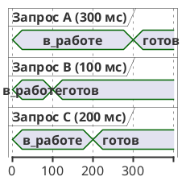

# Тема 04. flatMap, concatMap, flatMapSequential

> **Статус:** теория · **Дальше:** интервью в чате, затем [практика](04-flatmap-tasks.md)

---

## Оглавление

- [1. map против flatMap](#1-map-против-flatmap)
- [2. flatMap: все сразу, порядок по готовности](#2-flatmap-все-сразу-порядок-по-готовности)
- [3. concurrency: сколько одновременно](#3-concurrency-сколько-одновременно)
- [4. concatMap: по одному, по порядку](#4-concatmap-по-одному-по-порядку)
- [5. flatMapSequential: все сразу, но по порядку](#5-flatmapsequential-все-сразу-но-по-порядку)
- [6. Mono.flatMap и flatMapMany](#6-monoflatmap-и-flatmapmany)
- [Вопросы для интервью](#вопросы-для-интервью)

---

## 1. map против flatMap

**Аналогия:**

Менеджер получает список городов. Два варианта работы:

- **сам** пишет на каждой карточке название заглавными буквами — сразу, на месте;
- **звонит** по каждому городу в службу доставки и ждёт ответа — результат приходит позже.

**Как это устроено в коде:**

- **«Сам, на месте»** — `map`: принимает функцию `T → R` и выполняет её сразу.
- **«Звонок и ожидание»** — `flatMap`: принимает функцию `T → Publisher<R>`.
- **Звонок** — для каждого элемента строится внутренний издатель (inner publisher).
- **Ожидание ответа** — `flatMap` **подписывается** на внутренний издатель и пересылает вниз его элементы.
- Так в цепочку встраивают асинхронные вызовы: запрос к базе, HTTP-вызов.

```java
Flux<String> cities = Flux.just("Москва", "Казань");
Flux<Mono<Integer>> wrong = cities.map(city -> service.daysFor(city));     // Mono никто не подписал
Flux<Integer> right = cities.flatMap(city -> service.daysFor(city));       // подписан каждый Mono
```

**Правило:** функция вернула `Mono`/`Flux` — нужен оператор семейства `flatMap`, а не `map`.

---

## 2. flatMap: все сразу, порядок по готовности

**Аналогия:**

Менеджер звонит во все города одновременно с разных телефонов.

Ответы он записывает в том порядке, в каком перезванивают.

**Как это устроено в коде:**

- **Все телефоны сразу** — `flatMap` подписывается на внутренние издатели **жадно**: по мере поступления элементов, не дожидаясь окончания предыдущих.
- **Кто первым перезвонил** — элементы внутренних издателей идут вниз по мере готовности и могут перемешиваться.
- **Итог** — порядок исходных элементов не сохраняется.



```java
Flux.just(300, 100, 200)
    .flatMap(ms -> Mono.just(ms).delayElement(Duration.ofMillis(ms)))
    .collectList()
    .subscribe(System.out::println);
// [100, 200, 300]   — порядок готовности, всё заняло ~300 мс
```

Javadoc `Flux.flatMap(Function)`, reactor-core 3.8:

- Источник: https://projectreactor.io/docs/core/release/api/reactor/core/publisher/Flux.html#flatMap(java.util.function.Function)

> Generation of inners and subscription: this operator is eagerly subscribing to its inners.
> Ordering of the flattened values: this operator does not necessarily preserve original ordering, as inner element are flattened as they arrive.
> Interleaving: this operator lets values from different inners interleave (similar to merging the inner sequences).

RU:

> Создание внутренних издателей и подписка: этот оператор жадно подписывается на внутренние издатели.
> Порядок выходных значений: этот оператор не обязательно сохраняет исходный порядок, так как элементы внутренних издателей выдаются по мере поступления.
> Перемешивание: этот оператор допускает перемешивание значений разных внутренних издателей (как при слиянии внутренних последовательностей).

**Правило:** `flatMap` — быстро и параллельно, порядок не гарантирован.

---

## 3. concurrency: сколько одновременно

**Аналогия:**

Телефонов у менеджера только два.

Третий город он наберёт, когда освободится одна линия.

**Как это устроено в коде:**

- **Два телефона** — `flatMap(f, concurrency)`: одновременно не больше `concurrency` внутренних подписок.
- **Сколько карточек взять со стола** — это же число уходит первым запросом к upstream: `flatMap` берёт у источника столько элементов, сколько может обработать.
- **Без параметра** — действует значение по умолчанию из Reactor. В задаче 04.4 четыре вызова без параметра шли все одновременно.
- **Внешний сервис** — для него предел задают явно.

Javadoc `Flux.flatMap(Function, int)`:

- Источник: https://projectreactor.io/docs/core/release/api/reactor/core/publisher/Flux.html#flatMap(java.util.function.Function,int)

> The concurrency argument allows to control how many Publisher can be subscribed to and merged in parallel. In turn, that argument shows the size of the first Subscription.request(long) to the upstream.
>
> concurrency - the maximum number of in-flight inner sequences

RU:

> Аргумент `concurrency` позволяет управлять тем, на сколько `Publisher` можно подписаться и сливать их параллельно. Соответственно, этот аргумент задаёт размер первого `Subscription.request(long)` к upstream.
>
> concurrency — максимальное число внутренних последовательностей, находящихся в работе одновременно.

**Почему не иначе:**

- `flatMap` по тысяче идентификаторов без ограничения отправит в партнёрский API сотни запросов разом;
- результат — ответ 429 или упавший сервис партнёра.

**Правило:** вызов внешней системы внутри `flatMap` — всегда с явным `concurrency`.

---

## 4. concatMap: по одному, по порядку

**Аналогия:**

Один телефон и строгий порядок:

1. Позвонил в первый город.
2. Дождался ответа, записал.
3. Позвонил во второй.

**Как это устроено в коде:**

- **Один телефон** — `concatMap` подписывается на следующий внутренний издатель только после **завершения** предыдущего.
- **Порядок** — сохраняется полностью, перемешивания нет.
- **Цена** — время равно сумме всех вызовов.

```java
Flux.just(300, 100, 200)
    .concatMap(ms -> Mono.just(ms).delayElement(Duration.ofMillis(ms)))
    .collectList()
    .subscribe(System.out::println);
// [300, 100, 200]   — исходный порядок, ~600 мс
```

Javadoc `Flux.concatMap(Function)`:

- Источник: https://projectreactor.io/docs/core/release/api/reactor/core/publisher/Flux.html#concatMap(java.util.function.Function)

> Generation of inners and subscription: this operator waits for one inner to complete before generating the next one and subscribing to it.
> Ordering of the flattened values: this operator naturally preserves the same order as the source elements, concatenating the inners from each source element sequentially.
> Interleaving: this operator does not let values from different inners interleave (concatenation).

RU:

> Создание внутренних издателей и подписка: этот оператор ждёт завершения одного внутреннего издателя, прежде чем создать следующий и подписаться на него.
> Порядок выходных значений: этот оператор естественным образом сохраняет порядок исходных элементов, последовательно соединяя внутренние издатели каждого исходного элемента.
> Перемешивание: этот оператор не допускает перемешивания значений разных внутренних издателей (конкатенация).

**Когда нужен:**

- порядок важен сам по себе — события по одному счёту;
- следующий шаг не должен начаться раньше предыдущего — запись в базу пачками, тема 08.

**Правило:** `concatMap` — строгий порядок и по одному вызову за раз.

---

## 5. flatMapSequential: все сразу, но по порядку

**Аналогия:**

Менеджер звонит во все города одновременно, но в отчёт записывает ответы строго по списку.

Ответ Казани ждёт на столе, пока не придёт ответ Москвы.

**Как это устроено в коде:**

- **Все звонки сразу** — `flatMapSequential` подписывается жадно, как `flatMap`.
- **Отчёт по списку** — результаты выдаются в порядке исходных элементов.
- **Ответ на столе** — ранние ответы поздних элементов держатся в очереди.

| | Время | Порядок | Цена |
|---|---|---|---|
| `flatMapSequential` | как у `flatMap` | как у `concatMap` | память под очередь |

```java
Flux.just(300, 100, 200)
    .flatMapSequential(ms -> Mono.just(ms).delayElement(Duration.ofMillis(ms)))
    .collectList()
    .subscribe(System.out::println);
// [300, 100, 200]   — исходный порядок, ~300 мс
```

Javadoc `Flux.flatMapSequential(Function)`:

- Источник: https://projectreactor.io/docs/core/release/api/reactor/core/publisher/Flux.html#flatMapSequential(java.util.function.Function)

> However, if such an early inner takes more time to complete than subsequent faster inners, the data from these faster inners will be queued until the earlier inner completes, so as to maintain source ordering.

RU:

> Однако если такой ранний внутренний издатель завершается дольше, чем последующие более быстрые, данные этих более быстрых будут поставлены в очередь, пока ранний не завершится, — чтобы сохранить порядок источника.

| Оператор | Подписка на внутренние | Порядок результата | Время на примере |
|---|---|---|---|
| `flatMap` | сразу, жадно | по готовности | ~300 мс |
| `concatMap` | по одному | исходный | ~600 мс |
| `flatMapSequential` | сразу, жадно | исходный | ~300 мс |

Время в таблице — замер запуска примеров выше на Reactor 3.8.4.

**Правило:** нужен порядок и скорость — `flatMapSequential`; нужен порядок и «не раньше, чем закончился предыдущий» — `concatMap`.

---

## 6. Mono.flatMap и flatMapMany

**Как это устроено в коде:**

- `Mono.flatMap` — из одного значения новый `Mono`;
- `Mono.flatMapMany` — из одного значения поток, результат `Flux`;
- типовой случай: найти клиента, затем по нему загрузить заказы.

```java
Mono<Customer> customer = customers.findById(7);
Flux<String> lines = customer.flatMapMany(c ->
        orders.findByCustomerId(c.id()).map(o -> c.name() + ": " + o.id()));
```

Если клиента нет, `findById` вернёт пустой `Mono`, лямбда не вызовется, и `lines` завершится без элементов.

Javadoc `Mono.flatMapMany(Function)`:

- Источник: https://projectreactor.io/docs/core/release/api/reactor/core/publisher/Mono.html#flatMapMany(java.util.function.Function)

> Transform the item emitted by this Mono into a Publisher, then forward its emissions into the returned Flux.

RU:

> Преобразует элемент этого `Mono` в `Publisher`, затем пересылает его элементы в возвращаемый `Flux`.

**Правило:** один → один асинхронно — `Mono.flatMap`; один → много — `flatMapMany`.

---

## Вопросы для интервью

1. Почему `flux.map(id -> repository.findById(id))` не обращается к базе? Какой тип получится?
2. В каком порядке `flatMap` выдаёт результаты? Почему?
3. Что делает второй аргумент `flatMap`? Каким будет первый `request` к upstream?
4. Чем `concatMap` отличается от `flatMapSequential` по времени и по подпискам?
5. Три вызова по 300, 100 и 200 мс: сколько займёт каждый из трёх операторов и в каком порядке будут результаты?
6. Когда `concatMap` обязателен, даже если порядок результатов не важен?
7. Что вернёт `customer.flatMapMany(...)`, если клиента нет?
8. Почему `flatMap` по внешнему API без `concurrency` опасен?

---

**Практика:** [04-flatmap-tasks.md](04-flatmap-tasks.md)
