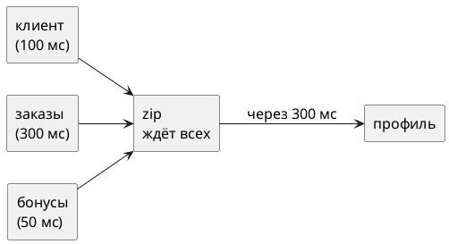

# Тема 05. Объединение источников

> **Статус:** теория · **Дальше:** интервью в чате, затем [практика](05-combining-tasks.md)

---

## Оглавление

- [1. zip: дождаться всех и собрать вместе](#1-zip-дождаться-всех-и-собрать-вместе)
- [2. Пустой участник zip](#2-пустой-участник-zip)
- [3. merge против concat](#3-merge-против-concat)
- [4. then и thenReturn: «после этого»](#4-then-и-thenreturn-после-этого)
- [5. Mono.when: дождаться завершения всех](#5-monowhen-дождаться-завершения-всех)
- [6. Что выбрать](#6-что-выбрать)
- [Вопросы для интервью](#вопросы-для-интервью)

---

## 1. zip: дождаться всех и собрать вместе

**Аналогия:**

Для выдачи кредита нужны три справки:

- из банка;
- из налоговой;
- с работы.

Их заказывают одновременно, а решение принимают, когда на руках все три.

**Как это устроено в коде:**

- **Справки** — источники `a`, `b`, `c`.
- **Заказ всех сразу** — `Mono.zip(a, b, c)` подписывается на все источники одновременно.
- **«Все три на руках»** — `zip` ждёт по одному значению от каждого.
- **Решение** — `Tuple3` или результат функции-комбинатора.
- **Срок** — время по самому медленному источнику, а не сумма.

```java
Mono<String> name   = Mono.just("Анна").delayElement(Duration.ofMillis(100));
Mono<Integer> count = Mono.just(4).delayElement(Duration.ofMillis(300));
Mono.zip(name, count, (n, c) -> n + ": " + c + " заказа")
    .subscribe(System.out::println);      // через ~300 мс: Анна: 4 заказа
```



Javadoc `Mono.zip(Mono, Mono, Mono)`, reactor-core 3.8:

- Источник: https://projectreactor.io/docs/core/release/api/reactor/core/publisher/Mono.html#zip(reactor.core.publisher.Mono,reactor.core.publisher.Mono,reactor.core.publisher.Mono)

> Merge given monos into a new Mono that will be fulfilled when all of the given Monos have produced an item, aggregating their values into a Tuple3. An error or empty completion of any source will cause other sources to be cancelled and the resulting Mono to immediately error or complete, respectively.

RU:

> Объединяет переданные `Mono` в новый `Mono`, который выполнится, когда все переданные `Mono` выдадут по элементу, и соберёт их значения в `Tuple3`. Ошибка или пустое завершение любого источника отменит остальные источники, и итоговый `Mono` сразу завершится ошибкой или пустым соответственно.

**Правило:** независимые запросы, нужны все результаты — `zip`.

---

## 2. Пустой участник zip

**Аналогия:**

Налоговая ответила «справки не будет». Банк не ждёт остальные справки.

Заявка закрыта без решения.

**Как это устроено в коде:**

- **«Справки не будет»** — пустой источник в `zip`.
- **Заявка без решения** — пустым становится **весь** результат (см. цитату выше).
- **Банк не ждёт** — остальные источники отменяются.
- **Необязательная справка** — значение заранее заменяют значением по умолчанию: `defaultIfEmpty` (тема 03) **до** `zip`.

```java
Mono<String> promo = Mono.empty();                     // промокода нет
Mono.zip(Mono.just("Анна"), promo)
    .subscribe(t -> System.out.println("есть"), e -> {}, () -> System.out.println("пусто"));
// пусто — имя потеряно вместе с промокодом

Mono.zip(Mono.just("Анна"), promo.defaultIfEmpty("нет"))
    .subscribe(t -> System.out.println(t.getT1() + ", промокод: " + t.getT2()));
// Анна, промокод: нет
```

**Внимание:**

С `count()` такой проблемы нет: `Flux.empty().count()` выдаёт `0`, а не пустоту.

**Почему не иначе:**

- пустой `zip` — тихая потеря: ни ошибки, ни данных;
- на интервью это любимая ловушка.

**Правило:** необязательный участник `zip` — с `defaultIfEmpty` до `zip`.

---

## 3. merge против concat

**Аналогия:**

В магазине две кассы:

- **общая очередь** — покупатели проходят по мере готовности из обеих касс;
- **по очереди** — вторая касса открывается только после того, как первая обслужила всех.

**Как это устроено в коде:**

- **Общая очередь** — `Flux.merge(a, b)`: подписывается на оба источника сразу и выдаёт элементы по мере появления.
- **По очереди** — `Flux.concat(a, b)`: подписывается на `b` только после `onComplete` у `a`.
- **Цена строгого порядка** — бесконечный `a` навсегда закроет дорогу `b`.

```java
Flux<String> archive = Flux.just("архив-1", "архив-2").delayElements(Duration.ofMillis(100));
Flux<String> live    = Flux.just("новое-1");
Flux.merge(archive, live).subscribe(System.out::println);    // новое-1, архив-1, архив-2
Flux.concat(archive, live).subscribe(System.out::println);   // архив-1, архив-2, новое-1
```

Javadoc `Flux.merge(Publisher)`:

- Источник: https://projectreactor.io/docs/core/release/api/reactor/core/publisher/Flux.html#merge(org.reactivestreams.Publisher)

> Merge data from Publisher sequences emitted by the passed Publisher into an interleaved merged sequence. Unlike concat, inner sources are subscribed to eagerly.

RU:

> Сливает данные последовательностей `Publisher`, выданных переданным `Publisher`, в одну перемешанную последовательность. В отличие от `concat`, на внутренние источники подписываются жадно.

Javadoc `Flux.concat(Publisher)`:

- Источник: https://projectreactor.io/docs/core/release/api/reactor/core/publisher/Flux.html#concat(org.reactivestreams.Publisher)

> Concatenation is achieved by sequentially subscribing to the first source then waiting for it to complete before subscribing to the next, and so on until the last source completes. Any error interrupts the sequence immediately and is forwarded downstream.

RU:

> Конкатенация достигается последовательной подпиской: на первый источник, затем ожидание его завершения перед подпиской на следующий, и так до завершения последнего источника. Любая ошибка сразу прерывает последовательность и передаётся вниз.

**Правило:** события «по мере появления» — `merge`; «сначала всё из первого» — `concat`.

---

## 4. then и thenReturn: «после этого»

**Аналогия:**

Поручение из трёх шагов:

1. Закрой смену.
2. Потом отправь отчёт.
3. Потом скажи мне «готово».

Результат закрытия смены не нужен — важен сам факт, что она закрыта.

**Как это устроено в коде:**

- **«Потом»** — `a.then(b)`: ждёт завершения `a`, **отбрасывает** его значение и подписывается на `b`.
- **«Скажи „готово“»** — `thenReturn(x)`: после завершения выдаёт готовое значение.
- **Смена не закрылась** — ошибка `a` идёт дальше, `b` не запускается.
- Так строят цепочки побочных действий типа `Mono<Void>`.

```java
Mono<Void> step1 = Mono.fromRunnable(() -> System.out.println("шаг 1"));
Mono<String> result = step1.then(Mono.fromCallable(() -> {
    System.out.println("шаг 2");
    return "готово";
}));
System.out.println("собрано");
result.subscribe(System.out::println);
// собрано
// шаг 1
// шаг 2
// готово
```

Javadoc `Mono.then(Mono)`:

- Источник: https://projectreactor.io/docs/core/release/api/reactor/core/publisher/Mono.html#then(reactor.core.publisher.Mono)

> Let this Mono complete then play another Mono. In other words ignore element from this Mono and transform its completion signal into the emission and completion signal of a provided Mono<V>. Error signal is replayed in the resulting Mono<V>.

RU:

> Даёт этому `Mono` завершиться, затем воспроизводит другой `Mono`. Иначе говоря, игнорирует элемент этого `Mono` и превращает его сигнал завершения в выдачу и завершение переданного `Mono<V>`. Сигнал ошибки воспроизводится в итоговом `Mono<V>`.

Javadoc `Mono.thenReturn(V)`:

- Источник: https://projectreactor.io/docs/core/release/api/reactor/core/publisher/Mono.html#thenReturn(V)

> Let this Mono complete successfully, then emit the provided value. On an error in the original Mono, the error signal is propagated instead.

RU:

> Даёт этому `Mono` успешно завершиться, затем выдаёт переданное значение. При ошибке в исходном `Mono` вместо этого передаётся сигнал ошибки.

**Почему не иначе:**

- аргумент `then(...)` вычисляется при сборке, как любой аргумент метода Java;
- `then(journal.notify(id))` безопасен, только если `notify` возвращает ленивый `Mono` и сам ничего не делает;
- метод, который делает работу сразу при вызове, оборачивают в `Mono.defer`.

**Правило:** «сделай A, потом B, результат A не нужен» — `then`.

---

## 5. Mono.when: дождаться завершения всех

**Как это устроено в коде:**

- `Mono.when(a, b, c)` запускает все источники сразу;
- завершается, когда завершились все;
- значения не собираются, результат — `Mono<Void>`;
- ошибка любого источника отменяет остальных.

Javadoc `Mono.when(Iterable)`:

- Источник: https://projectreactor.io/docs/core/release/api/reactor/core/publisher/Mono.html#when(java.lang.Iterable)

> Aggregate given publishers into a new Mono that will be fulfilled when all of the given Publishers have completed. An error will cause pending results to be cancelled and immediate error emission to the returned Mono.

RU:

> Объединяет переданные издатели в новый `Mono`, который выполнится, когда все переданные `Publisher` завершатся. Ошибка вызовет отмену ещё не завершённых и немедленную выдачу ошибки в возвращаемый `Mono`.

**Правило:** «запусти всё параллельно, значения не нужны, дождись конца» — `Mono.when`.

---

## 6. Что выбрать

| Нужно | Оператор |
|---|---|
| несколько независимых значений вместе | `Mono.zip` |
| события из нескольких потоков по мере появления | `Flux.merge` |
| сначала весь первый поток, потом второй | `Flux.concat` |
| побочное действие, потом следующее | `then`, `thenReturn` |
| несколько побочных действий параллельно | `Mono.when` |
| следующий запрос зависит от результата предыдущего | `flatMap` (тема 04) |

---

## Вопросы для интервью

1. Сколько времени займёт `zip` трёх запросов по 100, 300 и 50 мс? Почему?
2. Что вернёт `zip`, если один из `Mono` пустой? Как защититься?
3. Чем `merge` отличается от `concat`? Что будет с `concat`, если первый источник бесконечный?
4. Что делает `then` со значением предыдущего `Mono`? Что будет при ошибке?
5. Почему `then(service.doSomething())` может выполнить работу раньше времени?
6. Чем `Mono.when` отличается от `Mono.zip`?
7. Когда нужен `zip`, а когда — `flatMap`?

---

**Практика:** [05-combining-tasks.md](05-combining-tasks.md)
