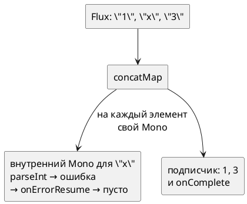

# Тема 06. Ошибки и повторы

> **Статус:** теория · **Дальше:** интервью в чате, затем [практика](06-errors-tasks.md)

---

## Оглавление

- [1. Ошибка — терминальный сигнал](#1-ошибка--терминальный-сигнал)
- [2. onErrorReturn, onErrorResume, onErrorMap](#2-onerrorreturn-onerrorresume-onerrormap)
- [3. Пропустить битый элемент, не останавливая поток](#3-пропустить-битый-элемент-не-останавливая-поток)
- [4. Повтор: retry и retryWhen](#4-повтор-retry-и-retrywhen)
- [5. Повторять можно не всё](#5-повторять-можно-не-всё)
- [6. timeout с запасным ответом](#6-timeout-с-запасным-ответом)
- [Вопросы для интервью](#вопросы-для-интервью)

---

## 1. Ошибка — терминальный сигнал

**Аналогия:**

На конвейере сломалась лента — партия останавливается. Что можно сделать:

- запустить запасную ленту;
- сообщить начальству.

Сломанная лента сама дальше не поедет.

**Как это устроено в коде:**

- **Поломка ленты** — `onError`: последний сигнал последовательности (тема 01).
- **Лента не поедет** — операторы обработки ошибок не «продолжают» поток.
- **Запасная лента** — они **заменяют** оборванную последовательность новой:
  - значением;
  - другим источником;
  - другой ошибкой.

- Источник: https://projectreactor.io/docs/core/release/reference/coreFeatures/error-handling.html

> Before you learn about error-handling operators, you must keep in mind that any error in a reactive sequence is a terminal event. Even if an error-handling operator is used, it does not let the original sequence continue. Rather, it converts the `onError` signal into the start of a new sequence (the fallback one). In other words, it replaces the terminated sequence upstream of it.

RU:

> Прежде чем изучать операторы обработки ошибок, нужно помнить, что любая ошибка в реактивной последовательности — терминальное событие. Даже если используется оператор обработки ошибок, он не позволяет исходной последовательности продолжиться. Вместо этого он превращает сигнал `onError` в начало новой последовательности (запасной). Иначе говоря, он заменяет оборвавшуюся последовательность выше себя.

```java
Flux.just(1, 2, 0, 4)
    .map(i -> 10 / i)                 // на 0 — ArithmeticException
    .onErrorReturn(-1)
    .subscribe(System.out::println);
// 10
// 5
// -1          — элемента 4 не будет: исходный поток уже закончился
```

**Правило:** обработчик ошибки заменяет хвост потока, а не чинит его.

---

## 2. onErrorReturn, onErrorResume, onErrorMap

**Аналогия:**

Курьер не смог доставить. Варианты:

- оставить записку-заглушку;
- отправить другого курьера;
- передать менеджеру жалобу в понятной форме.

**Как это устроено в коде:**

- **Записка-заглушка** — `onErrorReturn`.
- **Другой курьер** — `onErrorResume`.
- **Жалоба в понятной форме** — `onErrorMap`.

| Оператор | Что делает | Типовой случай |
|---|---|---|
| `onErrorReturn(value)` | выдаёт готовое значение и завершается | значение по умолчанию |
| `onErrorResume(e -> publisher)` | подписывается на запасной источник | кэш, другой сервис, `Mono.empty()` |
| `onErrorMap(e -> other)` | заменяет одну ошибку другой | технической ошибке — бизнес-смысл |

**Внимание:**

У каждого оператора есть вариант с типом исключения первым аргументом. Ошибки других типов проходят мимо.

```java
Mono<BigDecimal> rate = rateService.usd()
        .onErrorReturn(RateUnavailableException.class, BigDecimal.ONE);
Mono<Order> order = repository.load(id)
        .onErrorMap(SQLException.class, e -> new OrderStorageException(id, e));   // причина сохраняется
```

Javadoc `Flux.onErrorReturn(Class, T)`, reactor-core 3.8:

- Источник: https://projectreactor.io/docs/core/release/api/reactor/core/publisher/Flux.html#onErrorReturn(java.lang.Class,T)

> Simply emit a captured fallback value when an error of the specified type is observed on this Flux.

RU:

> Просто выдаёт захваченное запасное значение, когда в этом `Flux` замечена ошибка указанного типа.

Javadoc `Flux.onErrorResume(Class, Function)`:

- Источник: https://projectreactor.io/docs/core/release/api/reactor/core/publisher/Flux.html#onErrorResume(java.lang.Class,java.util.function.Function)

> Subscribe to a fallback publisher when an error matching the given type occurs, using a function to choose the fallback depending on the error.

RU:

> Подписывается на запасной издатель, когда возникает ошибка указанного типа; функция выбирает запасной издатель в зависимости от ошибки.

Javadoc `Flux.onErrorMap(Class, Function)`:

- Источник: https://projectreactor.io/docs/core/release/api/reactor/core/publisher/Flux.html#onErrorMap(java.lang.Class,java.util.function.Function)

> Transform an error emitted by this Flux by synchronously applying a function to it if the error matches the given type. Otherwise let the error pass through.

RU:

> Преобразует ошибку этого `Flux`, синхронно применяя к ней функцию, если ошибка подходит под указанный тип. Иначе пропускает ошибку дальше.

**Почему не иначе:**

- `onErrorReturn(BigDecimal.ONE)` без типа спрячет и ошибку курса, и `NullPointerException` в вашем коде;
- падение превратится в тихий неверный ответ.

**Правило:** обрабатывайте ошибку по типу; новая ошибка — с исходной причиной.

---

## 3. Пропустить битый элемент, не останавливая поток

**Аналогия:**

Из сотни накладных одна заполнена неразборчиво. Её откладывают в сторону с пометкой, остальные обрабатывают.

Смену из-за одной бумажки не останавливают.

**Как это устроено в коде:**

- **Остановка смены** — ошибка в основном потоке завершает его.
- **Отдельная накладная** — обработка элемента идёт во внутреннем `Mono` внутри `flatMap` / `concatMap`.
- **Отложить в сторону** — обработчик ошибки ставят **на этом внутреннем** `Mono`.
- **Смена работает** — внутренний `Mono` заменяется пустым, основной поток ничего не замечает.



```java
Flux.just("1", "x", "3")
    .concatMap(s -> Mono.fromCallable(() -> Integer.parseInt(s))
            .onErrorResume(NumberFormatException.class, e -> Mono.empty()))   // только этот элемент
    .subscribe(System.out::println);
// 1
// 3
```

**Почему не иначе:**

- тот же `onErrorResume`, поставленный после `concatMap`, сработает на весь поток;
- после `"x"` вы получите запасной источник, а `"3"` не будет никогда.

**Правило:** ошибку одного элемента ловят внутри его внутреннего `Mono`.

---

## 4. Повтор: retry и retryWhen

**Аналогия:**

Позвонили в службу — занято. Дальше:

1. Перезвонили через минуту.
2. Потом через две.
3. Потом через четыре.
4. После трёх неудач записали «недоступна».

**Как это устроено в коде:**

- **Перезвонить** — `retry(n)` и `retryWhen(spec)`: при ошибке **заново подписываются** на upstream.
- **Номер набирают заново** — поэтому источник должен быть ленивым:
  - `Mono.fromCallable(gateway::call)` вызовет шлюз заново;
  - `Mono.just(gateway.call())` вернёт ту же ошибку, вычисленную один раз при сборке.
- **Растущие паузы** — `Retry.backoff(n, min)`: до `n` повторов с растущей паузой.
- **«Недоступна»** — после исчерпания повторов приходит ошибка; её причина — последняя ошибка источника.

```java
Mono.fromCallable(gateway::call)                         // вызов при каждой подписке
    .retryWhen(Retry.backoff(3, Duration.ofMillis(100))) // паузы ~100, ~200, ~400 мс
    .subscribe(System.out::println, e -> System.out.println("сдались: " + e.getCause()));
```

- Источник: https://projectreactor.io/docs/core/release/reference/coreFeatures/error-handling.html

> As you can see from the preceding example, `retry(1)` merely re-subscribed to the original `interval` once, restarting the tick from 0.

RU:

> Как видно из предыдущего примера, `retry(1)` просто один раз заново подписался на исходный `interval`, и отсчёт начался заново с 0.

Javadoc `RetryBackoffSpec`:

- Источник: https://projectreactor.io/docs/core/release/api/reactor/util/retry/RetryBackoffSpec.html

> Retry delays are randomized with a user-provided `jitter(double)` factor between `0.d` (no jitter) and `1.0` (default is `0.5`). Even with the jitter, the effective backoff delay cannot be less than `minBackoff(Duration)` nor more than `maxBackoff(Duration)`. … When the maximum attempt of retries is reached, a runtime exception is propagated downstream which can be pinpointed with `Exceptions.isRetryExhausted(Throwable)`. The cause of the last attempt's failure is attached as said `retryExhausted` exception's cause.

RU:

> Задержки между повторами случайно варьируются с коэффициентом `jitter(double)` от `0.d` (без разброса) до `1.0` (по умолчанию `0.5`). Даже с разбросом фактическая задержка не может быть меньше `minBackoff(Duration)` и больше `maxBackoff(Duration)`. … Когда достигнуто максимальное число повторов, вниз передаётся runtime-исключение, которое можно распознать через `Exceptions.isRetryExhausted(Throwable)`. Причина неудачи последней попытки прикреплена как cause этого исключения `retryExhausted`.

**Разбор:**

- `backoff(3, …)` — 3 **повтора**, то есть до 4 вызовов всего;
- пауза не меньше `minBackoff`, но точное значение случайно: тест проверяет только нижнюю границу;
- итоговая ошибка — не исходная: исходная лежит в `getCause()`;
- запуск на Reactor 3.8.4 при постоянной ошибке: 4 вызова, сообщение `Retries exhausted: 3/3`.

**Правило:** повтор — это переподписка; повторяемый источник обязан быть ленивым.

---

## 5. Повторять можно не всё

**Аналогия:**

- «Занято» — повод перезвонить.
- «Такого номера не существует» — не повод: сколько ни звони, ответ тот же.

**Как это устроено в коде:**

- **«Занято»** — временные сбои: таймаут, 503, обрыв соединения. Их повторять имеет смысл.
- **«Номера не существует»** — ошибка данных: 400, неверный запрос. Повтор её не исправит, только нагрузит систему.
- **Отбор** — `filter(predicate)` у `Retry`: пропускает к повтору только подходящие ошибки, остальные сразу идут вниз.

**Внимание:**

Второе условие повтора — идемпотентность. Повтор платежа без ключа идемпотентности спишет деньги дважды.

```java
Mono.fromCallable(gateway::send)
    .retryWhen(Retry.max(3).filter(e -> e instanceof TemporaryFailureException));
```

Javadoc `RetryBackoffSpec.filter(Predicate)`:

- Источник: https://projectreactor.io/docs/core/release/api/reactor/util/retry/RetryBackoffSpec.html#filter(java.util.function.Predicate)

> Set the `Predicate` that will filter which errors can be retried. Exceptions that don't pass the predicate will be propagated downstream and terminate the retry sequence. Defaults to allowing retries for all exceptions.

RU:

> Задаёт `Predicate`, который отбирает, какие ошибки можно повторять. Исключения, не прошедшие предикат, передаются вниз и завершают последовательность повторов. По умолчанию повторяются все исключения.

**Правило:** повторяем только временные сбои и только идемпотентные операции.

---

## 6. timeout с запасным ответом

**Аналогия:**

Ждём ответа склада полсекунды.

Не ответил — показываем покупателю остаток из вчерашнего кэша с пометкой «примерно».

**Как это устроено в коде:**

- **Полсекунды** — `timeout(d, fallback)`: если за время `d` не пришёл элемент, оператор переключается на запасной источник.
- **Вчерашний кэш** — `fallback`.
- **Склад больше не ждём** — исходный медленный вызов получает `cancel()`. Так показал запуск на Reactor 3.8.4 с `doOnCancel` на источнике.
- **Без запасного ответа** — без `fallback` придёт ошибка `TimeoutException`.
- **Склад ответил ошибкой** — это не таймаут: ошибка проходит дальше как есть.

Javadoc `Flux.timeout(Duration, Publisher)`:

- Источник: https://projectreactor.io/docs/core/release/api/reactor/core/publisher/Flux.html#timeout(java.time.Duration,org.reactivestreams.Publisher)

> Switch to a fallback Flux as soon as no item is emitted within the given Duration from the previous emission (or the subscription for the first item). If the given Publisher is null, signal a TimeoutException instead.

RU:

> Переключается на запасной `Flux`, как только за заданную `Duration` от предыдущего элемента (или от подписки — для первого элемента) не выдано ни одного элемента. Если переданный `Publisher` равен `null`, вместо этого отправляется `TimeoutException`.

**Правило:** медленный ответ хуже приблизительного — `timeout` с запасным источником.

---

## Вопросы для интервью

1. Почему после `onErrorReturn` исходный поток не продолжается? Что выдаст `Flux.just(1, 2, 0, 4).map(i -> 10 / i).onErrorReturn(-1)`?
2. Чем отличаются `onErrorReturn`, `onErrorResume` и `onErrorMap`? Зачем вариант с типом исключения?
3. Как пропустить один битый элемент и обработать остальные? Куда ставить обработчик?
4. Что именно делает `retry` при ошибке? Почему `Mono.just(call()).retry(3)` не вызывает `call` повторно?
5. Сколько всего вызовов сделает `Retry.backoff(3, …)` при постоянной ошибке? Какое исключение придёт в конце?
6. Какие ошибки нельзя повторять и почему? Что такое идемпотентность?
7. Что произойдёт с исходным вызовом, когда сработал `timeout` с запасным источником?

---

**Практика:** [06-errors-tasks.md](06-errors-tasks.md)
