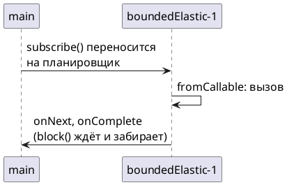

# Тема 07. Планировщики: subscribeOn и publishOn

> **Статус:** теория · **Дальше:** интервью в чате, затем [практика](07-schedulers-tasks.md)

---

## Оглавление

- [1. Где выполняется цепочка без планировщиков](#1-где-выполняется-цепочка-без-планировщиков)
- [2. Пулы Reactor: parallel и boundedElastic](#2-пулы-reactor-parallel-и-boundedelastic)
- [3. subscribeOn: откуда начинается работа](#3-subscribeon-откуда-начинается-работа)
- [4. publishOn: где продолжается работа](#4-publishon-где-продолжается-работа)
- [5. Блокирующий вызов в реактивном коде](#5-блокирующий-вызов-в-реактивном-коде)
- [Вопросы для интервью](#вопросы-для-интервью)

---

## 1. Где выполняется цепочка без планировщиков

**Аналогия:**

Кто нажал кнопку «пуск» на конвейере, тот и крутит ручку, пока детали не кончатся.

Так будет, если никого другого не позвали.

**Как это устроено в коде:**

- **Никого не позвали** — без планировщика (`Scheduler`) Reactor сам потоков не создаёт.
- **Кто нажал «пуск»** — цепочка работает на потоке, который вызвал `subscribe`.
- **Деталь привёз другой** — или на потоке, где источник выдал элемент.
- **Асинхронные источники** приходят со своим потоком: `Flux.interval` и `delayElement` — на пуле `parallel` (тема 01).

```java
Flux.just(1)
    .map(i -> Thread.currentThread().getName())
    .subscribe(name -> System.out.println("map on " + name));
// map on main
```

Reactor Reference Guide, «Threading and Schedulers»:

- Источник: https://projectreactor.io/docs/core/release/reference/coreFeatures/schedulers.html

> Reactor, like RxJava, can be considered to be concurrency-agnostic. That is, it does not enforce a concurrency model. … Obtaining a `Flux` or a `Mono` does not necessarily mean that it runs in a dedicated `Thread`. Instead, most operators continue working in the `Thread` on which the previous operator executed. Unless specified, the topmost operator (the source) itself runs on the `Thread` in which the `subscribe()` call was made.

RU:

> Reactor, как и RxJava, можно считать независимым от модели конкурентности: он её не навязывает. … Получить `Flux` или `Mono` ещё не значит, что он работает в отдельном `Thread`. Большинство операторов продолжают работать в том `Thread`, в котором выполнялся предыдущий оператор. Если не указано иное, самый верхний оператор (источник) работает в том `Thread`, в котором был вызван `subscribe()`.

**Правило:** нет планировщика — работает поток подписчика или поток источника.

---

## 2. Пулы Reactor: parallel и boundedElastic

**Аналогия:**

В ресторане два цеха:

- **повара** — их столько, сколько плит. Они не стоят без дела и делают только быстрые операции;
- **курьеры** — их можно нанять больше, они подолгу ждут в пробках. Число курьеров ограничено, чтобы не разорить ресторан.

**Как это устроено в коде:**

- **Повара** — `Schedulers.parallel()`: пул фиксированного размера по числу ядер, для коротких неблокирующих вычислений.
- **Курьеры** — `Schedulers.boundedElastic()`: растущий пул с потолком числа потоков, для долгих и блокирующих задач — JDBC, файлы, старые синхронные клиенты.
- **Бейджи** — имена потоков `parallel-N` и `boundedElastic-N`: по ним в логе видно, где шла работа.

Javadoc `Schedulers`, reactor-core 3.8:

- Источник: https://projectreactor.io/docs/core/release/api/reactor/core/scheduler/Schedulers.html

> parallel(): Optimized for fast Runnable non-blocking executions
>
> boundedElastic(): Optimized for longer executions, an alternative for blocking tasks where the number of active tasks (and threads) is capped
>
> parallel(): The common parallel instance, a Scheduler that hosts a fixed pool of single-threaded ExecutorService-based workers and is suited for parallel work.
>
> DEFAULT_POOL_SIZE: Default pool size, initialized by system property reactor.schedulers.defaultPoolSize and falls back to the number of processors available to the runtime on init.
>
> DEFAULT_BOUNDED_ELASTIC_SIZE: Default maximum size for the global boundedElastic() Scheduler, initialized by system property reactor.schedulers.defaultBoundedElasticSize and falls back to 10 x number of processors available to the runtime on init.

RU:

> `parallel()`: оптимизирован для быстрых неблокирующих выполнений `Runnable`.
>
> `boundedElastic()`: оптимизирован для более долгих выполнений, альтернатива для блокирующих задач, где число активных задач (и потоков) ограничено.
>
> `parallel()`: общий экземпляр parallel — `Scheduler` с фиксированным пулом однопоточных воркеров на основе `ExecutorService`, подходит для параллельной работы.
>
> `DEFAULT_POOL_SIZE`: размер пула по умолчанию; задаётся системным свойством `reactor.schedulers.defaultPoolSize`, а если его нет — число процессоров, доступных среде выполнения при инициализации.
>
> `DEFAULT_BOUNDED_ELASTIC_SIZE`: максимальный размер по умолчанию для глобального планировщика `boundedElastic()`; задаётся системным свойством `reactor.schedulers.defaultBoundedElasticSize`, а если его нет — 10 × число процессоров, доступных среде выполнения при инициализации.

**Правило:** вычисления — `parallel`, ожидание — `boundedElastic`.

---

## 3. subscribeOn: откуда начинается работа

**Аналогия:**

Начальник цеха говорит: «запуск конвейера поручите курьеру».

Неважно, где в инструкции записана эта фраза. Запускать будет курьер, и вся работа от источника пойдёт на нём.

**Как это устроено в коде:**

- **«Поручите курьеру»** — `subscribeOn(s)`: переносит на планировщик `s` саму подписку и запросы.
- **Работа от источника** — источник начинает работу на потоке `s`, и элементы идут вниз на этом же потоке — до первого `publishOn`.
- **Место в инструкции** — место `subscribeOn` в цепочке не важно.
- **Два распоряжения** — если `subscribeOn` два, действует тот, что ближе к источнику. Подписка идёт снизу вверх, и нижний лишь передаёт её верхнему.

```java
Mono.fromCallable(() -> Thread.currentThread().getName())
    .subscribeOn(Schedulers.boundedElastic())
    .block();                                     // boundedElastic-1

Mono.fromCallable(() -> Thread.currentThread().getName())
    .subscribeOn(Schedulers.boundedElastic())     // ближе к источнику — он и действует
    .subscribeOn(Schedulers.parallel())
    .block();                                     // boundedElastic-1
```

Вывод — запуск на Reactor 3.8.4.



Javadoc `Flux.subscribeOn(Scheduler)`:

- Источник: https://projectreactor.io/docs/core/release/api/reactor/core/publisher/Flux.html#subscribeOn(reactor.core.scheduler.Scheduler)

> Run subscribe, onSubscribe and request on a specified Scheduler's Scheduler.Worker. As such, placing this operator anywhere in the chain will also impact the execution context of onNext/onError/onComplete signals from the beginning of the chain up to the next occurrence of a publishOn. … Typically used for slow publisher e.g., blocking IO, fast consumer(s) scenarios.

RU:

> Выполняет `subscribe`, `onSubscribe` и `request` на `Scheduler.Worker` указанного `Scheduler`. Поэтому, где бы ни стоял этот оператор в цепочке, он влияет и на контекст выполнения сигналов `onNext`/`onError`/`onComplete` — от начала цепочки до следующего `publishOn`. … Обычно используется в сценариях «медленный издатель (например, блокирующий ввод-вывод), быстрые потребители».

Про несколько `subscribeOn` — Reference Guide, тот же раздел «Threading and Schedulers»:

- Источник: https://projectreactor.io/docs/core/release/reference/coreFeatures/schedulers.html#_the_subscribeon_method

> Only the closest `subscribeOn` call in the downstream chain effectively schedules subscription and request signals to the source or operators that can intercept them (`doFirst`, `doOnRequest`). Using multiple `subscribeOn` calls will introduce unnecessary Thread switches that have no value.

RU:

> Только ближайший (к источнику) вызов `subscribeOn` в нижней части цепочки на деле планирует сигналы подписки и запросов к источнику или к операторам, которые могут их перехватить (`doFirst`, `doOnRequest`). Несколько вызовов `subscribeOn` добавят лишние переключения потоков, от которых нет пользы.

**Правило:** `subscribeOn` выбирает поток для источника, где бы он ни стоял.

---

## 4. publishOn: где продолжается работа

**Аналогия:**

На середине конвейера стоит передаточный стол. Деталь кладут на стол, и дальше её несёт другая бригада:

- всё, что выше стола, делает первая бригада;
- всё, что ниже, — вторая.

**Как это устроено в коде:**

- **Передаточный стол** — `publishOn(s)`: переносит сигналы `onNext`, `onError`, `onComplete` **для операторов ниже себя** на планировщик `s`.
- **Первая бригада** — выше `publishOn` ничего не меняется.
- **Поверхность стола** — внутри у `publishOn` очередь: элементы кладутся в неё с одного потока, а забираются с другого.

```java
Flux.just(1)
    .map(i -> "до: " + Thread.currentThread().getName())
    .publishOn(Schedulers.parallel())
    .map(s -> s + " | после: " + Thread.currentThread().getName())
    .blockLast();
// до: main | после: parallel-2

Flux.just(1)
    .map(i -> "источник: " + Thread.currentThread().getName())
    .publishOn(Schedulers.parallel())
    .map(s -> s + " | ниже: " + Thread.currentThread().getName())
    .subscribeOn(Schedulers.boundedElastic())
    .blockLast();
// источник: boundedElastic-1 | ниже: parallel-4
```

**Внимание:**

Номер потока в выводе меняется от запуска к запуску. Важно имя пула.

Javadoc `Flux.publishOn(Scheduler)`:

- Источник: https://projectreactor.io/docs/core/release/api/reactor/core/publisher/Flux.html#publishOn(reactor.core.scheduler.Scheduler)

> Run onNext, onComplete and onError on a supplied Scheduler Worker. This operator influences the threading context where the rest of the operators in the chain below it will execute, up to a new occurrence of publishOn. Typically used for fast publisher, slow consumer(s) scenarios.

RU:

> Выполняет `onNext`, `onComplete` и `onError` на `Worker` переданного `Scheduler`. Этот оператор влияет на контекст потоков, в котором выполняются остальные операторы цепочки ниже него, — до следующего `publishOn`. Обычно используется в сценариях «быстрый издатель, медленные потребители».

| | `subscribeOn` | `publishOn` |
|---|---|---|
| Что переносит | подписку, запросы и, как следствие, работу источника | сигналы вниз от себя |
| Важно ли место | нет | да: действует только ниже |
| Несколько штук | действует ближайший к источнику | каждый переключает поток заново |

**Правило:** `publishOn` переключает поток для всего, что ниже.

---

## 5. Блокирующий вызов в реактивном коде

**Аналогия:**

У ресторана четыре повара на весь зал.

Если один повар встанет у окна ждать курьера, четверть кухни остановится. Заказы всех столов начнут опаздывать.

**Как это устроено в коде:**

- **Четыре повара** — WebFlux обслуживает все запросы небольшим числом потоков event loop.
- **Ждать у окна** — блокирующий вызов: `Thread.sleep`, JDBC, синхронный HTTP-клиент.
- **Опаздывают все столы** — блокирующий вызов на потоке event loop останавливает обслуживание всех запросов, назначенных этому потоку.
- **Отправить ждать курьера** — блокирующий вызов оборачивают: `Mono.fromCallable(blockingCall).subscribeOn(Schedulers.boundedElastic())`. Ожидание переезжает на отдельный поток, а event loop свободен.

```java
Mono<Integer> stock = Mono.fromCallable(() -> legacyClient.stockOf("SKU-1"))   // блокирует 200 мс
        .subscribeOn(Schedulers.boundedElastic());
```

Пять таких `Mono` через `flatMap` выполнятся одновременно на пяти потоках `boundedElastic`. Это проверяет задача 07.4.

Документация Spring Framework, раздел WebFlux «Concurrency Model»:

- Источник: https://docs.spring.io/spring-framework/reference/web/webflux/new-framework.html#webflux-concurrency-model

> In Spring WebFlux (and non-blocking servers in general), it is assumed that applications do not block. Therefore, non-blocking servers use a small, fixed-size thread pool (event loop workers) to handle requests.
>
> What if you do need to use a blocking library? Both Reactor and RxJava provide the `publishOn` operator to continue processing on a different thread. That means there is an easy escape hatch. Keep in mind, however, that blocking APIs are not a good fit for this concurrency model.

RU:

> В Spring WebFlux (и вообще в неблокирующих серверах) предполагается, что приложение не блокирует. Поэтому неблокирующие серверы обрабатывают запросы небольшим пулом потоков фиксированного размера (воркеры event loop).
>
> А если блокирующая библиотека всё-таки нужна? И Reactor, и RxJava дают оператор `publishOn`, чтобы продолжить обработку на другом потоке. Значит, есть простой обходной путь. Но помните: блокирующие API плохо подходят для этой модели конкурентности.

**Почему не иначе:**

- `publishOn(boundedElastic())` работает, только если блокирующий вызов стоит **ниже** него — например, в `map`;
- после `fromCallable` он не поможет: вызов произойдёт выше `publishOn`, на потоке подписчика;
- `subscribeOn` надёжнее: он переносит сам источник, где бы ни стоял.

**Страховка Reactor:**

`block()` на потоках `parallel` и `single` запрещён. Reference Guide, «Threading and Schedulers»:

- Источник: https://projectreactor.io/docs/core/release/reference/coreFeatures/schedulers.html

> While `boundedElastic` is made to help with legacy blocking code if it cannot be avoided, `single` and `parallel` are not. As a consequence, the use of Reactor blocking APIs (`block()`, `blockFirst()`, `blockLast()` (as well as iterating over `toIterable()` or `toStream()`) inside the default single and parallel schedulers) results in an `IllegalStateException` being thrown.

RU:

> `boundedElastic` создан, чтобы помочь со старым блокирующим кодом, если без него не обойтись, а `single` и `parallel` — нет. Поэтому блокирующие API Reactor (`block()`, `blockFirst()`, `blockLast()`, а также обход `toIterable()` или `toStream()`) внутри стандартных планировщиков single и parallel приводят к выбросу `IllegalStateException`.

**Разбор:**

- `parallel` для блокировки не подходит: его потоков столько, сколько ядер;
- заблокированный поток не обслуживает другие задачи.

**Правило:** блокирующий вызов — `fromCallable` + `subscribeOn(boundedElastic())`.

---

## Вопросы для интервью

1. На каком потоке выполнится `map`, если в цепочке нет планировщиков?
2. Чем `Schedulers.parallel()` отличается от `boundedElastic()`? Сколько потоков у каждого?
3. Что именно переносит `subscribeOn`? Почему его место в цепочке не важно?
4. Что будет, если в цепочке два `subscribeOn`?
5. На каких потоках выполнятся операторы выше и ниже `publishOn`?
6. Почему блокирующий вызов нельзя делать на потоке event loop WebFlux?
7. Как правильно обернуть синхронный JDBC-вызов? Почему `publishOn` после `fromCallable` здесь не помогает?
8. Что произойдёт при вызове `block()` на потоке `parallel-1`?

---

**Практика:** [07-schedulers-tasks.md](07-schedulers-tasks.md)
