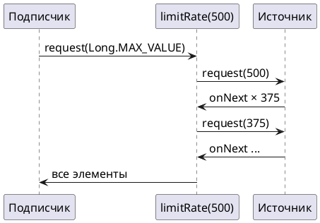

# Тема 08. Backpressure: запросы, порции, переполнение

> **Статус:** теория · **Дальше:** интервью в чате, затем [практика](08-backpressure-tasks.md)

---

## Оглавление

- [1. Что такое backpressure](#1-что-такое-backpressure)
- [2. Порции запросов: limitRate](#2-порции-запросов-limitrate)
- [3. Источник, который не умеет ждать](#3-источник-который-не-умеет-ждать)
- [4. Стратегии onBackpressure*](#4-стратегии-onbackpressure)
- [5. Пачки: buffer](#5-пачки-buffer)
- [Вопросы для интервью](#вопросы-для-интервью)

---

## 1. Что такое backpressure

**Аналогия:**

Кладовщик отпускает товар по накладным. Магазин пишет: «пришлите 10 коробок».

Пока магазин не напишет новую накладную, кладовщик больше не отправляет — даже если на складе тысяча коробок.

**Как это устроено в коде:**

- **Магазин решает, сколько принять** — backpressure (обратное давление): подписчик сам решает, сколько элементов готов принять.
- **Накладная** — `request(n)` (тема 01).
- **Кладовщик** — издатель: не вправе выдать больше, чем запрошено.

Reactive Streams 1.0.4, правило 1.1:

- Источник: https://github.com/reactive-streams/reactive-streams-jvm/blob/v1.0.4/README.md#1.1

> The total number of `onNext`´s signalled by a `Publisher` to a `Subscriber` MUST be less than or equal to the total number of elements requested by that `Subscriber`´s `Subscription` at all times.

RU:

> Общее число сигналов `onNext`, отправленных `Publisher` подписчику, в любой момент ДОЛЖНО быть не больше общего числа элементов, запрошенных через `Subscription` этого подписчика.

**Внимание:**

Операторы между источником и подписчиком тоже запрашивают. `publishOn` (тема 07) держит очередь и просит у источника порцию сразу:

```java
List<Long> requests = new CopyOnWriteArrayList<>();
Flux.range(1, 10)
    .doOnRequest(requests::add)
    .publishOn(Schedulers.parallel())
    .blockLast();
System.out.println(requests);   // [256]
```

**Разбор** (запуск на Reactor 3.8.4):

- `blockLast()` просит всё;
- до источника доходит запрос 256 — размер очереди `publishOn`.

**Правило:** издатель выдаёт не больше, чем запросили; запросы задают подписчик и операторы.

---

## 2. Порции запросов: limitRate

**Аналогия:**

Магазин пишет «пришлите всё», а склад умеет собирать заказ только по 500 коробок.

Диспетчер между ними:

1. Разбивает «всё» на накладные по 500.
2. Шлёт следующую, когда три четверти прошлой уже разгрузили.

**Как это устроено в коде:**

- **Диспетчер** — `limitRate(n)`: режет запросы, идущие вверх, на порции не больше `n`.
- **«Пришлите всё»** — подписчик просит `Long.MAX_VALUE`.
- **Склад по 500 коробок** — источник, который лучше работает небольшими запросами: база с постраничным чтением.
- **Всё будет доставлено** — все элементы всё равно придут, в отличие от `take`.

```java
List<Long> requests = new CopyOnWriteArrayList<>();
Flux.range(1, 2000)
    .doOnRequest(requests::add)
    .limitRate(500)
    .blockLast();
System.out.println(requests);   // [500, 375, 375, 375, 375, 375]
```

**Разбор** (запуск на Reactor 3.8.4):

- первый запрос — 500;
- каждое пополнение — 375, то есть 75 % от 500.

Javadoc `Flux.limitRate(int)`:

- Источник: https://projectreactor.io/docs/core/release/api/reactor/core/publisher/Flux.html#limitRate(int)

> Ensure that backpressure signals from downstream subscribers are split into batches capped at the provided prefetchRate when propagated upstream, effectively rate limiting the upstream Publisher. Note that this is an upper bound, and that this operator uses a prefetch-and-replenish strategy, requesting a replenishing amount when 75% of the prefetch amount has been emitted. Typically used for scenarios where consumer(s) request a large amount of data (eg. Long.MAX_VALUE) but the data source behaves better or can be optimized with smaller requests (eg. database paging, etc...). All data is still processed, unlike with take(long) which will cap the grand total request amount.

RU:

> Гарантирует, что сигналы backpressure от нижних подписчиков при передаче вверх режутся на порции не больше заданного `prefetchRate` — по сути ограничивает скорость верхнего `Publisher`. Это верхняя граница; оператор использует стратегию «предзапрос и пополнение»: запрашивает пополнение, когда выдано 75 % предзапрошенного. Обычно используется, когда потребители запрашивают много данных (например, `Long.MAX_VALUE`), а источник работает лучше или оптимизируется при небольших запросах (например, постраничное чтение из базы). Все данные всё равно обрабатываются — в отличие от `take(long)`, который ограничивает общий объём запроса.



**Правило:** нужно всё, но порциями — `limitRate(n)`.

---

## 3. Источник, который не умеет ждать

**Аналогия:**

Конвейер на заводе не останавливается: детали идут каждую секунду, хочет кладовщик или нет.

Если кладовщик просил одну, а пришла вторая — её некуда деть.

**Как это устроено в коде:**

- **Конвейер** — источники, которые выдают элементы по времени или по внешним событиям:
  - `Flux.interval`;
  - клики пользователя;
  - сообщения из сокета.
- **Не останавливается** — такие источники не могут «подождать запроса».
- **Некуда деть** — подписчик просит меньше, чем приходит: получается переполнение.

`Flux.interval` в этом случае завершается ошибкой:

```java
Flux.interval(Duration.ofMillis(1)).subscribe(new BaseSubscriber<Long>() {
    protected void hookOnSubscribe(Subscription s) { request(1); }   // просим один элемент
    protected void hookOnError(Throwable e) { System.out.println(e.getMessage()); }
});
// Could not emit tick 1 due to lack of requests (interval doesn't support small downstream
// requests that replenish slower than the ticks)
```

Вывод — запуск на Reactor 3.8.4, класс ошибки — `reactor.core.Exceptions$OverflowException`.

**Правило:** для источника, который не умеет ждать, явно выберите, что делать с лишним.

---

## 4. Стратегии onBackpressure*

**Аналогия:**

Конвейер не останавливается, кладовщик медленный. Варианты:

- складывать детали на стол ограниченного размера;
- выбрасывать лишние и записывать в журнал;
- держать на столе только последнюю;
- остановить смену с аварией.

**Как это устроено в коде:**

- **Стол ограниченного размера** — `onBackpressureBuffer(n)`.
- **Выбросить и записать в журнал** — `onBackpressureDrop(consumer)`.
- **Только последняя** — `onBackpressureLatest()`.
- **Авария** — `onBackpressureError()`.

Все `onBackpressure*` запрашивают у источника всё (`Long.MAX_VALUE`), а нижнему подписчику отдают по его запросам. Различаются тем, что делают с элементами, на которые запроса нет:

| Оператор | Лишние элементы | Когда подходит |
|---|---|---|
| `onBackpressureBuffer(n)` | копит до `n`; на `n+1` — ошибка переполнения | короткие всплески, терять нельзя |
| `onBackpressureDrop(consumer)` | выбрасывает, передаёт в `consumer` | телеметрия, события, где пропуск допустим |
| `onBackpressureLatest()` | хранит одну, последнюю; старую заменяет | табло, курс, состояние «сейчас» |
| `onBackpressureError()` | сразу ошибка | переполнение — это баг |

```java
BaseSubscriber<Integer> slow = new BaseSubscriber<>() {
    protected void hookOnSubscribe(Subscription s) { }                  // пока ничего не просим
    protected void hookOnNext(Integer v) { System.out.println("got " + v); }
    protected void hookOnError(Throwable e) { System.out.println(e.getMessage()); }
};
Flux.range(1, 10).onBackpressureBuffer(2).subscribe(slow);
slow.request(5);
// got 1
// got 2
// The receiver is overrun by more signals than expected (bounded queue...)
```

**Разбор** (запуск на Reactor 3.8.4):

- в буфер влезли 1 и 2;
- элемент 3 переполнил буфер;
- ошибка пришла после того, как подписчик забрал содержимое буфера.

Javadoc `Flux`:

- Источник: https://projectreactor.io/docs/core/release/api/reactor/core/publisher/Flux.html#onBackpressureBuffer(int)

> onBackpressureBuffer(int maxSize): Request an unbounded demand and push to the returned Flux, or park up to maxSize elements when not enough demand is requested downstream. The first element past this buffer to arrive out of sync with the downstream subscriber's demand (the "overflowing" element) immediately triggers an overflow error and cancels the source. The Flux is going to terminate with an overflow error, but this error is delayed, which lets the subscriber make more requests for the content of the buffer.
>
> onBackpressureDrop(Consumer onDropped): Request an unbounded demand and push to the returned Flux, or drop and notify dropping Consumer with the observed elements if not enough demand is requested downstream.
>
> onBackpressureLatest(): Request an unbounded demand and push to the returned Flux, or only keep the most recent observed item if not enough demand is requested downstream.

RU:

> `onBackpressureBuffer(int maxSize)`: запрашивает неограниченно и передаёт в возвращаемый `Flux` либо откладывает до `maxSize` элементов, если снизу запрошено недостаточно. Первый элемент сверх буфера, пришедший без запроса снизу («переполняющий»), сразу вызывает ошибку переполнения и отменяет источник. `Flux` завершится ошибкой переполнения, но ошибка отложена — подписчик может запросить содержимое буфера.
>
> `onBackpressureDrop(Consumer onDropped)`: запрашивает неограниченно и передаёт в возвращаемый `Flux` либо выбрасывает элементы и сообщает о них `Consumer`, если снизу запрошено недостаточно.
>
> `onBackpressureLatest()`: запрашивает неограниченно и передаёт в возвращаемый `Flux` либо хранит только последний полученный элемент, если снизу запрошено недостаточно.

**Почему не иначе:**

- `onBackpressureBuffer()` без размера скрывает проблему: медленный подписчик тихо копит память;
- размер буфера и реакция на переполнение — это решение о данных, а не техническая деталь.

**Правило:** нельзя терять — ограниченный буфер; можно терять — drop с журналом; важно только последнее — latest.

---

## 5. Пачки: buffer

**Аналогия:**

Грузчик не носит коробки по одной, а набирает тележку по 100 штук.

Последняя тележка — сколько осталось.

**Как это устроено в коде:**

- **Тележка** — `buffer(n)`: собирает элементы в `List` по `n` штук.
- **Последняя тележка** — последний список: остаток при завершении.
- **Зачем** — приём против перегрузки: одна запись в базу на 100 строк вместо 100 записей.
- **Тележки по одной** — чтобы пачки писались строго по одной, после `buffer` ставят `concatMap` (тема 04).

```java
Flux.range(1, 7).buffer(3).collectList().block();   // [[1, 2, 3], [4, 5, 6], [7]]
```

Вывод — запуск на Reactor 3.8.4.

Javadoc `Flux.buffer(int)`:

- Источник: https://projectreactor.io/docs/core/release/api/reactor/core/publisher/Flux.html#buffer(int)

> Collect incoming values into multiple List buffers that will be emitted by the returned Flux each time the given max size is reached or once this Flux completes.

RU:

> Собирает входящие значения в несколько буферов `List`, которые возвращаемый `Flux` выдаёт каждый раз, когда достигнут заданный максимальный размер, или когда этот `Flux` завершается.

**Правило:** пачками в базу — `buffer(n)` + `concatMap`.

---

## Вопросы для интервью

1. Что такое backpressure? Как подписчик сообщает, сколько готов принять?
2. Почему до источника под `publishOn` доходит не `Long.MAX_VALUE`?
3. Что делает `limitRate(500)`? Почему второй запрос 375? Чем он отличается от `take(500)`?
4. Какие источники не умеют ждать запросов? Что сделает `Flux.interval` с медленным подписчиком?
5. Сравните `onBackpressureBuffer(n)`, `onBackpressureDrop`, `onBackpressureLatest`, `onBackpressureError`. Приведите по примеру из бизнеса.
6. Чем опасен `onBackpressureBuffer()` без размера?
7. Как записать 10 000 строк в базу пачками по 100 и не держать открытыми десятки запросов одновременно?

---

**Практика:** [08-backpressure-tasks.md](08-backpressure-tasks.md)
