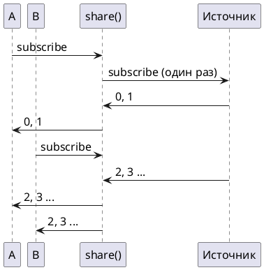

# Тема 09. Горячие и холодные потоки, кэш, Sinks

> **Статус:** теория · **Дальше:** интервью в чате, затем [практика](09-hot-cold-tasks.md)

---

## Оглавление

- [1. Холодный поток: каждому подписчику — своя работа](#1-холодный-поток-каждому-подписчику--своя-работа)
- [2. cache: сделать работу один раз](#2-cache-сделать-работу-один-раз)
- [3. share: одна подписка на всех](#3-share-одна-подписка-на-всех)
- [4. publish и autoConnect: начать, когда соберутся](#4-publish-и-autoconnect-начать-когда-соберутся)
- [5. replay: показать последнее новому подписчику](#5-replay-показать-последнее-новому-подписчику)
- [6. Sinks: отправлять события из обычного кода](#6-sinks-отправлять-события-из-обычного-кода)
- [Вопросы для интервью](#вопросы-для-интервью)

---

## 1. Холодный поток: каждому подписчику — своя работа

**Аналогия:**

Фильм на стриминговом сервисе: каждый зритель нажимает «play» и смотрит с начала.

Сколько зрителей — столько показов.

**Как это устроено в коде:**

- **Фильм по запросу** — холодный источник. Почти все источники Reactor холодные:
  - `Mono.fromCallable`;
  - `Flux.range`;
  - запрос в базу через R2DBC.
- **«Play»** — каждая подписка запускает работу заново (тема 02).
- **Два зрителя** — два подписчика, то есть два запроса в базу.

```java
AtomicInteger loads = new AtomicInteger();
Mono<Integer> cold = Mono.fromCallable(loads::incrementAndGet);
cold.block();
cold.block();
System.out.println(loads.get());   // 2
```

**Для сравнения:**

Горячий поток — прямой эфир. Он идёт независимо от зрителей, а опоздавший видит только то, что идёт сейчас.

**Правило:** холодный поток — сколько подписок, столько запусков.

---

## 2. cache: сделать работу один раз

**Аналогия:**

Первый сотрудник, которому понадобился прайс, звонит поставщику и вешает ответ на доску.

Остальные читают с доски.

**Как это устроено в коде:**

- **Звонок поставщику** — `cache()` подписывается на источник при первой подписке.
- **Доска** — `cache()` запоминает результат: значение, ошибку или завершение.
- **Читают с доски** — следующие подписчики получают сохранённое без повторной работы.
- **Прайс устаревает** — `Mono.cache(ttl)` хранит результат заданное время, потом следующий подписчик запускает загрузку заново.

```java
Mono<Integer> cached = Mono.fromCallable(loads::incrementAndGet).cache();
cached.block();   // 3 — загрузка
cached.block();   // 3 — с доски, loads по-прежнему 3
```

Вывод — запуск на Reactor 3.8.4 (продолжение примера из раздела 1).

**Ловушка:**

- `cache()` должен стоять на **одном и том же** объекте `Mono`;
- если метод каждый раз строит новую цепочку `loader.load().cache()`, у каждого вызова свой кэш — то есть кэша нет;
- кэширующий `Mono` хранят в поле.

Javadoc `Mono.cache()` и `Mono.cache(Duration)`:

- Источник: https://projectreactor.io/docs/core/release/api/reactor/core/publisher/Mono.html#cache()

> cache(): Turn this Mono into a hot source and cache last emitted signals for further Subscriber. Completion and Error will also be replayed. Once the first subscription is made to this Mono, the source is subscribed to and the signal will be cached, indefinitely. This process cannot be cancelled. In the face of multiple concurrent subscriptions, this operator ensures that only one subscription is made to the source.
>
> cache(Duration ttl): Turn this Mono into a hot source and cache last emitted signals for further Subscriber, with an expiry timeout. Completion and Error will also be replayed until ttl triggers in which case the next Subscriber will start over a new subscription.

RU:

> `cache()`: превращает этот `Mono` в горячий источник и кэширует последние выданные сигналы для следующих подписчиков. Завершение и ошибка тоже воспроизводятся. При первой подписке на этот `Mono` происходит подписка на источник, и сигнал кэшируется навсегда. Этот процесс нельзя отменить. При нескольких одновременных подписках оператор гарантирует, что к источнику будет только одна подписка.
>
> `cache(Duration ttl)`: превращает этот `Mono` в горячий источник и кэширует последние выданные сигналы для следующих подписчиков, со сроком годности. Завершение и ошибка тоже воспроизводятся, пока не истечёт `ttl`; после этого следующий подписчик начнёт новую подписку.

**Почему не иначе:**

- ошибка тоже кэшируется: если первая загрузка упала, `cache()` навсегда будет отдавать эту ошибку;
- для справочников, которые могут временно не загрузиться, чаще подходит `cache(ttl)`.

**Правило:** дорогой результат на всех — `cache()` в поле; со сроком — `cache(ttl)`.

---

## 3. share: одна подписка на всех

**Аналогия:**

Прямая трансляция матча:

1. Первый зритель включил — трансляция пошла.
2. Второй включил на 20-й минуте — смотрит с 20-й минуты.
3. Все ушли — трансляцию выключили.

**Как это устроено в коде:**

- **Трансляция пошла** — `share()` подписывается на источник один раз, при первом подписчике.
- **Все смотрят одно** — элементы раздаются всем текущим подписчикам.
- **С 20-й минуты** — поздний подписчик пропускает то, что было до него.
- **Выключили** — когда все отписались, подписка на источник отменяется.

```java
Flux<Long> shared = Flux.interval(Duration.ofMillis(100)).take(5).share();
shared.subscribe(v -> out.add("A" + v));
Thread.sleep(250);
shared.subscribe(v -> out.add("B" + v));
// [A0, A1, A2, B2, A3, B3, A4, B4]
```

**Разбор** (запуск на Reactor 3.8.4):

- A получил все элементы: 0–4;
- B подключился после 0 и 1 и их не увидел.

Javadoc `Flux.share()`:

- Источник: https://projectreactor.io/docs/core/release/api/reactor/core/publisher/Flux.html#share()

> Returns a new Flux that multicasts (shares) the original Flux. As long as there is at least one Subscriber this Flux will be subscribed and emitting data. When all subscribers have cancelled it will cancel the source Flux. This is an alias for publish().ConnectableFlux.refCount().

RU:

> Возвращает новый `Flux`, который раздаёт (разделяет) исходный `Flux` всем подписчикам. Пока есть хотя бы один подписчик, на этот `Flux` есть подписка и он выдаёт данные. Когда все подписчики отменили подписку, он отменяет исходный `Flux`. Это псевдоним для `publish().refCount()`.



**Правило:** одна дорогая лента на многих зрителей — `share()`; опоздавшие видят только новое.

---

## 4. publish и autoConnect: начать, когда соберутся

**Аналогия:**

Экскурсовод ждёт, пока соберётся группа из двух человек.

Только тогда он начинает рассказ — обоим с начала.

**Как это устроено в коде:**

- **Экскурсовод** — `publish()`: возвращает `ConnectableFlux`, горячий поток, который **не подписывается на источник сам**.
- **«Начинаем»** — подключение к источнику запускают явно, `connect()`, или автоматически.
- **«Когда соберутся двое»** — `autoConnect(2)`.

Варианты автоматического подключения:

| Метод | Когда подключается к источнику | Когда отключается |
|---|---|---|
| `autoConnect(n)` | когда подписались `n` | не отключается при уходе подписчиков |
| `refCount(n)` | когда подписались `n` | когда все отписались или источник завершился |

```java
Flux<Integer> auto = Flux.just(1, 2).publish().autoConnect(2);
auto.subscribe(v -> out.add("A" + v));   // out = [], подписок на источник 0
auto.subscribe(v -> out.add("B" + v));   // out = [A1, B1, A2, B2], подписка 1
```

Вывод — запуск на Reactor 3.8.4.

Javadoc `ConnectableFlux`:

- Источник: https://projectreactor.io/docs/core/release/api/reactor/core/publisher/ConnectableFlux.html

> The abstract base class for connectable publishers that let subscribers pile up before they connect to their data source.
>
> autoConnect(int minSubscribers): Connects this ConnectableFlux to the upstream source when the specified amount of Subscriber subscribes. Subscribing and immediately unsubscribing still contributes to the counter that triggers the connection.
>
> refCount(): Connects to the upstream source when the first Subscriber subscribes and disconnects when all Subscribers cancelled or the upstream source completed.

RU:

> Абстрактный базовый класс подключаемых издателей: подписчики могут накопиться до того, как издатель подключится к источнику данных.
>
> `autoConnect(int minSubscribers)`: подключает этот `ConnectableFlux` к верхнему источнику, когда подписалось заданное число подписчиков. Подписка с немедленной отпиской тоже увеличивает счётчик, по которому происходит подключение.
>
> `refCount()`: подключается к верхнему источнику, когда подписывается первый подписчик, и отключается, когда все подписчики отменили подписку или источник завершился.

**Правило:** «начать, когда соберутся n» — `publish().autoConnect(n)`.

---

## 5. replay: показать последнее новому подписчику

**Аналогия:**

Табло на вокзале. Подошедший пассажир сразу видит три последних объявления.

Потом — новые по мере появления.

**Как это устроено в коде:**

- **Табло** — `replay(n)`: горячий поток, который хранит последние `n` элементов.
- **Подошёл пассажир** — каждый новый подписчик сначала получает сохранённые элементы, затем новые.
- **Табло без ограничения** — `cache()` у `Flux`: то же, но хранит всё.

```java
Flux<Integer> replayed = Flux.just(1, 2, 3, 4, 5).replay(3).autoConnect();
replayed.subscribe();                       // первый подписчик запускает источник
replayed.collectList().block();             // [3, 4, 5]
```

Вывод — запуск на Reactor 3.8.4.

Javadoc `Flux.replay(int)`:

- Источник: https://projectreactor.io/docs/core/release/api/reactor/core/publisher/Flux.html#replay(int)

> Turn this Flux into a connectable hot source and cache last emitted signals for further Subscriber. Will retain up to the given history size onNext signals. Completion and Error will also be replayed.

RU:

> Превращает этот `Flux` в подключаемый горячий источник и кэширует последние выданные сигналы для следующих подписчиков. Хранит не больше заданного размера истории сигналов `onNext`. Завершение и ошибка тоже воспроизводятся.

**Правило:** новому подписчику нужны последние n — `replay(n)`.

---

## 6. Sinks: отправлять события из обычного кода

**Аналогия:**

Громкоговоритель в офисе. Дежурный говорит в микрофон:

- слышат все, кто сейчас в комнате;
- кто пришёл позже — не слышал;
- если в комнате никого — объявление уходит в пустоту.

**Как это устроено в коде:**

- **Дежурный** — обычный императивный код, где рождаются события: обработчик HTTP-запроса, слушатель очереди.
- **Микрофон** — `Sinks.Many`.
- **Сказать в микрофон** — `tryEmitNext(value)`.
- **Динамик в комнате** — `asFlux()`: поток для подписчиков.
- **Тип громкоговорителя** — вид `Sinks` задаёт, кто и что получит:

| Создание | Без подписчиков | Новый подписчик получает |
|---|---|---|
| `Sinks.many().multicast().directBestEffort()` | `tryEmitNext` сразу неудача | только новые |
| `Sinks.many().multicast().onBackpressureBuffer()` | копит до первого подписчика | накопленное до первого подписчика, затем новые |
| `Sinks.many().replay().limit(n)` | запоминает | последние `n`, затем новые |
| `Sinks.many().replay().all()` | запоминает | всё с начала |

```java
Sinks.Many<String> sink = Sinks.many().multicast().directBestEffort();
sink.tryEmitNext("никому");          // FAIL_ZERO_SUBSCRIBER
sink.asFlux().subscribe(out::add);
sink.tryEmitNext("подписчику");      // OK
// out = [подписчику]
```

**Разбор** (запуск на Reactor 3.8.4):

- `tryEmitNext` возвращает `Sinks.EmitResult`, а не бросает исключение;
- результат стоит проверять.

Javadoc `Sinks.MulticastSpec.directBestEffort()`:

- Источник: https://projectreactor.io/docs/core/release/api/reactor/core/publisher/Sinks.MulticastSpec.html#directBestEffort()

> Without Subscriber: fail fast on tryEmitNext. Backpressure : notify the caller with Sinks.EmitResult.FAIL_OVERFLOW if none of the subscribers can process an element. Otherwise, it ignores slow subscribers and emits the element to fast ones as a best effort. … Replaying: No replay of elements. Only forwards to a Subscriber the elements that have been pushed to the sink AFTER this subscriber was subscribed.

RU:

> Без подписчиков: `tryEmitNext` сразу возвращает неудачу. Backpressure: сообщает вызывающему `Sinks.EmitResult.FAIL_OVERFLOW`, если ни один подписчик не может обработать элемент. Иначе игнорирует медленных подписчиков и по возможности отдаёт элемент быстрым. … Повтор: элементы не повторяются. Подписчику передаются только элементы, отправленные в sink ПОСЛЕ его подписки.

Javadoc `Sinks.MulticastReplaySpec.limit(int)`:

- Источник: https://projectreactor.io/docs/core/release/api/reactor/core/publisher/Sinks.MulticastReplaySpec.html#limit(int)

> Without Subscriber: up to historySize elements pushed to this sink are remembered, even when there is no subscriber. Older elements are discarded … Replaying: up to historySize elements pushed to this sink are replayed to new subscribers. Older elements are discarded.

RU:

> Без подписчиков: запоминается до `historySize` элементов, отправленных в sink, даже когда подписчиков нет. Более старые отбрасываются … Повтор: до `historySize` элементов, отправленных в sink, воспроизводятся новым подписчикам. Более старые отбрасываются.

Остальные строки таблицы — Javadoc `Sinks.MulticastSpec.onBackpressureBuffer()` и `Sinks.MulticastReplaySpec.all()`:

- Источник: https://projectreactor.io/docs/core/release/api/reactor/core/publisher/Sinks.MulticastSpec.html#onBackpressureBuffer()
- Источник: https://projectreactor.io/docs/core/release/api/reactor/core/publisher/Sinks.MulticastReplaySpec.html#all()

> onBackpressureBuffer(): Without Subscriber: warm up. Remembers up to Queues.SMALL_BUFFER_SIZE elements pushed via Sinks.Many.tryEmitNext(Object) before the first Subscriber is registered. … Replaying: No replay of values seen by earlier subscribers.
>
> all(): Without Subscriber: all elements pushed to this sink are remembered, even when there is no subscriber. … Replaying: all elements pushed to this sink are replayed to new subscribers.

RU:

> `onBackpressureBuffer()`: без подписчиков — «прогрев»: запоминает до `Queues.SMALL_BUFFER_SIZE` элементов, отправленных через `tryEmitNext`, пока не зарегистрирован первый подписчик. … Повтор: значения, которые видели прежние подписчики, не повторяются.
>
> `all()`: без подписчиков — все отправленные в sink элементы запоминаются, даже когда подписчиков нет. … Повтор: все отправленные в sink элементы воспроизводятся новым подписчикам.

**Почему не иначе:**

- свой `List<Consumer>` вместо `Sinks` придётся самому защищать от гонок, отписок и медленных подписчиков;
- подписчики не получат обычный `Flux` с операторами.

Javadoc `Sinks`:

- Источник: https://projectreactor.io/docs/core/release/api/reactor/core/publisher/Sinks.html

> Sinks are constructs through which Reactive Streams signals can be programmatically pushed, with Flux or Mono semantics. These standalone sinks expose tryEmit methods that return an Sinks.EmitResult enum, allowing to atomically fail in case the attempted signal is inconsistent with the spec and/or the state of the sink. … Unless constructed through the unsafe() spec, these sinks are thread safe in the sense that they will detect concurrent access and fail fast on one of the attempts.

RU:

> Sinks — конструкции, через которые сигналы Reactive Streams можно отправлять программно, с семантикой `Flux` или `Mono`. Эти самостоятельные sinks дают методы `tryEmit`, возвращающие перечисление `Sinks.EmitResult`, — так попытка атомарно завершается неудачей, если сигнал противоречит спецификации и/или состоянию sink. … Если sink создан не через `unsafe()`, он потокобезопасен в том смысле, что обнаруживает одновременный доступ и сразу отклоняет одну из попыток.

**Правило:** события из императивного кода — `Sinks`; вид выбирают по тому, что должен увидеть новый подписчик.

---

## Вопросы для интервью

1. Чем холодный поток отличается от горячего? Приведите по примеру из бизнеса.
2. Почему два `subscribe` на `Mono` с запросом в базу дают два запроса? Как сделать один?
3. Почему `return loader.load().cache();` в методе не кэширует?
4. Что `cache()` сделает с ошибкой первой загрузки? Чем здесь помогает `cache(ttl)`?
5. Что увидит поздний подписчик `share()`? Что будет, когда все отпишутся?
6. Чем `publish().autoConnect(2)` отличается от `publish().refCount(2)`?
7. Чем `replay(3)` отличается от `cache()` у `Flux`?
8. Когда нужен `Sinks`? Что вернёт `tryEmitNext`, если подписчиков нет, у `directBestEffort`?
9. Какой `Sinks` выбрать для табло «три последние цены»?

---

**Практика:** [09-hot-cold-tasks.md](09-hot-cold-tasks.md)
