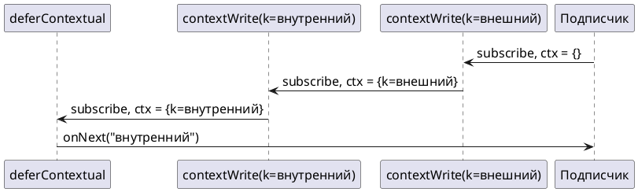

# Тема 10. Context: данные подписки вместо ThreadLocal

> **Статус:** теория · **Дальше:** интервью в чате, затем [практика](10-context-tasks.md)

---

## Оглавление

- [1. Почему ThreadLocal не работает](#1-почему-threadlocal-не-работает)
- [2. Context: что это и как устроен](#2-context-что-это-и-как-устроен)
- [3. Запись: contextWrite](#3-запись-contextwrite)
- [4. Чтение: deferContextual](#4-чтение-defercontextual)
- [5. Видимость: снизу вверх](#5-видимость-снизу-вверх)
- [6. Контекст внутри flatMap](#6-контекст-внутри-flatmap)
- [Вопросы для интервью](#вопросы-для-интервью)

---

## 1. Почему ThreadLocal не работает

**Аналогия:**

Курьер носит в кармане бейдж с номером заказа.

На полпути посылку передают другому курьеру, а бейдж остаётся в кармане первого.

**Как это устроено в коде:**

- **Курьер** — поток.
- **Карман курьера** — `ThreadLocal`: привязывает данные к потоку.
- **Передача посылки** — в реактивной цепочке операция может начаться на одном потоке и продолжиться на другом (тема 07).
- **У курьера много посылок** — один поток обслуживает много цепочек вперемешку.
- **Бейдж** — номер трассировки в `ThreadLocal` (например, в MDC логгера). Он теряется или, хуже, достаётся чужому запросу.

Reactor Reference Guide, «Adding a Context to a Reactive Sequence»:

- Источник: https://projectreactor.io/docs/core/release/reference/advancedFeatures/context.html

> Contrary to what you might be used to, in reactive programming, you can use a `Thread` to process several asynchronous sequences that run at roughly the same time (actually, in non-blocking locksteps). The execution can also easily and often jump from one thread to another. This arrangement is especially hard for developers that use features dependent on the threading model being more “stable,” such as `ThreadLocal`. … Using the MDC of Logback to store and log correlation IDs is a prime example of such a situation.

RU:

> В отличие от привычного, в реактивном программировании один `Thread` может обрабатывать несколько асинхронных последовательностей, идущих примерно одновременно (точнее, неблокирующими шагами по очереди). Выполнение также легко и часто перескакивает с одного потока на другой. Это особенно трудно для разработчиков, которые используют возможности, рассчитанные на более «стабильную» модель потоков, например `ThreadLocal`. … Хранение и логирование идентификаторов корреляции в MDC Logback — характерный пример такой ситуации.

**Правило:** данные запроса в реактивной цепочке не кладут в `ThreadLocal`.

---

## 2. Context: что это и как устроен

**Аналогия:**

Бейдж приклеен не к курьеру, а к самой посылке.

Точнее — к накладной, которую получатель отправил вверх по цепочке.

**Как это устроено в коде:**

- **Накладная с бейджем** — `Context`: неизменяемый словарь «ключ → значение».
- **Приклеен к посылке** — `Context` привязан к **подписке**, а не к потоку.
- **Получатель заполняет** — контекст заполняет подписчик в момент подписки.
- **Вверх по цепочке** — операторы выше могут его прочитать.
- **Неизменяемость** — `put` не меняет контекст, а возвращает новый.

```java
Context c1 = Context.of("a", 1);
Context c2 = c1.put("b", 2);
// c1.size() = 1, c2.size() = 2
```

Вывод — запуск на Reactor 3.8.4.

Reactor Reference Guide, «The Context API»:

- Источник: https://projectreactor.io/docs/core/release/reference/advancedFeatures/context.html#context.api

> `Context` is an interface reminiscent of `Map`. It stores key-value pairs and lets you fetch a value you stored by its key. It has a simplified version that only exposes read methods, the `ContextView`. … A `Context` is immutable. It exposes write methods like `put` and `putAll` but they produce a new instance.

RU:

> `Context` — интерфейс, похожий на `Map`. Он хранит пары «ключ — значение» и позволяет получить сохранённое значение по ключу. У него есть упрощённая версия только с методами чтения — `ContextView`. … `Context` неизменяем. У него есть методы записи вроде `put` и `putAll`, но они создают новый экземпляр.

**Правило:** контекст — неизменяемый словарь подписки.

---

## 3. Запись: contextWrite

**Аналогия:**

Получатель, оформляя заявку, пишет в шапке: «номер трассировки T-1».

Шапка уходит вверх вместе с заявкой.

**Как это устроено в коде:**

- **Запись в шапку** — `contextWrite(Context.of(k, v))` или `contextWrite(ctx -> ctx.put(k, v))`.
- **Дописать, а не переписать** — значения добавляются к контексту, пришедшему снизу.
- **Уходит вверх** — результат передаётся операторам выше.
- **Прежние строки шапки** — остальные ключи подписчика сохраняются: новый контекст строится из пришедшего.

Reactor Reference Guide, «Tying a Context to a Flux and Writing»:

- Источник: https://projectreactor.io/docs/core/release/reference/advancedFeatures/context.html#context.write

> In order to populate the `Context`, which can only be done at subscription time, you need to use the `contextWrite` operator. `contextWrite(ContextView)` merges the `ContextView` you provide and the `Context` from downstream (remember, the `Context` is propagated from the bottom of the chain towards the top). This is done through a call to `putAll`, resulting in a NEW `Context` for upstream.

RU:

> Заполнить `Context` можно только в момент подписки — для этого нужен оператор `contextWrite`. `contextWrite(ContextView)` объединяет переданный `ContextView` с `Context`, пришедшим снизу (помните: `Context` распространяется снизу цепочки вверх). Это делается вызовом `putAll` и даёт НОВЫЙ `Context` для верхней части.

**Правило:** записывают контекст `contextWrite` — внизу цепочки, ближе к подписчику.

---

## 4. Чтение: deferContextual

**Аналогия:**

Работник склада открывает заявку и читает шапку.

Только после этого он собирает посылку.

**Как это устроено в коде:**

- **Работник склада** — `Mono.deferContextual(ctx -> ...)` и `Flux.deferContextual(ctx -> ...)`: источник, который в момент подписки получает `ContextView` и строит по нему цепочку.
- **Строки в шапке нет**:
  - `ctx.get(key)` бросит исключение;
  - `ctx.getOrDefault(key, default)` вернёт значение по умолчанию.
- **Разные заявки** — одна и та же цепочка у разных подписчиков видит разные контексты.

```java
Mono<String> line = Mono.deferContextual(ctx ->
        Mono.just("trace " + ctx.getOrDefault("traceId", "нет")));

line.contextWrite(Context.of("traceId", "T-1")).block();   // trace T-1
line.block();                                               // trace нет
```

Вывод — запуск на Reactor 3.8.4 (первая строка).

Javadoc `ContextView`:

- Источник: https://projectreactor.io/docs/core/release/api/reactor/util/context/ContextView.html

> get(Object key): Resolve a value given a key that exists within the Context, or throw a NoSuchElementException if the key is not present.
>
> getOrDefault(Object key, T defaultValue): Resolve a value given a key within the Context. If unresolved return the passed default value.

RU:

> `get(Object key)`: возвращает значение по ключу, который есть в `Context`, или бросает `NoSuchElementException`, если ключа нет.
>
> `getOrDefault(Object key, T defaultValue)`: возвращает значение по ключу из `Context`. Если ключ не найден — возвращает переданное значение по умолчанию.

Reactor Reference Guide, «Reading a Context, through the ContextView»:

- Источник: https://projectreactor.io/docs/core/release/reference/advancedFeatures/context.html#context.read

> to access the context from a source-like operator, use `deferContextual` factory method … alternatively, when dealing with an inner sequence (like inside a `flatMap`), the `ContextView` can be materialized using `Mono.deferContextual(Mono::just)`.

RU:

> чтобы получить контекст в операторе-источнике, используйте фабричный метод `deferContextual` … либо, во внутренней последовательности (например, внутри `flatMap`), `ContextView` можно получить через `Mono.deferContextual(Mono::just)`.

**Правило:** читают контекст `deferContextual`; при необязательном ключе — `getOrDefault`.

---

## 5. Видимость: снизу вверх

**Аналогия:**

Шапку заявки видят только те, кто стоит **выше** по конвейеру: к ним заявка уже пришла.

Тот, кто ниже, её не получал.

**Как это устроено в коде:**

- **Заявка идёт вверх** — подписка идёт снизу вверх, и контекст едет вместе с ней.
- **Видят те, кто выше** — `contextWrite` виден только операторам **выше** него.
- **Две записи одного ключа** — читатель видит ближайшую к нему запись снизу.

```java
Mono.just("x")
    .contextWrite(Context.of("traceId", "T-1"))      // записано слишком высоко
    .flatMap(x -> Mono.deferContextual(ctx ->
            Mono.just("too high: " + ctx.getOrDefault("traceId", "нет"))))
    .block();                                         // too high: нет

Mono.deferContextual(c -> Mono.just(c.get("k").toString()))
    .contextWrite(Context.of("k", "внутренний"))
    .contextWrite(Context.of("k", "внешний"))
    .block();                                         // внутренний
```

Вывод — запуск на Reactor 3.8.4.



Reactor Reference Guide, «Simple Context Examples»:

- Источник: https://projectreactor.io/docs/core/release/reference/advancedFeatures/context.html#_simple_context_examples

> In your chain of operators, the relative positions of where you write to the `Context` and where you read from it matters. The `Context` is immutable and its content can only be seen by operators above it … Operators that read the `Context` see the value that was set closest to being under them

RU:

> В цепочке операторов важно взаимное расположение места записи в `Context` и места чтения. `Context` неизменяем, и его содержимое видят только операторы выше … Операторы, читающие `Context`, видят значение, записанное ближе всего под ними.

**Правило:** `contextWrite` — ниже того, кто читает.

---

## 6. Контекст внутри flatMap

**Аналогия:**

Отдел закупок пересылает заявку партнёру, но в шапке для партнёра пишет «от имени закупок».

Партнёр видит эту шапку, а остальной конвейер — исходную.

**Как это устроено в коде:**

- **Пересылка партнёру** — внутренняя цепочка `flatMap`: получает контекст основной подписки.
- **Шапка для партнёра** — `contextWrite` **внутри** внутренней цепочки меняет контекст только для неё.
- **Остальной конвейер** — основная цепочка изменения не видит.
- Так вызывают внешний сервис «от другого имени», не ломая контекст остальной цепочки.

Reactor Reference Guide, «Simple Context Examples»:

- Источник: https://projectreactor.io/docs/core/release/reference/advancedFeatures/context.html#_simple_context_examples

> the `contextWrite` that writes `"Reactor"` does so as part of the inner sequence of the second `flatMap`. As a consequence, it is not visible or propagated through the main sequence and the first `flatMap` does not see it. Propagation and immutability isolate the `Context` in operators that create intermediate inner sequences such as `flatMap`.

RU:

> `contextWrite`, записывающий `"Reactor"`, делает это внутри внутренней последовательности второго `flatMap`. Поэтому это значение не видно и не распространяется по основной последовательности, и первый `flatMap` его не видит. Распространение и неизменяемость изолируют `Context` в операторах, создающих промежуточные внутренние последовательности, таких как `flatMap`.

**Правило:** другой контекст для одного вызова — `contextWrite` на этом вызове, а не на всей цепочке.

---

## Вопросы для интервью

1. Почему `ThreadLocal` и MDC ненадёжны в реактивной цепочке?
2. К чему привязан `Context` — к потоку, к элементу или к подписке?
3. Что вернёт `ctx.put("k", v)`? Изменится ли исходный контекст?
4. Где в цепочке ставить `contextWrite`, чтобы его увидел `deferContextual`? Почему?
5. Какое значение увидит читатель, если ключ записан двумя `contextWrite` подряд?
6. Чем `ctx.get(key)` отличается от `ctx.getOrDefault(key, d)`?
7. Как вызвать внешний сервис с другим значением ключа, не меняя контекст остальной цепочки?

---

**Практика:** [10-context-tasks.md](10-context-tasks.md)
