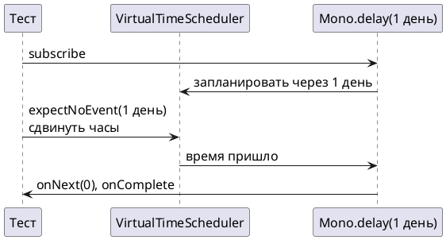

# Тема 11. Время и тестирование: delay, interval, виртуальное время

> **Статус:** теория · **Дальше:** интервью в чате, затем [практика](11-time-testing-tasks.md)

---

## Оглавление

- [1. Операторы времени](#1-операторы-времени)
- [2. Почему нельзя ждать по-настоящему](#2-почему-нельзя-ждать-по-настоящему)
- [3. StepVerifier.withVirtualTime](#3-stepverifierwithvirtualtime)
- [4. Ловушка: источник создан вне лямбды](#4-ловушка-источник-создан-вне-лямбды)
- [5. switchMap: отменить устаревшее](#5-switchmap-отменить-устаревшее)
- [Вопросы для интервью](#вопросы-для-интервью)

---

## 1. Операторы времени

**Аналогия:**

Кухонный таймер умеет два режима:

- «напомнить через 10 минут» — один звонок;
- «звонить каждые 10 минут» — много звонков, пока не выключишь.

**Как это устроено в коде:**

- **Один звонок** — `Mono.delay(d)`.
- **Звонить каждые 10 минут** — `Flux.interval(d)`.
- **Выключить** — бесконечный `interval` ограничивают `take(n)`.

Все операторы времени:

| Оператор | Что делает |
|---|---|
| `Mono.delay(d)` | один элемент `0L` через `d` |
| `Flux.interval(d)` | `0, 1, 2…` каждые `d`, первый — через `d`; сам не завершается |
| `Flux.interval(start, d)` | первый через `start`, дальше каждые `d` |
| `delayElement(d)` / `delayElements(d)` | сдвигает каждый элемент на `d` |

**Внимание:**

Все они по умолчанию работают на `Schedulers.parallel()` (тема 07).

Javadoc `Mono.delay(Duration)` и `Flux.interval(Duration)`:

- Источник: https://projectreactor.io/docs/core/release/api/reactor/core/publisher/Mono.html#delay(java.time.Duration)
- Источник: https://projectreactor.io/docs/core/release/api/reactor/core/publisher/Flux.html#interval(java.time.Duration)

> Mono.delay: Create a Mono which delays an onNext signal by a given duration on a default Scheduler and completes. If the demand cannot be produced in time, an onError will be signalled instead. The delay is introduced through the parallel default Scheduler.
>
> Flux.interval: Create a Flux that emits long values starting with 0 and incrementing at specified time intervals on the global timer. The first element is emitted after an initial delay equal to the period. … In normal conditions, the Flux will never complete. Runs on the Schedulers.parallel() Scheduler.

RU:

> `Mono.delay`: создаёт `Mono`, который задерживает сигнал `onNext` на заданное время на планировщике по умолчанию и завершается. Если спрос не появился вовремя, вместо этого придёт `onError`. Задержка выполняется на планировщике `parallel` по умолчанию.
>
> `Flux.interval`: создаёт `Flux`, который выдаёт значения `long`, начиная с 0 и увеличивая, через заданные интервалы на глобальном таймере. Первый элемент выдаётся после начальной задержки, равной периоду. … В обычных условиях этот `Flux` никогда не завершается. Работает на планировщике `Schedulers.parallel()`.

**Правило:** один раз через время — `delay`; периодически — `interval` + `take`.

---

## 2. Почему нельзя ждать по-настоящему

**Аналогия:**

Проверять, что будильник звонит через сутки, сидя рядом сутки, — никто так не делает.

Будильник переводят вперёд.

**Как это устроено в коде:**

- **Сидеть рядом сутки** — тест «напоминание через сутки» с настоящим временем шёл бы сутки.
- **`Thread.sleep`** — тесты медленные и нестабильные: на загруженной машине 300 мс превращаются в 400.
- **Перевести будильник** — нужны часы, которыми управляет тест.

**Правило:** время в тесте не ждут, а двигают.

---

## 3. StepVerifier.withVirtualTime

**Аналогия:**

Тест получает пульт от часов:

1. Перемотать на 23 часа — проверить, что тишина.
2. Ещё на час — проверить звонок.

**Как это устроено в коде:**

- **Пульт** — `StepVerifier.withVirtualTime(() -> publisher)`.
- **Подменённые часы** — все планировщики `Schedulers` подменяются виртуальным `VirtualTimeScheduler`.
- **Кнопки пульта** — время двигается только командами теста:

| Шаг | Что делает |
|---|---|
| `expectSubscription()` | первый шаг: подписка прошла |
| `expectNoEvent(d)` | за `d` виртуального времени не было ни одного сигнала |
| `thenAwait(d)` | сдвинуть часы на `d` |
| `expectNext(...)` | проверить элементы |

```java
long start = System.currentTimeMillis();
StepVerifier.withVirtualTime(() -> Mono.delay(Duration.ofDays(1)))
        .expectSubscription()
        .expectNoEvent(Duration.ofDays(1))
        .expectNext(0L)
        .verifyComplete();
System.out.println(System.currentTimeMillis() - start);   // 30
```

**Разбор** (запуск на Reactor 3.8.4):

- проверка «через сутки» заняла 30 мс реального времени.



Javadoc `StepVerifier.withVirtualTime(Supplier)`:

- Источник: https://projectreactor.io/docs/test/release/api/reactor/test/StepVerifier.html#withVirtualTime(java.util.function.Supplier)

> Prepare a new StepVerifier in a controlled environment using VirtualTimeScheduler to manipulate a virtual clock via StepVerifier.Step.thenAwait(). The scheduler is injected into all Schedulers factories, which means that any operator created within the lambda without a specific scheduler will use virtual time.

RU:

> Готовит новый `StepVerifier` в управляемой среде: `VirtualTimeScheduler` позволяет двигать виртуальные часы через `StepVerifier.Step.thenAwait()`. Планировщик подставляется во все фабрики `Schedulers`, поэтому любой оператор, созданный внутри лямбды без явного планировщика, использует виртуальное время.

Javadoc `StepVerifier.Step.expectNoEvent(Duration)`:

- Источник: https://projectreactor.io/docs/test/release/api/reactor/test/StepVerifier.Step.html#expectNoEvent(java.time.Duration)

> Expect that no event has been observed by the verifier for the length of the provided Duration. If virtual time is used, this duration is verified using the virtual clock. Note that you should only use this method as the first expectation if you actually don't expect a subscription to happen. Use StepVerifier.FirstStep.expectSubscription() combined with expectNoEvent(Duration) to work around that.

RU:

> Ожидает, что за указанную `Duration` проверяющий не увидел ни одного события. При виртуальном времени длительность проверяется по виртуальным часам. Используйте этот метод первым ожиданием, только если подписки действительно не ждёте. Иначе сочетайте `StepVerifier.FirstStep.expectSubscription()` с `expectNoEvent(Duration)`.

**Почему не иначе:**

- без `expectSubscription()` первый `expectNoEvent` упадёт;
- сама подписка — тоже событие.

**Правило:** тест со временем — `withVirtualTime`, `expectSubscription`, затем `expectNoEvent` / `thenAwait`.

---

## 4. Ловушка: источник создан вне лямбды

**Аналогия:**

Пульт управляет только часами, которые повесили после того, как его выдали.

Часы, висевшие раньше, идут сами по себе.

**Как это устроено в коде:**

- **Выдали пульт** — подмена планировщиков происходит при вызове `withVirtualTime`.
- **Часы, висевшие раньше** — оператор времени, созданный **до** этого (например, сохранённый в переменную заранее), уже взял настоящий планировщик `parallel`.
- **Идут сами по себе** — сдвиг виртуальных часов на него не действует, и тест зависает до таймаута.

```java
Mono<Long> outside = Mono.delay(Duration.ofDays(1));        // создан до withVirtualTime
StepVerifier.withVirtualTime(() -> outside)
        .expectSubscription()
        .thenAwait(Duration.ofDays(1))
        .expectNext(0L)
        .expectComplete()
        .verify(Duration.ofMillis(500));
// AssertionError: VerifySubscriber timed out on reactor.core.publisher.MonoDelay$MonoDelayRunnable@…
```

Вывод — запуск на Reactor 3.8.4.

Javadoc `StepVerifier.withVirtualTime`, параметр `scenarioSupplier`:

- Источник: https://projectreactor.io/docs/test/release/api/reactor/test/StepVerifier.html#withVirtualTime(java.util.function.Supplier)

> scenarioSupplier - a mandatory supplier of the Publisher to subscribe to and verify. In order for operators to use virtual time, they must be invoked from within the lambda.

RU:

> `scenarioSupplier` — обязательный поставщик `Publisher`, на который нужно подписаться и проверить. Чтобы операторы использовали виртуальное время, их нужно вызывать внутри лямбды.

**Правило:** весь поток со временем строится внутри лямбды `withVirtualTime`.

---

## 5. switchMap: отменить устаревшее

**Аналогия:**

Пользователь печатает в поиске «r», «re», «rea».

Официант, который побежал на кухню за «r», возвращается с полпути: заказ уже другой.

**Как это устроено в коде:**

- **Новый заказ** — `switchMap(fn)` на каждый новый элемент запускает новую внутреннюю цепочку.
- **Вернуться с полпути** — предыдущая цепочка **отменяется**, если она ещё не закончилась.
- **Пауза тишины** — вместе с `delayElement` запрос уходит, только если за 300 мс не пришёл новый ввод.

```java
Flux<String> terms = typed.switchMap(term -> Mono.just(term).delayElement(Duration.ofMillis(300)));
```

**Разбор** (тест задачи 11.4 с эталонным решением):

- `r` и `re` пришли раньше, чем истекли их 300 мс;
- их цепочки отменены, в результат они не попали.

Javadoc `Flux.switchMap(Function)`:

- Источник: https://projectreactor.io/docs/core/release/api/reactor/core/publisher/Flux.html#switchMap(java.util.function.Function)

> Switch to a new Publisher generated via a Function whenever this Flux produces an item. As such, the elements from each generated Publisher are emitted in the resulting Flux. This operator requests the source for an unbounded amount, but doesn't request each generated Publisher unless the downstream has made a corresponding request (no prefetch of inner publishers).

RU:

> Переключается на новый `Publisher`, созданный функцией, каждый раз, когда этот `Flux` выдаёт элемент. Поэтому в итоговый `Flux` попадают элементы каждого созданного `Publisher`. Оператор запрашивает у источника неограниченно, но у каждого созданного `Publisher` запрашивает только при соответствующем запросе снизу (без предзагрузки внутренних издателей).

| Оператор | Новый элемент, а прошлая внутренняя цепочка не закончилась |
|---|---|
| `flatMap` | обе работают параллельно |
| `concatMap` | новая ждёт окончания прошлой |
| `switchMap` | прошлая отменяется |

**Правило:** важен только последний запрос — `switchMap`.

---

## Вопросы для интервью

1. Чем `Mono.delay` отличается от `Flux.interval`? Когда `interval` выдаёт первый элемент и когда завершается?
2. На каком планировщике по умолчанию работают операторы времени?
3. Почему тесты с `Thread.sleep` плохи?
4. Как `withVirtualTime` делает так, что тест «через сутки» идёт миллисекунды?
5. Зачем `expectSubscription()` перед `expectNoEvent`?
6. Почему тест зависнет, если `Mono.delay` создан вне лямбды `withVirtualTime`?
7. Сравните `flatMap`, `concatMap` и `switchMap`, когда новый элемент пришёл раньше, чем закончилась прошлая цепочка.
8. Как сделать «поиск по мере ввода» с паузой 300 мс?

---

**Практика:** [11-time-testing-tasks.md](11-time-testing-tasks.md)
