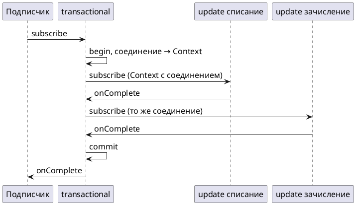

# Тема 13. R2DBC и транзакции

> **Статус:** теория · **Дальше:** интервью в чате, затем [практика](13-r2dbc-transactions-tasks.md)

---

## Оглавление

- [1. DatabaseClient: запрос — тоже Publisher](#1-databaseclient-запрос--тоже-publisher)
- [2. Ошибки базы как исключения Spring](#2-ошибки-базы-как-исключения-spring)
- [3. Где живёт реактивная транзакция](#3-где-живёт-реактивная-транзакция)
- [4. TransactionalOperator](#4-transactionaloperator)
- [5. Отмена — это откат](#5-отмена--это-откат)
- [6. Пачки и всё-или-ничего](#6-пачки-и-всё-или-ничего)
- [Вопросы для интервью](#вопросы-для-интервью)

---

## 1. DatabaseClient: запрос — тоже Publisher

**Аналогия:**

Заявка в бухгалтерию: пока её не отдали, никто не считает.

Отдали — бухгалтер считает и присылает ответ.

**Как это устроено в коде:**

- **Бухгалтерия** — база; обращаются к ней через `DatabaseClient`, клиент Spring для R2DBC.
- **Текст заявки** — `db.sql("...")`: описывает запрос.
- **Поля заявки** — `.bind("name", value)`: подставляет параметр `:name`.
- **Какой ответ нужен** — `fetch()`: выбирает, что получить.
- **Отдать заявку** — подписка: запрос уходит в базу только при ней, как и у любого холодного источника (тема 09).

| Вызов | Результат |
|---|---|
| `.fetch().rowsUpdated()` | `Mono<Long>` — сколько строк изменено |
| `.map(row -> ...).one()` | `Mono<T>` — одна строка или пусто |
| `.map(row -> ...).all()` | `Flux<T>` — все строки |

```java
Mono<Long> changed = db.sql("""
                update reactive_study.rc_bonus_accounts
                set balance = balance + :delta
                where customer_id = :customerId
                """)
        .bind("delta", -100)
        .bind("customerId", 1)
        .fetch()
        .rowsUpdated();      // запроса ещё нет — только описание
```

Документация Spring Framework, «Using DatabaseClient»:

- Источник: https://docs.spring.io/spring-framework/reference/data-access/r2dbc.html#r2dbc-DatabaseClient

> `one()` returns exactly one result and fails if the result contains more rows. … `all()` returns all rows of the result. … `rowsUpdated()` returns the number of affected rows (`INSERT`/`UPDATE`/`DELETE` count).
>
> Spring Framework’s R2DBC support lets you use native bind markers or named bind markers with the `:name` syntax.

RU:

> `one()` возвращает ровно один результат и завершается ошибкой, если строк больше. … `all()` возвращает все строки результата. … `rowsUpdated()` возвращает число затронутых строк (счётчик `INSERT`/`UPDATE`/`DELETE`).
>
> Поддержка R2DBC в Spring Framework позволяет использовать нативные маркеры параметров или именованные маркеры в синтаксисе `:name`.

**Правило:** запрос через `DatabaseClient` — описание; выполнится при подписке.

---

## 2. Ошибки базы как исключения Spring

**Аналогия:**

Банк отказал в переводе.

Клиенту не нужен внутренний код ошибки банковской системы. Ему нужна понятная причина: «недостаточно средств».

**Как это устроено в коде:**

- **Внутренний код ошибки** — исключение драйвера R2DBC.
- **Понятная причина** — исключение из иерархии `org.springframework.dao`: в неё ошибки переводит `DatabaseClient`.

В тестах курса на Postgres:

| Что нарушено | Исключение | Где видно |
|---|---|---|
| `check (balance >= 0)` | `DataIntegrityViolationException` | тест задачи 13.1 |
| `unique (order_id)` | `DuplicateKeyException` (подкласс предыдущего) | тест задачи 13.2 |

**Разбор:**

- бизнес-код ловит эти исключения через `onErrorMap` / `onErrorResume` по классу (тема 06);
- и превращает в свои исключения или ответы.

**Почему не иначе:**

- ограничение в базе надёжнее проверки «прочитать, сравнить, записать»;
- между чтением и записью другой запрос может успеть изменить данные.

Документация Spring Framework, «Using DatabaseClient»:

- Источник: https://docs.spring.io/spring-framework/reference/data-access/r2dbc.html#r2dbc-DatabaseClient

> Catches R2DBC exceptions and translates them to the generic, more informative, exception hierarchy defined in the `org.springframework.dao` package.

RU:

> Перехватывает исключения R2DBC и переводит их в общую, более информативную иерархию исключений из пакета `org.springframework.dao`.

Javadoc `DuplicateKeyException`, Spring Framework 7:

- Источник: https://docs.spring.io/spring-framework/docs/current/javadoc-api/org/springframework/dao/DuplicateKeyException.html

> public class DuplicateKeyException extends DataIntegrityViolationException
>
> Exception thrown when an attempt to insert or update data results in violation of a primary key or unique constraint.

RU:

> `public class DuplicateKeyException extends DataIntegrityViolationException`
>
> Исключение при попытке вставить или изменить данные с нарушением первичного ключа или ограничения уникальности.

**Внимание:**

Порядок обработчиков важен. `onErrorResume(DuplicateKeyException.class, …)` ставят раньше обработчика `DataIntegrityViolationException`, иначе общий обработчик перехватит и дубликат.

**Правило:** правило данных — ограничение в базе; его нарушение — исключение Spring, которое переводят в бизнес-ошибку.

---

## 3. Где живёт реактивная транзакция

**Аналогия:**

- **Обычный банк** — операционист держит вашу папку на своём столе.
- **Реактивный банк** — папка едет вместе с заявкой, кто бы её ни обрабатывал.

**Как это устроено в коде:**

- **Стол операциониста** — в JDBC транзакция привязана к потоку через `ThreadLocal`.
- **Операционисты меняются** — в реактивном коде поток меняется (тема 07).
- **Папка едет с заявкой** — соединение с открытой транзакцией хранится в `Context` подписки (тема 10).
- **Кто кладёт и кто берёт** — `R2dbcTransactionManager` кладёт соединение в `Context`, а `DatabaseClient` берёт его оттуда.
- **Вывод** — все запросы одной транзакции должны быть **в одной цепочке**, под одним `transactional`.

Документация Spring Framework, «Using R2dbcTransactionManager»:

- Источник: https://docs.spring.io/spring-framework/reference/data-access/r2dbc.html#r2dbc-R2dbcTransactionManager

> The `R2dbcTransactionManager` class is a `ReactiveTransactionManager` implementation for a single R2DBC `ConnectionFactory`. It binds an R2DBC `Connection` from the specified `ConnectionFactory` to the subscriber `Context`, potentially allowing for one subscriber `Connection` for each `ConnectionFactory`. … All framework classes (such as `DatabaseClient`) use this strategy implicitly.

RU:

> Класс `R2dbcTransactionManager` — реализация `ReactiveTransactionManager` для одного R2DBC `ConnectionFactory`. Он привязывает R2DBC `Connection` из указанного `ConnectionFactory` к `Context` подписчика, что позволяет иметь по одному `Connection` подписчика на каждый `ConnectionFactory`. … Все классы фреймворка (например, `DatabaseClient`) используют эту стратегию неявно.



**Правило:** одна транзакция — одна цепочка под одним `transactional`.

---

## 4. TransactionalOperator

**Аналогия:**

Нотариус говорит: «всё, что вы подпишете в этой папке, либо вступит в силу целиком, либо не вступит вовсе».

**Как это устроено в коде:**

- **Нотариус** — `TransactionalOperator`: оборачивает цепочку в транзакцию.
- **Открыть папку** — начать транзакцию при подписке.
- **Вступит в силу** — `commit` при успешном завершении.
- **Не вступит** — `rollback` при ошибке.
- **Откуда берётся** — в этом проекте бин `TransactionalOperator` создаёт Spring Boot, своей конфигурации нет. В практике он приходит через конструктор.

```java
Mono<Void> transfer = debit.then(credit).as(tx::transactional);
```

Документация Spring Framework, «Using the TransactionalOperator»:

- Источник: https://docs.spring.io/spring-framework/reference/data-access/transaction/programmatic.html#tx-prog-operator

> The Spring team generally recommends the `TransactionTemplate` for programmatic transaction management in imperative flows and `TransactionalOperator` for reactive code. …
>
> `TransactionalOperator` can be used in two ways: Operator-style using Project Reactor types (`mono.as(transactionalOperator::transactional)`); Callback-style for every other case (`transactionalOperator.execute(TransactionCallback)`)

RU:

> Команда Spring обычно рекомендует `TransactionTemplate` для программного управления транзакциями в императивном коде и `TransactionalOperator` — для реактивного. …
>
> `TransactionalOperator` используют двумя способами: в стиле оператора с типами Project Reactor (`mono.as(transactionalOperator::transactional)`) и в стиле обратного вызова для остальных случаев (`transactionalOperator.execute(TransactionCallback)`).

**Почему не иначе:**

- если обернуть в `transactional` только `credit`, а `debit` выполнить отдельно, при ошибке зачисления списание уже будет зафиксировано;
- это проверяет тест задачи 13.1 «получателя нет».

**Правило:** весь бизнес-шаг целиком — `.as(tx::transactional)` в конце.

---

## 5. Отмена — это откат

**Аналогия:**

Клиент бросил трубку на середине оформления.

Банк не знает, передумал он или оборвалась связь, — и отменяет операцию.

**Как это устроено в коде:**

- **Бросил трубку** — подписчик отменяет подписку: `take(1)`, `next()`, `timeout`.
- **Банк отменяет операцию** — для транзакции отмена означает откат.
- **Вывод** — `Flux` под `transactional` надо дочитать до конца, иначе изменения пропадут.
- **Для сравнения** — тот же принцип, что у `asyncCancel` в `usingWhen` (тема 12).

Документация Spring Framework, «Cancel Signals»:

- Источник: https://docs.spring.io/spring-framework/reference/data-access/transaction/programmatic.html#tx-prog-operator-cancel

> In Reactive Streams, a `Subscriber` can cancel its `Subscription` and stop its `Publisher`. Operators in Project Reactor, as well as in other libraries, such as `next()`, `take(long)`, `timeout(Duration)`, and others can issue cancellations. There is no way to know the reason for the cancellation, whether it is due to an error or a simply lack of interest to consume further. Since version 5.3 cancel signals lead to a roll back. As a result it is important to consider the operators used downstream from a transaction `Publisher`. In particular in the case of a `Flux` or other multi-value `Publisher`, the full output must be consumed to allow the transaction to complete.

RU:

> В Reactive Streams подписчик может отменить `Subscription` и остановить `Publisher`. Операторы Project Reactor и других библиотек, например `next()`, `take(long)`, `timeout(Duration)` и другие, могут отправлять отмену. Узнать причину отмены — ошибка это или просто нежелание читать дальше — нельзя. Начиная с версии 5.3 сигнал отмены приводит к откату. Поэтому важно учитывать операторы, стоящие ниже транзакционного `Publisher`. В частности, для `Flux` и других многоэлементных `Publisher` весь вывод нужно прочитать, чтобы транзакция завершилась.

**Правило:** под транзакцией результат дочитывают до конца; удобнее всего свести его к одному `Mono` (`reduce`, `count`, `then`).

---

## 6. Пачки и всё-или-ничего

**Аналогия:**

Грузчики носят тележки по одной (тема 08).

Но вся разгрузка оформляется одним актом: либо принят весь груз, либо ничего.

**Как это устроено в коде:**

- **Тележки** — пачки: `buffer(n)`.
- **По одной** — `concatMap`: пачки пишутся по очереди в одном соединении.
- **Итог разгрузки** — `reduce`: сводит результаты пачек в один.
- **Один акт** — `transactional` стоит в самом конце.
- **Груз не принят** — ошибка в любой пачке откатывает все предыдущие.

```java
orders.findByStatusOrderById("delivered")
        .map(RcOrder::id)
        .buffer(4)
        .concatMap(this::insertAudit)      // Mono<Long> на пачку
        .reduce(0L, Long::sum)
        .as(tx::transactional);
```

**Как проверить, что транзакция одна:**

- в Postgres у каждой строки есть системный столбец `xmin` — номер транзакции, которая её вставила;
- одна транзакция — одно значение `xmin`;
- так проверяет тест задачи 13.3:

```sql
select count(distinct xmin::text) from reactive_study.rc_audit_log;   -- 1
```

Документация PostgreSQL, «System Columns»:

- Источник: https://www.postgresql.org/docs/16/ddl-system-columns.html

> xmin: The identity (transaction ID) of the inserting transaction for this row version.

RU:

> `xmin`: идентификатор (ID транзакции) транзакции, вставившей эту версию строки.

**Почему не иначе:**

- с `flatMap` пачки запускаются, не дожидаясь предыдущих (тема 04);
- порядок записи и то, какие пачки успели уйти до ошибки, перестают быть предсказуемыми;
- `concatMap` пишет строго по одной — это проверено в задаче 08.3 (`maxInFlight = 1`).

**Правило:** пачки под транзакцией — `buffer` + `concatMap` + `reduce` + `transactional` в конце.

---

## Вопросы для интервью

1. Когда `db.sql(...).fetch().rowsUpdated()` отправляет запрос в базу?
2. Во что `DatabaseClient` превращает ошибки драйвера? Какое исключение будет при нарушении `unique`?
3. Почему проверка «прочитать баланс → сравнить → списать» хуже ограничения `check` в базе?
4. Где хранится транзакция в реактивном коде и почему не в `ThreadLocal`?
5. Что случится, если обернуть в `transactional` только второй из двух запросов?
6. Что произойдёт с транзакцией, если ниже `transactional` стоит `take(1)`?
7. Как записать 10 строк пачками по 4 в одной транзакции? Как проверить, что транзакция действительно одна?
8. Почему под транзакцией пачки пишут через `concatMap`, а не `flatMap`?

---

**Практика:** [13-r2dbc-transactions-tasks.md](13-r2dbc-transactions-tasks.md)
